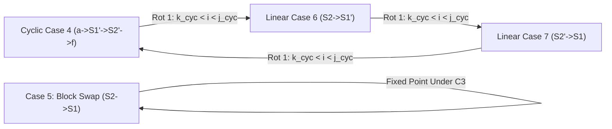

# GPU 3-Opt Local Search: Candidate-List Pruning, $C_3$ Rotation Mapping, and Empirical Trade-Offs vs. 2-Opt

Evaluating 3-opt neighborhoods exhaustively requires $\Theta(n^3)$ move checks per pass—nearly $1.67 \times 10^8$ triples per tour at $n = 1{,}002$—making unpruned 3-opt intractable inside a population-based memetic Genetic Algorithm (Lin 1965; Johnson & McGeoch 1997). The GPU 3-opt kernel family under [experiment-comparing-3opt-and-2opt](../compare_3opt_2opt_runner.py) combines candidate-list pruning ($\Theta(n k^2)$), an exact non-negative lower-bound filter, Bentley's zero-scratch three-reversal reconnection, and Rocki & Suda's (2013) greedy disjoint multi-move selection so a single CUDA block refines a tour in-place inside shared memory.

## 1. The 7 Non-Identity 3-Opt Reconnections and Bentley's 3-Reversal Identity

Cutting three distinct tour edges $(a, b) = (t[i], t[i+1])$, $(c, d) = (t[j], t[j+1])$, and $(e, f) = (t[k], t[(k+1) \bmod n])$ at sorted indices $0 \le i < j < k < n$ partitions a closed tour into three oriented segments:

$$S_0 = [k+1, \dots, n-1, 0, \dots, i], \qquad S_1 = [i+1, \dots, j], \qquad S_2 = [j+1, \dots, k]$$

Anchoring $S_0$ (which preserves `tour[0]` across every move when $i \ge 0$ and $k \le n - 1$) leaves $2^2 \cdot 2! = 8$ ways to order and orient $(S_1, S_2)$. One is the identity $S_0 \to S_1 \to S_2$; the remaining **7 non-identity reconnections** consist of **3 degenerate 2-opt moves** (one cut edge is kept intact) and **4 pure 3-opt moves** (all three cut edges are replaced).

| Case | Class | Reconnected Tour | New Edges Added ($\Delta$ removes $d_{ab}+d_{cd}+d_{ef}$) | Step 1: rev $[i+1, j]$ | Step 2: rev $[j+1, k]$ | Step 3: rev $[i+1, k]$ |
| :--- | :--- | :--- | :--- | :---: | :---: | :---: |
| **1** | 2-opt on $S_1$ | $a \to S_1' \to S_2 \to f$ | $d(a,c) + d(b,d) + d(e,f)$ | Yes | — | — |
| **2** | 2-opt on $S_2$ | $a \to S_1 \to S_2' \to f$ | $d(a,b) + d(c,e) + d(d,f)$ | — | Yes | — |
| **3** | 2-opt on $S_1+S_2$ | $a \to S_2' \to S_1' \to f$ | $d(a,e) + d(b,f) + d(c,d)$ | — | — | Yes |
| **4** | Pure 3-opt | $a \to S_1' \to S_2' \to f$ | $d(a,c) + d(b,e) + d(d,f)$ | Yes | Yes | — |
| **5** | Pure 3-opt (swap) | $a \to S_2 \to S_1 \to f$ | $d(a,d) + d(b,e) + d(c,f)$ | Yes | Yes | Yes |
| **6** | Pure 3-opt | $a \to S_2 \to S_1' \to f$ | $d(a,d) + d(c,e) + d(b,f)$ | — | Yes | Yes |
| **7** | Pure 3-opt | $a \to S_2' \to S_1 \to f$ | $d(a,e) + d(b,d) + d(c,f)$ | Yes | — | Yes |

### Why Three In-Place Reversals Suffice With Zero Scratch Memory

Following Bentley's (1992) three-reversal block-swap identity, reversing the concatenated block $(S_1' S_2')$ flips both the segment order and each segment's internal orientation:

$$(S_1' S_2')' = (S_2')' (S_1')' = S_2 S_1$$

Similarly, $(S_1 S_2')' = S_2 S_1'$ (Case 6), $(S_1' S_2)' = S_2' S_1$ (Case 7), and $(S_1 S_2)' = S_2' S_1'$ (Case 3). Inside [three_opt_common.cuh::three_opt_apply_reconnection](../kernels/three_opt_common.cuh), this decomposes every reconnection into at most three cooperative reversals:

1. **Steps 1 & 2 are strictly disjoint:** `[i+1, j]` and `[j+1, k]` share zero array indices. All threads in the CUDA block execute both reversals cooperatively with **one single `__syncthreads()`** barrier afterward.
2. **Step 3 completes block swaps in-place:** Cases `{3, 5, 6, 7}` reverse `[i+1, k]` cooperatively after that barrier, followed by one `__syncthreads()`.
3. **2-opt requires only Step 1:** Pure 2-opt moves store sentinel `(i, j, j, case=1)`, skipping Steps 2 and 3.

## 2. Candidate-List Pass A/B Pruning and $C_3$ Rotation Mapping

Inside [three_opt_common.cuh::three_opt_scan_neighborhood](../kernels/three_opt_common.cuh), candidate-list mode (`candidate_k = 20`) replaces the $\Theta(n^3)$ triple loop with a three-stage per-anchor scan for each city $a = \text{tour}[i]$ and its successor $b = \text{tour}[(i+1) \bmod n]$:

1. **2-opt seeding:** Scans `cand_a[0..cand_k-1]` to seed `s_deltas[tid]` with all candidate 2-opt moves (`case=1`), ensuring 3-opt strictly subsumes candidate-list 2-opt.
2. **Pass A (`d(a, v1) < d(a, b)`):** Walks `cand_a` in sorted nearest-neighbor order, breaking immediately (`break`) once `d(a, v1) >= d(a, b)`, and pairs each qualifying $v_1$ with $v_2 \in \text{cand}_b[0..\text{eff\_inner}-1]$.
3. **Pass B (`d(b, v2) < d(a, b)` with `d(a, v1) >= d(a, b)`):** Walks `cand_b` in sorted order, breaking once `d(b, v2) >= d(a, b)`, and pairs each $v_2$ with $v_1 \in \text{cand}_a$ skipping `d(a, v1) < d(a, b)` (already covered by Pass A).

### 2.1 Pigeonhole Necessity of Pass A + Pass B

Any improving pure 3-opt move replaces three removed edges $\{e_1, e_2, e_3\}$ with three new edges $\{e_1', e_2', e_3'\}$ satisfying:

$$\Delta = \sum_{m=1}^{3} w(e_m') - \sum_{m=1}^{3} w(e_m) < 0$$

By the **pigeonhole principle**, at least one removed edge $e_m$ must be paired with a shorter replacement edge $e_m'$ satisfying $w(e_m') < w(e_m)$ (otherwise $\Delta \ge 0$). Choosing that cut as anchor $(a, b) = (t[i], t[i+1])$ guarantees that either $a$'s new neighbor satisfies $d(a, v_1) < d(a, b)$ (**Pass A**) or $b$'s new neighbor satisfies $d(b, v_2) < d(a, b)$ (**Pass B**) (Johnson & McGeoch 1997). Scanning only $a$'s neighbors (**Pass A**) leaves a blind spot whenever the shortening edge attaches to $b$ while $a$'s new edge exceeds $d(a, b)$; **Pass B** closes that blind spot without duplicating Pass A work.

### 2.2 Cyclic Case Assignment and Or-Opt-1 Relocations

Once anchor $i$ picks $(v_1, v_2)$ at tour positions $(p_1, p_2)$, [three_opt_common.cuh::three_opt_eval_cyclic_pair](../kernels/three_opt_common.cuh) measures clockwise offsets from $i$:

$$\text{rel}_1 = (p_1 - i) \bmod n, \qquad \text{rel}_2 = (p_2 - i) \bmod n$$

Think of $a = t[i]$ and $b = t[i+1]$ as breaking edge $(a, b)$ so $v_1$ must reconnect to $a$ and $v_2$ must reconnect to $b$:

- **$\text{rel}_1 \ge 2$ and $\text{rel}_1 < \text{rel}_2$ ($i \to p_1 \to p_2$):** Depending on whether the remaining cuts break *after* $v_1$ or *before* $v_1$, and *after* $v_2$ or *before* $v_2$, three valid single-tour orientations arise:
  - **Cyclic Case 4** (`j_cyc = p1`, `k_cyc = p2`): $c = v_1, e = v_2$, third edge $(d, f)$.
  - **Cyclic Case 5** (`j_cyc = p1 - 1`, `k_cyc = p2`): $d = v_1, e = v_2$, third edge $(c, f)$.
  - **Cyclic Case 6** (`j_cyc = p1 - 1`, `k_cyc = p2 - 1`): $d = v_1, f = v_2$, third edge $(c, e)$.
- **$\text{rel}_1 \ge 2$ and $\text{rel}_1 == \text{rel}_2$ ($v_1 = v_2$, degenerate Or-opt-1):** Both $a$ and $b$ connect to the *same* single city $v_1$, extracting city $v_1$ from between $(c = t[p_1-1], f = t[p_1+1])$ and inserting it between $a$ and $b$ (`j_cyc = p1 - 1`, `k_cyc = p1`, **Cyclic Case 5**, third edge $(c, f)$).
- **$\text{rel}_2 \ge 2$ and $\text{rel}_2 < \text{rel}_1$ ($i \to p_2 \to p_1$):** Only one orientation connects $a \leftrightarrow v_1$ and $b \leftrightarrow v_2$ into a single Hamiltonian cycle without splitting into two subtours:
  - **Cyclic Case 7** (`j_cyc = p2 - 1`, `k_cyc = p1`): $d = v_2, e = v_1$, third edge $(c, f)$.

### 2.3 $C_3$ Rotation Isomorphism Onto Linear Indices $(i_0 < j_0 < k_0)$

Because the anchor $i$ can be *any* index in $[0, n)$, the cyclic triple $(i, j_{\text{cyc}}, k_{\text{cyc}})$ frequently wraps past $n - 1$. However, `three_opt_apply_reconnection` operates on sorted linear array slices $0 \le i_0 < j_0 < k_0 < n$ so `tour[0]` stays anchored and slice bounds never wrap. Because the three cuts are ordered cyclically ($i \to j_{\text{cyc}} \to k_{\text{cyc}} \to i$), sorting them into $(i_0, j_0, k_0)$ is always a **cyclic rotation** in the 3-element cyclic group $C_3$, never an arbitrary reflection!

- **Identity (`i < j_cyc < k_cyc`):** `(i0, j0, k0) = (i, j_cyc, k_cyc)`, `lin_case = cyc_case`.
- **Rotation 1 (`k_cyc < i < j_cyc`):** `(i0, j0, k0) = (k_cyc, i, j_cyc)` maps $4 \to 6 \to 7 \to 4$ and fixes $5$.
- **Rotation 2 (`j_cyc < k_cyc < i`):** `(i0, j0, k0) = (j_cyc, k_cyc, i)` maps $4 \to 7 \to 6 \to 4$ and fixes $5$.

#### Worked Numeric Example ($n = 50$, $i = 40$, $p_1 = 5$, $p_2 = 20$)

Suppose $n = 50$, anchor edge $(a, b) = (t[40], t[41])$, $v_1 = t[5]$ ($p_1 = 5$), and $v_2 = t[20]$ ($p_2 = 20$):

1. **Clockwise offsets:** $\text{rel}_1 = (5 - 40) \bmod 50 = 15$ and $\text{rel}_2 = (20 - 40) \bmod 50 = 30$. Since $2 \le \text{rel}_1 < \text{rel}_2$, `three_opt_eval_cyclic_pair` tests Cyclic Cases 4, 5, and 6.
2. **Cyclic Case 4 trace:** `j_cyc = 5`, `k_cyc = 20`, third edge connects $d = t[6]$ and $f = t[21]$.
3. **Sorting into linear cuts:** Comparing `(i=40, j_cyc=5, k_cyc=20)` hits Rotation 2 (`j_cyc < k_cyc < i`: $5 < 20 < 40$), assigning `(i0, j0, k0) = (5, 20, 40)`.
4. **Segment mapping & reconnection equivalence:**
   - Linear segments: $S_0^{\text{lin}} = [41..49, 0..5]$, $S_1^{\text{lin}} = [6..20]$, $S_2^{\text{lin}} = [21..40]$.
   - Cyclic segments from $i = 40$: $S_0^{\text{cyc}} = S_2^{\text{lin}}$, $S_1^{\text{cyc}} = S_0^{\text{lin}}$, $S_2^{\text{cyc}} = S_1^{\text{lin}}$.
   - Cyclic Case 4 produces $S_0^{\text{cyc}} \to (S_1^{\text{cyc}})' \to (S_2^{\text{cyc}})' = S_2^{\text{lin}} \to (S_0^{\text{lin}})' \to (S_1^{\text{lin}})'$. Reversing this symmetric closed tour and reading from $S_0^{\text{lin}}$ yields $S_0^{\text{lin}} \to (S_2^{\text{lin}})' \to S_1^{\text{lin}}$, which is **Linear Case 7** (`4 -> 7 -> 6 -> 4` under Rotation 2), adding the exact same edges $(t[5], t[40])$, $(t[6], t[21])$, and $(t[20], t[41])$.

## 3. Exact Lower-Bound Filter, Shared-Memory Layout, and Coordinates

Every cyclic candidate evaluation avoids the expensive third random global-VRAM distance lookup (`d_df`, `d_cf`, or `d_ce`) unless it can possibly beat the thread's current best `s_deltas[tid]`. Because all TSPLIB edge weights are non-negative integers ($d_{\text{third}} \ge 0$), precomputing `base_new = d_av1 + d_bv2 - d_ab` gives an **exact, zero-approximation lower bound**:

$$\text{lb} = \underbrace{d(a, v_1) + d(b, v_2) - d(a, b)}_{\text{base\_new}} - \text{edge\_buf}[j_{\text{cyc}}] - \text{edge\_buf}[k_{\text{cyc}}] \le \text{lb} + d_{\text{third}} = \Delta$$

Whenever `lb >= s_deltas[tid]`, the third global matrix fetch is skipped completely (cutting $n = 1{,}002$ kernel time by roughly $2\times$ with zero loss of exactness).

### Shared-Memory Budget and Coordinate Fallback

In [gpu_three_opt.py::_shared_mem_bytes](../gpu_three_opt.py), each block (`block_size <= 256`) allocates:

$$\text{SMEM}_{\text{3-opt}} = \underbrace{5 \cdot \text{block\_size} \cdot 4}_{\text{5 KB at } B=256} + \begin{cases} 2 \cdot n \cdot 4 & \text{if } n \le 4{,}096 \\ 0 & \text{otherwise} \end{cases}$$

For $n \le 4{,}096$, caching both `s_tour[n]` and `s_edge[n]` keeps total SMEM at $\le 5{,}120 + 32{,}768 = 37{,}888\text{ B} < 49{,}152\text{ B}$ (Pascal GP107 / GTX 1050 48 KB limit; contrast 2-opt's `11_520` full-tour ceiling and $T=2048$ window tiling in [analysis-gpu-distance-and-shared-memory-limits.md](../../../../documentation/knowledge-base/analysis-gpu-distance-and-shared-memory-limits.md)). For $n > 4{,}096$, `use_shared_tour = 0` keeps dynamic SMEM fixed at **5 KB** and spills `edge_buf` to global scratch `d_edge_costs`. When `distances == nullptr` (`n > max_matrix_dimension`), `three_opt_dist` delegates to [pairwise_device.cuh::gpu_pairwise_distance](../../../../src/distances/kernels/pairwise_device.cuh).

## 4. Empirical Analysis: 3-Opt vs. 2-Opt (`batch` vs. `multi_move`)

### 4.1 Experimental Scope at Analysis Time

The iso-algorithmic GPU comparison in [algorithms.json](../configs/algorithms.json) (`pop=128`, `mut=0.03`, `seed=42`, `local_search_stage="post_mutation"`, `max_iterations=10`, `candidate_k=20`) was executed with **10 repetitions per instance** (`-r 10`). At analysis time, **6 of 9 TSPLIB instances** (`d198`, `pr264`, `lin318`, `pcb442`, `att532`, `si535` — **240 completed runs**) have finalized `problem_statistics/*_stats.json` files, while `gr666` is mid-run (`TwoOpt_Batch_GPU` 10/10, `TwoOpt_MultiMove_GPU` 10/10, `ThreeOpt_Batch_GPU` 4/10 completed) and `rat783`/`pr1002` have not started yet.

### 4.2 Measured Per-Instance Results (`d198`–`si535`, $r = 10$)

| Problem ($n$) | Algorithm | Mean Gap (%) | Mean Time (s) | Speedup vs. `2Opt_Batch` | Mean Gens | Wall ms / Gen |
| :--- | :--- | ---: | ---: | ---: | ---: | ---: |
| `d198` (198) | `TwoOpt_Batch_GPU` | 0.86 ± 0.08 | 0.127 ± 0.018 | 1.00x | 29.4 | 4.32 |
| `d198` (198) | `TwoOpt_MultiMove_GPU` | 0.80 ± 0.12 | **0.038 ± 0.003** | **3.34x** | 8.6 | 4.43 |
| `d198` (198) | `ThreeOpt_Batch_GPU` | 0.49 ± 0.21 | 1.304 ± 0.051 | 0.10x | 13.1 | 99.54 |
| `d198` (198) | `ThreeOpt_MultiMove_GPU` | **0.42 ± 0.13** | 0.507 ± 0.003 | 0.25x | **5.0** | 101.33 |
| `pr264` (264) | `TwoOpt_Batch_GPU` | 0.78 ± 0.19 | 0.249 ± 0.063 | 1.00x | 45.5 | 5.47 |
| `pr264` (264) | `TwoOpt_MultiMove_GPU` | 0.67 ± 0.19 | **0.066 ± 0.020** | **3.78x** | 11.5 | 5.72 |
| `pr264` (264) | `ThreeOpt_Batch_GPU` | 0.78 ± 1.04 | 3.173 ± 1.193 | 0.08x | 25.3 | 125.41 |
| `pr264` (264) | `ThreeOpt_MultiMove_GPU` | **0.43 ± 0.27** | 0.815 ± 0.045 | 0.31x | **5.5** | 148.25 |
| `lin318` (318) | `TwoOpt_Batch_GPU` | 1.19 ± 0.29 | 0.586 ± 0.251 | 1.00x | 98.9 | 5.92 |
| `lin318` (318) | `TwoOpt_MultiMove_GPU` | 0.88 ± 0.13 | **0.123 ± 0.025** | **4.76x** | 20.5 | 5.99 |
| `lin318` (318) | `ThreeOpt_Batch_GPU` | 1.22 ± 0.32 | 8.009 ± 2.364 | 0.07x | 57.4 | 139.52 |
| `lin318` (318) | `ThreeOpt_MultiMove_GPU` | **0.87 ± 0.09** | 1.448 ± 0.102 | 0.40x | **8.4** | 172.34 |
| `pcb442` (442) | `TwoOpt_Batch_GPU` | 1.81 ± 0.46 | 1.422 ± 0.242 | 1.00x | 191.5 | 7.42 |
| `pcb442` (442) | `TwoOpt_MultiMove_GPU` | 0.95 ± 0.04 | **0.272 ± 0.070** | **5.23x** | 36.9 | 7.37 |
| `pcb442` (442) | `ThreeOpt_Batch_GPU` | 1.42 ± 0.39 | 13.902 ± 2.623 | 0.10x | 115.2 | 120.68 |
| `pcb442` (442) | `ThreeOpt_MultiMove_GPU` | **0.87 ± 0.09** | 2.290 ± 0.096 | 0.62x | **13.0** | 176.19 |
| `att532` (532) | `TwoOpt_Batch_GPU` | 1.44 ± 0.41 | 2.296 ± 0.747 | 1.00x | 240.9 | 9.53 |
| `att532` (532) | `TwoOpt_MultiMove_GPU` | 0.97 ± 0.08 | **0.509 ± 0.341** | **4.51x** | 54.4 | 9.35 |
| `att532` (532) | `ThreeOpt_Batch_GPU` | 2.09 ± 0.64 | 27.389 ± 5.261 | 0.08x | 163.1 | 167.93 |
| `att532` (532) | `ThreeOpt_MultiMove_GPU` | **0.85 ± 0.12** | 3.606 ± 0.249 | 0.64x | **14.6** | 247.01 |
| `si535` (535) | `TwoOpt_Batch_GPU` | 0.94 ± 0.06 | 0.647 ± 0.016 | 1.00x | 62.9 | 10.29 |
| `si535` (535) | `TwoOpt_MultiMove_GPU` | 0.93 ± 0.06 | **0.122 ± 0.005** | **5.29x** | 10.2 | 12.01 |
| `si535` (535) | `ThreeOpt_Batch_GPU` | 0.84 ± 0.07 | 12.601 ± 0.360 | 0.05x | 31.7 | 397.52 |
| `si535` (535) | `ThreeOpt_MultiMove_GPU` | **0.59 ± 0.22** | 3.465 ± 0.146 | 0.19x | **8.3** | 417.53 |

Across the 6 completed instances (geometric mean speedup relative to `TwoOpt_Batch_GPU`):
- **`TwoOpt_MultiMove_GPU`:** **0.87%** mean gap, **0.188 s** mean time, **23.7** mean generations (**4.42x** speedup).
- **`TwoOpt_Batch_GPU`:** **1.17%** mean gap, **0.888 s** mean time, **111.5** mean generations (**1.00x** baseline).
- **`ThreeOpt_MultiMove_GPU`:** **0.67%** mean gap (best on 6/6 instances, Wilcoxon $p \le 0.0273$ vs. `TwoOpt_MultiMove_GPU` on 5/6 instances), **2.022 s** mean time, **9.1** mean generations (**0.36x** vs. `2Opt_Batch`, **5.5x faster** than `3Opt_Batch`).
- **`ThreeOpt_Batch_GPU`:** **1.14%** mean gap, **11.063 s** mean time, **67.6** mean generations (**0.08x** vs. `2Opt_Batch`). In the partial `gr666` run (`n=666`), `TwoOpt_Batch_GPU` averaged `2.45 s` (`3.58%` gap, `236.5` gens) and `TwoOpt_MultiMove_GPU` averaged `0.91 s` (`1.10%` gap, `99.2` gens), whereas `ThreeOpt_Batch_GPU` averaged **45.7 s per repetition** over its first 4 completed runs (`2.38%`–`3.83%` gap).

> [!IMPORTANT]
> **Why `ThreeOpt_Batch_GPU` Exhibits a Severe Runtime Blowup (and Worse Quality on `att532`):**
> `ThreeOpt_Batch_GPU` suffers a **double multiplicative penalty**:
> 1. **Per-generation $\Theta(n k^2)$ scan $\times 10$ unconditional passes:** At $k = 20$, each 3-opt pass scans up to $2 \cdot k^2 = 800$ candidate pairs per city (plus $3\text{–}4$ cases), pushing per-generation wall time from `4.3–10.3 ms` (2-opt) to `99.5–397.5 ms` (3-opt)—and `LocalSearchGPUThreeOpt._improve_grid` launches all `max_iterations = 10` passes unconditionally even when a tour converges early.
> 2. **Single-move nibbling inflates generation count by $8\times\text{–}11\times$:** Applying only *one* steepest move per pass allows at most 10 moves per generation across hundreds of cities. On `att532`, `ThreeOpt_Batch_GPU` runs **163.1 generations** (`1,631` passes, `27.39 s`) versus **14.6 generations** (`146` passes, `3.61 s`) for `ThreeOpt_MultiMove_GPU`, yet stalls at **2.09% gap** vs. **0.85%** because slow single-move progress trips early-stopping patience before reaching 3-opt local optima.

### 4.3 Practical Deployment Trade-Offs

- **Default fast memetic baseline:** `TwoOpt_MultiMove_GPU` delivers `4.42x` wall-time speedup over `TwoOpt_Batch_GPU` while simultaneously cutting mean gap (`0.87%` vs. `1.17%`); see [analysis-gpu-multi-move-conflict-resolution.md](../../../../documentation/knowledge-base/analysis-gpu-multi-move-conflict-resolution.md) for why multi-move conflict resolution dominates single-steepest `batch` across both 2-opt and 3-opt.
- **High-precision refinement:** `ThreeOpt_MultiMove_GPU` consistently pushes tour quality lower (`0.42%–0.87%` gap vs. `0.67%–0.97%` for `TwoOpt_MultiMove_GPU`) at $\sim 10.8\times$ the wall time of `TwoOpt_MultiMove_GPU`.
- **Tuning levers for production pipelines:** Lowering `inner_candidate_k` (e.g., `inner_candidate_k=8` instead of `20` shrinks the $\Theta(n \cdot k \cdot k_{\text{inner}})$ inner probe by $2.5\times$) or running a **hybrid two-tier schedule**—`TwoOpt_MultiMove_GPU` every generation paired with `ThreeOpt_MultiMove_GPU` via `EliteOnlyLocalSearchStep` or `post_evolution`—captures nearly all of 3-opt's gap reduction at a fraction of the per-generation cost.

## References

- **Lin, S.** (1965). *Computer Solutions of the Traveling Salesman Problem*. Bell System Technical Journal, 44(10), 2245–2269.
- **Bentley, J. L.** (1992). *Fast Algorithms for Geometric Traveling Salesman Problems*. ORSA Journal on Computing, 4(4), 387–411.
- **Johnson, D. S., & McGeoch, L. A.** (1997). *The Traveling Salesman Problem: A Case Study in Local Optimization*. In *Local Search in Combinatorial Optimization*, pp. 215–310.
- **Rocki, K., & Suda, R.** (2012). *Accelerating 2-opt and 3-opt Local Search Using GPU in the Travelling Salesman Problem*. IEEE HPCS, pp. 489–495.
- **Rocki, K., & Suda, R.** (2013). *High Performance GPU Accelerated Local Optimization in TSP*. IEEE IPDPSW, pp. 1788–1796.
- **O'Neil, M. A., & Burtscher, M.** (2015). *Rethinking the Parallelization of Random-Restart Hill Climbing: A Case Study in Optimizing a 2-Opt TSP Solver for GPU Execution*. GPGPU-8, pp. 99–108.
