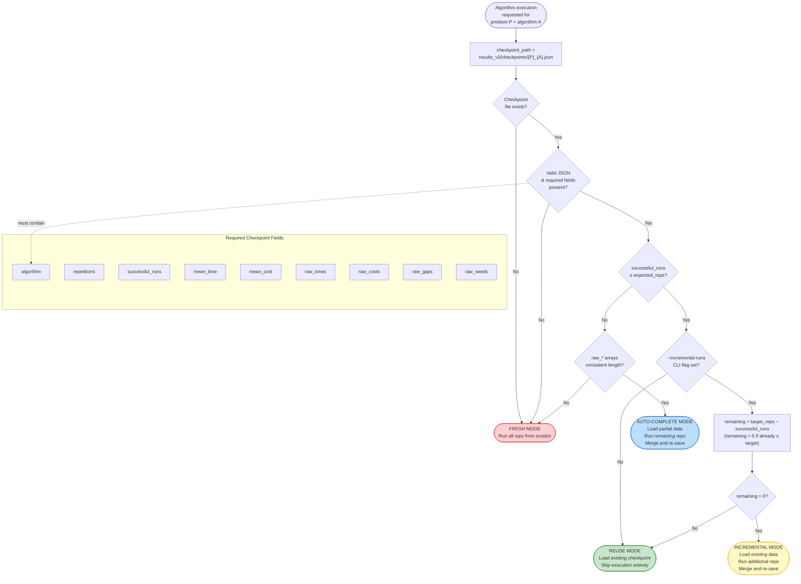
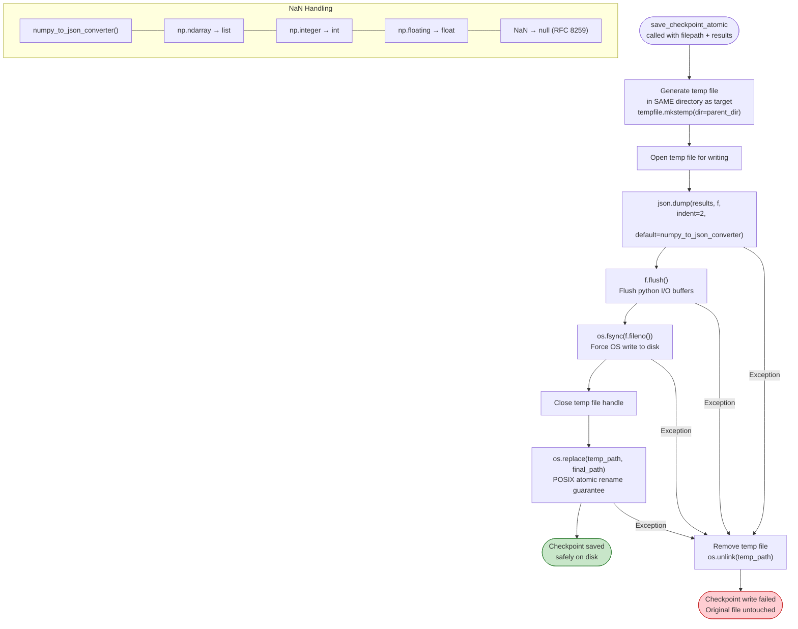
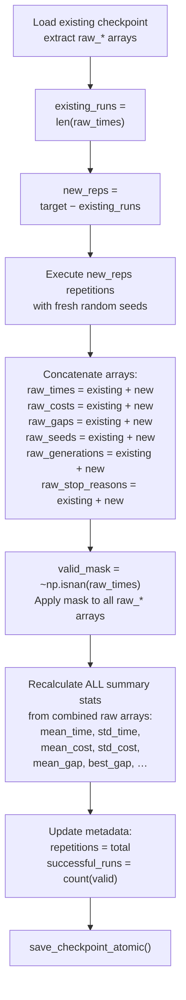
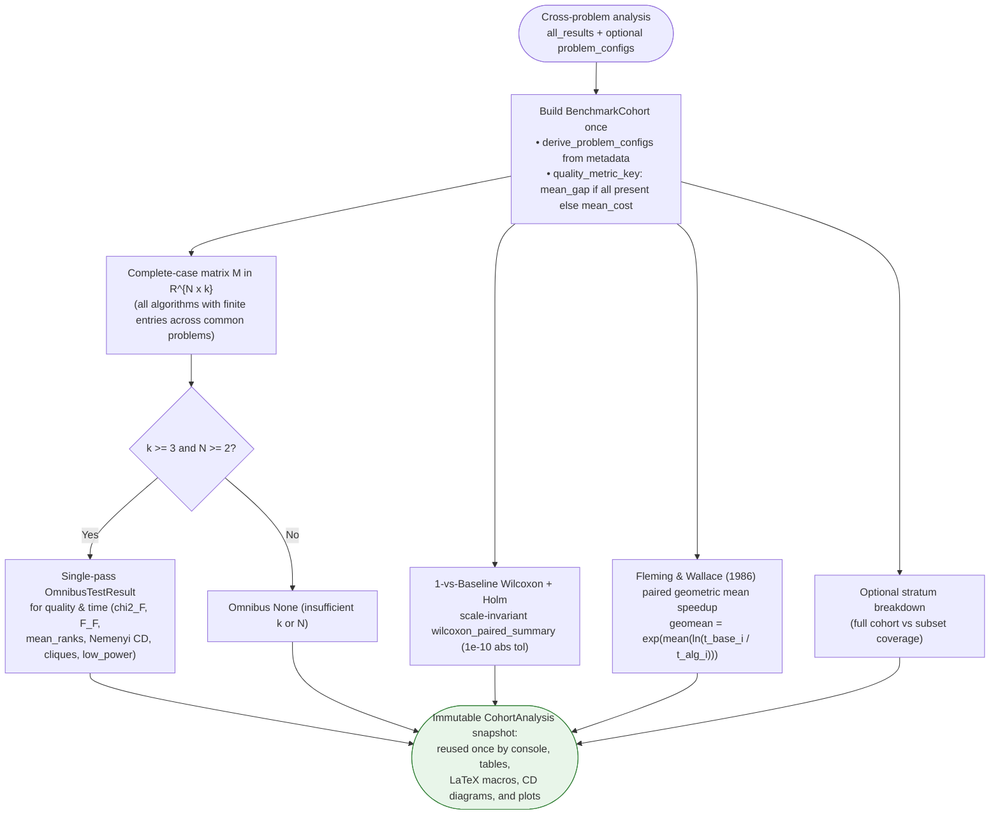
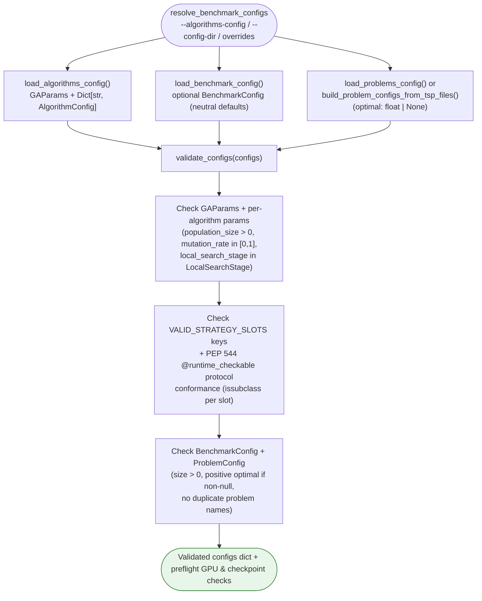
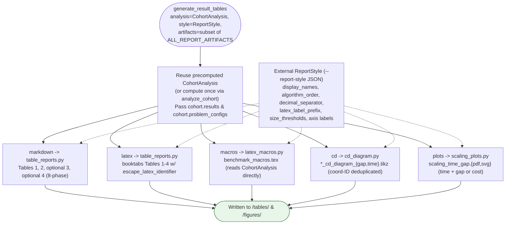
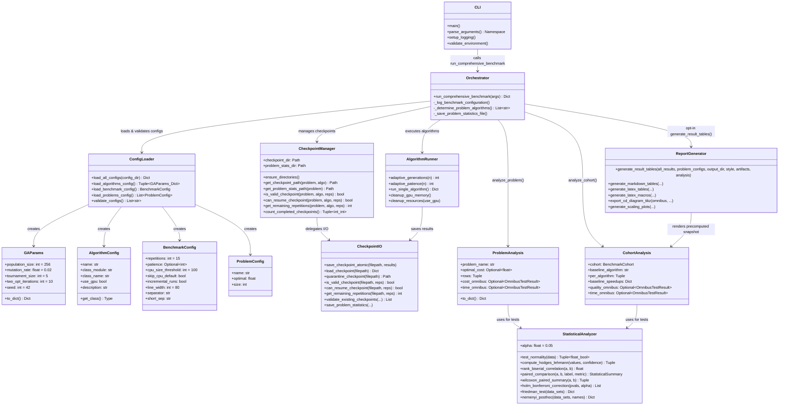

# Benchmarking System — Comprehensive Documentation

> **System purpose:** Orchestrate generic, reproducible, configuration-driven benchmarks of arbitrary Genetic Algorithm (GA) compositions across `.tsp` corpora (or optional DuckDB stores) with atomic per-repetition checkpoints, pure non-parametric statistical analysis (`src/benchmarking/analysis/`), and decoupled composable report generation (`src/benchmarking/reporting/`, `tsp-report`). Dissertation Chapter 4 presets (`15` TSPLIB95 instances × `4` variants × `30` repetitions) live isolated outside `src/` under `benchmark_scripts/experiments-and-examples/chapter4/`.
>
> For low-level symbol contracts, GoF mappings, and ADR citations, see [guide-architecture-benchmarking-cli-and-utils.md](../guide-architecture-benchmarking-cli-and-utils.md).

---

## Table of Contents

1. [Overview](#1-overview)
2. [Full Pipeline Sequence Diagram](#2-full-pipeline-sequence-diagram)
3. [Checkpoint System Flowchart](#3-checkpoint-system-flowchart)
4. [Statistical Analysis Flowchart](#4-statistical-analysis-flowchart)
5. [Configuration Loading Flowchart](#5-configuration-loading-flowchart)
6. [Report Generation Flowchart](#6-report-generation-flowchart)
7. [Module Interaction Diagram](#7-module-interaction-diagram)

---

## 1. Overview

### 1.1 Purpose

The benchmarking system measures and compares arbitrary declarative GA configurations (CPU, hybrid, full-GPU, or external user strategies/pipeline steps) on TSP instances. Collection (`tsp-benchmark`) is strictly separated from report rendering (`tsp-report`): collection emits atomic per-repetition JSON checkpoints and per-problem statistics, while pure analysis builds single-pass `ProblemAnalysis` / `CohortAnalysis` / `OmnibusTestResult` snapshots consumed once by pure report renderers parameterized with an external `ReportStyle`.

### 1.2 Architecture

```text
src/cli/benchmark.py (tsp-benchmark) & benchmark_scripts/experiments-and-examples/chapter4/run_chapter4_benchmark.py
  └→ runner/orchestration.py         Preflight validation, problem loading, quarantine, orchestration
       ├→ runner/config_loader.py    JSON config loading, slot/protocol validation, GA instantiation
       ├→ runner/schema_generator.py Reflective Draft 2020-12 JSON Schemas (algorithms + report_style)
       ├→ runner/algorithm_runner.py Isolated AOT warmup, sequential seeds, ddof=1 telemetry & summaries
       ├→ runner/checkpoint_io.py    Atomic save, nullable raw_gaps validation, drift checks, quarantine
       ├→ analysis/                  Pure statistical computation (zero I/O or console logging)
       │    ├→ cohort.py             BenchmarkCohort, complete-case matrices, paired geometric speedups
       │    ├→ statistics.py         Unconditional Wilcoxon, Hodges-Lehmann CI, Kerby r_rb,
       │    │                        Friedman + Iman-Davenport F_F + Nemenyi (OmnibusTestResult)
       │    ├→ stats_utils.py        Holm-Bonferroni step-down, Nemenyi CD, finite_metric, baseline
       │    ├→ problem_statistics.py analyze_problem() -> ProblemAnalysis (cost & time)
       │    └→ cohort_analysis.py    analyze_cohort() -> CohortAnalysis, compare_algorithms()
       ├→ reporting/                 Pure formatters & console logger (zero statistical test execution)
       │    ├→ style.py              External ReportStyle contract, load_report_style, size strata
       │    ├→ console.py            log_problem_analysis(), log_cohort_analysis()
       │    ├→ table_reports.py      Markdown & LaTeX Tables 1-4 (per-problem, aggregate, strata, phases)
       │    ├→ latex_macros.py       Quantitative LaTeX \newcommand macro exporter
       │    ├→ cd_diagram.py         Demšar Critical Difference TikZ exporter
       │    ├→ scaling_plots.py      Dual-panel PDF/SVG scaling figures (time + gap/cost)
       │    └→ generator.py          Single-pass generate_result_tables() facade
       └→ database/ (optional)       DuckDB natural-key upsert (tsp-import-checkpoints) & full-table
                                     consistency audit (tsp-validate-db / compare_databases)

src/cli/report.py (tsp-report)       Standalone checkpoint-to-report CLI (reads checkpoints/*.json only)
```

### 1.3 Key Defaults & Chapter 4 Study Reference

| Dimension | Generic Framework Default (`tsp-benchmark`) | Isolated Chapter 4 Study (`benchmark_scripts/experiments-and-examples/chapter4/`) |
| ----------- | ------------------------------------------- | ---------------------------------------------------------------- |
| Algorithm variants | Arbitrary declarative JSON variants (`--algorithms-config`) | 4 (`CPU`, `HybridNaive`, `HybridOptimized`, `FullGPUModular`) |
| TSPLIB instances | Any `--tsp-dir` / `--tsp-files` (or optional `--db-path`) | 15 (`att48` … `pr1002`, sizes 48–1002) |
| Repetitions | `10` (`BenchmarkConfig` default) | `30` per algorithm per instance (`seeds 42..71`) |
| GA population / mutation | `256` / `0.02` (`GAParams` default) | `256` / `0.02`, tournament `k=5`, 2-opt `max_iterations=10`, `candidate_k=20` |
| Base seed | `42` | `42` |
| CPU size threshold | `None` (all variants run on every instance) | `null` (full 4-variant coverage on all 15 instances, `DP13-1`) |
| Max generations / patience | Adaptive `2 × n × √n` / `2 × √n` (overridable) | Adaptive `2 × n × √n` / `2 × √n` |
| Default report emission | Collection-only (`--reports none`; regenerate via `tsp-report`) | Regenerated via `tsp-report --report-style .../report_style.json` |

### 1.4 Adaptive Scaling Formulas

**Max generations** — scales with problem complexity to balance convergence time and solution quality:

```text
generations(n) = 2 × n × √n

  n = 51   →   728
  n = 100  →  2000
  n = 318  → 11 324
  n = 1002 → 63 456
```

**Early-stop patience** — stagnation window before halting:

```text
patience(n) = 2 × √n

  n = 51  → 14
  n = 100 → 20
  n = 318 → 36
  n = 1002→ 63
```

### 1.5 Metrics Collected per Repetition

| Metric | Description |
| -------- | ------------- |
| `elapsed_time` | Wall-clock time via `time.perf_counter()` |
| `initial_cost` | Tour cost after construction heuristic |
| `final_cost` | Best tour cost after GA evolution |
| `gap` | `(final_cost − optimal) / optimal × 100` (%) |
| `improvement` | `(initial_cost − final_cost) / initial_cost × 100` (%) |
| `generations_completed` | Generations actually executed before stopping |
| `stop_reason` | `"completed"` or `"early_stop"` |
| `h2d_bytes` | Host-to-device transfer volume (GPU only) |
| `d2h_bytes` | Device-to-host transfer volume (GPU only) |
| `kernel_launches` | Number of GPU kernel invocations (GPU only) |

### 1.6 Algorithm Variants

| Name | Module | Class | GPU |
| ------ | -------- | ------- | ----- |
| CPU | `genetic_algorithm_cpu` | `GeneticAlgorithmCPU` | No |
| HybridNaive | `genetic_algorithm_hybrid_naive` | `GeneticAlgorithmHybridNaive` | Yes |
| HybridOptimized | `genetic_algorithm_hybrid_optimized` | `GeneticAlgorithmHybridOptimized` | Yes |
| FullGPU | `genetic_algorithm_full_gpu_early_stop` | `GeneticAlgorithmFullGPUEarlyStop` | Yes |

### 1.7 Problem Set (38 TSPLIB Instances)

| # | Name | Size (n) | Optimal | Category |
| --- | ------ | ---------- | --------- | ---------- |
| 1 | eil51 | 51 | 426 | Small |
| 2 | berlin52 | 52 | 7 542 | Small |
| 3 | st70 | 70 | 675 | Small |
| 4 | eil76 | 76 | 538 | Small |
| 5 | pr76 | 76 | 108 159 | Small |
| 6 | rat99 | 99 | 1 211 | Small |
| 7 | kroA100 | 100 | 21 282 | Medium |
| 8 | kroB100 | 100 | 22 141 | Medium |
| 9 | kroC100 | 100 | 20 749 | Medium |
| 10 | kroD100 | 100 | 21 294 | Medium |
| 11 | kroE100 | 100 | 22 068 | Medium |
| 12 | rd100 | 100 | 7 910 | Medium |
| 13 | eil101 | 101 | 629 | Medium |
| 14 | lin105 | 105 | 14 379 | Medium |
| 15 | pr107 | 107 | 44 303 | Medium |
| 16 | pr124 | 124 | 59 030 | Medium |
| 17 | bier127 | 127 | 118 282 | Medium |
| 18 | ch130 | 130 | 6 110 | Medium |
| 19 | pr136 | 136 | 96 772 | Medium |
| 20 | pr144 | 144 | 58 537 | Medium |
| 21 | ch150 | 150 | 6 528 | Medium |
| 22 | kroA150 | 150 | 26 524 | Medium |
| 23 | kroB150 | 150 | 26 130 | Medium |
| 24 | pr152 | 152 | 73 682 | Medium |
| 25 | u159 | 159 | 42 080 | Medium |
| 26 | rat195 | 195 | 2 323 | Medium |
| 27 | d198 | 198 | 15 780 | Medium |
| 28 | kroA200 | 200 | 29 368 | Medium |
| 29 | ts225 | 225 | 126 643 | Medium |
| 30 | pr264 | 264 | 49 135 | Medium |
| 31 | pr299 | 299 | 48 191 | Medium |
| 32 | lin318 | 318 | 42 029 | Large |
| 33 | rd400 | 400 | 15 281 | Large |
| 34 | fl417 | 417 | 11 861 | Large |
| 35 | pr439 | 439 | 107 217 | Large |
| 36 | pcb442 | 442 | 50 778 | Large |
| 37 | rat783 | 783 | 8 806 | Large |
| 38 | pr1002 | 1 002 | 259 045 | Large |

> **Size categories:** Small (n < 100), Medium (100 ≤ n < 300), Large (n ≥ 300)

---

## 2. Full Pipeline Sequence Diagram

```mermaid
sequenceDiagram
    autonumber

    participant CLI as CLI<br/>(tsp-benchmark / tsp-report)
    participant Orch as Orchestrator<br/>(runner/orchestration.py)
    participant CfgL as ConfigLoader<br/>(runner/config_loader.py)
    participant CkptM as CheckpointManager<br/>(runner/checkpoint_io.py)
    participant Runner as AlgorithmRunner<br/>(runner/algorithm_runner.py)
    participant Algo as Algorithm<br/>(GeneticAlgorithm)
    participant Stats as StatisticalAnalyzer<br/>(analysis/statistics.py)
    participant PStats as ProblemAnalysis<br/>(analysis/problem_statistics.py)
    participant Cohort as CohortAnalysis<br/>(analysis/cohort_analysis.py)
    participant Report as Reporting<br/>(reporting/generator.py + console.py)

    %% ── Phase 1: Initialisation & Preflight ──────────────
    rect rgb(240, 248, 255)
        Note over CLI,Report: Phase 1 — Initialisation & Preflight
        CLI->>CLI: parse_args() + setup_benchmark_logging()
        CLI->>+Orch: run_comprehensive_benchmark(args)
        Orch->>+CfgL: resolve_benchmark_configs(...)
        CfgL->>CfgL: load_algorithms_config() -> GAParams + AlgorithmConfig
        CfgL->>CfgL: load_benchmark_config() + load_problems_config() / build_problem_configs_from_tsp_files()
        CfgL-->>-Orch: configs dict

        Orch->>Orch: _run_preflight(): validate_configs (slots, protocols, params),<br/>GPU probe, validate_existing_checkpoints (allow_corrupt=not dry_run)
        Orch->>Orch: _log_benchmark_configuration()
        Orch->>+CkptM: CheckpointManager(checkpoint_dir, problem_stats_dir)
        CkptM->>CkptM: ensure_directories()
        CkptM-->>-Orch: manager instance
        Orch->>CkptM: count_completed_checkpoints(...)
        CkptM-->>Orch: (completed, total) — progress summary
        Orch->>Stats: StatisticalAnalyzer(alpha=0.05)
    end

    %% ── Phase 2: Benchmark Execution Loop ────────────────
    rect rgb(255, 255, 240)
        Note over CLI,Report: Phase 2 — Benchmark Execution (Problems × Algorithms)

        loop 38 TSPLIB problems
            Orch->>Orch: _determine_problem_algorithms(problem_size, cpu_threshold)
            Note right of Orch: n ≤ 100 → [CPU, HybridNaive,<br/>HybridOptimized, FullGPU]<br/>n > 100 → [HybridNaive,<br/>HybridOptimized, FullGPU]

            Orch->>Orch: adaptive_generations(n) = 2·n·√n
            Orch->>Orch: adaptive_patience(n) = 2·√n
            Orch->>Orch: DatabaseLoader.load(problem_name)

            loop Up to 4 algorithms per problem
                Orch->>CkptM: get_checkpoint_path(problem, algorithm)
                CkptM-->>Orch: filepath

                alt REUSE — checkpoint valid & complete
                    Orch->>CkptM: is_valid_checkpoint(path, expected_reps)
                    CkptM-->>Orch: true
                    Orch->>CkptM: load_checkpoint(path)
                    CkptM-->>Orch: existing data
                    Note right of Orch: Skip execution —<br/>reuse cached results

                else INCREMENTAL — checkpoint valid but incomplete
                    Orch->>CkptM: can_resume_checkpoint(path, expected_reps)
                    CkptM-->>Orch: true
                    Orch->>CkptM: get_remaining_repetitions(path, expected_reps)
                    CkptM-->>Orch: remaining_reps
                    Orch->>CkptM: load_checkpoint(path)
                    CkptM-->>Orch: existing_checkpoint

                    Orch->>+Runner: run_single_algorithm(<br/>  algorithm, problem, remaining_reps,<br/>  existing_checkpoint, incremental=true)

                    loop remaining_reps repetitions
                        Runner->>Runner: seed = np.random.randint(0, 2³¹−1)
                        Runner->>Runner: ProblemContext(problem, xp, seed)
                        Runner->>+Algo: evolve(context, customers,<br/>  max_generations, patience)
                        Algo-->>-Runner: stats dict
                        Runner->>Runner: Extract metrics:<br/>time, cost, gap,<br/>improvement, generations,<br/>stop_reason, h2d/d2h bytes,<br/>kernel_launches
                        Runner->>Runner: Append to raw_* arrays

                        alt Run succeeds
                            Runner->>Runner: Append valid metrics
                        else Run raises exception
                            Runner->>Runner: Log error
                            Runner->>Runner: Append NaN to all metrics
                        end

                        Runner->>Runner: cleanup_gpu_memory()
                    end

                    Runner->>Runner: Merge existing + new raw_* arrays
                    Runner->>Runner: Recalculate summary statistics<br/>(mean, std, min, max from combined data)
                    Runner-->>-Orch: results dict (merged)

                    Orch->>CkptM: save_checkpoint_atomic(path, results)

                else FRESH — no valid checkpoint
                    Orch->>+Runner: run_single_algorithm(<br/>  algorithm, problem, all_reps,<br/>  existing_checkpoint=None,<br/>  incremental=false)

                    loop all repetitions (e.g. 30)
                        Runner->>Runner: seed = np.random.randint(0, 2³¹−1)
                        Runner->>Runner: ProblemContext(problem, xp, seed)
                        Runner->>+Algo: evolve(context, customers,<br/>  max_generations, patience)
                        Algo-->>-Runner: stats dict
                        Runner->>Runner: Extract metrics
                        Runner->>Runner: Append to raw_* arrays

                        alt Run succeeds
                            Runner->>Runner: Append valid metrics
                        else Run raises exception
                            Runner->>Runner: Log error
                            Runner->>Runner: Append NaN to all metrics
                        end

                        Runner->>Runner: cleanup_gpu_memory()
                    end

                    Runner->>Runner: Filter valid runs (non-NaN mask)
                    Runner->>Runner: Calculate summary statistics
                    Runner-->>-Orch: results dict

                    Orch->>CkptM: save_checkpoint_atomic(path, results)
                end

                Orch->>Orch: cleanup_resources(use_gpu)<br/>gc.collect() + free CuPy pool
            end

            %% ── Per-problem statistics ──
            Orch->>+PStats: analyze_problem(problem_name, optimal_cost, results, analyzer)

            PStats->>Stats: run_friedman_nemenyi_analysis() [cost & time, k >= 3, N >= 2]
            Stats-->>PStats: OmnibusTestResult (chi2_F, F_F, mean_ranks, CD, cliques)

            loop All C(k,2) algorithm pairs (cost & time)
                PStats->>Stats: paired_comparison(data_a, data_b)<br/>Unconditional Wilcoxon zsplit + descriptive Shapiro-Wilk<br/>+ Hodges-Lehmann CI + Kerby rank-biserial r_rb
            end

            PStats->>Stats: holm_bonferroni_correction(p_values, alpha=analyzer.alpha)
            Stats-->>PStats: monotonic step-down adjusted p-values
            PStats-->>-Orch: ProblemAnalysis snapshot

            Orch->>Report: log_problem_analysis(problem_analysis)
            Orch->>CkptM: save_problem_statistics(problem_analysis.to_dict())
        end
    end

    %% ── Phase 3: Cross-Problem Analysis ──────────────────
    rect rgb(245, 255, 245)
        Note over CLI,Report: Phase 3 — Single-Pass Cross-Problem Cohort Analysis

        Orch->>+Cohort: analyze_cohort(all_results, problem_configs, baseline, algorithm_order)
        Cohort->>Stats: run_friedman_nemenyi_analysis() [quality & time, k >= 3, N >= 2]
        Stats-->>Cohort: quality_omnibus & time_omnibus (OmnibusTestResult)
        Cohort->>Stats: wilcoxon_paired_summary() [1-vs-baseline, 1e-10 abs tol] + Holm
        Cohort->>Cohort: Compute BenchmarkCohort aggregates & Fleming-Wallace geomean speedups
        Cohort-->>-Orch: CohortAnalysis immutable snapshot
        Orch->>Report: log_cohort_analysis(cohort_analysis)
    end

    %% ── Phase 4: Composable Report Generation (opt-in or via tsp-report) ──
    rect rgb(255, 245, 245)
        Note over CLI,Report: Phase 4 — Composable Reporting (opt-in --reports or standalone tsp-report)

        Orch->>+Report: generate_result_tables(analysis=cohort_analysis, style=ReportStyle, artifacts=...)
        Report->>Report: markdown / latex -> Tables 1-4 (problem, aggregate, optional strata, 8-phase telemetry)
        Report->>Report: macros -> benchmark_macros.tex (from CohortAnalysis directly)
        Report->>Report: cd -> *_cd_diagram_{gap,time}.tikz (from OmnibusTestResult)
        Report->>Report: plots -> scaling_time_gap.{pdf,svg} (time + gap or cost fallback)
        Report-->>-Orch: written artifact paths dict
    end

    Orch-->>-CLI: all_results dict
    CLI->>CLI: Log completion summary
```



---

## 3. Checkpoint System Flowchart



### 3.1 Atomic Write Process



### 3.2 Resume / Incremental Merge Logic



---

## 4. Statistical Analysis Flowchart

### 4.1 Per-Problem Analysis Pipeline (`problem_statistics.py::analyze_problem`)

```mermaid
flowchart TD
    Input([Per-problem analysis<br/>problem_name + optimal_cost +<br/>algorithm_results dict])

    Input --> Extract["Extract paired raw_costs & raw_times<br/>(guard min_len >= 2)"]
    Extract --> CountAlgos{k >= 3 algorithms<br/>and N >= 2 runs?}

    %% ── Friedman + Iman-Davenport + Nemenyi ──
    CountAlgos -- Yes --> Omnibus["run_friedman_nemenyi_analysis()<br/>Friedman chi2_F + Iman-Davenport F_F<br/>Nemenyi CD = (q_Tukey / sqrt(2)) * sqrt(k(k+1)/(6N))<br/>Output: OmnibusTestResult (low_power if N < 5)"]
    CountAlgos -- No --> SkipOmnibus["Omnibus skipped (need k >= 3, N >= 2)"]
    Omnibus --> Pairwise
    SkipOmnibus --> Pairwise

    %% ── Pairwise Comparisons ──
    Pairwise["Unconditional paired comparisons (DP13-4)<br/>for all C(k,2) pairs across cost & time"]
    Pairwise --> PairLoop

    subgraph PairLoop [For each algorithm pair A vs B]
        direction TB
        Norm["Descriptive Shapiro-Wilk on A & B<br/>((nan, False) if n < 3 or zero variance;<br/>never used for test selection)"]
        Wilcoxon["Unconditional Wilcoxon signed-rank<br/>zero_method='zsplit', exact small-n p = 2^-(n-1)<br/>no_test_needed only if all |d_i| < 1e-10"]
        EffectSize["Kerby rank-biserial correlation<br/>r_rb = (W+ - W-) / (W+ + W-) in [-1, 1]"]
        EffectSize --> Interpret{"Interpret |r_rb| (correlation scale)"}

        Interpret --> |"< 0.1"| Neg["negligible"]
        Interpret --> |"0.1 - 0.3"| Sml["small"]
        Interpret --> |"0.3 - 0.5"| Med["medium"]
        Interpret --> |">= 0.5"| Lrg["large"]

        CI95["Distribution-free Hodges-Lehmann 95% CIs<br/>(marginal A, marginal B, difference;<br/>(nan, nan) when 2^-(n-1) > alpha)"]
        Norm --> Wilcoxon --> EffectSize
        Neg --> CI95
        Sml --> CI95
        Med --> CI95
        Lrg --> CI95
    end

    CI95 --> HolmBonf

    %% ── Multiple Comparison Correction ──
    subgraph HolmBonf [Monotonic Step-Down Holm-Bonferroni]
        direction TB
        Sort["1. Sort p-values ascending<br/>p_1 <= p_2 <= ... <= p_m"]
        Sort --> Compare["2. Adjusted p_adj_i = max_{j<=i} min(1, (m-j+1)*p_j)<br/>Reject iff p_adj_i <= analyzer.alpha"]
    end

    HolmBonf --> Output([ProblemAnalysis snapshot:<br/>• cost & time OmnibusTestResult<br/>• PairwiseComparisonRecord list<br/>• Serializable via .to_dict()])
    style Output fill:#e8f5e9,stroke:#2e7d32
```

### 4.2 Cross-Problem Cohort Analysis (`cohort_analysis.py::analyze_cohort`)



---

## 5. Configuration Loading Flowchart



---

## 6. Report Generation Flowchart



---

## 7. Module Interaction Diagram



---

## Appendix A — File Locations

| Layer / Module | Path | Lines |
| -------- | ------ | ------- |
| Benchmark CLI | `src/cli/benchmark.py` | 354 |
| Report CLI | `src/cli/report.py` | 255 |
| Checkpoints & DB CLI | `src/cli/checkpoints.py` | 106 |
| TSPLIB CLI | `src/cli/tsplib.py` | 104 |
| Orchestration | `src/benchmarking/runner/orchestration.py` | 824 |
| Config Loader | `src/benchmarking/runner/config_loader.py` | 947 |
| Schema Generator | `src/benchmarking/runner/schema_generator.py` | 751 |
| Algorithm Runner | `src/benchmarking/runner/algorithm_runner.py` | 568 |
| Checkpoint I/O | `src/benchmarking/runner/checkpoint_io.py` | 933 |
| Core Statistics | `src/benchmarking/analysis/statistics.py` | 809 |
| Stats Utilities | `src/benchmarking/analysis/stats_utils.py` | 125 |
| Cohort Model | `src/benchmarking/analysis/cohort.py` | 382 |
| Problem Analysis | `src/benchmarking/analysis/problem_statistics.py` | 459 |
| Cohort Analysis | `src/benchmarking/analysis/cohort_analysis.py` | 368 |
| Report Style | `src/benchmarking/reporting/style.py` | 278 |
| Console Reporter | `src/benchmarking/reporting/console.py` | 263 |
| Table Reports | `src/benchmarking/reporting/table_reports.py` | 853 |
| LaTeX Macros | `src/benchmarking/reporting/latex_macros.py` | 294 |
| CD Diagrams | `src/benchmarking/reporting/cd_diagram.py` | 227 |
| Scaling Plots | `src/benchmarking/reporting/scaling_plots.py` | 856 |
| Report Facade | `src/benchmarking/reporting/generator.py` | 189 |
| DB Operations (optional) | `src/benchmarking/database/db_operations.py` | 689 |
| DB Importer (optional) | `src/benchmarking/database/import_checkpoints.py` | 312 |
| DB Consistency (optional) | `src/benchmarking/database/validate_consistency.py` | 285 |

**Configuration & schema files:**

| Purpose | Path |
| ------ | ------ |
| Generic example configs | `configs/{cpu-operators,local-search-pipelines,gpu-backends,algorithms.full,report-style}.example.json` |
| Reflective Draft 2020-12 JSON Schemas | `configs/schemas/{algorithms,benchmark,problems,report_style}.schema.json` |
| Isolated Chapter 4 thesis configs | `benchmark_scripts/experiments-and-examples/chapter4/configs/{algorithms,benchmark,problems,report_style}.json` |

## Appendix B — Key Formulas Reference

| Formula | Expression | Purpose |
| --------- | ------------ | --------- |
| Adaptive generations | `2 × n × √n` | Scale computation budget with problem size |
| Adaptive patience | `2 × √n` | Scale early-stop stagnation window |
| Optimality gap | `(cost − optimal) / optimal × 100` (or `null` when `optimal` is unknown) | Solution quality vs known optimum (%) |
| Improvement | `(initial − final) / initial × 100` | GA improvement over raw generation-0 solution (%) |
| Kerby rank-biserial $r_{\text{rb}}$ | `(W+ − W−) / (W+ + W−)` (cutoffs `0.1 / 0.3 / 0.5`) | Non-parametric matched-pairs effect size (`DP13-4`) |
| Hodges–Lehmann CI | Order statistics of Walsh averages `(v_i + v_j) / 2` (`NaN` if `2^-(n-1) > α`) | Distribution-free location & difference CI |
| Holm-Bonferroni | `p_adj_i = max_{j<=i} min(1, (m − j + 1) · p_j)` | Monotonic step-down family-wise adjustment (`BUG-46`) |
| Iman–Davenport $F_F$ | `((N − 1) · χ²_F) / (N(k − 1) − χ²_F)` with `df1 = k − 1, df2 = (k − 1)(N − 1)` | Less conservative Friedman omnibus correction (`DP13-3`) |
| Nemenyi CD | `(q_Tukey / √2) × √(k(k+1) / (6N))` | Critical distance for all-vs-all rank differences (`BUG-47`) |
| Geometric mean speedup | `exp(mean(ln(t_base_i / t_alg_i)))` | Fleming & Wallace (1986) paired aggregate speedup (`BUG-34`) |

## Appendix C — Checkpoint JSON Schema

```json
{
  "algorithm": "string",
  "problem_name": "string",
  "problem_size": "int",
  "optimal_cost": "float | null",
  "backend": "CPU | GPU",
  "repetitions": "int",
  "successful_runs": "int",
  "max_generations_configured": "int",

  "mean_time": "float", "std_time": "float",
  "min_time": "float",  "max_time": "float",

  "mean_cost": "float", "std_cost": "float",
  "best_cost": "float", "worst_cost": "float",

  "mean_gap": "float | null",  "std_gap": "float | null",  "best_gap": "float | null",
  "mean_initial_cost": "float", "std_initial_cost": "float",
  "mean_improvement": "float",

  "mean_generations": "float", "std_generations": "float",
  "min_generations": "float",  "max_generations": "float",

  "mean_h2d_mb": "float", "mean_d2h_mb": "float",
  "total_transfer_mb": "float", "mean_kernels": "float",
  "mean_phase_timings": {"phase": "float"},
  "phase_share_pct": {"phase": "float"},
  "phase_share_cv_pct": {"phase": "float"},

  "raw_times": ["float"],
  "raw_costs": ["float"],
  "raw_initial_costs": ["float"],
  "raw_gaps": ["float | null (or null array when optimal_cost is null)"],
  "raw_generations": ["int"],
  "raw_stop_reasons": ["string"],
  "raw_seeds": ["int"],
  "raw_phase_timings": [{"phase": {"total_ms": "float", "calls": "int"}}],

  "strategies": {
    "initialization": "string",
    "selection": "string",
    "crossover": "string",
    "mutation": "string",
    "local_search": "string",
    "evaluation": "string"
  },
  "algorithm_config": {
    "population_size": "int",
    "mutation_rate": "float",
    "seed": "int",
    "local_search_stage": "string",
    "strategy_params": {"slot": {"class": "string", "...": "params"}},
    "pipeline": [{"class": "string", "params": {}}]
  },
  "timestamp": "ISO 8601"
}
```
