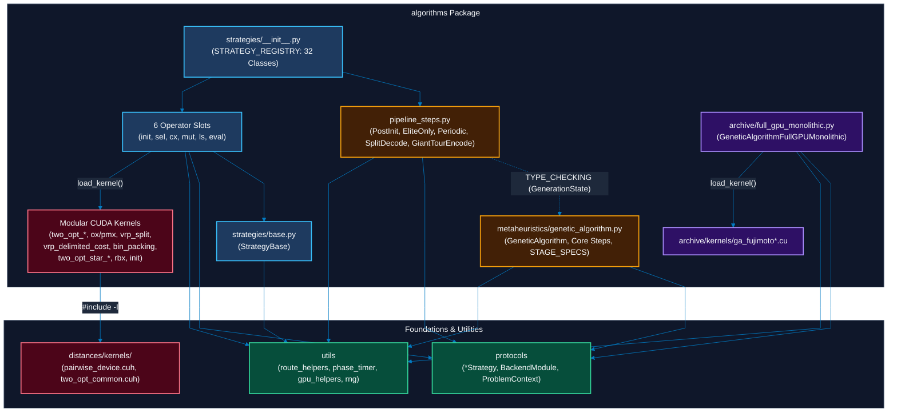
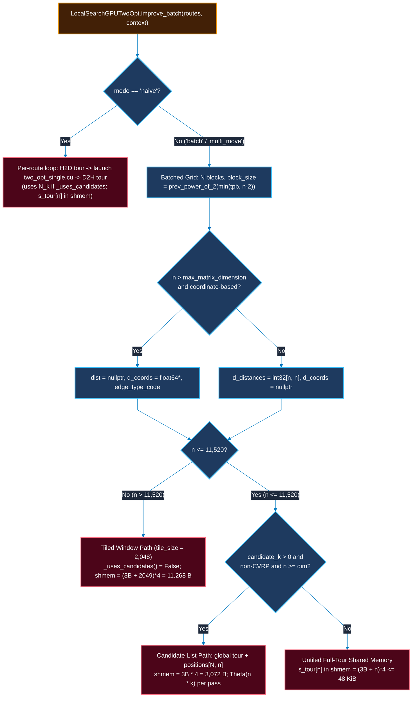

# Architecture Guide for `algorithms` and `strategies`

This guide documents the evolutionary metaheuristic orchestrator, composable generational pipeline steps, the 26 slot-prefixed `Design B` operator strategies (`DP11-1`, `DP17-2`–`DP17-3`), all 16 modular CUDA kernels, cross-package `utils` integration, and the isolated `archive/` monolithic baseline in `src/algorithms/`.

---

## 1. Scope & Architectural Boundaries

`src/algorithms/` implements the **Solver Execution & Evolutionary Operator Layer** on top of `protocols/`, `distances/`, and `utils/`.

| Subpackage / Module | Responsibility | Key Symbols |
| :--- | :--- | :--- |
| `src/algorithms/metaheuristics/` | Step-driven GA orchestrator, 6 core steps, and `STAGE_SPECS` dispatch | [`GeneticAlgorithm`](../../src/algorithms/metaheuristics/genetic_algorithm.py), [`GenerationState`](../../src/algorithms/metaheuristics/genetic_algorithm.py), [`STAGE_SPECS`](../../src/algorithms/metaheuristics/genetic_algorithm.py) |
| `src/algorithms/pipeline_steps.py` | Declarative extension steps (`PostInit`, `EliteOnly`, `Periodic`, `SplitDecode`, `GiantTourEncode`) | [`PostInitLocalSearchStep`](../../src/algorithms/pipeline_steps.py), [`EliteOnlyLocalSearchStep`](../../src/algorithms/pipeline_steps.py), [`PeriodicLocalSearchStep`](../../src/algorithms/pipeline_steps.py), [`SplitDecodeStep`](../../src/algorithms/pipeline_steps.py), [`GiantTourEncodeStep`](../../src/algorithms/pipeline_steps.py), [`PIPELINE_STEP_REGISTRY`](../../src/algorithms/pipeline_steps.py) |
| `src/algorithms/strategies/` | `StrategyBase` + `STRATEGY_REGISTRY` over 6 operator subpackages (26 classes) & 16 `.cu` kernels | [`StrategyBase`](../../src/algorithms/strategies/base.py), [`STRATEGY_REGISTRY`](../../src/algorithms/strategies/__init__.py) |
| `src/algorithms/archive/` | Isolated pre-modularization fused-kernel GA for Chapter 4 baselines (`DP9-4`, `DP10-2`) | [`GeneticAlgorithmFullGPUMonolithic`](../../src/algorithms/archive/full_gpu_monolithic.py), [`ga_fujimoto_early_stop.cu`](../../src/algorithms/archive/kernels/ga_fujimoto_early_stop.cu) |

### Verified Package Exports and Architectural Notes

1. **`GeneticAlgorithmBase` Alias Retention:** [`metaheuristics/__init__.py`](../../src/algorithms/metaheuristics/__init__.py) retains `GeneticAlgorithmBase = GeneticAlgorithm`, and [`algorithms/__init__.py`](../../src/algorithms/__init__.py) re-exports `"GeneticAlgorithm"`, `"GeneticAlgorithmBase"`, and `"LocalSearchStage"` (never importing or exporting `archive/`).
2. **`archive/` Quarantine (`DP9-4`, `DP10-2`, `DP10-3`):** `src/algorithms/archive/` is excluded from both `mypy` and `ruff` in [`pyproject.toml`](../../pyproject.toml) and loaded dynamically via `class_module`/`class_name` from `configs/algorithms.archive.json` (the former `"FullGPU"` duplicate config was deleted in `BUG-11`, leaving `"FullGPUMonolithic"` as the single monolithic identifier).
3. **Reliance on `src/utils/` Helpers:** All modular strategies delegate cross-cutting plumbing—batch normalization (`ensure_routes_batch`, `to_cpu_batch`, `restore_routes_shape`), host topology detection (`resolve_route_bounds`, `DP11-19`), rejection-free distinct-pair draws (`sample_distinct_pairs`, `DP11-20`), sparse CVRP node-index maps (`inverse_positions`, `BUG-19`), kernel loading + SHA-256 cache invalidation (`load_kernel`, `BUG-58`), and timing (`PhaseTimer`, `@time_strategy`, `DP11-22`)—to `src/utils/`.

---

## 2. Dependency Graph

*Dependency graph: `GeneticAlgorithm` communicates exclusively through `protocols` interfaces; `STRATEGY_REGISTRY` and `PIPELINE_STEP_REGISTRY` bind concrete implementations for configuration loading; `archive/` stays isolated from the modular pipeline.*

---

## 3. Core Abstractions & Contracts

### 3.1 `GeneticAlgorithm`, `GenerationStep`, and `STAGE_SPECS` (`genetic_algorithm.py`)

[`GeneticAlgorithm`](../../src/algorithms/metaheuristics/genetic_algorithm.py) orchestrates evolution over mutable [`GenerationState`](../../src/algorithms/metaheuristics/genetic_algorithm.py) objects (`population`, `fitness`, `context`, `offspring`, `offspring_fitness`, `generation`) via a list of [`GenerationStep`](../../src/algorithms/metaheuristics/genetic_algorithm.py) objects (`run(state, timer) -> None`).

The six core step wrappers translate pipeline steps into strategy calls timed by `PhaseTimer`:
- [`SelectionStep`](../../src/algorithms/metaheuristics/genetic_algorithm.py) (`"selection"`), [`CrossoverStep`](../../src/algorithms/metaheuristics/genetic_algorithm.py) (`"crossover"`), [`MutationStep`](../../src/algorithms/metaheuristics/genetic_algorithm.py) (`"mutation"`), [`EvaluationStep`](../../src/algorithms/metaheuristics/genetic_algorithm.py) (`"evaluation"`, `target="offspring" \| "population"`), [`SurvivalStep`](../../src/algorithms/metaheuristics/genetic_algorithm.py) (`"survival"`, deterministic $(\mu + \lambda)$ elitist sort on `old_pop ∪ new_pop`), and [`LocalSearchStep`](../../src/algorithms/metaheuristics/genetic_algorithm.py) (`"local_search"`, optional `"evaluation"` re-scoring).

A single lookup table [`STAGE_SPECS`](../../src/algorithms/metaheuristics/genetic_algorithm.py) (`Mapping[LocalSearchStage, StageSpec]`, `DP11-9`) maps all five `LocalSearchStage` values (`"none"`, `"post_crossover"`, `"post_mutation"`, `"post_evaluation"`, `"post_evolution"`), guaranteeing that Generation 0 (`initialize` + `evaluate_batch`) always remains raw across all five stages (`DP11-8`, `BUG-21`).

### 3.2 Declarative Pipeline Extension Steps (`pipeline_steps.py`)

[`pipeline_steps.py`](../../src/algorithms/pipeline_steps.py) defines [`StageAnchor`](../../src/algorithms/pipeline_steps.py) (`Literal["pre_selection", "pre_evaluation", "post_survival"]`) and three composable steps registered in [`PIPELINE_STEP_REGISTRY`](../../src/algorithms/pipeline_steps.py):

| Step Class | `stage_anchor` | Behavior & Architectural Rationale |
| :--- | :--- | :--- |
| [`PostInitLocalSearchStep`](../../src/algorithms/pipeline_steps.py) | `"pre_selection"` | Runs `local_search.improve_batch` + re-evaluation **only when `state.generation == 1`**, preserving raw Generation-0 `initial_fitness` (`DP11-6`, `BUG-30`). |
| [`EliteOnlyLocalSearchStep`](../../src/algorithms/pipeline_steps.py) | `"post_survival"` | Refines only the top `k = min(elite_count, pop_size)` routes via `xp.argsort(state.fitness)[:k]` and updates them in place (`DP11-10`). |
| [`PeriodicLocalSearchStep`](../../src/algorithms/pipeline_steps.py) | `"pre_evaluation"` if `target="offspring"`, else `"post_survival"` | Executes local search every `interval` generations (`state.generation % interval == 0`); requires `re_evaluate` when `target="population"` (`DP11-10`). |
| [`SplitDecodeStep`](../../src/algorithms/pipeline_steps.py) | `"pre_evaluation"` | Decodes `(N, n - 1)` Giant-Tours into `0`-delimited `(N, n + K_max)` routes via `PrinsSplitDecoder` / `GreedySplitDecoder` before inter-route VRP local search (`DP17-2`). |
| [`GiantTourEncodeStep`](../../src/algorithms/pipeline_steps.py) | `"pre_evaluation"` | Strips depot `0` delimiters back into `(N, n - 1)` Giant-Tours via `strip_depot_delimiters_kernel` with `d2h_bytes == 0` (`DP17-2`). |
| [`FleetBinPackStep`](../../src/algorithms/vrp_pipeline_steps.py) | `"pre_evaluation"` | Applies `BinPacking[CPU\|GPU]{FFD,BFD}` repacking under hard $K_{\max}$ fleet limits (`DP17-9`, `BUG-117`). |
| [`PenaltyAdaptationStep`](../../src/algorithms/vrp_pipeline_steps.py) | `"post_survival"` | Updates `AdaptivePenaltyPolicy` multipliers from population feasibility ratios (`DP17-9`). |

Notice that [`GeneticAlgorithm._compose_pipeline`](../../src/algorithms/metaheuristics/genetic_algorithm.py) inserts extension steps without inspecting class names, [`GeneticAlgorithm._all_strategies`](../../src/algorithms/metaheuristics/genetic_algorithm.py) deduplicates strategy identities across both GA slots and `step.strategies()` so H2D/D2H/kernel telemetry is never missed (`BUG-30`), and [`GeneticAlgorithm.warmup`](../../src/algorithms/metaheuristics/genetic_algorithm.py) invokes every step's `warmup(context)` regardless of generation cadence (`DP11-21`, `BUG-25`).

### 3.3 `StrategyBase`, 32 Core Strategies, and 10 Composable Sub-Strategies (`DP11-1`, `DP17-2`, `DP17-7`–`DP17-9`)

[`StrategyBase`](../../src/algorithms/strategies/base.py) centralizes `seed`, `rng = make_rng(seed)`, `h2d_bytes`, `d2h_bytes`, `kernel_launches`, `reset_metrics()`, `warmup(context)`, and `_warmup_batch(context, rows)` (which produces `xp.tile(xp.arange(n, dtype=xp.int32), (rows, 1))`, preventing `cp.zeros` warm-up poisoning of closed-route heuristics per `BUG-24`). Per `BUG-27`, `@time_strategy` telemetry fields (`last_elapsed_ms`, `total_elapsed_ms`, `call_count`) are only type-annotated at class scope and assigned on `self` in `__init__` so they cannot shadow instance state.

[`STRATEGY_REGISTRY`](../../src/algorithms/strategies/__init__.py) maps all **32** slot-prefixed core classes (explicit CPU/GPU initializers, selection, TSP/VRP crossover & mutation, `2-opt` & `2-opt*` local search, and unified `Evaluation[CPU|GPU]Cost`), complemented by **10** composable sub-strategies in [`SUB_STRATEGY_REGISTRY`](../../src/algorithms/strategies/__init__.py) (`strategies/{decoding,penalties,bin_packing}/`: `PrinsSplitDecoder`, `GreedySplitDecoder`, `InstanceScaledPenaltyPolicy`, `StrictFeasibilityPolicy`, `FixedPenaltyPolicy`, `AdaptivePenaltyPolicy`, and `BinPacking[CPU|GPU]{FFD,BFD}`; see [analysis-cvrp-gpu-split-and-deb-statistics.md](../knowledge-base/analysis-cvrp-gpu-split-and-deb-statistics.md)):

| Slot | Class Name | Backend / Kernel | Key Constructor Parameters & Contract |
| :--- | :--- | :--- | :--- |
| `Initialization*` | [`InitializationCPURandom`](../../src/algorithms/strategies/initialization/random_init.py) / [`InitializationGPURandom`](../../src/algorithms/strategies/initialization/random_init.py) | CPU NumPy / CUDA [`random_init.cu`](../../src/algorithms/strategies/initialization/kernels/random_init.cu) (`SplitMix64`) | `seed=None` (GPU adds `return_gpu=True`; $\Theta(n)$ per route) |
| `Initialization*` | [`InitializationCPUNearestNeighbor`](../../src/algorithms/strategies/initialization/nearest_neighbor_init.py) / [`InitializationGPUNearestNeighbor`](../../src/algorithms/strategies/initialization/nearest_neighbor_init.py) | CPU GRASP RCL / CUDA [`nearest_neighbor_init.cu`](../../src/algorithms/strategies/initialization/kernels/nearest_neighbor_init.cu) | `k=20, seed=None` ($\Theta(n \cdot k)$) |
| `Selection*` | [`SelectionTournament`](../../src/algorithms/strategies/selection/tournament_selection.py) | CPU NumPy or GPU CuPy array indexing | `k=3, seed=None`; unified host RNG (`BUG-28`) |
| `Selection*` | [`SelectionRouletteWheel`](../../src/algorithms/strategies/selection/roulette_wheel_selection.py) | CPU inverse-cost weights | `seed=None`; $w_i = 1 / (\max(c_i, 0) + 10^{-6})$ |
| `Selection*` | [`SelectionGPUTournament`](../../src/algorithms/strategies/selection/tournament_selection.py) | CUDA [`tournament_selection.cu::tournament_selection_kernel`](../../src/algorithms/strategies/selection/kernels/tournament_selection.cu) | `k=5, seed=None`; outputs `winner_indices`, coalesced CuPy gather (`DP11-16`) |
| `Crossover*` | [`CrossoverOrder`](../../src/algorithms/strategies/crossover/order_crossover.py) | CPU vectorized NumPy (`in_seg` + `np.roll`) | `seed=None`; disjoint pairs $(2k, 2k+1)$, `OX-A` (`DP12-14`) |
| `Crossover*` | [`CrossoverPartiallyMapped`](../../src/algorithms/strategies/crossover/pmx_crossover.py) | CPU NumPy (`inv_p2` inverse index) | `seed=None`; preserves depot endpoints (`DP12-14`) |
| `Crossover*` | [`CrossoverGPUOrder`](../../src/algorithms/strategies/crossover/order_crossover.py) | CUDA [`order_crossover.cu::order_crossover_kernel`](../../src/algorithms/strategies/crossover/kernels/order_crossover.cu) | `seed=None`; 1 warp/route, Format A shmem (`DP11-11`, bit-identical to CPU) |
| `Mutation*` | [`MutationSwap`](../../src/algorithms/strategies/mutation/swap_mutation.py) | CPU NumPy in-place/copy slice | `seed=None, candidate_k=None`; shared host oracle (`SWAP-A`) |
| `Mutation*` | [`MutationGPUSwap`](../../src/algorithms/strategies/mutation/swap_mutation.py) | CUDA [`swap_mutation.cu::swap_mutation_kernel`](../../src/algorithms/strategies/mutation/kernels/swap_mutation.cu) | `seed=None, candidate_k=None`; 1 thread/route (`DP11-14`, `BUG-28`) |
| `Mutation*` | [`MutationInversion`](../../src/algorithms/strategies/mutation/inversion_mutation.py) | CPU NumPy slice reversal | `seed=None, candidate_k=None`; shared host oracle (`INV-A`) |
| `Mutation*` | [`MutationGPUInversion`](../../src/algorithms/strategies/mutation/inversion_mutation.py) | CUDA [`inversion_mutation.cu::inversion_mutation_kernel`](../../src/algorithms/strategies/mutation/kernels/inversion_mutation.cu) | `seed=None, candidate_k=None`; 1 warp/route parallel reversal (`DP11-17`) |
| `LocalSearch*` | [`LocalSearchNoOp`](../../src/algorithms/strategies/local_search/no_op.py) | CPU/GPU pass-through copy | `max_iterations=0` |
| `LocalSearch*` | [`LocalSearchCPUTwoOpt`](../../src/algorithms/strategies/local_search/two_opt.py) | CPU vectorized NumPy (`_pair_deltas` in `int64`) | `max_iterations=10, mode="best" \| "first" \| "multi_move", candidate_k=None` (`DP13-5`) |
| `LocalSearch*` | [`LocalSearchGPUTwoOpt`](../../src/algorithms/strategies/local_search/two_opt.py) | CUDA [`two_opt_batch.cu`](../../src/algorithms/strategies/local_search/kernels/two_opt_batch.cu) / [`two_opt_multi_move.cu`](../../src/algorithms/strategies/local_search/kernels/two_opt_multi_move.cu) / [`two_opt_single.cu`](../../src/algorithms/strategies/local_search/kernels/two_opt_single.cu) | `max_iterations=10, mode="batch" \| "multi_move" \| "naive", threads_per_block=256, max_matrix_dimension=None, max_shared_tour_cities=11_520, candidate_k=None` |
| `Evaluation*` | [`EvaluationCPUCost`](../../src/algorithms/strategies/evaluation/cost_evaluation.py) | CPU flat 1D gather (`float64` sum) | `()` — enforces `Fitness = NDArray[np.float64]` (`DP12-13`, `DP12-15`, `BUG-40`) |
| `Evaluation*` | [`EvaluationGPUCost`](../../src/algorithms/strategies/evaluation/cost_evaluation.py) | CUDA [`tour_cost.cu::tour_cost_kernel`](../../src/algorithms/strategies/evaluation/kernels/tour_cost.cu) & [`vrp_delimited_cost.cu::vrp_delimited_cost_kernel`](../../src/algorithms/strategies/evaluation/kernels/vrp_delimited_cost.cu) | `return_gpu=False, threads_per_block=256, max_matrix_dimension=None, decoder=None, penalty_policy=None` (`EVAL-A`, `DP11-15`, `DP17-7`) |

---

## 4. GoF Design Pattern Mapping

| Pattern (GoF) | Implementation in `algorithms` | Catalog Link |
| :--- | :--- | :--- |
| **Strategy** | `GeneticAlgorithm` delegates all 6 evolutionary phases to injected `StrategyBase` subclasses implementing `protocols.algorithm_strategies` | [Behavioral patterns](../../design-patterns-links.md#behavioral-patterns) |
| **Template Method** | `GeneticAlgorithm.evolve` fixes initialization, Gen-0 evaluation, stopping rules, and metric collection while steps vary; `StrategyBase.warmup` provides a compile-and-launch hook | [Behavioral patterns](../../design-patterns-links.md#behavioral-patterns) |
| **Chain / Pipeline & Command** | `GenerationStep` objects (`SelectionStep`, `PostInitLocalSearchStep`, etc.) mutate `GenerationState` sequentially along declarative `StageAnchor` slots | [Behavioral patterns](../../design-patterns-links.md#behavioral-patterns) |
| **Factory / Registry** | `STRATEGY_REGISTRY` and `PIPELINE_STEP_REGISTRY` resolve declarative JSON classes (validated reflexively by `schema_generator.py`, `BUG-85`) | [Creational patterns](../../design-patterns-links.md#creational-patterns) |
| **Flyweight / Mirror Cache** | `DistanceOperandCache` in `gpu_base.py` tracks context-owned VRAM buffers without duplicate allocations (`DP10-17`, `BUG-14`, `DP17-8`) | [Structural patterns](../../design-patterns-links.md#structural-patterns) |

---

## 5. Data/Execution Flow & Mathematical Models

### 5.1 `GeneticAlgorithm.warmup` and `evolve` Execution Lifecycle

```mermaid
---
config:
  theme: base
  themeVariables:
    darkMode: true
    background: "#0F172A"
    mainBkg: "#1E293B"
    primaryColor: "#1E293B"
    primaryTextColor: "#F8FAFC"
    primaryBorderColor: "#38BDF8"
    secondaryColor: "#1E3A5F"
    secondaryTextColor: "#F8FAFC"
    tertiaryColor: "#172554"
    tertiaryTextColor: "#F8FAFC"
    lineColor: "#027BC2"
    textColor: "#F8FAFC"
    actorBkg: "#1E293B"
    actorBorder: "#38BDF8"
    actorTextColor: "#F8FAFC"
    actorLineColor: "#027BC2"
    signalColor: "#38BDF8"
    signalTextColor: "#F8FAFC"
    labelBoxBkgColor: "#1E293B"
    labelBoxBorderColor: "#818CF8"
    labelTextColor: "#F8FAFC"
    loopTextColor: "#F8FAFC"
    activationBkgColor: "#1E3A5F"
    activationBorderColor: "#38BDF8"
    noteBkgColor: "#334155"
    noteBorderColor: "#FBBF24"
    noteTextColor: "#F8FAFC"
    sequenceNumberColor: "#0F172A"
  sequence:
    diagramMarginX: 24
    diagramMarginY: 16
    actorMargin: 45
    boxMargin: 12
    noteMargin: 12
    messageMargin: 38
    mirrorActors: true
    wrap: true
---
sequenceDiagram
    participant Runner as Benchmark / Caller
    participant GA as GeneticAlgorithm
    participant Steps as Pipeline Steps
    participant Strat as GPU/CPU Strategies
    participant Ctx as ProblemContext

    rect rgb(24, 34, 54)
        Runner->>+GA: warmup(context) (on isolated clone)
        loop every step in pipeline + unvisited strategies
            GA->>Steps: step.warmup(context)
            Steps->>Strat: strategy.warmup(context)
            Strat->>Strat: _get_kernel() + launch on arange(n)
        end
        deactivate GA

        Runner->>+GA: evolve(context, customers, max_gens, optimal, patience)
        GA->>Strat: initialization.initialize(customers, N, context)
        GA->>Strat: evaluation.evaluate_batch(population, context)
        GA->>GA: _extract_best -> initial_best_cost (Gen 0 raw)

        loop gen = 1 .. max_generations
            loop step in self.pipeline
                GA->>Steps: step.run(state, self.timer)
                Steps->>Strat: operator(..., state.context)
                Strat->>Ctx: get_gpu_distance_operands / candidate_list
            end
            GA->>GA: _best_cost(state.fitness) (1 scalar D2H)
            opt gen_best_cost < best_cost - 1e-6
                GA->>GA: _extract_best (lazy full-tour D2H copy)
            end
            opt optimal hit, gap < 1%, or stagnation >= patience
                GA->>GA: break early
            end
        end

        opt local_search_stage == "post_evolution"
            GA->>Strat: local_search.improve_batch + evaluate_batch
        end
        GA-->>-Runner: (best_tour, stats)
    end
```

*Runtime lifecycle showing AOT kernel compilation (`DP11-21`), raw Generation-0 evaluation (`DP11-8`, `BUG-21`), and lazy route D2H extraction only on strict cost improvement (`DP11-7`, `BUG-30`).*

### 5.2 `LocalSearchGPUTwoOpt` Kernel & Memory-Mode Dispatch

*Dispatch tree in [`LocalSearchGPUTwoOpt`](../../src/algorithms/strategies/local_search/two_opt.py) coordinating kernel selection (`two_opt_single.cu`, `two_opt_batch.cu`, `two_opt_multi_move.cu`), shared-memory mode, candidate lists, and on-the-fly coordinate distances.*

### 5.3 Mathematical & CUDA Kernel Architecture Models

#### 1. 2-Opt Move Gain, Shared-Memory Tiling, and Pascal CC 6.1 Occupancy (`two_opt_batch.cu`, `two_opt_multi_move.cu`, `two_opt_single.cu`)

For tour $\boldsymbol{\pi} = (\pi_0, \dots, \pi_{n-1})$ with cyclic edge $e_k = (\pi_k, \pi_{(k+1) \bmod n})$, reversing segment $[\pi_{i+1}, \dots, \pi_j]$ over the upper triangle $0 \le i < i + 2 \le j < n$ excluding $(0, n-1)$ yields exact integer gain (Croes, 1958; Flood, 1956):

$$
\Delta_{i,j} = \bigl(d(\pi_i, \pi_j) + d(\pi_{i+1}, \pi_{j+1})\bigr) - \bigl(d(\pi_i, \pi_{i+1}) + d(\pi_j, \pi_{j+1})\bigr)
$$

In [`LocalSearchCPUTwoOpt`](../../src/algorithms/strategies/local_search/two_opt.py), [`_exhaustive_pairs`](../../src/algorithms/strategies/local_search/two_opt.py) (`np.triu_indices(n, k=2)` excluding `(0, n-1)`) feeds chunked slices of `_PAIR_BLOCK = 2**18` pairs into [`_pair_deltas`](../../src/algorithms/strategies/local_search/two_opt.py) in `int64` (preventing `int32` sum overflow near TSPLIB bounds, `DP13-5`/`BUG-63`).

On GPU, [`_shared_mem_bytes`](../../src/algorithms/strategies/local_search/two_opt.py) provisions per-block dynamic shared memory for block size $B \le 256$:

$$
S_{\text{block}}(B, n, T, \text{use\_cand}) =
\begin{cases}
12 B, & \text{if } \text{use\_cand} = \text{True} \quad (\text{tour \& } \text{pos}[N, n] \text{ in VRAM}), \\
(3B + n) \times 4, & \text{if } \text{use\_cand} = \text{False}, T = 0 \quad (n \le 11{,}520 \implies \le 49{,}152\text{ B}), \\
(3B + T + 1) \times 4, & \text{if } T = 2{,}048 \quad (n > 11{,}520).
\end{cases}
$$

When $n > 11{,}520$, `s_tour[n]` exceeds the $48\text{ KiB}$ ($49{,}152\text{ B}$) per-block limit ($3 \cdot 256 \cdot 4 + 11{,}520 \cdot 4 = 49{,}152\text{ B}$). Choosing `TWO_OPT_TILE_SIZE = 2048` (`two_opt_common.cuh`, `Rocki & Suda, 2012`; `O'Neil & Burtscher, 2015`) requires $S_{\text{block}} = 3{,}072 + 2{,}049 \times 4 = 11{,}268\text{ B}$ (aligned to $11{,}520\text{ B}$ at 256-byte Pascal CC 6.1 granularity). Because each GP107 SM has $96\text{ KiB}$ ($98{,}304\text{ B}$) shared memory and $2{,}048$ max threads:

$$
\left\lfloor \frac{98{,}304\text{ B}}{11{,}520\text{ B}} \right\rfloor = 8\text{ blocks/SM} \implies 8 \times 256 = 2{,}048\text{ threads/SM} \quad (\mathbf{100\%\text{ SM occupancy}}),
$$

while reducing global tour DRAM traffic by $B:1 = 256:1$ ($99.61\%$ reuse ratio). During `mode="multi_move"` ([`two_opt_multi_move.cu::two_opt_multi_move_batch_kernel`](../../src/algorithms/strategies/local_search/kernels/two_opt_multi_move.cu)), each thread stores its single steepest candidate (`two_opt_consider`), limiting proposals to $\min(B, \lfloor n/2 \rfloor)$ per pass (`DP11-2`, `BUG-20`), thread 0 selects disjoint segments where `!(me + 1 < seg_start || seg_end + 1 < ms)`, and all $B$ threads reverse each selected segment cooperatively (`DP11-18`, `Rocki & Suda, 2013`). Notice also `two_opt_single.cu` (`mode="naive"`) honors `candidate_k` (`BUG-57`) using global `positions[n]` while keeping `s_tour[n]` in shared memory.

#### 2. Format A 1-Warp/Route Order Crossover (`order_crossover.cu`, `DP11-11`)

[`CrossoverOrder`](../../src/algorithms/strategies/crossover/order_crossover.py) and [`CrossoverGPUOrder`](../../src/algorithms/strategies/crossover/order_crossover.py) share the host rejection-free bijection `sample_distinct_pairs` (`DP11-20`):

$$
u \sim \mathcal{U}\{a..b-1\}, \quad v' \sim \mathcal{U}\{a..b-2\}, \quad v = v' + \mathbb{I}[v' \ge u],
$$

applied across disjoint pairs $(2k, 2k+1)$ (`OX-A`; Davis, 1985). [`order_crossover.cu::order_crossover_kernel`](../../src/algorithms/strategies/crossover/kernels/order_crossover.cu) assigns **1 warp (32 lanes) per route** (`route_idx = global_tid >> 5`) and allocates Format A shared memory (`unsigned char my_in_seg[n]`, 1 byte per city per warp):

$$
S_{\text{OX}}(W, n) = W \cdot n \le S_{\max}^{\text{block}} \quad (49{,}152\text{ B}), \quad W = \text{threads\_per\_block} / 32 \in \{8, 4, 2, 1\}.
$$

[`CrossoverGPUOrder`](../../src/algorithms/strategies/crossover/order_crossover.py) dynamically halves `threads_per_block` from `256` down to `32` so Format A scales from $n \le 6{,}144$ at $8$ warps/block up to $n \le 49{,}152$ at $1$ warp/block (eliminating `BUG-22`'s $\mathcal{O}(n^2)$ linear scan while remaining bit-identical to CPU `CrossoverOrder`). Remaining genes from `parent2` are compacted deterministically across the 32 lanes via `__ballot_sync(0xFFFFFFFFu, retain)` and `__popc(mask & ((1u << lane_id) - 1u))` without atomics.

#### 3. Coalesced Evaluation, Selection Gather, and Cooperative Mutation (`DP11-14`–`DP11-17`)

- **Evaluation (`tour_cost.cu` & `vrp_delimited_cost.cu`):** [`tour_cost.cu::tour_cost_kernel`](../../src/algorithms/strategies/evaluation/kernels/tour_cost.cu) walks flat tour edges with a coalesced block-stride loop (`for (i = tid; i < n; i += block_size)`), accumulates into `long long` (`int64`), and reduces via [`block_reductions.cuh::block_reduce_sum`](../../src/utils/kernels/block_reductions.cuh) (`EVAL-A`, `DP11-15`), casting to `float64` on return (`DP12-15`, `BUG-40`); [`vrp_delimited_cost.cu::vrp_delimited_cost_kernel`](../../src/algorithms/strategies/evaluation/kernels/vrp_delimited_cost.cu) evaluates `0`-delimited VRP routes with a 32-lane Kogge-Stone segmented scan.
- **Selection (`tournament_selection.cu`):** [`tournament_selection.cu::tournament_selection_kernel`](../../src/algorithms/strategies/selection/kernels/tournament_selection.cu) emits only 1D `winner_indices[N]` and delegates the 2D population gather (`d_pop[d_winner_indices]`) to CuPy/CUB (`SEL-A`, `DP11-16`), using host `rng.integers(..., dtype=np.int32)` so CPU and GPU tournament selection share one RNG sequence (`BUG-28`).
- **Mutation (`swap_mutation.cu`, `inversion_mutation.cu`):** Both CPU and GPU mutation call `sample_mutation_positions` (`route_helpers.py`), preserving identical seeds and `candidate_k` behavior (`SWAP-A`, `INV-A`). [`inversion_mutation.cu::inversion_mutation_kernel`](../../src/algorithms/strategies/mutation/kernels/inversion_mutation.cu) assigns 1 warp per route so all 32 lanes reverse `[left, right]` cooperatively under zero intra-warp divergence (`DP11-17`).

#### 4. Legacy Monolithic Baseline (`archive/`)

[`GeneticAlgorithmFullGPUMonolithic`](../../src/algorithms/archive/full_gpu_monolithic.py) runs the entire GA inside [`ga_fujimoto_early_stop.cu::ga_evolution_early_stop`](../../src/algorithms/archive/kernels/ga_fujimoto_early_stop.cu) using `curandStateXORWOW` (`48 B` per individual) and device-side `two_opt_device` bounded by `#define MAX_CITIES 2048` (Fujimoto & Tsutsui, 2011). Because intermediate generations never exit the kernel, `best_cost_history` linearly interpolates between initial and final best costs.

---

## 6. Cross-Cutting Concerns

- **Asynchronous Stream Ordering (`DP10-18`, `DP11-22`, `BUG-15`, `BUG-26`):** GPU strategies no longer invoke `cp.cuda.Stream.null.synchronize()`, and `@time_strategy` defaults to `time.perf_counter()` without forcing `end_evt.synchronize()` on every call. Synchronization occurs implicitly only on D2H copies (`.get()` / `cp.asnumpy()`) or when `use_gpu_events = True` / `PhaseTimer(use_cuda_events=True)` is explicitly requested (`BUG-51`).
- **Route Topology Bounds (`DP11-19`, `BUG-24`, `BUG-28`):** `resolve_route_bounds(n, context, route_sample)` checks host endpoints (`O(1)`) or `context.is_closed` on GPU batches, returning `(1, n - 1)` for closed depot tours (`CVRP`) and `(0, n)` for open `TSP`/`ATSP` permutations without D2H syncs or sample-cache poisoning.
- **AOT Warm-Up & SHA-256 Recompilation (`DP11-21`, `BUG-25`, `BUG-58`):** `load_kernel` hashes `.cu` bytes via SHA-256 to invalidate `_compile_kernel_cached` on live source edits, while `GeneticAlgorithm.warmup` pre-compiles and exercises every step/strategy on `arange(n)` permutations prior to timed runs.
- **Telemetry Accounting (`BUG-30`):** [`GeneticAlgorithm._collect_strategy_metrics`](../../src/algorithms/metaheuristics/genetic_algorithm.py) sets `_ = context` and sums `h2d_bytes`, `d2h_bytes`, and `kernel_launches` solely across `_all_strategies()`, explicitly **not** re-adding `context._gpu_distances.nbytes`. Instead, `ProblemContext.h2d_bytes` records physical host-to-device uploads inside lazy context accessors, and both [`gpu_base.py::DistanceOperandCache.resolve, DistanceOperandCache.resolve_candidates`](../../src/algorithms/strategies/local_search/gpu_base.py) and [`base.py::EvaluationGPUBase._distance_operands`](../../src/algorithms/strategies/evaluation/base.py) measure `max(0, int(getattr(context, "h2d_bytes", 0)) - before_h2d)` around context lookups—charging the physical upload delta **once** to whichever strategy first triggers the transfer while charging `0` bytes on subsequent cached bindings across sibling strategies and generations.
- **Test Boundaries:** `tests/algorithms/` covers contracts ([`test_unit_strategy_contracts.py`](../../tests/algorithms/test_unit_strategy_contracts.py)), pipeline composition ([`test_unit_pipeline_steps.py`](../../tests/algorithms/test_unit_pipeline_steps.py)), fail-loud GPU guards ([`test_unit_gpu_strategy_fail_loud.py`](../../tests/algorithms/test_unit_gpu_strategy_fail_loud.py)), GA invariants (`metaheuristics/`), and per-operator CPU/GPU bit-parity (`crossover/`, `evaluation/`, `initialization/`, `local_search/`, `mutation/`), plus `tests/validation/` ([`test_early_stopping.py`](../../tests/validation/test_early_stopping.py), [`test_incremental_checkpoints.py`](../../tests/validation/test_incremental_checkpoints.py)).

---

## 7. Extension Recipes

1. **Adding a New Design B Operator Strategy:**
   - Subclass [`StrategyBase`](../../src/algorithms/strategies/base.py) and satisfy the target protocol in `src/protocols/algorithm_strategies.py`, naming the class `<SlotPrefix><Family>` (e.g., `CrossoverEdgeAssembly`).
   - Decorate the batch entry point with `@time_strategy`, use `resolve_rng(context, self.rng)`, accept `RouteOrRoutes`, and honor `GPUUnavailableError` (`require_gpu()`) without CPU fallback for GPU classes (`DP9-2`).
   - Register the class in [`STRATEGY_REGISTRY`](../../src/algorithms/strategies/__init__.py) and regenerate/verify `configs/schemas/algorithms.schema.json` via `schema_generator.py` (`BUG-85`).
2. **Adding a Custom Generational Pipeline Step:**
   - Implement `run(self, state: GenerationState, timer: PhaseTimer) -> None`, `stage_anchor: StageAnchor`, `strategies() -> list[Any]`, `public_params() -> dict[str, Any]`, and `warmup(self, context: ProblemContext) -> None` following [`PostInitLocalSearchStep`](../../src/algorithms/pipeline_steps.py).
   - Register the class in [`PIPELINE_STEP_REGISTRY`](../../src/algorithms/pipeline_steps.py) so declarative `configs/algorithms.json` pipelines can instantiate and serialize it cleanly.

---

## 8. Architectural Decision Records

| ID | Summary & Architectural Impact | Status | Correlation |
| :--- | :--- | :--- | :--- |
| `DP9-4` / `DP10-2` / `DP10-3` | Quarantined monolithic GA in `algorithms/archive/` (`FullGPUMonolithic` + `configs/algorithms.archive.json`) outside `algorithms.__all__`. | Accepted | [table-of-symbols.plan.md](../../documents_tcc/plan/table-of-symbols.plan.md#decisões-dp) |
| `DP9-6` / `BUG-8` | `GeneticAlgorithm.evolve` validates non-empty `customers`, raising `ValueError`. | Resolved | [table-of-symbols.plan.md](../../documents_tcc/plan/table-of-symbols.plan.md#decisões-dp) |
| `DP10-18` / `BUG-15` | Removed redundant `Stream.null.synchronize()` from GPU 2-opt when `input_on_gpu=True`. | Resolved | [table-of-symbols.plan.md](../../documents_tcc/plan/table-of-symbols.plan.md#decisões-dp) |
| `DP11-1` | Adopted Design B slot-prefixed operator-family classes (`17` classes) inheriting `StrategyBase` over umbrella classes. | Resolved | [table-of-symbols.plan.md](../../documents_tcc/plan/table-of-symbols.plan.md#fase-11-dp11) |
| `DP11-2` / `BUG-20` / `BUG-29` | Removed `applied_start[16]` static cap in `two_opt_multi_move.cu` (now `min(block_size, n // 2)`), added grid bounds guard, and short-circuited no-improvement barriers. | Resolved | [table-of-symbols.plan.md](../../documents_tcc/plan/table-of-symbols.plan.md#fase-11-dp11) |
| `DP11-6` / `DP11-8` / `DP11-9` / `DP11-10` | Enforced raw Gen 0 via `STAGE_SPECS`, extracted `PostInitLocalSearchStep`, and implemented real `EliteOnlyLocalSearchStep` / `PeriodicLocalSearchStep` (`BUG-21`, `BUG-30`). | Resolved | [table-of-symbols.plan.md](../../documents_tcc/plan/table-of-symbols.plan.md#fase-11-dp11) |
| `DP11-11` / `DP12-1` / `BUG-22` | Rewrote `order_crossover_kernel` to 1 warp/route + Format A shared-memory membership (`O(n)`), documenting Format B bitpacking as future scaling (`DP12-1`). | Resolved | [table-of-symbols.plan.md](../../documents_tcc/plan/table-of-symbols.plan.md#fase-11-dp11) |
| `DP11-14`–`DP11-18` | Delivered `SWAP-A`, `EVAL-A`, `SEL-A`, `INV-A`, and `2OPT-A` kernel coalescing, `__shfl_down_sync` reduction, and cooperative segment reversals. | Resolved | [table-of-symbols.plan.md](../../documents_tcc/plan/table-of-symbols.plan.md#fase-11-dp11) |
| `DP11-19` / `DP11-20` / `BUG-24` / `BUG-28` | Shared `resolve_route_bounds` and `sample_distinct_pairs` bijection across CPU/GPU operators (`72x` host sampling speedup, zero warm-up cache poisoning). | Resolved | [table-of-symbols.plan.md](../../documents_tcc/plan/table-of-symbols.plan.md#fase-11-dp11) |
| `DP11-21` / `DP11-22` / `BUG-25` / `BUG-26` | Pipeline-wide AOT `warmup(context)` and non-synchronizing default `@time_strategy` (`perf_counter`). | Resolved | [table-of-symbols.plan.md](../../documents_tcc/plan/table-of-symbols.plan.md#fase-11-dp11) |
| `DP12-12`–`DP12-15` / `DP13-5` / `BUG-40` / `BUG-63` | Vectorized CPU `EvaluationCPUCost` (`float64` output), `CrossoverOrder` / `CrossoverPartiallyMapped`, and NumPy `LocalSearchCPUTwoOpt` (`14.3x`–`28.2x` CPU speedup). | Resolved | [table-of-symbols.plan.md](../../documents_tcc/plan/table-of-symbols.plan.md#fase-12-dp12) |
| `BUG-27` / `BUG-52` / `BUG-54` / `BUG-57` / `BUG-58` | Fixed `StrategyBase` instance counter shadowing, `prev_power_of_2`, empty-pool fallback, `two_opt_single.cu` candidate-list binding, and SHA-256 `.cu` cache invalidation. | Resolved | [table-of-symbols.plan.md](../../documents_tcc/plan/table-of-symbols.plan.md#defeitos-bug) |
