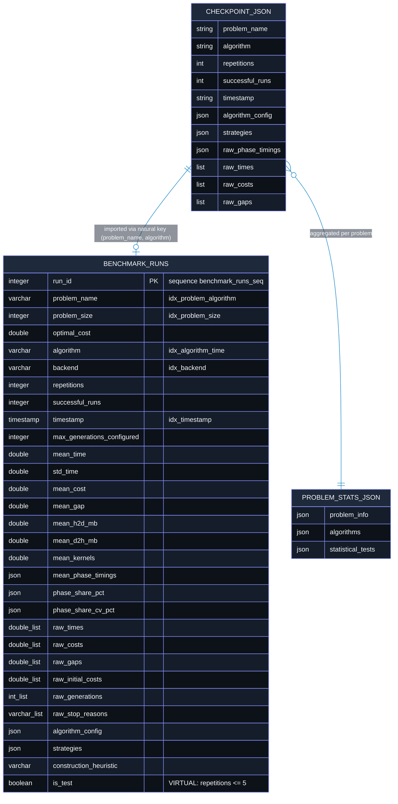

# Architecture Guide — Benchmarking, CLI, and Utilities

## 1. Scope and architectural boundaries

This guide documents the operational infrastructure, experimental harness, persistence, statistical inference, CLI surface, and cross-cutting runtime utilities of the GPU-accelerated routing solver. It complements the earlier subsystem overview in [analysis-benchmarking-system.md](./benchmarking/analysis-benchmarking-system.md) with `Implementation-Ready` contracts grounded directly in the source tree.

| Subsystem | Package / Path | Primary Responsibility | Boundary Rule |
| --- | --- | --- | --- |
| Utilities | [`src/utils/`](../../src/utils/__init__.py) | CUDA kernel JIT loading, host/device timing, deterministic `np.random.Generator` resolution, route batch normalization, and host RNG sampling | May depend only on `protocols/` (`backend`, `problem_context`, `types`); never imports `algorithms/`, `loaders/`, or `benchmarking/` |
| CLI | [`src/cli/`](../../src/cli/__init__.py) | Console entrypoints (`tsp-benchmark`, `tsp-report`, `tsp-ingest`, `tsp-import-checkpoints`, `tsp-validate-db`) registered in `[project.scripts]` of [pyproject.toml](../../pyproject.toml) | Parses arguments, configures logging after parsing (`BUG-74`), and delegates immediately to `benchmarking` or `loaders` |
| Benchmark Runner | [`src/benchmarking/runner/`](../../src/benchmarking/runner/__init__.py) | Configuration loading, reflective JSON Schema generation, atomic checkpoint I/O, isolated AOT GPU warmup, repetition loop, and end-to-end orchestration | Owns experimental budget, seed offsets, and checkpoint resume; isolates thesis-specific constants in `benchmark_scripts/` (`DP13-8`) |
| Benchmark Database | [`src/benchmarking/database/`](../../src/benchmarking/database/__init__.py) | Single-table DuckDB results store (`benchmark_runs`), checkpoint ingestion with natural-key upsert, and database-vs-JSON consistency checks | Strictly distinct from the TSPLIB input corpus DuckDB managed by `routing_data` (`DP10-14`) |
| Statistical Analysis & Reporting | [`src/benchmarking/analysis/`](../../src/benchmarking/analysis/__init__.py) | Demšar (2006) non-parametric inference (Friedman + Iman–Davenport, Nemenyi CD, Wilcoxon + Holm–Bonferroni), Markdown/LaTeX tables, TikZ CD plots, LaTeX macros, and Matplotlib scaling figures | Kept domain- and thesis-agnostic; receives `baseline_algorithm` and labels from callers (`DP12-9`, `DP14-2`, `DP14-3`) |
| Configs & Schemas | [`configs/`](../../configs/cpu-operators.example.json), [`configs/schemas/`](../../configs/schemas/benchmark.schema.json) | Generic declarative GA examples, optional `ReportStyle` templates, and Draft 2020-12 JSON Schemas | Constructor-validated strategy parameters (`BUG-85`) plus external `"module"` loading; thesis configs isolated under `benchmark_scripts/configs/chapter4/` |
| External Scripts | [`benchmark_scripts/`](../../benchmark_scripts/run_chapter4_benchmark.py) | Thesis-specific cohort runner, documentation gates (`check_docs`, `check_thesis`), and one-off sweeps | Lives outside `src/`; `run_chapter4_benchmark.py` delegates CLI parsing and execution to [benchmark.py::main](../../src/cli/benchmark.py) (`DP13-8`) |

> [!NOTE]
> Under `pythonpath = ["src"]` in [pyproject.toml](../../pyproject.toml), all modules import `benchmarking.*`, `cli.*`, `utils.*`, `protocols.*`, `data_models.*`, `loaders.*`, and `algorithms.*` without a `src.` prefix (`DP-3`).

---

## 2. Dependency graph and layer coupling

The diagram below captures every actual package-level and cross-module dependency verified by AST import inspection across `src/utils/`, `src/cli/`, and `src/benchmarking/`.

```mermaid
---
config:
  theme: base
  themeVariables:
    darkMode: true
    background: "#0F172A"
    mainBkg: "#1E293B"
    primaryColor: "#1E293B"
    primaryTextColor: "#F8FAFC"
    primaryBorderColor: "#38BDF8"
    secondaryColor: "#1E3A5F"
    secondaryTextColor: "#F8FAFC"
    secondaryBorderColor: "#60A5FA"
    tertiaryColor: "#172554"
    tertiaryTextColor: "#F8FAFC"
    tertiaryBorderColor: "#818CF8"
    lineColor: "#027BC2"
    edgeLabelBackground: "#1E293B"
    textColor: "#F8FAFC"
    nodeTextColor: "#F8FAFC"
    clusterBkg: "#0F172A"
    clusterBorder: "#64748B"
    titleColor: "#F8FAFC"
  flowchart:
    nodeSpacing: 50
    rankSpacing: 60
    padding: 16
    wrappingWidth: 260
    curve: "linear"
---
flowchart TD
    Scripts["benchmark_scripts/run_chapter4_benchmark.py"] -->|"delegates argv + hooks"| CliBench["src/cli/benchmark.py"]
    CliBench -->|"logging + orchestration"| RunnerOrch["benchmarking/runner/orchestration.py"]
    CliRep["src/cli/report.py (tsp-report)"] --> RunnerCkpt["benchmarking/runner/checkpoint_io.py"]
    CliRep --> AnalysisProb["benchmarking/analysis/problem_statistics.py"]
    CliRep --> AnalysisCohort["benchmarking/analysis/cohort_analysis.py"]
    CliRep --> ReportConsole["benchmarking/reporting/console.py"]
    CliRep --> ReportGen["benchmarking/reporting/generator.py"]
    CliCkpt["src/cli/checkpoints.py"] --> DbImport["benchmarking/database/import_checkpoints.py"]
    CliCkpt --> DbVal["benchmarking/database/validate_consistency.py"]
    CliTsp["src/cli/tsplib.py"] --> Loaders["loaders/ (TsplibLoader, DatabaseLoader)"]

    RunnerOrch --> RunnerAlgo["benchmarking/runner/algorithm_runner.py"]
    RunnerOrch --> RunnerCkpt
    RunnerOrch --> RunnerCfg["benchmarking/runner/config_loader.py"]
    RunnerOrch --> LogCfg["benchmarking/logging_config.py"]
    RunnerOrch --> Loaders
    RunnerOrch --> AnalysisProb
    RunnerOrch --> AnalysisCohort
    RunnerOrch --> ReportConsole
    RunnerOrch --> ReportGen

    RunnerCfg -->|"Registry & GA instantiation"| Algos["algorithms/ (GeneticAlgorithm, Registries)"]
    RunnerCfg -->|"Slot protocols & LocalSearchStage"| Protos["protocols/ (backend, problem_context, types)"]
    RunnerCfg -->|"TSP bundle builder"| Loaders
    RunnerSchema["benchmarking/runner/schema_generator.py"] -->|"Inspects signatures"| Algos
    RunnerSchema -->|"Reads TypeAliasType"| Protos
    RunnerSchema -->|"Reflects ReportStyle"| ReportStyle["benchmarking/reporting/style.py"]

    RunnerAlgo -->|"private _compile_kernel_cached"| UtilsGpu["utils/gpu_helpers.py"]
    RunnerAlgo --> Protos
    RunnerAlgo --> DataModels["data_models/ (Problem, records)"]

    AnalysisProb --> AnalysisStat["benchmarking/analysis/statistics.py"]
    AnalysisProb --> AnalysisUtil["benchmarking/analysis/stats_utils.py"]
    AnalysisCohort --> AnalysisBase["benchmarking/analysis/cohort.py"]
    AnalysisCohort --> AnalysisStat
    AnalysisCohort --> AnalysisUtil
    AnalysisBase --> AnalysisUtil
    AnalysisStat --> AnalysisUtil
    AnalysisStat --> DataModels

    ReportGen --> AnalysisCohort
    ReportGen --> ReportTables["benchmarking/reporting/table_reports.py"]
    ReportGen --> ReportMacros["benchmarking/reporting/latex_macros.py"]
    ReportGen --> ReportStyle
    ReportGen --> ReportCD["benchmarking/reporting/cd_diagram.py"]
    ReportGen -.->|"lazy import (matplotlib)"| ReportPlot["benchmarking/reporting/scaling_plots.py"]
    ReportConsole --> AnalysisProb
    ReportConsole --> AnalysisCohort
    ReportTables --> AnalysisCohort
    ReportTables --> ReportStyle
    ReportMacros --> AnalysisCohort
    ReportMacros --> ReportStyle
    ReportCD --> AnalysisStat
    ReportCD --> ReportStyle
    ReportPlot --> AnalysisBase
    ReportPlot --> ReportStyle

    DbImport --> DbOps["benchmarking/database/db_operations.py"]
    DbImport --> DbSchema["benchmarking/database/schema.py + schema.sql"]
    DbOps --> DbSchema
    DbOps --> DataModels
    DbVal --> DbSchema

    UtilsGpu --> Protos
    UtilsTimer["utils/phase_timer.py"] --> Protos
    UtilsRng["utils/rng.py"] --> Protos
    UtilsRoute["utils/route_helpers.py"] --> Protos

    classDef cli fill:#1E3A5F,stroke:#38BDF8,color:#F8FAFC,stroke-width:2px;
    classDef runner fill:#064E3B,stroke:#34D399,color:#F8FAFC,stroke-width:2px;
    classDef analysis fill:#422006,stroke:#F59E0B,color:#F8FAFC,stroke-width:2px;
    classDef reporting fill:#4C1D95,stroke:#C084FC,color:#F8FAFC,stroke-width:2px;
    classDef db fill:#2E1065,stroke:#A78BFA,color:#F8FAFC,stroke-width:2px;
    classDef utils fill:#164E63,stroke:#22D3EE,color:#F8FAFC,stroke-width:2px;
    classDef ext fill:#334155,stroke:#94A3B8,color:#F8FAFC,stroke-width:2px;

    class CliBench,CliRep,CliCkpt,CliTsp cli;
    class RunnerOrch,RunnerAlgo,RunnerCkpt,RunnerCfg,RunnerSchema,LogCfg runner;
    class AnalysisProb,AnalysisCohort,AnalysisBase,AnalysisStat,AnalysisUtil analysis;
    class ReportGen,ReportConsole,ReportTables,ReportMacros,ReportStyle,ReportCD,ReportPlot reporting;
    class DbImport,DbOps,DbSchema,DbVal db;
    class UtilsGpu,UtilsTimer,UtilsRng,UtilsRoute utils;
    class Scripts,Loaders,Algos,Protos,DataModels ext;
```



*Subsystem dependency topology across `cli/`, `benchmarking/{runner,analysis,reporting,database}/`, `utils/`, and core domain layers (`protocols/`, `data_models/`, `loaders/`, `algorithms/`).*

### Observed coupling & architectural anomalies

1. **Resolved — Acyclic split between `benchmarking/analysis/` and `benchmarking/reporting/`**: Pure statistical computation ([cohort.py](../../src/benchmarking/analysis/cohort.py), [statistics.py](../../src/benchmarking/analysis/statistics.py), [stats_utils.py](../../src/benchmarking/analysis/stats_utils.py), [problem_statistics.py](../../src/benchmarking/analysis/problem_statistics.py), [cohort_analysis.py](../../src/benchmarking/analysis/cohort_analysis.py)) emits single-pass immutable snapshots (`OmnibusTestResult`, `ProblemAnalysis`, `CohortAnalysis`) with zero file I/O or logging side effects. All presentation and formatting live under `benchmarking/reporting/` with [style.py](../../src/benchmarking/reporting/style.py) as the leaf style contract, [console.py](../../src/benchmarking/reporting/console.py) for console logging, [table_reports.py](../../src/benchmarking/reporting/table_reports.py), [latex_macros.py](../../src/benchmarking/reporting/latex_macros.py), [cd_diagram.py](../../src/benchmarking/reporting/cd_diagram.py), and [scaling_plots.py](../../src/benchmarking/reporting/scaling_plots.py) as pure renderers, and [generator.py](../../src/benchmarking/reporting/generator.py) as the single-pass facade (`DP16-2`). `analysis/` never imports `reporting/`.
2. **Private symbol coupling & incomplete `utils/__init__.py` barrel**: [utils/__init__.py](../../src/utils/__init__.py) exports only **9** symbols (`PhaseTimer`, `ensure_routes_batch`, `is_gpu_array`, `load_kernel`, `make_rng`, `resolve_rng`, `restore_routes_shape`, `time_strategy`, `to_cpu_batch`), omitting `prev_power_of_2`, `_compile_kernel_cached` (`gpu_helpers.py`), `resolve_route_bounds`, `sample_distinct_pairs`, `inverse_positions`, `select_proximity_index`, and `sample_mutation_positions` (`route_helpers.py`), forcing callers to import submodules directly. In particular, [algorithm_runner.py::run_single_algorithm](../../src/benchmarking/runner/algorithm_runner.py) imports the module-private `_compile_kernel_cached` from [gpu_helpers.py::_compile_kernel_cached](../../src/utils/gpu_helpers.py) solely to read `.cache_info().currsize` before and after the repetition loop (`DP11-21`, `BUG-25`). Exposing a public `get_kernel_cache_size() -> int` helper in `src/utils/gpu_helpers.py` would restore encapsulation.
3. **Top-level coupling from `runner` to `algorithms` and `loaders`, plus import-time environment mutation**: [config_loader.py](../../src/benchmarking/runner/config_loader.py) imports `PIPELINE_STEP_REGISTRY` and `tsplib_loader` at module import time, and [schema_generator.py](../../src/benchmarking/runner/schema_generator.py) inspects `STRATEGY_REGISTRY` and `PIPELINE_STEP_REGISTRY` directly. While intentional for reflective schema validation (`BUG-85`), it places `benchmarking.runner` above `algorithms` and `loaders` in the dependency hierarchy. Additionally, both [algorithm_runner.py](../../src/benchmarking/runner/algorithm_runner.py) and [orchestration.py](../../src/benchmarking/runner/orchestration.py) mutate `os.environ["CUPY_CACHE_DIR"]` to `tempfile.gettempdir() / "cupy_cache"` at import time if `~` is non-writable.
4. **Inconsistent I/O logging discipline**: `runner/` and `analysis/` emit structured records via `logging` (managed by [logging_config.py::setup_benchmark_logging](../../src/benchmarking/logging_config.py)), whereas `database/` ([import_checkpoints.py](../../src/benchmarking/database/import_checkpoints.py), [validate_consistency.py](../../src/benchmarking/database/validate_consistency.py)) and `cli/` ([checkpoints.py](../../src/cli/checkpoints.py), [tsplib.py](../../src/cli/tsplib.py)) still write directly to `stdout`/`stderr` via `print()`.

---

## 3. Core abstractions and contracts

### 3.1 Utilities (`src/utils/`)

#### GPU Kernel Loading & Block Sizing (`gpu_helpers.py`)

[gpu_helpers.py::load_kernel](../../src/utils/gpu_helpers.py) resolves `.cu` files relative to the caller (`<caller_dir>/kernels/`, `../kernels/`, `../../kernels/`), injects `-I<src/distances/kernels>` via [gpu_helpers.py::_kernel_compile_options](../../src/utils/gpu_helpers.py) so kernels can `#include "pairwise_device.cuh"` (`DP10-19`), and invalidates the `lru_cache(maxsize=32)` in [gpu_helpers.py::_compile_kernel_cached](../../src/utils/gpu_helpers.py) whenever a file's SHA-256 digest changes ([gpu_helpers.py::_invalidate_if_source_changed](../../src/utils/gpu_helpers.py), `BUG-58`). [gpu_helpers.py::prev_power_of_2](../../src/utils/gpu_helpers.py) rounds thread counts down to $2^{\lfloor \log_2(\text{value}) \rfloor}$ clamped to `[min_val, max_val]` (`BUG-52`).

#### Non-Intrusive Phase & Strategy Timing (`phase_timer.py`)

[phase_timer.py::PhaseTimer](../../src/utils/phase_timer.py) and [phase_timer.py::time_strategy](../../src/utils/phase_timer.py) share the internal executor [phase_timer.py::_timed_call](../../src/utils/phase_timer.py). By default (`use_cuda_events=False` / `use_gpu_events=False`), both read `time.perf_counter()` without synchronizing the CUDA stream (`DP11-22`, `BUG-26`), avoiding 5–6 hidden host–device barriers per generation. Hardware `cp.cuda.Event` timing is strictly opt-in, and once events are armed, `func(*args, **kwargs)` executes outside `try/except` so CUDA failures propagate instead of triggering a second execution on CPU (`DP12-27`, `BUG-51`):

```python
from utils.phase_timer import PhaseTimer, time_strategy

class ExampleStrategy:
  use_gpu_events: bool = False  # Opt-in CUDA Event sync (DP11-22)

  @time_strategy
  def apply(self, batch):
    return batch

timer = PhaseTimer(enabled=True, use_cuda_events=False)
out = timer.measure("local_search", ExampleStrategy().apply, [1, 2, 3])
summary = timer.summary()  # {"local_search": {"total_ms": ..., "calls": 1, "mean_ms": ...}}
```

#### Deterministic RNG Resolution (`rng.py`)

[rng.py::make_rng](../../src/utils/rng.py) and [rng.py::resolve_rng](../../src/utils/rng.py) standardize all stochastic operators on `np.random.Generator` (`DP10-15`, `BUG-2`), accepting an `int`, `Sequence[int]` (via `SeedSequence`), existing `Generator`, zero-argument factory, or `None`, and preferring `context.rng` when a `ProblemContext` is provided.

#### Route Batch Normalization & Host Sampling (`route_helpers.py`)

[route_helpers.py](../../src/utils/route_helpers.py) provides the shared contract enabling strategies to operate uniformly on 1D `(n_cities,)` or 2D `(N, n_cities)` arrays across host (`np.ndarray`) and device (`cp.ndarray`):

- **Residency & shape normalization**: [route_helpers.py::is_gpu_array](../../src/utils/route_helpers.py), [route_helpers.py::ensure_routes_batch](../../src/utils/route_helpers.py), [route_helpers.py::to_cpu_batch](../../src/utils/route_helpers.py), and [route_helpers.py::restore_routes_shape](../../src/utils/route_helpers.py).
- **Canonical topology slicing**: [route_helpers.py::resolve_route_bounds](../../src/utils/route_helpers.py) returns `(0, n)` for open TSP permutations or `(1, n - 1)` for depot-bounded routes, reading `context.is_closed` for GPU arrays to prevent zero-filled warm-up batches from poisoning a per-instance cache (`DP11-19`, `BUG-24`, `BUG-28`).
- **Iso-algorithmic host sampling**: [route_helpers.py::sample_distinct_pairs](../../src/utils/route_helpers.py) (`DP11-20`), [route_helpers.py::inverse_positions](../../src/utils/route_helpers.py) (`BUG-19`), [route_helpers.py::select_proximity_index](../../src/utils/route_helpers.py) (`BUG-54`), and [route_helpers.py::sample_mutation_positions](../../src/utils/route_helpers.py) guarantee bit-identical random draws between CPU and GPU sibling strategies.

### 3.2 CLI Surface (`src/cli/`)

| Script Entrypoint | Module & Function | Key Responsibilities & Flags |
| --- | --- | --- |
| `tsp-benchmark` | [benchmark.py::main](../../src/cli/benchmark.py) | Builds canonical parser via [benchmark.py::build_parser](../../src/cli/benchmark.py) (`--algorithms-config`, optional `--config-dir`/`--benchmark-config`/`--problems-config`, `--tsp-dir`, `--tsp-files`, `--max-generations`, collection-only default with opt-in `--reports` and `--report-style`, optional `--db-path`), parses repeatable `--strategy-param SLOT.KEY=VALUE` overrides via [benchmark.py::parse_strategy_param](../../src/cli/benchmark.py), initializes logging **after** `parse_args` (`BUG-74`), and supports extension hooks (`preflight_validator`, `on_complete`, `parser_epilog`) used by [run_chapter4_benchmark.py](../../benchmark_scripts/run_chapter4_benchmark.py) (`DP13-8`) |
| `tsp-report` | [report.py::main](../../src/cli/report.py) | Loads `checkpoints/*.json` read-only via [checkpoint_io.py::load_checkpoints_dir](../../src/benchmarking/runner/checkpoint_io.py), validates `--config-dir` strictly (`rc=2` on missing paths, `BUG-100`), updates root logger level explicitly, writes per-problem stats without creating a spurious `output_root/checkpoints/` folder, and regenerates selectable reports (`--reports`) styled via optional `--report-style <file.json>` with zero DuckDB dependency |
| `tsp-import-checkpoints` | [checkpoints.py::import_main](../../src/cli/checkpoints.py) | Validates `--input` (directory or file) and `--output-dir`, then invokes [import_checkpoints.py::import_checkpoints](../../src/benchmarking/database/import_checkpoints.py) |
| `tsp-validate-db` | [checkpoints.py::validate_main](../../src/cli/checkpoints.py) | Optionally runs full-table deterministic [validate_consistency.py::compare_databases](../../src/benchmarking/database/validate_consistency.py) (`BUG-102`) when `--db2` is provided, then validates `--db1` against `--checkpoints` via [validate_consistency.py::validate_against_checkpoints](../../src/benchmarking/database/validate_consistency.py) |
| `tsp-ingest` | [tsplib.py::main](../../src/cli/tsplib.py) | Inspects single `.tsp` instances (`--instance`), validates directories with `parse_tsplib_file` / `bundle_to_problem`, or ingests `.tsp` corpora into DuckDB (`--to-duckdb`) |

### 3.3 Runner, Configs, and Checkpoints (`src/benchmarking/runner/`)

- **Configuration dataclasses & loaders** ([config_loader.py](../../src/benchmarking/runner/config_loader.py)):
  - [config_loader.py::GAParams](../../src/benchmarking/runner/config_loader.py), [config_loader.py::BenchmarkConfig](../../src/benchmarking/runner/config_loader.py), [config_loader.py::ProblemConfig](../../src/benchmarking/runner/config_loader.py), and [config_loader.py::AlgorithmConfig](../../src/benchmarking/runner/config_loader.py).
  - [config_loader.py::AlgorithmConfig.instantiate](../../src/benchmarking/runner/config_loader.py) validates all slot names against [config_loader.py::VALID_STRATEGY_SLOTS](../../src/benchmarking/runner/config_loader.py), composes modular `GeneticAlgorithm` pipelines from `STRATEGY_REGISTRY` / external `{"module", "class"}` specs and `PIPELINE_STEP_REGISTRY` (injecting `seed`, `local_search`, `evaluation`, `re_evaluate`, and nested strategy specs), or dynamically imports archived monolithic variants via [config_loader.py::AlgorithmConfig.get_class](../../src/benchmarking/runner/config_loader.py). [config_loader.py::validate_configs](../../src/benchmarking/runner/config_loader.py) enforces slot-to-protocol `issubclass` conformance against the 6 `@runtime_checkable` protocols and validates per-algorithm `params` overrides (`population_size`, `mutation_rate`, `local_search_stage`; `BUG-101`).
  - [config_loader.py::build_problem_configs_from_duckdb](../../src/benchmarking/runner/config_loader.py) and [config_loader.py::build_problem_configs_from_tsp_files](../../src/benchmarking/runner/config_loader.py) resolve optimal costs from DuckDB `solutions` or `problems.json` (`DP11-4`), leaving `optimal=None` when unknown.
- **Reflective JSON Schema Generator** ([schema_generator.py](../../src/benchmarking/runner/schema_generator.py)):
  - Introspects `__init__` signatures via `inspect.signature` and `typing.get_type_hints` across `STRATEGY_REGISTRY` and `PIPELINE_STEP_REGISTRY` ([schema_generator.py::build_class_params_schema](../../src/benchmarking/runner/schema_generator.py), [schema_generator.py::annotation_to_json_schema](../../src/benchmarking/runner/schema_generator.py)) and reflects `ReportStyle` fields into [report_style.schema.json](../../configs/schemas/report_style.schema.json), overlaying `ADVISORY_PARAM_METADATA` to emit per-class `$defs/params_<snake_name>` and conditional `allOf` `if/then` rules in [algorithms.schema.json](../../configs/schemas/algorithms.schema.json) (`BUG-85`). CLI `--check` detects schema drift across both schemas.
- **Atomic Checkpoint I/O** ([checkpoint_io.py](../../src/benchmarking/runner/checkpoint_io.py)):
  - [checkpoint_io.py::CheckpointManager](../../src/benchmarking/runner/checkpoint_io.py) resolves file paths (`<problem>_<algorithm>.json` and `<problem>_stats.json`) and delegates validation/persistence to module-level helpers: [checkpoint_io.py::save_checkpoint_atomic](../../src/benchmarking/runner/checkpoint_io.py) (`tempfile.mkstemp` + `os.fsync` + `os.replace`), [checkpoint_io.py::quarantine_checkpoint](../../src/benchmarking/runner/checkpoint_io.py) (`<path>.corrupt.<ts>.bak`), [checkpoint_io.py::_validate_checkpoint_arrays](../../src/benchmarking/runner/checkpoint_io.py) (accepting nullable `raw_gaps: None` for unknown-optimal instances, `BUG-96`), [checkpoint_io.py::is_valid_checkpoint](../../src/benchmarking/runner/checkpoint_io.py), [checkpoint_io.py::can_resume_checkpoint](../../src/benchmarking/runner/checkpoint_io.py), [checkpoint_io.py::save_problem_statistics](../../src/benchmarking/runner/checkpoint_io.py) (deriving retroactive gaps from `optimal_cost` and handling summary-only entries), and [checkpoint_io.py::validate_existing_checkpoints](../../src/benchmarking/runner/checkpoint_io.py) checking `REQUIRED_MODULAR_CHECKPOINT_KEYS`, raw array lengths, `local_search_stage`, `strategy_params`, `pipeline`, and `allow_corrupt` separation (`BUG-98`).
- **Execution & Orchestration** ([algorithm_runner.py](../../src/benchmarking/runner/algorithm_runner.py), [orchestration.py](../../src/benchmarking/runner/orchestration.py)):
  - [algorithm_runner.py::run_single_algorithm](../../src/benchmarking/runner/algorithm_runner.py) creates a shared `candidate_cache` across repetitions (`BUG-59`), runs an isolated AOT `warmup(warmup_context)` on a factory-built or `copy.deepcopy` instance (`DP11-21`), verifies `_compile_kernel_cached.cache_info().currsize` invariance (`BUG-25`), executes `repetitions` with collision-free sequential seeds (`BUG-37`), calls `on_repetition_completed` for atomic mid-run persistence (`DP12-7`), and computes sample aggregates (`ddof=1`, `BUG-38`) via [algorithm_runner.py::compute_series_stats](../../src/benchmarking/runner/algorithm_runner.py) and [algorithm_runner.py::_build_summary_payload](../../src/benchmarking/runner/algorithm_runner.py).
  - [orchestration.py::run_comprehensive_benchmark](../../src/benchmarking/runner/orchestration.py) sequences logging setup, config loading, [orchestration.py::_run_preflight](../../src/benchmarking/runner/orchestration.py) (`validate_configs`, `validate_gpu_backend_for_algorithms`, `validate_existing_checkpoints` with `allow_corrupt=not dry_run`, `BUG-79`, `BUG-98`), problem loading + dimension guard (`problem_config.size != problem.dimension`, `BUG-84`), corrupt-checkpoint quarantine with clean restart, custom `strategy_overrides` metadata capture, per-problem stats JSON, cross-problem Demšar analysis, and opt-in final tables/figures.

### 3.4 Persistence, Statistical Analysis & Reporting (`src/benchmarking/database/`, `analysis/`, `reporting/`)

- **DuckDB Results Store** ([schema.sql](../../src/benchmarking/database/schema.sql), [db_operations.py](../../src/benchmarking/database/db_operations.py), [import_checkpoints.py](../../src/benchmarking/database/import_checkpoints.py), [validate_consistency.py](../../src/benchmarking/database/validate_consistency.py)):
  - [db_operations.py::validate_benchmark_data](../../src/benchmarking/database/db_operations.py) validates records against `BenchmarkRunInput.__required_keys__` ([records.py](../../src/data_models/records.py)), rejects `NaN`s, allows nullable `optimal_cost`/`raw_gaps`, and checks array lengths against `successful_runs` (`BUG-36`).
  - [import_checkpoints.py::check_duplicate](../../src/benchmarking/database/import_checkpoints.py) enforces natural-key idempotency on `(problem_name, algorithm)` (keeping higher `repetitions`, or newer UTC `timestamp` on tie), replacing existing rows inside an explicit `begin/commit/rollback` transaction (`BUG-49`).
  - [db_operations.py::compute_speedup_matrix](../../src/benchmarking/database/db_operations.py) aggregates cross-algorithm speedups in a single SQL query without N+1 round-trips (`BUG-39`), and [validate_consistency.py::compare_databases](../../src/benchmarking/database/validate_consistency.py) closes connections via `try/finally`, handles empty tables, and compares every row ordered by `(problem_name, algorithm, timestamp, run_id)` across all data columns (`BUG-102`).
- **Pure Statistical Analysis Engine** ([cohort.py](../../src/benchmarking/analysis/cohort.py), [statistics.py](../../src/benchmarking/analysis/statistics.py), [stats_utils.py](../../src/benchmarking/analysis/stats_utils.py), [problem_statistics.py](../../src/benchmarking/analysis/problem_statistics.py), [cohort_analysis.py](../../src/benchmarking/analysis/cohort_analysis.py)):
  - [cohort.py::BenchmarkCohort](../../src/benchmarking/analysis/cohort.py) parses raw nested result dictionaries once at the boundary, centralizing finite-metric extraction ([stats_utils.py::finite_metric](../../src/benchmarking/analysis/stats_utils.py)), complete-case matrices, gap-vs-cost fallback (`all(...)`), paired Fleming & Wallace geometric speedups, and checkpoint-derived `ProblemConfig` fallback ([cohort.py::derive_problem_configs](../../src/benchmarking/analysis/cohort.py)).
  - [statistics.py::StatisticalAnalyzer](../../src/benchmarking/analysis/statistics.py) executes unconditional Wilcoxon signed-rank paired tests (`DP13-4`, `BUG-60`) with exact small-$n$ $p = 2^{-(n-1)}$, scale-invariant `1e-10` zero-difference tolerance shared by `paired_comparison` and [statistics.py::StatisticalAnalyzer.wilcoxon_paired_summary](../../src/benchmarking/analysis/statistics.py) (`BUG-97`), distribution-free Hodges–Lehmann marginal and difference CIs guarded when $2^{-(n-1)} > \alpha$, correlation-scale Kerby rank-biserial classification (`0.1/0.3/0.5`, [statistics.py::interpret_rank_biserial](../../src/benchmarking/analysis/statistics.py)), descriptive Shapiro–Wilk diagnostics (`(nan, False)` for $n < 3$ or zero variance), unified Friedman + Iman–Davenport $F_F$ + Nemenyi post-hoc ([statistics.py::run_friedman_nemenyi_analysis](../../src/benchmarking/analysis/statistics.py) returning [statistics.py::OmnibusTestResult](../../src/benchmarking/analysis/statistics.py) for $k \ge 3, N \ge 2$ with `low_power` and `omnibus_significant` flags, `DP13-3`, `BUG-61`, `DP12-24`, `BUG-47`).
  - [problem_statistics.py::analyze_problem](../../src/benchmarking/analysis/problem_statistics.py) returns pure [problem_statistics.py::ProblemAnalysis](../../src/benchmarking/analysis/problem_statistics.py) across `cost` and `time` with step-down [stats_utils.py::holm_bonferroni_correction](../../src/benchmarking/analysis/stats_utils.py) (`BUG-46`, propagating `analyzer.alpha`) and baseline resolution via [stats_utils.py::resolve_baseline_algorithm](../../src/benchmarking/analysis/stats_utils.py) (`DP12-9`, `BUG-56`).
  - [cohort_analysis.py::analyze_cohort](../../src/benchmarking/analysis/cohort_analysis.py) computes a single-pass [cohort_analysis.py::CohortAnalysis](../../src/benchmarking/analysis/cohort_analysis.py) snapshot (aggregates, paired geometric speedups, quality & time `OmnibusTestResult`, baseline Wilcoxon + Holm comparisons, and stratum coverage, `DP14-2`, `BUG-92`), with [cohort_analysis.py::compare_algorithms](../../src/benchmarking/analysis/cohort_analysis.py) as a thin convenience wrapper.
- **Pure Reporting Layer** ([style.py](../../src/benchmarking/reporting/style.py), [console.py](../../src/benchmarking/reporting/console.py), [table_reports.py](../../src/benchmarking/reporting/table_reports.py), [latex_macros.py](../../src/benchmarking/reporting/latex_macros.py), [cd_diagram.py](../../src/benchmarking/reporting/cd_diagram.py), [scaling_plots.py](../../src/benchmarking/reporting/scaling_plots.py), [generator.py](../../src/benchmarking/reporting/generator.py)):
  - [generator.py::generate_result_tables](../../src/benchmarking/reporting/generator.py) builds or reuses a single `CohortAnalysis` snapshot and passes `cohort.results` / `cohort.problem_configs` to [table_reports.py::generate_markdown_tables](../../src/benchmarking/reporting/table_reports.py), [table_reports.py::generate_latex_tables](../../src/benchmarking/reporting/table_reports.py), [latex_macros.py::generate_latex_macros](../../src/benchmarking/reporting/latex_macros.py), [cd_diagram.py::export_cd_diagram_tikz](../../src/benchmarking/reporting/cd_diagram.py) (with coordinate-ID deduplication), and [scaling_plots.py::generate_scaling_plots](../../src/benchmarking/reporting/scaling_plots.py) (`DP13-9`, `DP14-3`, `DP14-5`, `BUG-99`), parameterized uniformly by [style.py::ReportStyle](../../src/benchmarking/reporting/style.py) (`DP16-2`). [console.py::log_problem_analysis](../../src/benchmarking/reporting/console.py) and [console.py::log_cohort_analysis](../../src/benchmarking/reporting/console.py) isolate all terminal reporting from statistical computation.

---

## 4. GoF design pattern mapping

All pattern references link to the repository catalog in [design-patterns-links.md](../../design-patterns-links.md).

| Pattern | Category | Concrete Realization | Architectural Role & Trade-offs |
| --- | --- | --- | --- |
| [Abstract Factory](https://refactoring.guru/design-patterns/abstract-factory) / [Factory Method](https://refactoring.guru/design-patterns/factory-method) | Creational | [config_loader.py::AlgorithmConfig.instantiate](../../src/benchmarking/runner/config_loader.py), `_build_spec` | Instantiates a coordinated family of `GeneticAlgorithm` strategy slots (`initialization`, `selection`, `crossover`, `mutation`, `evaluation`, `local_search`) and `GenerationStep`s from `STRATEGY_REGISTRY` and `PIPELINE_STEP_REGISTRY`, or falls back to dynamic class loading for archived monolithic solvers. |
| [Decorator](https://refactoring.guru/design-patterns/decorator) | Structural | [phase_timer.py::time_strategy](../../src/utils/phase_timer.py) | Wraps strategy methods transparently to record `last_elapsed_ms`, `total_elapsed_ms`, and `call_count` without polluting algorithmic signatures; avoids implicit CUDA stream barriers unless `self.use_gpu_events` is explicitly `True` (`DP11-22`). |
| [Facade](https://refactoring.guru/design-patterns/facade) | Structural | [orchestration.py::run_comprehensive_benchmark](../../src/benchmarking/runner/orchestration.py), [cli/benchmark.py::main](../../src/cli/benchmark.py), [cli/checkpoints.py](../../src/cli/checkpoints.py), [cli/tsplib.py](../../src/cli/tsplib.py) | Shields CLI and external script callers from configuration loading, preflight checks, DuckDB/TSPLIB loader dispatch, checkpoint resume, statistical analysis, and report generation. |
| [Strategy](https://refactoring.guru/design-patterns/strategy) | Behavioral | [statistics.py::StatisticalAnalyzer](../../src/benchmarking/analysis/statistics.py), [route_helpers.py::sample_mutation_positions](../../src/utils/route_helpers.py), [scaling_plots.py](../../src/benchmarking/reporting/scaling_plots.py) | Parameterizes metric extraction (`metric_key` in `compare_algorithms`), dispersion rendering (`"iqr"` \| `"std"` \| `"ci"`), and proximity vs uniform host mutation sampling while keeping a unified caller contract. |
| [Template Method](https://refactoring.guru/design-patterns/template-method) (Callback Inversion) | Behavioral | [cli/benchmark.py::main](../../src/cli/benchmark.py) (`preflight_validator`, `on_complete`), [algorithm_runner.py::run_single_algorithm](../../src/benchmarking/runner/algorithm_runner.py) (`on_repetition_completed`, `algorithm_factory`) | Fixes the invariant benchmark lifecycle (parse $\to$ log $\to$ preflight $\to$ warmup $\to$ repetitions $\to$ finalize) while allowing callers like `run_chapter4_benchmark.py` to inject domain-specific preflight contracts and post-run plots (`DP13-8`) and permitting atomic per-repetition checkpointing (`DP12-7`). |
| [Adapter](https://refactoring.guru/design-patterns/adapter) | Structural | [route_helpers.py::ensure_routes_batch, to_cpu_batch, restore_routes_shape](../../src/utils/route_helpers.py), [config_loader.py::build_problem_configs_from_duckdb, build_problem_configs_from_tsp_files](../../src/benchmarking/runner/config_loader.py) | Adapts 1D/2D NumPy/CuPy arrays to a uniform 2D batch contract and adapts DuckDB/TSPLIB schemas into `ProblemConfig` records. |

---

## 5. Data flow, execution sequence, and mathematical models

### 5.1 End-to-End Benchmark Execution & Telemetry Sequence

```mermaid
---
config:
  theme: base
  themeVariables:
    darkMode: true
    background: "#0F172A"
    mainBkg: "#1E293B"
    primaryColor: "#1E293B"
    primaryTextColor: "#F8FAFC"
    primaryBorderColor: "#38BDF8"
    secondaryColor: "#1E3A5F"
    secondaryTextColor: "#F8FAFC"
    tertiaryColor: "#172554"
    tertiaryTextColor: "#F8FAFC"
    lineColor: "#027BC2"
    textColor: "#F8FAFC"
    actorBkg: "#1E293B"
    actorBorder: "#38BDF8"
    actorTextColor: "#F8FAFC"
    actorLineColor: "#027BC2"
    signalColor: "#38BDF8"
    signalTextColor: "#F8FAFC"
    labelBoxBkgColor: "#1E293B"
    labelBoxBorderColor: "#818CF8"
    labelTextColor: "#F8FAFC"
    loopTextColor: "#F8FAFC"
    activationBkgColor: "#1E3A5F"
    activationBorderColor: "#38BDF8"
    noteBkgColor: "#334155"
    noteBorderColor: "#FBBF24"
    noteTextColor: "#F8FAFC"
    sequenceNumberColor: "#0F172A"
  sequence:
    diagramMarginX: 24
    diagramMarginY: 16
    actorMargin: 45
    boxMargin: 12
    noteMargin: 12
    messageMargin: 38
    mirrorActors: true
    wrap: true
---
sequenceDiagram
    participant Caller as CLI / run_chapter4_benchmark
    participant Orch as orchestration.run_comprehensive_benchmark
    participant Cfg as config_loader + _run_preflight
    participant Ckpt as CheckpointManager + checkpoint_io
    participant Runner as algorithm_runner.run_single_algorithm
    participant GA as GeneticAlgorithm + @time_strategy
    participant Stats as analysis (problem + aggregate + report)

    rect rgb(24, 34, 54)
        Caller->>Orch: invoke with overrides & optional hooks
        Orch->>Cfg: load_all_configs() + validate_configs() + validate_gpu_backend + validate_existing_checkpoints()
        alt dry_run is True
            Cfg-->>Caller: preflight passed, return {}
        end
        loop for each ProblemConfig
            Orch->>Orch: load Problem + assert size == dimension
            loop for each active AlgorithmConfig
                Orch->>Ckpt: load_checkpoint() (quarantine_checkpoint on corrupt JSON)
                Orch->>+Runner: run_single_algorithm(factory, on_repetition_completed)
                opt use_gpu and repetitions > 0
                    Runner->>+GA: clone.warmup(warmup_context)
                    Note over Runner,GA: Record _compile_kernel_cached.cache_info().currsize
                    deactivate GA
                end
                loop rep in 1..actual_repetitions
                    Runner->>+GA: evolve(context, customers, max_gen, patience)
                    Note over GA: PhaseTimer.measure + @time_strategy (perf_counter default, DP11-22)
                    GA-->>-Runner: (best_tour, stats with phase_timings, h2d/d2h_bytes)
                    Runner->>Ckpt: on_repetition_completed -> save_checkpoint_atomic()
                end
                Runner->>Runner: assert JIT currsize unchanged (BUG-25) & _build_summary_payload(ddof=1)
                Runner-->>-Orch: summary dict
                Orch->>Ckpt: save_checkpoint_atomic(final_payload)
            end
            Orch->>Stats: analyze_problem() + log_problem_analysis() + save_problem_statistics()
        end
        Orch->>Stats: analyze_cohort() + log_cohort_analysis() + generate_result_tables(analysis=...)
        Stats-->>Caller: problem_results + Markdown/LaTeX/TikZ/PDF/macros
    end
```



*Benchmark lifecycle from CLI invocation through isolated GPU warmup, repetition telemetry, atomic checkpoints, and Demšar reporting.*

### 5.2 Persistence Schema (`benchmark_runs` in DuckDB)



*Entity-relationship view of JSON checkpoints, per-problem statistical summaries, and the denormalized DuckDB `benchmark_runs` table (`src/benchmarking/database/schema.sql`).*

### 5.3 Mathematical & Statistical Models

1. **Adaptive Evolution Budget & Early Stopping** ([algorithm_runner.py::adaptive_generations, adaptive_patience](../../src/benchmarking/runner/algorithm_runner.py)):
   For problem dimension $n$, the generation cap and stagnation patience scale sub-quadratically:
   $$G_{\max}(n) = \lfloor 2\, n \sqrt{n} \rfloor, \qquad P(n) = \lfloor 2 \sqrt{n} \rfloor$$

2. **Sample Dispersion with Bessel's Correction** ([algorithm_runner.py::compute_series_stats](../../src/benchmarking/runner/algorithm_runner.py), [db_operations.py::compute_run_aggregates](../../src/benchmarking/database/db_operations.py), `BUG-38`):
   Across $n_{\text{valid}} > 1$ finite observations $x_1, \dots, x_{n_{\text{valid}}}$, sample standard deviation uses $\text{ddof} = 1$:
   $$s = \sqrt{\frac{1}{n_{\text{valid}} - 1} \sum_{i=1}^{n_{\text{valid}}} (x_i - \bar{x})^2}$$
   Phase-time shares normalize each phase's cumulative duration $T_{\text{phase}, r}$ against the repetition's wall-clock time $T_{\text{wall}, r}$:
   $$\text{Share}_{r}(\text{phase}) = 100 \cdot \frac{T_{\text{phase}, r}}{T_{\text{wall}, r}}, \qquad \text{CV}(\text{phase}) = 100 \cdot \frac{s_{\text{share}}}{\overline{\text{Share}}}$$

3. **Geometric Mean Speedup** ([cohort.py::BenchmarkCohort.paired_geometric_speedup](../../src/benchmarking/analysis/cohort.py), [table_reports.py::_compute_table2_stats](../../src/benchmarking/reporting/table_reports.py), Fleming & Wallace 1986, `BUG-34`):
   Over $N$ paired instances comparing candidate runtime $t_i^{\text{cand}}$ against baseline runtime $t_i^{\text{base}}$:
   $$\bar{S}_{\text{geom}} = \exp\!\left(\frac{1}{N} \sum_{i=1}^{N} \ln \frac{t_i^{\text{base}}}{t_i^{\text{cand}}}\right)$$

4. **Omnibus Friedman Test & Iman–Davenport Correction** ([statistics.py::StatisticalAnalyzer.friedman_test, compute_iman_davenport_f](../../src/benchmarking/analysis/statistics.py), Friedman 1937; Iman & Davenport 1980; Demšar 2006, `DP13-3`):
   For $k \ge 3$ algorithms across $N \ge 2$ instances with average ranks $R_j = \frac{1}{N}\sum_{i=1}^{N} r_i^j$ conserving $\sum_{j=1}^k R_j = \frac{k(k+1)}{2}$ ([statistics.py::run_friedman_nemenyi_analysis](../../src/benchmarking/analysis/statistics.py)):
   $$\chi_F^2 = \frac{12N}{k(k+1)}\left[\sum_{j=1}^k R_j^2 - \frac{k(k+1)^2}{4}\right], \qquad F_F = \frac{(N - 1)\chi_F^2}{N(k - 1) - \chi_F^2} \sim F_{(k-1),\,(k-1)(N-1)}$$

5. **Nemenyi Critical Difference** ([stats_utils.py::compute_nemenyi_critical_distance](../../src/benchmarking/analysis/stats_utils.py), Demšar 2006 Eq. 8, `DP12-24`, `BUG-47`):
   Scaling the Studentized range quantile $Q_{\alpha, k, \infty}$ by $1/\sqrt{2}$ prevents a $+41.4\%$ inflation:
   $$\text{CD} = q_\alpha \sqrt{\frac{k(k+1)}{6N}}, \qquad q_\alpha = \frac{Q_{1-\alpha,\,k,\,\infty}}{\sqrt{2}}$$

6. **Unconditional Paired Wilcoxon, Hodges–Lehmann CI, Rank-Biserial Effect Size, & Step-Down Holm–Bonferroni** ([statistics.py::StatisticalAnalyzer.paired_comparison, StatisticalAnalyzer.compute_hodges_lehmann, StatisticalAnalyzer.rank_biserial_correlation](../../src/benchmarking/analysis/statistics.py), [stats_utils.py::holm_bonferroni_correction](../../src/benchmarking/analysis/stats_utils.py), Kerby 2014; Demšar 2006 §3.1.2, `DP13-4`, `BUG-46`, `BUG-60`):
   - **Location estimator**: median of Walsh averages $W_{ij} = (d_i + d_j)/2$ for $1 \le i \le j \le n$.
   - **Effect size**: matched-pairs rank-biserial correlation $r = \frac{W_+ - W_-}{W_+ + W_-} \in [-1, 1]$.
   - **FWER control**: ordered $p_{(1)} \le \dots \le p_{(m)}$ yield adjusted $p$-values $\tilde{p}_{(i)} = \max_{u \le i}\min\!\big(1, (m - u + 1)\,p_{(u)}\big)$ with monotonic step-down rejection $\tilde{p}_{(i)} \le \alpha$.

7. **Rejection-Free Distinct Pair Bijection** ([route_helpers.py::sample_distinct_pairs](../../src/utils/route_helpers.py), `DP11-20`):
   Drawing $u \sim \mathcal{U}\{a, \dots, b-1\}$ and $v' \sim \mathcal{U}\{a, \dots, b-2\}$, the bijection
   $$v = v' + \mathbb{I}[v' \ge u]$$
   samples $(u, v)$ uniformly over distinct pairs in $[a, b)$ in two vectorized draws, cutting host sampling overhead by $\approx 72\times$ while preserving CPU/GPU bit-identity.

---

## 6. Cross-cutting concerns

- **Strict Static Typing**: Configured with `strict = true` and `python_version = "3.12"` in [pyproject.toml](../../pyproject.toml). Modules use `from __future__ import annotations`, PEP 695 generic type parameters (`def _timed_call[**P, R]`), and `TypedDict` payloads (`BenchmarkRunInput`, `NemenyiResult` in [records.py](../../src/data_models/records.py)) so dictionary keys in DuckDB inserts and Nemenyi results are statically checked.
- **Dual-Target Idempotent Logging**: [logging_config.py::setup_benchmark_logging](../../src/benchmarking/logging_config.py) attaches a single `stdout` `StreamHandler` and a single `FileHandler` at `<output_dir>/<benchmark_name>.log`, closing stale managed file handlers when switching output directories and preventing duplicate lines (`DP12-8`, `BUG-74`).
- **Deterministic RNG Isolation**: [rng.py::resolve_rng](../../src/utils/rng.py) guarantees `np.random.Generator` usage across CPU and GPU strategies; [algorithm_runner.py::run_single_algorithm](../../src/benchmarking/runner/algorithm_runner.py) derives non-colliding seeds `seed_base + current_run_idx` across incremental resumes (`BUG-37`) and isolates GPU AOT warmup on a cloned or factory-constructed instance (`DP11-21`).
- **Async Timing & Kernel Cache Hygiene**: `@time_strategy` defaults to `time.perf_counter()` (`DP11-22`), while [gpu_helpers.py::load_kernel](../../src/utils/gpu_helpers.py) guards `_compile_kernel_cached` with SHA-256 source digest checks (`BUG-58`) and `run_single_algorithm` asserts constant cache `currsize` across repetitions (`BUG-25`).
- **Atomic Persistence & Corrupt Checkpoint Quarantine**: [checkpoint_io.py::save_checkpoint_atomic](../../src/benchmarking/runner/checkpoint_io.py) writes to a sibling temporary file, calls `os.fsync`, and atomically swaps via `os.replace`; unreadable JSON checkpoints are moved to `.corrupt.<ts>.bak` via [checkpoint_io.py::quarantine_checkpoint](../../src/benchmarking/runner/checkpoint_io.py) (`BUG-37`).

---

## 7. Extension recipes

### 7.1 Adding a new strategy or pipeline parameter to `configs/schemas/`

1. Add the typed parameter with explicit type hints (e.g., `Literal[...]`, `int | None`) to the strategy's `__init__` in `src/algorithms/`.
2. If the parameter benefits from advisory schema bounds (`minimum`, `description`, `$comment`), add its metadata entry to [schema_generator.py::ADVISORY_PARAM_METADATA](../../src/benchmarking/runner/schema_generator.py).
3. Regenerate and verify [algorithms.schema.json](../../configs/schemas/algorithms.schema.json):

```bash
rtk .venv/bin/python -m benchmarking.runner.schema_generator
rtk .venv/bin/python -m benchmarking.runner.schema_generator --check
```

### 7.2 Adding a CLI flag to `tsp-benchmark`

1. Add the option in [benchmark.py::build_parser](../../src/cli/benchmark.py) and forward `args.<flag>` in [benchmark.py::main](../../src/cli/benchmark.py) to `run_comprehensive_benchmark`.
2. Add the keyword parameter to [orchestration.py::run_comprehensive_benchmark](../../src/benchmarking/runner/orchestration.py) and include it in `_run_preflight` if it alters configuration invariants.
3. Because `benchmark_scripts/run_chapter4_benchmark.py` delegates directly to `cli.benchmark.main(argv)` (`DP13-8`), the flag becomes automatically available in thesis scripts without parser duplication (`BUG-80`).

### 7.3 Adding a new statistical test or report metric

1. Implement the pure statistical computation in [statistics.py::StatisticalAnalyzer](../../src/benchmarking/analysis/statistics.py) (or [stats_utils.py](../../src/benchmarking/analysis/stats_utils.py)), adding any new summary fields to `StatisticalSummary` or `NemenyiResult` in [records.py](../../src/data_models/records.py).
2. Wire per-problem orchestration in [problem_statistics.py::analyze_problem](../../src/benchmarking/analysis/problem_statistics.py) and cross-problem aggregation in [cohort_analysis.py::compare_algorithms](../../src/benchmarking/analysis/cohort_analysis.py) using `metric_key` and `higher_is_better`.
3. Export LaTeX macros in [latex_macros.py::generate_latex_macros](../../src/benchmarking/reporting/latex_macros.py) using [style.py::escape_latex_identifier](../../src/benchmarking/reporting/style.py) and `_format_decimal_latex` (`BUG-45`, `DP14-5`).

### 7.4 Adding a custom `PhaseTimer` instrumentation hook

1. Wrap the phase call inside `GeneticAlgorithm` with `timer.measure("my_phase", fn, *args)` or decorate a strategy method with `@time_strategy`.
2. If device-exact timing is required for a microbenchmark, set `use_gpu_events = True` on the strategy instance or instantiate `PhaseTimer(use_cuda_events=True)` — never insert `cp.cuda.Stream.null.synchronize()` into production hot paths (`DP10-18`, `DP11-22`).
3. To include the new phase in Markdown/LaTeX Table 4, append its name to `_PHASE_NAMES` in [table_reports.py](../../src/benchmarking/reporting/table_reports.py).

---

## 8. Architectural decision records

All `DP*` and `BUG-*` identifiers below are canonically registered in [table-of-symbols.plan.md](../../documents_tcc/plan/table-of-symbols.plan.md).

| ADR | Decision Summary | Architectural Rationale & Consequences | Source Anchors |
| --- | --- | --- | --- |
| `DP10-15` | Standardize `ProblemContext.rng` and all utilities on `np.random.Generator` | Eliminates legacy `RandomState` divergence (`BUG-2`); unifies seeding across host, strategies, and runner repetitions | [rng.py::make_rng, resolve_rng](../../src/utils/rng.py) |
| `DP11-6` | Express $P_0$ refinement as an explicit `PostInitLocalSearchStep` in `params.pipeline` | Keeps generation 0 fitness raw (`initial_fitness`) and attributes refinement time to `local_search` | [config_loader.py::AlgorithmConfig.instantiate](../../src/benchmarking/runner/config_loader.py) |
| `DP11-7` | Persist `raw_phase_timings`, `mean_phase_timings`, `phase_share_pct`, `phase_share_cv_pct` (`ddof=1`) in checkpoints and DuckDB | Enables 8-phase breakdown reporting (`survival`, `host_sync`) and SQL telemetry queries | [algorithm_runner.py::_build_summary_payload](../../src/benchmarking/runner/algorithm_runner.py), [schema.sql](../../src/benchmarking/database/schema.sql) |
| `DP11-21` | Isolate AOT GPU `warmup(context)` on a cloned/factory instance and assert constant `_compile_kernel_cached` size | Prevents `PeriodicLocalSearchStep` JIT spikes inside repetition 1 (`BUG-25`) without advancing repetition 1 RNG | [algorithm_runner.py::run_single_algorithm](../../src/benchmarking/runner/algorithm_runner.py) |
| `DP11-22` | Decouple `@time_strategy` from implicit `end_evt.synchronize()` by default | Eliminates 5–6 hidden CUDA barriers per generation (`BUG-26`); CUDA Events remain opt-in | [phase_timer.py::time_strategy, PhaseTimer](../../src/utils/phase_timer.py) |
| `DP12-7` | Atomic per-repetition checkpoint saves via `on_repetition_completed` | Prevents loss of in-flight runs during long sweeps without polluting measured `evolve()` wall time | [checkpoint_io.py::save_checkpoint_atomic](../../src/benchmarking/runner/checkpoint_io.py) |
| `DP12-8` | Dual-target idempotent logging initialized after CLI argument parsing | Routes console + `<output_dir>/<benchmark_name>.log` cleanly and honors `--output-dir` (`BUG-74`) | [logging_config.py::setup_benchmark_logging](../../src/benchmarking/logging_config.py) |
| `DP12-9` | Baseline-agnostic statistical analysis & reporting (`resolve_baseline_algorithm`) | Replaces hardcoded `"CPU"` assumptions with declarative `--baseline-algorithm` and deterministic fallback (`BUG-56`) | [stats_utils.py::resolve_baseline_algorithm](../../src/benchmarking/analysis/stats_utils.py) |
| `DP12-24` | Canonical Nemenyi scaling $q_\alpha = Q_{\text{Tukey}} / \sqrt{2}$ | Aligns `StatisticalAnalyzer.nemenyi_posthoc` with `cd_diagram.py` and Demšar (2006) Eq. 8 (`BUG-47`) | [stats_utils.py::compute_nemenyi_critical_distance](../../src/benchmarking/analysis/stats_utils.py) |
| `DP12-27` | Single-shot `@time_strategy` execution without CPU exception replay | Propagates CUDA exceptions immediately instead of silently re-running `func` on CPU (`BUG-51`), plus `BUG-52`/`BUG-54` fixes | [phase_timer.py::_timed_call](../../src/utils/phase_timer.py), [gpu_helpers.py::prev_power_of_2](../../src/utils/gpu_helpers.py) |
| `DP13-3` | Add Iman–Davenport $F_F$ correction and full `df1`, `df2`, `mean_ranks` reporting | Eliminates conservative $\chi_F^2$-only reporting (`BUG-61`, `BUG-62`) and renames `friedman_chi2` to `friedman_f` | [statistics.py::compute_iman_davenport_f](../../src/benchmarking/analysis/statistics.py), [statistics.py::OmnibusTestResult](../../src/benchmarking/analysis/statistics.py) |
| `DP13-4` | Unconditional Wilcoxon signed-rank paired test with Hodges–Lehmann CI and Kerby rank-biserial | Removes invalid Shapiro–Wilk pre-test branching (`BUG-60`) in compliance with Demšar (2006) §3.1.2 | [statistics.py::StatisticalAnalyzer.paired_comparison](../../src/benchmarking/analysis/statistics.py) |
| `DP13-8` | Keep thesis scripts outside `src/` and delegate CLI/execution to `cli.benchmark.main` | Eliminates parser drift and duplicate preflight logic (`BUG-79`, `BUG-80`) while preserving script-level contracts | [cli/benchmark.py::main](../../src/cli/benchmark.py), [orchestration.py::_run_preflight](../../src/benchmarking/runner/orchestration.py) |
| `DP16-1` | Nullable `raw_gaps` checkpoint validation, scale-invariant `wilcoxon_paired_summary`, and strict preflight drift vs corrupt-JSON quarantine separation | Supports unknown-optimal `.tsp` checkpoints and retroactive gaps (`BUG-96`), eliminates relative-tolerance Wilcoxon collapse on large costs (`BUG-97`), and catches stage/strategy-param/pipeline drift while quarantining truncated JSON on live runs (`BUG-98`) | [checkpoint_io.py::_validate_checkpoint_arrays](../../src/benchmarking/runner/checkpoint_io.py), [statistics.py::StatisticalAnalyzer.wilcoxon_paired_summary](../../src/benchmarking/analysis/statistics.py), [orchestration.py::_run_preflight](../../src/benchmarking/runner/orchestration.py) |
| `DP16-2` | Single-pass cohort/style reporting alignment, strict `tsp-report` CLI, PEP 544 slot validation, and full-table DuckDB comparison | Unifies `dimension`/gap-vs-cost/`algorithm_order` across renderers (`BUG-99`), removes spurious `checkpoints/` creation and silent `--config-dir` ignores (`BUG-100`), validates slot keys/protocols/params (`BUG-101`), and compares every sorted DuckDB row with guaranteed connection close (`BUG-102`) | [generator.py::generate_result_tables](../../src/benchmarking/reporting/generator.py), [report.py::main](../../src/cli/report.py), [config_loader.py::validate_configs](../../src/benchmarking/runner/config_loader.py), [validate_consistency.py::compare_databases](../../src/benchmarking/database/validate_consistency.py) |
