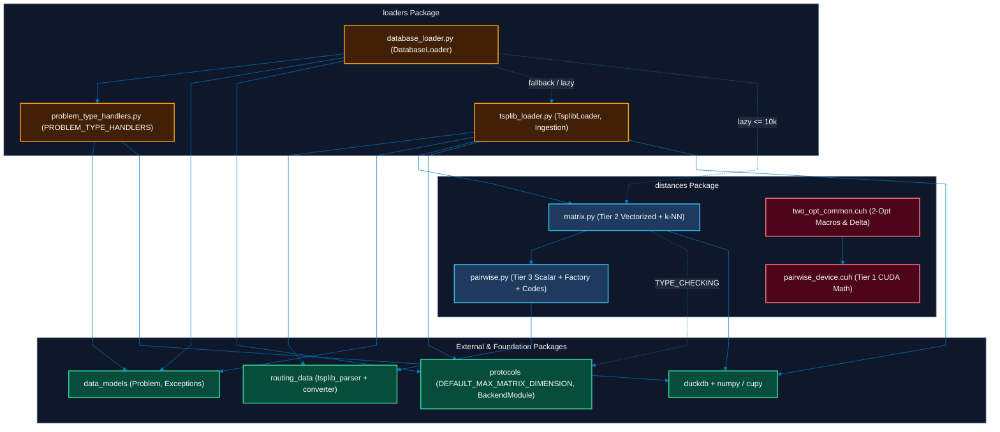
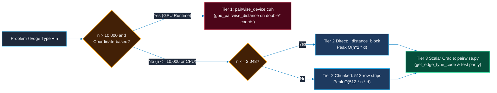

# Architecture Guide for `loaders` and `distances`

This guide documents the problem ingestion, database loading, and three-tier TSPLIB95 distance computation subsystems in `src/loaders/` and `src/distances/`.

---

## 1. Scope & Architectural Boundaries

`src/loaders/` and `src/distances/` form the **Problem Ingestion and Distance Metric Computation** layers that transform raw `.tsp` / `.vrp` / `.opt.tour` / `.sol` files and normalized DuckDB records into validated `Problem` instances (including `VRPConstraints` and `int32` TSPLIB95 `nint` BKS recomputation per `DP17-6`), dense `int32` distance matrices, $k$-NN candidate tables, and CUDA device primitives.

| Module | Role | Key Symbols |
| :--- | :--- | :--- |
| `src/loaders/problem_type_handlers.py` | Formulation-specific SQL & metadata extraction (`TSP`, `ATSP`, `CVRP`, `OVRP`, `DCVRP`) | [`ProblemTypeHandler`](../../src/loaders/problem_type_handlers.py), [`PROBLEM_TYPE_HANDLERS`](../../src/loaders/problem_type_handlers.py), [`ProblemMetadataRow`](../../src/loaders/problem_type_handlers.py) |
| `src/loaders/database_loader.py` | Context-managed DuckDB reader with `.tsp` fallback & eager threshold | [`DatabaseLoader`](../../src/loaders/database_loader.py) |
| `src/loaders/tsplib_loader.py` | `routing_data` ETL adapter, `.tsp` reader, and DuckDB batch ingestion | [`TsplibLoader`](../../src/loaders/tsplib_loader.py), [`parse_tsplib_file`](../../src/loaders/tsplib_loader.py), [`ingest_tsplib_directory_to_duckdb`](../../src/loaders/tsplib_loader.py) |
| `src/distances/pairwise.py` | Tier 3 scalar TSPLIB95 functions, factory lookup, `EDGE_TYPE_TO_CODE`, `BUG-32` patch | [`get_distance_function`](../../src/distances/pairwise.py), [`get_edge_type_code`](../../src/distances/pairwise.py), [`compute_geographical`](../../src/distances/pairwise.py) |
| `src/distances/matrix.py` | Tier 2 vectorized NumPy/CuPy matrix & chunked $k$-NN candidate builders | [`compute_distance_matrix`](../../src/distances/matrix.py), [`compute_candidate_list`](../../src/distances/matrix.py) |
| `src/distances/kernels/pairwise_device.cuh` | Tier 1 NVRTC-compiled `__device__` pairwise arithmetic (`0..8`) | [`pairwise_device.cuh::gpu_pairwise_distance`](../../src/distances/kernels/pairwise_device.cuh), [`pairwise_device.cuh::gpu_geo_radians`](../../src/distances/kernels/pairwise_device.cuh) |
| `src/distances/kernels/two_opt_common.cuh` | Shared 2-opt delta evaluator, tile accessors (`TOUR_AT`/`TOUR_SET`), thread selector | [`two_opt_common.cuh::two_opt_delta`](../../src/distances/kernels/two_opt_common.cuh), [`two_opt_common.cuh::two_opt_consider`](../../src/distances/kernels/two_opt_common.cuh) |

### Verified Export Surfaces and Package Quirks

1. **No `src/distances/factory.py` Module:** Unlike earlier pre-reorganization layouts, `src/distances/factory.py` **does not exist**. Both the callable distance factory ([`get_distance_function`](../../src/distances/pairwise.py)) and the CUDA integer enum mapper ([`get_edge_type_code`](../../src/distances/pairwise.py)) live directly in [`pairwise.py`](../../src/distances/pairwise.py).
2. **Partial Package-Root Re-Exports in `src/distances/__init__.py`:** [__init__.py](../../src/distances/__init__.py) exports only the 10 scalar distance functions and [`get_distance_function`](../../src/distances/pairwise.py). Callers needing [`compute_distance_matrix`](../../src/distances/matrix.py), [`compute_candidate_list`](../../src/distances/matrix.py), [`get_edge_type_code`](../../src/distances/pairwise.py), or [`EDGE_TYPE_TO_CODE`](../../src/distances/pairwise.py) import from `distances.matrix` or `distances.pairwise`.
3. **Edge-Type Coverage Discrepancy (`13` vs `10` vs `9`):** The docstring of [__init__.py](../../src/distances/__init__.py) refers to all 13 classical TSPLIB95 types, whereas:
   - [`pairwise.py::_DISTANCE_FUNCTION_MAP`](../../src/distances/pairwise.py) and [`matrix.py::_distance_block`](../../src/distances/matrix.py) implement **10** calculated types (`EUC_2D`, `EUC_3D`, `MAN_2D`, `MAN_3D`, `MAX_2D`, `MAX_3D`, `CEIL_2D`, `ATT`, `GEO`, `XRAY1`), while `EXPLICIT` uses stored matrices and `SPECIAL`/`XRAY2` raise explicit `ValueError`s.
   - [`pairwise.py::EDGE_TYPE_TO_CODE`](../../src/distances/pairwise.py) and `enum GpuEdgeTypeCode` in [`pairwise_device.cuh`](../../src/distances/kernels/pairwise_device.cuh) cover **9** coordinate metrics (`0..8`), excluding `XRAY1` (which uses Tier 2 `_xray_block` / Tier 3 `compute_xray1`), `EXPLICIT`, and `SPECIAL`.
4. **Upstream `routing_data` Delegation + Canonical `GEO` Patch:** Since `DP10-6` and `DP10-14`, `tsplib95` and duplicated DuckDB DDL are removed in favor of `routing-data` (`v0.2.0` via `pyproject.toml`), while [`pairwise.py::_to_radians_geo`](../../src/distances/pairwise.py) locally patches an upstream `routing_data` `GEO` degree-rounding defect (`BUG-32`).

---

## 2. Dependency Graph



*Dependency structure: `loaders/` coordinates `routing_data`, `duckdb`, `data_models`, `distances.matrix`, and `DEFAULT_MAX_MATRIX_DIMENSION`; `distances/` keeps runtime independence from `protocols` (`BackendModule` imported only under `TYPE_CHECKING`).*

---

## 3. Core Abstractions & Contracts

### 3.1 Polymorphic Handler Registry & DuckDB Loader (`src/loaders/`)

[`ProblemTypeHandler`](../../src/loaders/problem_type_handlers.py) decouples SQL table layouts (`tsp_problems`, `atsp_problems`, `cvrp_problems`) from [`DatabaseLoader`](../../src/loaders/database_loader.py):

```python
class ProblemTypeHandler(Protocol):
  problem_type: str
  def list_problems(self, conn: duckdb.DuckDBPyConnection) -> list[dict[str, Any]]: ...
  def load_metadata(self, conn: duckdb.DuckDBPyConnection, base: BaseProblemRow) -> ProblemMetadataRow: ...
```

*Source: [`problem_type_handlers.py::ProblemTypeHandler`](../../src/loaders/problem_type_handlers.py).*

- [`TspHandler`](../../src/loaders/problem_type_handlers.py), [`AtspHandler`](../../src/loaders/problem_type_handlers.py), and [`CvrpHandler`](../../src/loaders/problem_type_handlers.py) populate the global [`PROBLEM_TYPE_HANDLERS`](../../src/loaders/problem_type_handlers.py) dictionary (extensible at runtime via [`register_problem_type_handler`](../../src/loaders/problem_type_handlers.py)).
- [`ProblemMetadataRow`](../../src/loaders/problem_type_handlers.py) (`DP10-8`) replaces untyped metadata dictionaries between handlers and [`DatabaseLoader`](../../src/loaders/database_loader.py).
- [`DatabaseLoader`](../../src/loaders/database_loader.py) connects read-only to DuckDB inside `__enter__`. When `db_path` is absent and `fallback_tsp_dir` exists, it delegates cleanly to [`TsplibLoader`](../../src/loaders/tsplib_loader.py); otherwise it verifies existence *before* entering `try/except` so missing files raise [`DatabaseConnectionError`](../../src/data_models/exceptions.py) directly (`DP10-11`, `BUG-16`).

### 3.2 TSPLIB95 Parsing & DuckDB Ingestion (`tsplib_loader.py`)

[`tsplib_loader.py`](../../src/loaders/tsplib_loader.py) adapts `routing_data` into two complementary paths:
1. **Direct/File Loading (`parse_tsplib_file` $\to$ `bundle_to_problem`):** [`parse_tsplib_file`](../../src/loaders/tsplib_loader.py) invokes `FormatParser` and `ProblemNormalizer`, validating coordinate shapes against `expected_coordinate_dimension(edge_type)` (`2` or `3` for `EUC_3D`, `DP14-6`) into [`TsplibIngestionBundle`](../../src/loaders/tsplib_loader.py) ([`ProblemRowRecord`](../../src/loaders/tsplib_loader.py), [`NodeRowRecord`](../../src/loaders/tsplib_loader.py) with `z`, [`MatrixRowRecord`](../../src/loaders/tsplib_loader.py)). [`bundle_to_problem`](../../src/loaders/tsplib_loader.py) converts the bundle to a validated `Problem` and eagerly computes `distances` when `dimension <= DEFAULT_MAX_MATRIX_DIMENSION` (`10_000`, `DP11-3`).
2. **Batch Ingestion (`ingest_tsplib_directory_to_duckdb`):** [`ingest_tsplib_directory_to_duckdb`](../../src/loaders/tsplib_loader.py) creates or opens DuckDB via `routing_data`'s `DatabaseManager` (`DP10-14`), feeds `_problem_payload` for each `*.tsp` (skipping unsupported types/malformed files with warnings rather than aborting), and runs [`_ingest_opt_tour_solutions`](../../src/loaders/tsplib_loader.py) to parse `*.opt.tour` files and populate the `solutions` table (`cost` resolved directly or via `converter.utils.cost.compute_routes_cost`).

### 3.3 Three-Tier TSPLIB95 Distance Architecture (`src/distances/`)

To balance register speed at extreme scale ($n > 10{,}000$), vectorized batch throughput ($n \le 10{,}000$), and exact unit-test oracles without calling Python's `math` module in any hot loop, `src/distances/` is organized into three disjoint execution tiers (`DP10-13`, `DP10-19`):

| Tier | Module | Execution Medium | Primary Callers & Role |
| :--- | :--- | :--- | :--- |
| **Tier 1** | [`pairwise_device.cuh`](../../src/distances/kernels/pairwise_device.cuh), [`two_opt_common.cuh`](../../src/distances/kernels/two_opt_common.cuh) | Compiled CUDA `__device__ __forceinline__` | `cost_calculator.cu`, `two_opt_batch.cu`, `two_opt_multi_move.cu`, `two_opt_single.cu` |
| **Tier 2** | [`matrix.py`](../../src/distances/matrix.py) | Vectorized `xp` (`numpy` / `cupy`) array broadcast | `DatabaseLoader`, `TsplibLoader`, `ProblemContext.get_*_distances`, `compute_candidate_list` |
| **Tier 3** | [`pairwise.py`](../../src/distances/pairwise.py) | Scalar Python `math` (`routing_data` + `BUG-32` patch) | `get_edge_type_code` mapping before kernel launch, unit-test parity oracles |

Key contracts in [`pairwise.py`](../../src/distances/pairwise.py):
- [`PairwiseDistanceFn`](../../src/distances/pairwise.py) uses positional-only arguments `(coord1, coord2, /) -> int` so `routing_data` functions satisfy the protocol without wrapper boilerplate (`DP10-8`).
- [`EDGE_TYPE_TO_CODE`](../../src/distances/pairwise.py) assigns integers `0..8` (`EUC_2D: 0`, `EUC_3D: 1`, `MAN_2D: 2`, `MAN_3D: 3`, `MAX_2D: 4`, `MAX_3D: 5`, `CEIL_2D: 6`, `ATT: 7`, `GEO: 8`), verified bit-for-bit against `enum GpuEdgeTypeCode` in [`pairwise_device.cuh`](../../src/distances/kernels/pairwise_device.cuh) by `tests/distances/test_unit_gpu_pairwise_device.py`.

---

## 4. GoF Design Pattern Mapping

| Pattern (GoF) | Implementation in `loaders` / `distances` | Catalog Link |
| :--- | :--- | :--- |
| **Strategy + Registry** | `ProblemTypeHandler` protocol + `PROBLEM_TYPE_HANDLERS` mapping (`TSP`/`ATSP`/`CVRP`) + `register_problem_type_handler` | [Behavioral patterns](../../design-patterns-links.md#behavioral-patterns) |
| **Facade** | `DatabaseLoader` presenting a uniform `.load(name)` / `.list_problems()` interface over DuckDB tables, eager matrix materialization, and `TsplibLoader` fallback | [Structural patterns](../../design-patterns-links.md#structural-patterns) |
| **Adapter** | `tsplib_loader.py` translating `routing_data`'s `FormatParser` / `ProblemNormalizer` payloads into `Problem` and DuckDB `DatabaseManager` inputs | [Structural patterns](../../design-patterns-links.md#structural-patterns) |
| **Factory Method (Function)** | `get_distance_function(edge_weight_type)` and `get_edge_type_code(edge_weight_type)` dispatching metric implementations | [Creational patterns](../../design-patterns-links.md#creational-patterns) |
| **Bridge** | `compute_distance_matrix(..., xp=...)` and `compute_candidate_list(..., xp=...)` abstracting array execution across NumPy and CuPy | [Structural patterns](../../design-patterns-links.md#structural-patterns) |

---

## 5. Data/Execution Flow & Mathematical Models

### 5.1 Ingestion and Loading Pipeline

```mermaid
---
config:
  theme: base
  themeVariables:
    darkMode: true
    background: "#0F172A"
    mainBkg: "#1E293B"
    primaryColor: "#1E293B"
    primaryTextColor: "#F8FAFC"
    primaryBorderColor: "#38BDF8"
    secondaryColor: "#1E3A5F"
    secondaryTextColor: "#F8FAFC"
    tertiaryColor: "#172554"
    tertiaryTextColor: "#F8FAFC"
    lineColor: "#027BC2"
    textColor: "#F8FAFC"
    actorBkg: "#1E293B"
    actorBorder: "#38BDF8"
    actorTextColor: "#F8FAFC"
    actorLineColor: "#027BC2"
    signalColor: "#38BDF8"
    signalTextColor: "#F8FAFC"
    labelBoxBkgColor: "#1E293B"
    labelBoxBorderColor: "#818CF8"
    labelTextColor: "#F8FAFC"
    loopTextColor: "#F8FAFC"
    activationBkgColor: "#1E3A5F"
    activationBorderColor: "#38BDF8"
    noteBkgColor: "#334155"
    noteBorderColor: "#FBBF24"
    noteTextColor: "#F8FAFC"
    sequenceNumberColor: "#0F172A"
  sequence:
    diagramMarginX: 24
    diagramMarginY: 16
    actorMargin: 45
    boxMargin: 12
    noteMargin: 12
    messageMargin: 38
    mirrorActors: true
    wrap: true
---
sequenceDiagram
    participant Caller as CLI / Runner
    participant TLoader as tsplib_loader
    participant RData as routing_data (Parser/DB)
    participant DLoader as DatabaseLoader
    participant Handler as PROBLEM_TYPE_HANDLERS
    participant Matrix as distances.matrix

    rect rgb(24, 34, 54)
        Note over Caller,RData: Offline Ingestion Path
        Caller->>+TLoader: ingest_tsplib_directory_to_duckdb(dir, db)
        loop each *.tsp
            TLoader->>RData: FormatParser + ProblemNormalizer
            TLoader->>TLoader: _problem_payload (2D/3D validation)
            TLoader->>RData: DatabaseManager.insert_problem(payload)
        end
        TLoader->>RData: _ingest_opt_tour_solutions (parse_solution_file)
        deactivate TLoader

        Note over Caller,Matrix: Runtime Problem Loading Path
        Caller->>+DLoader: with DatabaseLoader(db) as loader: load(name)
        DLoader->>+Handler: load_metadata(conn, BaseProblemRow)
        Handler-->>-DLoader: ProblemMetadataRow
        DLoader->>DLoader: _load_coordinates (float64, 2D or 3D)
        DLoader->>DLoader: _load_distance_matrix (if EXPLICIT)
        opt EXPLICIT is False and n <= 10000
            DLoader->>+Matrix: compute_distance_matrix(coords, edge_type)
            Matrix-->>-DLoader: (n, n) int32 matrix
        end
        DLoader-->>-Caller: frozen Problem instance
    end
```



*End-to-end ingestion and loading flow enforcing `DP10-6`, `DP10-14`, `DP11-3`, and `DP14-6`.*

### 5.2 Three-Tier Distance Execution Dispatch



*Three-tier TSPLIB95 metric pipeline ensuring bit-identical integer weights across scalar validation, vectorized CPU/GPU matrix materialization, and register-level CUDA computation.*

### 5.3 Mathematical Models: TSPLIB95 Metrics, `GEO` Truncation, and Chunked Memory

All distance tiers enforce Reinelt's (1991, 1995) TSPLIB95 integer rounding operator $\operatorname{nint}(x) = \lfloor x + 0.5 \rfloor$ (`gpu_nint` in CUDA, `(int)(x + 0.5)` / `.astype(int64)` on non-negative distances in vectorized code) rather than Python/IEEE banker's rounding (`round()`):

- **Euclidean ($L_2$, `EUC_2D` / `EUC_3D`):** $d(u,v) = \operatorname{nint}\!\left(\sqrt{\sum_{k=1}^{D}(x_{u,k}-x_{v,k})^2}\right)$, $D \in \{2,3\}$.
- **Manhattan ($L_1$, `MAN_2D` / `MAN_3D`):** $d(u,v) = \operatorname{nint}\!\left(\sum_{k=1}^{D}\lvert x_{u,k}-x_{v,k}\rvert\right)$.
- **Maximum ($L_\infty$, `MAX_2D` / `MAX_3D`):** $d(u,v) = \max_{k=1..D}\operatorname{nint}\!\left(\lvert x_{u,k}-x_{v,k}\rvert\right)$ in Tier 1 (`pairwise_device.cuh`) and $\operatorname{nint}(\max_k \lvert \Delta x_k \rvert)$ in Tier 2 (`matrix.py`)—both coincide for integer or exact half-shift differences, though continuous fractional coordinates may differ at `.5` boundaries if axes are rounded before vs after `max`.
- **Ceiling Euclidean (`CEIL_2D`):** $d(u,v) = \left\lceil\sqrt{(x_u-x_v)^2 + (y_u-y_v)^2}\right\rceil$.
- **Pseudo-Euclidean (`ATT`):** with $r_{uv} = \sqrt{\frac{(x_u-x_v)^2 + (y_u-y_v)^2}{10}}$ and $t_{uv} = \operatorname{nint}(r_{uv})$,
  $$d(u,v) = \begin{cases} t_{uv} + 1, & \text{if } t_{uv} < r_{uv}, \\ t_{uv}, & \text{otherwise.} \end{cases}$$
- **Geographical (`GEO`, Canonical `BUG-32` Truncation):** coordinates in `DDD.MM` format are converted to radians with `PI = 3.141592` and `EARTH_RADIUS_KM = 6378.388` via **truncation toward zero** (`int(x)` / `xp.trunc(x)` / `(int)coord_val`):
  $$\text{deg}(x) = \operatorname{trunc}(x), \quad \text{min}(x) = x - \text{deg}(x), \quad \theta(x) = \frac{\pi_{\text{TSPLIB}}}{180}\left(\text{deg}(x) + \frac{5}{3}\text{min}(x)\right)$$
  $$d_{\text{GEO}}(u,v) = \left\lfloor R_E \arccos\!\left(\operatorname{clip}\!\left(\frac{(1+q_1)q_2 - (1-q_1)q_3}{2}, -1, 1\right)\right) + 1.0 \right\rfloor$$
  where $q_1 = \cos(\lambda_u - \lambda_v)$, $q_2 = \cos(\phi_u - \phi_v)$, $q_3 = \cos(\phi_u + \phi_v)$. Using `nint(x)` instead of `trunc(x)` corrupts any coordinate with fractional minutes $\ge 0.50$ (shifting `burma14` $d(1,3)$ from canonical **`510`** to `560`). Because identical points yield $1$ under $+ 1.0$, [`compute_distance_matrix`](../../src/distances/matrix.py) calls `xp.fill_diagonal(result, 0)` explicitly.
- **Crystallography (`XRAY1`, Tier 2/3 only):** wraps the $\phi$ axis modulo $360^\circ$:
  $$d_{\text{XRAY1}}(u,v) = \operatorname{trunc}\!\left(100 \cdot \max\!\left(\frac{\min(\lvert\Delta\phi\rvert, \lvert\lvert\Delta\phi\rvert - 360\rvert)}{s_x},\, \frac{\lvert\Delta\chi\rvert}{s_y},\, \frac{\lvert\Delta(2\theta)\rvert}{s_z}\right) + 0.5\right)$$

#### Chunked Broadcast and $k$-NN Memory Scaling (`DP10-16`, `DP10-20`, `BUG-13`)

Naive 2D broadcasting of coordinates `(n, d)` builds an intermediate `(n, n, d)` `float64` difference tensor ($8 n^2 d$ bytes; e.g., $1.6\text{ GB}$ at $n = 10{,}000, d = 2$). [`compute_distance_matrix`](../../src/distances/matrix.py) keeps direct broadcast for $n \le 2{,}048$ (`DEFAULT_CHUNK_THRESHOLD`) and switches to row strips of width $c = 512$ (`DEFAULT_CHUNK_SIZE`) above $2{,}048$:

$$
M_{\text{peak}}^{\text{matrix}}(n, d) =
\begin{cases}
\mathcal{O}(n^2 d), & n \le 2{,}048, \\
\mathcal{O}(512 \cdot n \cdot d + 4n^2), & n > 2{,}048.
\end{cases}
$$

Similarly, [`compute_candidate_list`](../../src/distances/matrix.py) constructs $\mathcal{N}_k \in \mathbb{Z}^{n \times k_{\text{eff}}}$ ($k_{\text{eff}} = \min(k, n-1)$) in strips of $c = 512$ rows using `xp.argpartition` (expected $\mathcal{O}(n)$ selection per row) followed by `xp.lexsort((candidate_columns, candidate_distances))` (tie-breaking by ascending distance then ascending node ID), yielding $\mathcal{O}(c \cdot n + n k_{\text{eff}})$ peak memory without materializing the full $(n, n)$ matrix when `distances=None`.

---

## 6. Cross-Cutting Concerns

- **NVRTC Header Injection (No `<math.h>`):** `src/utils/gpu_helpers.py` compiles `.cu` kernels with `-I<src/distances/kernels>`, allowing any strategy kernel to `#include "pairwise_device.cuh"` or `#include "two_opt_common.cuh"`. Because CuPy's NVRTC runtime ships no C++ standard headers, [`pairwise_device.cuh`](../../src/distances/kernels/pairwise_device.cuh) deliberately omits `#include <math.h>` and relies on NVRTC-predeclared `floor`, `sqrt`, `fabs`, `ceil`, `cos`, and `acos` over `double` (`float64`) coordinates.
- **`int64` Intermediate Sentinel Safety (`matrix.py`):** [`_distance_block`](../../src/distances/matrix.py) returns `int64` arrays (except `_xray_block`, which returns `int32`) so [`compute_candidate_list`](../../src/distances/matrix.py) can mask self-edges with `np.iinfo(np.int64).max` without overflowing `int32`, while [`compute_distance_matrix`](../../src/distances/matrix.py) downcasts the final output to `int32` (`DP10-12`).
- **Strict 2D/3D Coordinate Enforcement (`DP14-6`, `BUG-53`):** [`tsplib_loader.py`](../../src/loaders/tsplib_loader.py) and [`DatabaseLoader._load_coordinates`](../../src/loaders/database_loader.py) validate coordinate vector widths against `expected_coordinate_dimension(edge_type)` (`3` for `EUC_3D`, `2` otherwise), enforce `2`D for `display_coords`, reject `NaN`/`Inf` and `NULL` explicit matrices, and normalize arrays to C-contiguous `float64`.
- **Aligned Eager Threshold (`DP11-3`):** Both `DatabaseLoader(..., max_eager_matrix_dimension=DEFAULT_MAX_MATRIX_DIMENSION)` and `bundle_to_problem(..., max_eager_matrix_dimension=DEFAULT_MAX_MATRIX_DIMENSION)` share `10_000` with `ProblemContext`, eliminating the former $4{,}000 < n \le 10{,}000$ gray zone where loaders skipped materialization and forced `ProblemContext` to compute `(n, n)` inside timed loops.
- **Test Boundaries:**
  - `tests/loaders/`: [`test_integration_loaders.py`](../../tests/loaders/test_integration_loaders.py), [`test_unit_database_loader_errors.py`](../../tests/loaders/test_unit_database_loader_errors.py), [`test_unit_problem_type_handlers.py`](../../tests/loaders/test_unit_problem_type_handlers.py) test DuckDB roundtrips, `TsplibLoader` fallback, `BUG-16`, `BUG-53`, and `DP14-6` 3D ingestion.
  - `tests/distances/`: 8 unit test suites plus [`probe_pairwise.cu`](../../tests/distances/kernels/probe_pairwise.cu) verify all scalar metrics, `BUG-32` `burma14` parity, chunked vs direct matrix equivalence (`BUG-13`), $k$-NN candidate sorting (`DP10-20`), and bit-for-bit Tier 1–3 parity across `EDGE_TYPE_TO_CODE` `0..8`.

---

## 7. Extension Recipes

1. **Registering a New Problem Formulation (`ProblemTypeHandler`):**
   - Add the new formulation key to `VALID_PROBLEM_TYPES` in `src/data_models/problem.py`.
   - Implement a class satisfying [`ProblemTypeHandler`](../../src/loaders/problem_type_handlers.py) (`list_problems`, `load_metadata` returning [`ProblemMetadataRow`](../../src/loaders/problem_type_handlers.py)) and register it via [`register_problem_type_handler`](../../src/loaders/problem_type_handlers.py).
2. **Adding a New TSPLIB95 Edge Weight Type Across All Three Tiers:**
   - **Tier 3 ([`pairwise.py`](../../src/distances/pairwise.py)):** Add the scalar function to `_DISTANCE_FUNCTION_MAP` and assign the next integer code in [`EDGE_TYPE_TO_CODE`](../../src/distances/pairwise.py).
   - **Tier 2 ([`matrix.py`](../../src/distances/matrix.py)):** Add vectorized handling inside [`_distance_block`](../../src/distances/matrix.py) and `_VECTORIZED_TYPES`.
   - **Tier 1 ([`pairwise_device.cuh`](../../src/distances/kernels/pairwise_device.cuh)):** Add matching `GPU_EDGE_*` enum constant, `__device__ __forceinline__` function, and `switch` case inside [`pairwise_device.cuh::gpu_pairwise_distance`](../../src/distances/kernels/pairwise_device.cuh).
   - Add parity tests in [`test_unit_distance_matrix.py`](../../tests/distances/test_unit_distance_matrix.py) and [`test_unit_gpu_pairwise_device.py`](../../tests/distances/test_unit_gpu_pairwise_device.py).

---

## 8. Architectural Decision Records

| ID | Summary & Architectural Impact | Status | Correlation |
| :--- | :--- | :--- | :--- |
| `DP10-6` / `DP10-7` | Replaced `tsplib95` and duplicated parser/DDL code with pinned `routing-data` (`v0.2.0`) and `duckdb>=1.4.0`. | Accepted | [table-of-symbols.plan.md](../../documents_tcc/plan/table-of-symbols.plan.md#decisões-dp) |
| `DP10-8` | Typed `PairwiseDistanceFn` (`/` positional-only) and `ProblemMetadataRow` replacing raw `dict[str, Any]` bags. | Accepted | [table-of-symbols.plan.md](../../documents_tcc/plan/table-of-symbols.plan.md#decisões-dp) |
| `DP10-11` / `BUG-16` | `DatabaseLoader.__enter__` checks file existence before `try` to avoid masking `FileNotFoundError` under a generic exception wrapper. | Resolved | [table-of-symbols.plan.md](../../documents_tcc/plan/table-of-symbols.plan.md#decisões-dp) |
| `DP10-12` | Retained `int32` / DuckDB `INTEGER[][]` edge weights across the pipeline per TSPLIB95 integral semantics. | Accepted | [table-of-symbols.plan.md](../../documents_tcc/plan/table-of-symbols.plan.md#decisões-dp) |
| `DP10-13` / `BUG-32` | Scalar TSPLIB95 functions reside in `routing_data` (`converter.utils.cost`), with canonical `GEO` degree-truncation override in `pairwise.py`. | Resolved | [table-of-symbols.plan.md](../../documents_tcc/plan/table-of-symbols.plan.md#decisões-dp) |
| `DP10-14` | `routing_data` `DatabaseManager` owns 100% of corpus SQL DDL/upserts; `DatabaseLoader` owns domain hydration. | Accepted | [table-of-symbols.plan.md](../../documents_tcc/plan/table-of-symbols.plan.md#decisões-dp) |
| `DP10-16` / `BUG-13` | `compute_distance_matrix` uses direct 2D broadcast for $n \le 2048$ and 512-row chunked strips above $2048$. | Resolved | [table-of-symbols.plan.md](../../documents_tcc/plan/table-of-symbols.plan.md#decisões-dp) |
| `DP10-19` | `pairwise_device.cuh` provides on-the-fly CUDA register distance calculation for $n > 10{,}000$. | Accepted | [table-of-symbols.plan.md](../../documents_tcc/plan/table-of-symbols.plan.md#decisões-dp) |
| `DP10-20` | `compute_candidate_list` builds $\mathcal{N}_k \in \mathbb{Z}^{n \times k}$ in 512-row chunks via `argpartition` + `lexsort`. | Accepted | [table-of-symbols.plan.md](../../documents_tcc/plan/table-of-symbols.plan.md#decisões-dp) |
| `DP11-3` | Aligned loader `max_eager_matrix_dimension` with `ProblemContext` on `DEFAULT_MAX_MATRIX_DIMENSION = 10_000`. | Resolved | [table-of-symbols.plan.md](../../documents_tcc/plan/table-of-symbols.plan.md#fase-11-dp11) |
| `DP14-6` / `BUG-53` | Full 3D `(n, 3)` `EUC_3D` pipeline across `NodeRowRecord`, `tsplib_loader`, `DatabaseLoader`, and strict NULL/shape validation. | Resolved | [table-of-symbols.plan.md](../../documents_tcc/plan/table-of-symbols.plan.md#fase-14-dp14) |
