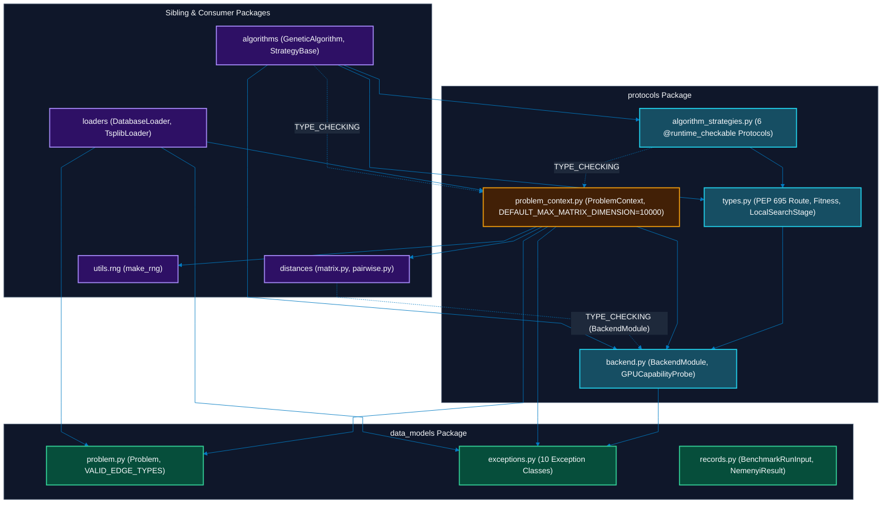
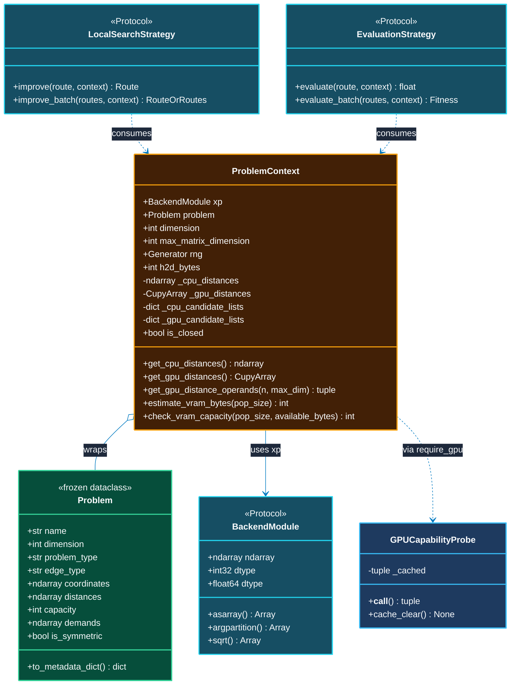

# Architecture Guide for `protocols` and `data_models`

This guide documents the architectural contracts, runtime invariants, memory models, and extension rules for the foundational layers `src/protocols/` and `src/data_models/` in `gpu_accelerated_clean`.

---

## 1. Scope & Architectural Boundaries

Together, `src/data_models/` and `src/protocols/` form the **Domain Model and Interface Contract Foundation** (Layers 1–2) on top of which `loaders/`, `distances/`, `algorithms/`, `benchmarking/`, and `cli/` operate.

| Package / Module | Responsibility | Key Exported & Internal Symbols |
| :--- | :--- | :--- |
| `src/data_models/` | Immutable problem value objects, TypedDict exchange schemas, and domain exceptions | [`Problem`](../../src/data_models/problem.py), [`exceptions.py`](../../src/data_models/exceptions.py), [`records.py`](../../src/data_models/records.py) |
| `src/protocols/types.py` | PEP 695 standardized array, seed, and stage type aliases | [`types.py`](../../src/protocols/types.py) (`SeedLike`, `Route`, `Routes`, `Fitness`, `LocalSearchStage`) |
| `src/protocols/backend.py` | NumPy/CuPy structural protocol and lazy CUDA capability probe | [`BackendModule`](../../src/protocols/backend.py), [`GPUCapabilityProbe`](../../src/protocols/backend.py), [`require_gpu`](../../src/protocols/backend.py) |
| `src/protocols/algorithm_strategies.py` | `@runtime_checkable` PEP 544 operator interfaces for the 6 GA slots | [`InitializationStrategy`](../../src/protocols/algorithm_strategies.py), [`LocalSearchStrategy`](../../src/protocols/algorithm_strategies.py), etc. |
| `src/protocols/problem_context.py` | Concrete lazy host/device problem data holder, cache owner, and VRAM estimator | [`ProblemContext`](../../src/protocols/problem_context.py), [`DEFAULT_MAX_MATRIX_DIMENSION`](../../src/protocols/problem_context.py) |

### Verified Export Surfaces and Boundary Anomalies

1. **Partial Re-Exports in `src/data_models/__init__.py`:** [__init__.py](../../src/data_models/__init__.py) exports only **6 symbols** (`Problem` and **5 of 10** exceptions: [`GPUUnavailableError`](../../src/data_models/exceptions.py), [`InstanceNotFoundError`](../../src/data_models/exceptions.py), [`InvalidEdgeTypeError`](../../src/data_models/exceptions.py), [`MissingCoordinatesError`](../../src/data_models/exceptions.py), [`ProblemLoaderError`](../../src/data_models/exceptions.py)). Five concrete exceptions ([`DatabaseConnectionError`](../../src/data_models/exceptions.py), [`InvalidProblemDataError`](../../src/data_models/exceptions.py), [`VRAMInsufficientError`](../../src/data_models/exceptions.py), [`DatabaseNotEmptyError`](../../src/data_models/exceptions.py), [`UnsupportedProblemTypeError`](../../src/data_models/exceptions.py)), the validation constants/helper ([`VALID_PROBLEM_TYPES`](../../src/data_models/problem.py), [`VALID_EDGE_TYPES`](../../src/data_models/problem.py), [`THREE_DIMENSIONAL_EDGE_TYPES`](../../src/data_models/problem.py), [`expected_coordinate_dimension`](../../src/data_models/problem.py)), and all of [`records.py`](../../src/data_models/records.py) must be imported from their submodules.
2. **Stale Error Text in `InvalidEdgeTypeError`:** [`InvalidEdgeTypeError`](../../src/data_models/exceptions.py) still formats `"Valid types: EUC_2D, GEO, ATT, EXPLICIT"`, omitting `EUC_3D` and `CEIL_2D` that [`VALID_EDGE_TYPES`](../../src/data_models/problem.py) accepts (`DP14-6`). Callers should treat `VALID_EDGE_TYPES` as authoritative.
3. **Benchmarking Coupling in `data_models/records.py`:** [`records.py`](../../src/data_models/records.py) defines [`NemenyiResult`](../../src/data_models/records.py), [`JsonPayload`](../../src/data_models/records.py), and [`BenchmarkRunInput`](../../src/data_models/records.py) (which mirrors `src/benchmarking/database/schema.sql` column-for-column) inside Layer 2 `data_models/` rather than `src/benchmarking/`. This avoids circular imports between `benchmarking/runner`, `benchmarking/database`, and `benchmarking/analysis`, at the cost of placing persistence-coupled schemas alongside problem domain models.
4. **Concrete Class Inside `src/protocols/`:** As documented in [`problem_context.py`](../../src/protocols/problem_context.py), [`ProblemContext`](../../src/protocols/problem_context.py) is a stateful concrete wrapper—not a PEP 544 `Protocol`—placed in `protocols/` for organizational symmetry with strategy signatures. Furthermore, [__init__.py](../../src/protocols/__init__.py) exports `ProblemContext`, all 6 `*Strategy` protocols, and 13 type aliases (`20` total), leaving [`BackendModule`](../../src/protocols/backend.py), [`require_gpu`](../../src/protocols/backend.py), [`gpu_available`](../../src/protocols/backend.py), [`cupy_backend`](../../src/protocols/backend.py), [`clear_gpu_cache`](../../src/protocols/backend.py), and [`DEFAULT_MAX_MATRIX_DIMENSION`](../../src/protocols/problem_context.py) to submodule imports.

---

## 2. Dependency Graph

`src/data_models/` has **zero** internal package imports (pure leaf layer depending only on standard library + `numpy`). `src/protocols/` bridges `data_models`, `distances`, and `utils.rng` without importing `loaders/` or `algorithms/`.



*Dependency architecture: `data_models` acts as a zero-dependency leaf; `ProblemContext` integrates `data_models`, `backend`, `distances`, and `utils.rng`, while `distances.matrix` references `BackendModule` solely under `TYPE_CHECKING` to avoid runtime cycles.*

---

## 3. Core Abstractions & Contracts

### 3.1 PEP 695 Domain Type Aliases (`types.py`)

[`types.py`](../../src/protocols/types.py) establishes non-generic PEP 695 `type` aliases (`DP-1`, `DP12-13`, `BUG-55`) separating host NumPy payloads from unchecked CuPy device handles (`CupyArray = Any`):

| Type Alias | Definition | Semantics & Shape Contract |
| :--- | :--- | :--- |
| [`SeedLike`](../../src/protocols/types.py) | `int \| Sequence[int] \| Generator \| Callable[[], Generator] \| None` | Reproducible seed specification accepted by `make_rng` |
| [`Route`](../../src/protocols/types.py) | `NDArray[np.int32]` | Single 1D tour `(n_cities,)` (`int32` node IDs) |
| [`Routes`](../../src/protocols/types.py) | `NDArray[np.int32]` | 2D batch/population `(N, n_cities)` (`int32`) |
| [`RouteOrRoutes`](../../src/protocols/types.py) | `Route \| Routes` | Polymorphic input enabling route/batch reuse |
| [`Fitness`](../../src/protocols/types.py) | `NDArray[np.float64]` | 1D tour costs `(N,)`; lower is better (`BUG-40`) |
| [`DistanceMatrix`](../../src/protocols/types.py) | `NDArray[np.int32] \| NDArray[np.float64]` | 2D `(n_cities, n_cities)` matrix (`int32` for TSPLIB95) |
| [`DeviceRoute`](../../src/protocols/types.py) / [`DeviceRoutes`](../../src/protocols/types.py) / [`DeviceFitness`](../../src/protocols/types.py) / [`DeviceDistanceMatrix`](../../src/protocols/types.py) | `CupyArray` (`Any`) | Explicit GPU-resident counterparts without false `ndarray` claims |
| [`LocalSearchStage`](../../src/protocols/types.py) | `Literal["post_crossover", "post_mutation", "post_evaluation", "post_evolution", "none"]` | Pipeline placement selector for `GeneticAlgorithm` |

### 3.2 Structural Strategy Protocols (`algorithm_strategies.py`)

Each evolutionary operator slot is governed by a `@runtime_checkable` PEP 544 `Protocol` in [`algorithm_strategies.py`](../../src/protocols/algorithm_strategies.py). Concrete strategy classes inherit from `StrategyBase` and structurally satisfy one of these protocols without nominal coupling (`GeneticAlgorithm` never imports concrete strategies):

| Protocol | Primary Batch Contract | Single-Route / Pair Contract |
| :--- | :--- | :--- |
| [`InitializationStrategy`](../../src/protocols/algorithm_strategies.py) | `initialize(customers, population_size, context) -> Routes` | — |
| [`SelectionStrategy`](../../src/protocols/algorithm_strategies.py) | `select_batch(routes, fitness, num_parents=None, context=None) -> Routes` | `select(population, fitness, context=None) -> Route` |
| [`CrossoverStrategy`](../../src/protocols/algorithm_strategies.py) | `crossover_batch(routes, context=None) -> RouteOrRoutes` | `crossover(parent1, parent2, context=None) -> Route` |
| [`MutationStrategy`](../../src/protocols/algorithm_strategies.py) | `mutate_batch(routes, mutation_rate, context=None) -> RouteOrRoutes` | `mutate(individual, mutation_rate, context=None) -> Route` |
| [`LocalSearchStrategy`](../../src/protocols/algorithm_strategies.py) | `improve_batch(routes, context) -> RouteOrRoutes` | `improve(route, context) -> Route` |
| [`EvaluationStrategy`](../../src/protocols/algorithm_strategies.py) | `evaluate_batch(routes, context) -> Fitness` | `evaluate(route, context) -> float` |

### 3.3 Backend Protocol and Lazy CUDA Capability Probe (`backend.py`)

[`BackendModule`](../../src/protocols/backend.py) declares the shared subset of NumPy and CuPy operations (constructors, element-wise math, reductions, and read-only dtype/constant `@property` members) returning `Array = NDArray[Any]` (`DP-1`). Module constants cannot satisfy writable protocol attributes, so `newaxis`, `ndarray`, `int32`, `int64`, `float64`, and `random` are declared as `@property` getters.

[`GPUCapabilityProbe`](../../src/protocols/backend.py) replaces earlier `@lru_cache` functions and monkey-patched `cache_clear` attributes (`DP10-8`) with a stateful typed callable instance `_probe_gpu`:

```python
class GPUCapabilityProbe:
  def __init__(self) -> None:
    self._cached: tuple[Any | None, GPUUnavailableError | None] | None = None

  def __call__(self) -> tuple[Any | None, GPUUnavailableError | None]:
    if self._cached is None:
      self._cached = self._probe()
    return self._cached

  @staticmethod
  def _probe() -> tuple[Any | None, GPUUnavailableError | None]:
    if importlib.util.find_spec("cupy") is None:
      return None, GPUUnavailableError("CuPy is not installed...")
    try:
      import cupy as cp
      count = cp.cuda.runtime.getDeviceCount()
      if count <= 0:
        return None, GPUUnavailableError("CUDA device unavailable...")
      return cp, None
    except Exception as exc:
      return None, GPUUnavailableError(f"CUDA device unavailable... ({exc}).")
```

*Source: [`backend.py::GPUCapabilityProbe`](../../src/protocols/backend.py).*

Notice three architectural guarantees (`DP9-1`, `DP9-2`, `DP9-3`):
- **Zero import-time CUDA probes:** `import protocols.backend` performs no GPU initialization (`import cupy` happens lazily inside `_probe()`).
- **Single failure contract:** Both missing `cupy` and absent/broken CUDA devices raise [`GPUUnavailableError`](../../src/data_models/exceptions.py) (`RuntimeError` subclass) from [`require_gpu`](../../src/protocols/backend.py), while [`gpu_available`](../../src/protocols/backend.py) and [`cupy_backend`](../../src/protocols/backend.py) convert that exception into `False` or `None`.
- **Deterministic test reset:** [`clear_gpu_cache`](../../src/protocols/backend.py) delegates to `_probe_gpu.cache_clear()` without `# type: ignore[attr-defined]`.

### 3.4 `ProblemContext` Lazy Cache & Operand Ownership (`problem_context.py`)

[`ProblemContext`](../../src/protocols/problem_context.py) wraps an immutable [`Problem`](../../src/data_models/problem.py) alongside a preferred `xp: BackendModule`, an independent `np.random.Generator` (`self.rng = make_rng(seed)` per `DP10-15`/`BUG-2`), and [`DEFAULT_MAX_MATRIX_DIMENSION`](../../src/protocols/problem_context.py) (`10_000`, `DP11-3`). All six lazy caches (`_cpu_distances`, `_gpu_distances`, `_cpu_demands`, `_gpu_demands`, `_cpu_coordinates`, `_gpu_coordinates`, plus `_cpu_candidate_lists` and `_gpu_candidate_lists`) start empty (`None` / `{}`).

Key contracts:
1. **Context-owned GPU caches (`DP10-17`, `BUG-14`):** [`ProblemContext.get_gpu_distances`](../../src/protocols/problem_context.py), [`ProblemContext.get_gpu_coordinates`](../../src/protocols/problem_context.py), [`ProblemContext.get_gpu_demands`](../../src/protocols/problem_context.py), and [`ProblemContext.get_gpu_candidate_list`](../../src/protocols/problem_context.py) resolve CuPy via `require_gpu()` rather than asserting `self.xp != np`. Consequently, a `ProblemContext(problem, xp=np)` passed to a hybrid CPU+GPU pipeline serves shared GPU buffers without forcing strategies to allocate private duplicate matrices.
2. **Pre-allocation VRAM check:** [`ProblemContext.get_gpu_distances`](../../src/protocols/problem_context.py) calls `_raise_if_insufficient(4 * self.dimension * self.dimension, self._query_free_vram_bytes(), ...)` *before* allocating the `(n, n)` `cp.int32` matrix so OOM conditions raise [`VRAMInsufficientError`](../../src/data_models/exceptions.py) rather than aborting inside CUDA.
3. **Single operand dispatcher (`DP10-19`):** [`ProblemContext.get_gpu_distance_operands`](../../src/protocols/problem_context.py) uses [`ProblemContext.uses_on_the_fly_distances`](../../src/protocols/problem_context.py) (`n > threshold and edge_type != "EXPLICIT" and coordinates is not None`) to return either `(d_distances, 0, 0)` or `(0, d_coords, edge_type_code)`.
4. **Shared candidate cache across repetitions (`BUG-59`):** Passing `candidate_cache: dict[int, np.ndarray]` into [`ProblemContext`](../../src/protocols/problem_context.py) lets benchmark runners amortize $\Theta(n^2)$ $k$-NN candidate construction across repetitions while keeping per-repetition context creation lightweight.
5. **Host-side topology check (`DP11-19`, `BUG-24`):** [`ProblemContext.is_closed`](../../src/protocols/problem_context.py) returns `self.problem.problem_type == "CVRP"`, avoiding D2H syncs or sample-poisoning caches in crossover/mutation.

### 3.5 Immutable `Problem` Value Object, Exceptions & Records (`src/data_models/`)

[`Problem`](../../src/data_models/problem.py) is a `@dataclass(frozen=True)` value object enforcing domain invariants inside [`Problem.__post_init__`](../../src/data_models/problem.py):
- `dimension > 0`, `problem_type in VALID_PROBLEM_TYPES` (`{"TSP", "ATSP", "CVRP"}`), `edge_type in VALID_EDGE_TYPES` (`{"EUC_2D", "EUC_3D", "CEIL_2D", "GEO", "ATT", "EXPLICIT"}`).
- `edge_type == "EXPLICIT"` requires non-null `distances` of shape `(dimension, dimension)`; all other edge types require `coordinates` of shape `(dimension, expected_coordinate_dimension(edge_type))`—`(n, 3)` for `EUC_3D` (`DP14-6`) and `(n, 2)` for 2D metrics—coerced via `np.ascontiguousarray(..., dtype=np.float64)` and checked with `np.isfinite`.
- `display_coords` (optional for `EXPLICIT`) must be finite `(dimension, 2)` `float64`.
- `CVRP` requires positive `capacity` and `demands` of shape `(dimension,)`.
- Custom [`Problem.__eq__`](../../src/data_models/problem.py) (`np.array_equal` across `_ARRAY_FIELDS`) and [`Problem.__hash__`](../../src/data_models/problem.py) (shape, dtype, `.tobytes()`) override default dataclass array comparison that previously raised `ValueError` / `TypeError` (`BUG-1`).

[`exceptions.py`](../../src/data_models/exceptions.py) separates **8 loader exceptions** rooted at [`ProblemLoaderError`](../../src/data_models/exceptions.py) ([`InstanceNotFoundError`](../../src/data_models/exceptions.py), [`InvalidEdgeTypeError`](../../src/data_models/exceptions.py), [`MissingCoordinatesError`](../../src/data_models/exceptions.py), [`DatabaseConnectionError`](../../src/data_models/exceptions.py), [`InvalidProblemDataError`](../../src/data_models/exceptions.py), [`DatabaseNotEmptyError`](../../src/data_models/exceptions.py), [`UnsupportedProblemTypeError`](../../src/data_models/exceptions.py)) from **2 hardware/runtime exceptions** deriving from `RuntimeError` ([`GPUUnavailableError`](../../src/data_models/exceptions.py), [`VRAMInsufficientError`](../../src/data_models/exceptions.py) storing `required_bytes` and `available_bytes`).

[`records.py`](../../src/data_models/records.py) defines [`NemenyiResult`](../../src/data_models/records.py), [`JsonPayload`](../../src/data_models/records.py), and [`BenchmarkRunInput`](../../src/data_models/records.py) (`22` required keys matching `NOT NULL` columns of `schema.sql` plus `21` `NotRequired` nullable fields — including `optimal_cost` and gap fields for unknown-optimum instances, `BUG-31`).

---

## 4. GoF Design Pattern Mapping

| Pattern (GoF / Fowler) | Implementation in `protocols` / `data_models` | Catalog Link |
| :--- | :--- | :--- |
| **Strategy** | Six PEP 544 protocols (`InitializationStrategy`..`EvaluationStrategy`) decoupling `GeneticAlgorithm` from concrete CPU/GPU operators | [Behavioral patterns](../../design-patterns-links.md#behavioral-patterns) |
| **Bridge** | `BackendModule` protocol separating array-algorithm intent from NumPy vs CuPy concrete execution | [Structural patterns](../../design-patterns-links.md#structural-patterns) |
| **Proxy / Virtual Lazy Cache** | `ProblemContext` deferring $O(n^2)$ matrix computation, H2D uploads, and $k$-NN indexing until explicit `get_*()` access | [Structural patterns](../../design-patterns-links.md#structural-patterns) |
| **Singleton (Module Probe)** | `_probe_gpu = GPUCapabilityProbe()` caching CUDA/CuPy availability once per process until `clear_gpu_cache()` | [Creational patterns](../../design-patterns-links.md#creational-patterns) |
| **Dependency Injection** | `GeneticAlgorithm` accepts `ProblemContext` and 6 strategy instances without instantiating backends internally | [Behavioral patterns](../../design-patterns-links.md#behavioral-patterns) |
| **Value Object** | Frozen `Problem` dataclass with structural normalization and content-based `__eq__` / `__hash__` (`BUG-1`) | [Structural patterns](../../design-patterns-links.md#structural-patterns) |

---

## 5. Data/Execution Flow & Mathematical Models

### 5.1 Structural Class Model



*Static structure of `Problem`, `ProblemContext`, `BackendModule`, `GPUCapabilityProbe`, and representative `Protocol` consumers.*

### 5.2 Lazy GPU Operand Resolution & VRAM Guardrail Flow

```mermaid
---
config:
  theme: base
  themeVariables:
    darkMode: true
    background: "#0F172A"
    mainBkg: "#1E293B"
    primaryColor: "#1E293B"
    primaryTextColor: "#F8FAFC"
    primaryBorderColor: "#38BDF8"
    secondaryColor: "#1E3A5F"
    secondaryTextColor: "#F8FAFC"
    tertiaryColor: "#172554"
    tertiaryTextColor: "#F8FAFC"
    lineColor: "#027BC2"
    textColor: "#F8FAFC"
    actorBkg: "#1E293B"
    actorBorder: "#38BDF8"
    actorTextColor: "#F8FAFC"
    actorLineColor: "#027BC2"
    signalColor: "#38BDF8"
    signalTextColor: "#F8FAFC"
    labelBoxBkgColor: "#1E293B"
    labelBoxBorderColor: "#818CF8"
    labelTextColor: "#F8FAFC"
    loopTextColor: "#F8FAFC"
    activationBkgColor: "#1E3A5F"
    activationBorderColor: "#38BDF8"
    noteBkgColor: "#334155"
    noteBorderColor: "#FBBF24"
    noteTextColor: "#F8FAFC"
    sequenceNumberColor: "#0F172A"
  sequence:
    diagramMarginX: 24
    diagramMarginY: 16
    actorMargin: 45
    boxMargin: 12
    noteMargin: 12
    messageMargin: 38
    mirrorActors: true
    wrap: true
---
sequenceDiagram
    participant Strategy as GPU Strategy (Eval / 2-Opt)
    participant Ctx as ProblemContext
    participant Probe as require_gpu()
    participant Dist as distances.matrix
    participant Dev as CUDA Device VRAM

    rect rgb(24, 34, 54)
        Strategy->>+Ctx: get_gpu_distance_operands(n, max_matrix_dimension)
        Ctx->>Ctx: uses_on_the_fly_distances(n, threshold)
        alt n > threshold and edge_type != "EXPLICIT" and coords != None
            Ctx->>+Probe: require_gpu()
            Probe-->>-Ctx: cupy module
            Ctx->>Ctx: check _gpu_coordinates cache
            opt cache miss
                Ctx->>Dev: cp.asarray(coordinates, float64)
            end
            Ctx-->>Strategy: (0, d_coords, edge_type_code)
        else Dense matrix path (n <= threshold or EXPLICIT)
            Ctx->>+Probe: require_gpu()
            Probe-->>-Ctx: cupy module
            opt _gpu_distances is None
                Ctx->>Dev: mem_info (free_bytes)
                Ctx->>Ctx: _raise_if_insufficient(4 * n^2, free_bytes)
                alt _cpu_distances or problem.distances exists
                    Ctx->>Dev: cp.asarray(source, dtype=cp.int32)
                else compute from coordinates
                    Ctx->>+Dist: compute_distance_matrix(coords_gpu, edge_type, cp)
                    Dist-->>-Ctx: (n, n) int32 matrix
                end
            end
            Ctx-->>-Strategy: (d_distances, 0, 0)
        end
    end
```



*Runtime decision path in [`ProblemContext.get_gpu_distance_operands`](../../src/protocols/problem_context.py) separating $\mathcal{O}(n)$ coordinate residency from $\mathcal{O}(n^2)$ dense matrix residency.*

### 5.3 VRAM Capacity Mathematical Model

[`ProblemContext.estimate_vram_bytes`](../../src/protocols/problem_context.py) models the VRAM footprint (in bytes) required to evolve a population of $P = \text{pop\_size}$ tours of $n = \text{dimension}$ cities with coordinate width $d \in \{2, 3\}$ (or $d = 1$ fallback when no 2D coordinate matrix exists):

$$
B_{\text{VRAM}}(n, P, d) =
\begin{cases}
4n^2 + 12Pn + 24P + 8dn, & \text{if } n \le n_{\max} \text{ or } \text{edge\_type} = \texttt{"EXPLICIT"}, \\
12Pn + 24P + 8dn, & \text{if } n > n_{\max} \text{ and } \text{coordinates} \ne \text{None},
\end{cases}
$$

where $n_{\max} = \texttt{DEFAULT\_MAX\_MATRIX\_DIMENSION} = 10{,}000$ (`DP10-19`, `DP11-3`):
- **$4n^2$ (`int32` distance matrix):** $n \times n$ matrix at 4 bytes/entry ($400\text{ MB}$ at $n = 10{,}000$; eliminated in on-the-fly mode).
- **$12Pn$ (population buffers):** three `(P, n)` `int32` device arrays (current population, offspring, and scratch/parents) at $4\text{ B}$ each.
- **$24P$ (fitness buffers):** three `(P,)` 8-byte `int64`/`float64` fitness/cost buffers.
- **$8dn$ (coordinate buffer):** `(n, d)` `float64` coordinates (`Problem.__post_init__` normalizes coordinates to `float64`), defaulting `components = 1` when `coordinates` is `None` or 1D (`_coordinate_bytes()`).
- **Optional $k$-NN candidate table (`DP10-20`):** when a strategy invokes [`ProblemContext.get_gpu_candidate_list`](../../src/protocols/problem_context.py), it adds $4 n \cdot \min(k, n - 1)$ bytes for the `int32` candidate matrix $\mathcal{N}_k$.

On a $4\text{ GiB}$ GTX 1050 Mobile, dropping the $4n^2$ matrix above $n = 10{,}000$ shifts peak problem storage from quadratic ($\approx 900\text{ MB}$ at $n = 15{,}000$) to linear ($\approx 240\text{ KB}$ for 2D `float64` coordinates at $n = 15{,}000$), enabling execution of large TSPLIB95 instances without triggering `VRAMInsufficientError` (Rocki & Suda, 2012; O'Neil & Burtscher, 2015).

---

## 6. Cross-Cutting Concerns

- **Strict Typing (`mypy --strict`):** [`pyproject.toml`](../../pyproject.toml) enforces `strict = true` on Python 3.12 while ignoring missing stubs for `cupy.*`. Using `Array = NDArray[Any]` and `CupyArray = Any` prevents cascade generics (`DP-1`) while keeping `Route`, `Routes`, and `Fitness` (`float64`) strictly typed at host boundaries.
- **Exception Semantics:** Loader failures inherit from [`ProblemLoaderError`](../../src/data_models/exceptions.py) so callers can catch ingestion faults uniformly, whereas hardware/memory faults ([`GPUUnavailableError`](../../src/data_models/exceptions.py), [`VRAMInsufficientError`](../../src/data_models/exceptions.py)) inherit from `RuntimeError` so GPU strategies fail loudly rather than silently degrading to CPU (`DP9-2`).
- **RNG Isolation (`DP10-15`, `BUG-2`):** `ProblemContext.rng` is always a `numpy.random.Generator` created via `make_rng(seed)`, supporting integer seeds, `list[int]` `SeedSequence` hierarchies, existing generators, or factories.
- **Test Boundaries:**
  - `tests/protocols/`: [`test_unit_gpu_capability.py`](../../tests/protocols/test_unit_gpu_capability.py), [`test_unit_problem_context.py`](../../tests/protocols/test_unit_problem_context.py), [`test_unit_problem_context_gpu_distances.py`](../../tests/protocols/test_unit_problem_context_gpu_distances.py), [`test_unit_problem_context_gpu_guards.py`](../../tests/protocols/test_unit_problem_context_gpu_guards.py) verify lazy loading, `BUG-14`/`BUG-59` cache sharing, VRAM estimates, and `GPUUnavailableError` fail-loud semantics.
  - `tests/data_models/`: [`test_unit_exceptions.py`](../../tests/data_models/test_unit_exceptions.py), [`test_unit_problem_metadata.py`](../../tests/data_models/test_unit_problem_metadata.py), [`test_unit_problem_validation.py`](../../tests/data_models/test_unit_problem_validation.py), [`test_unit_records.py`](../../tests/data_models/test_unit_records.py) verify frozen equality/hashing (`BUG-1`), 3D `EUC_3D` shapes (`DP14-6`), and `BenchmarkRunInput.__required_keys__` alignment with `schema.sql` (`BUG-31`).
  - [`conftest.py`](../../tests/conftest.py) auto-skips `@pytest.mark.gpu` tests whenever `gpu_available()` is `False`.

---

## 7. Extension Recipes

1. **Adding a New Evolutionary Strategy Slot Protocol:**
   - Define a `@runtime_checkable` `Protocol` in [`algorithm_strategies.py`](../../src/protocols/algorithm_strategies.py) accepting `RouteOrRoutes` and optional/required `ProblemContext`, then re-export it in [__init__.py](../../src/protocols/__init__.py).
   - Ensure the concrete class inherits from `StrategyBase` in `src/algorithms/strategies/base.py` so telemetry and `warmup(context)` work uniformly.
2. **Adding a New Coordinate Dimensionality or Edge Weight Type:**
   - Add the identifier to [`VALID_EDGE_TYPES`](../../src/data_models/problem.py) (and [`THREE_DIMENSIONAL_EDGE_TYPES`](../../src/data_models/problem.py) if 3D) so [`expected_coordinate_dimension`](../../src/data_models/problem.py) enforces exact shape `(dimension, d)` in [`Problem.__post_init__`](../../src/data_models/problem.py).
   - Update [`InvalidEdgeTypeError`](../../src/data_models/exceptions.py) error text alongside distance tier implementations (`src/distances/`).
3. **Extending `BenchmarkRunInput` for New Telemetry Columns:**
   - Add new nullable fields as `NotRequired[T | None]` in [`BenchmarkRunInput`](../../src/data_models/records.py) matching `src/benchmarking/database/schema.sql`, and update `OPTIONAL_FIELDS` / `FULL_PAYLOAD` in [`test_unit_records.py`](../../tests/data_models/test_unit_records.py) (`BUG-31`).

---

## 8. Architectural Decision Records

| ID | Summary & Architectural Impact | Status | Correlation |
| :--- | :--- | :--- | :--- |
| `DP-1` | Non-generic `BackendModule` returning `Array` (`NDArray[Any]`) avoids cascading `TypeVar` generics across NumPy/CuPy boundaries. | Accepted | [table-of-symbols.plan.md](../../documents_tcc/plan/table-of-symbols.plan.md#decisões-dp) |
| `DP9-1`–`DP9-3` | Centralized GPU probe in `protocols.backend`, lazy CuPy imports, and `GPUUnavailableError(RuntimeError)` fail-loud semantics. | Accepted | [table-of-symbols.plan.md](../../documents_tcc/plan/table-of-symbols.plan.md#decisões-dp) |
| `DP10-8` | Typed `GPUCapabilityProbe` class replacing `@lru_cache` + `# type: ignore` `cache_clear` patches. | Accepted | [table-of-symbols.plan.md](../../documents_tcc/plan/table-of-symbols.plan.md#decisões-dp) |
| `DP10-15` / `BUG-2` | Standardized `ProblemContext.rng` on `np.random.Generator` via `make_rng(seed)`. | Resolved | [table-of-symbols.plan.md](../../documents_tcc/plan/table-of-symbols.plan.md#decisões-dp) |
| `DP10-17` / `BUG-14` | `ProblemContext.get_gpu_*` resolves `cp = require_gpu()` directly, eliminating duplicate VRAM allocations in hybrid runs. | Resolved | [table-of-symbols.plan.md](../../documents_tcc/plan/table-of-symbols.plan.md#decisões-dp) |
| `DP10-19` | On-the-fly coordinate distance dispatch and pre-allocation `VRAMInsufficientError` checks above `max_matrix_dimension`. | Accepted | [table-of-symbols.plan.md](../../documents_tcc/plan/table-of-symbols.plan.md#decisões-dp) |
| `DP10-20` / `BUG-59` | Shared $k$-NN candidate list caching (`get_cpu_candidate_list`, `get_gpu_candidate_list`) with caller-injected `candidate_cache`. | Resolved | [table-of-symbols.plan.md](../../documents_tcc/plan/table-of-symbols.plan.md#decisões-dp) |
| `DP11-3` | Unified `DEFAULT_MAX_MATRIX_DIMENSION = 10_000` shared across `ProblemContext`, `DatabaseLoader`, and `TsplibLoader`. | Resolved | [table-of-symbols.plan.md](../../documents_tcc/plan/table-of-symbols.plan.md#fase-11-dp11) |
| `DP14-6` | Full `(n, 3)` `EUC_3D` validation and C-contiguous finite `float64` normalization in `Problem.__post_init__`. | Resolved | [table-of-symbols.plan.md](../../documents_tcc/plan/table-of-symbols.plan.md#fase-14-dp14) |
| `BUG-1` | Content-based `Problem.__eq__` and `Problem.__hash__` using `np.array_equal` and byte digests. | Resolved | [table-of-symbols.plan.md](../../documents_tcc/plan/table-of-symbols.plan.md#defeitos-bug) |
