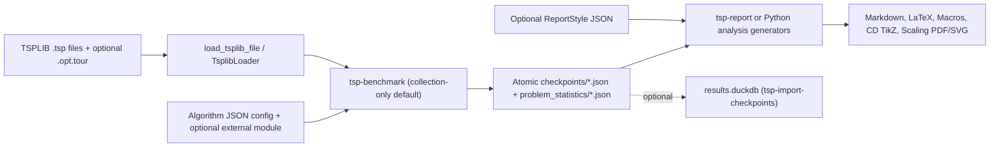

# Getting Started — Modular Evolutionary TSP Solver

This guide walks through the full workflow of the framework as a general-purpose library and CLI benchmark suite: loading `.tsp` problems directly, composing built-in operators and generational pipelines, **authoring custom strategies and pipeline steps without editing `src/`**, executing multi-repetition benchmarks, and generating composable styled reports.

For reproducing the dissertation Chapter 4 study, see the separate [Thesis Chapter 4 Reproduction Guide](./guide-thesis-reproduction.md).

## 1. Workflow Overview

Benchmark collection and report rendering are decoupled around atomic JSON checkpoints, and DuckDB is strictly optional on both input and output:



## 2. Installation

Requirements:

- Python `>= 3.12`
- [`uv`](https://docs.astral.sh/uv/) and `git` (fetches the public TSPLIB parser `routing-data` at tag `v0.2.0` from GitHub)
- Optional: NVIDIA GPU (Compute Capability `>= 5.0`) + CUDA 12.x driver for `use_gpu: true` strategies

```bash
git clone https://github.com/lucasgaldinos/tsp_gpu_clean.git
cd tsp_gpu_clean
uv sync
```

Confirm the installation on CPU (no GPU required):

```bash
uv run pytest -q -m "not gpu and not slow"
```

## 3. Loading TSPLIB `.tsp` Files Directly (No Database Required)

Use [`load_tsplib_file`](../src/loaders/tsplib_loader.py) for a single file or [`TsplibLoader`](../src/loaders/tsplib_loader.py) for a directory of `.tsp` files. If a sibling `<name>.opt.tour` file exists in the same folder, [`resolve_opt_tour_cost`](../src/loaders/tsplib_loader.py) automatically computes its canonical TSPLIB95 tour length; otherwise optimal cost stays `None` and downstream statistics/reports fall back cleanly to raw tour cost.

```python
from loaders import load_tsplib_file, resolve_opt_tour_cost

problem = load_tsplib_file("tests/fixtures/tsp/berlin52.tsp")
optimal = resolve_opt_tour_cost("tests/fixtures/tsp/berlin52.tsp")

print(problem.name, problem.dimension, problem.edge_type, "optimal:", optimal)
```

Supported TSPLIB95 `EDGE_WEIGHT_TYPE` formats include `EUC_2D`, `EUC_3D`, `CEIL_2D`, `GEO`, `ATT`, and `EXPLICIT` (`FULL_MATRIX`, `UPPER_ROW`, `LOWER_ROW`, `UPPER_DIAG_ROW`, `LOWER_DIAG_ROW`).

## 4. Composing Built-In Strategies & Pipelines in Python

[`GeneticAlgorithm`](../src/algorithms/metaheuristics/genetic_algorithm.py) uses explicit dependency injection across six operator slots. Every slot has CPU and/or CUDA implementations in [`src/algorithms/strategies/`](../src/algorithms/strategies/__init__.py):

- **Initialization:** `InitializationRandom`, `InitializationNearestNeighbor`
- **Selection:** `SelectionTournament`, `SelectionRouletteWheel`, `SelectionGPUTournament`
- **Crossover:** `CrossoverOrder`, `CrossoverPartiallyMapped`, `CrossoverGPUOrder`
- **Mutation:** `MutationSwap`, `MutationInversion`, `MutationGPUSwap`, `MutationGPUInversion`
- **Local Search:** `LocalSearchCPUTwoOpt` (`mode="first" | "best" | "multi_move"`), `LocalSearchGPUTwoOpt` (`mode="naive" | "batch"`), `LocalSearchNoOp`
- **Evaluation:** `EvaluationCPUCost`, `EvaluationGPUCost`

Within each generation, you can either pick a built-in `local_search_stage` (`"post_crossover"`, `"post_mutation"`, `"post_evaluation"`, `"post_evolution"`, `"none"`) or pass custom steps from [`src/algorithms/pipeline_steps.py`](../src/algorithms/pipeline_steps.py) (`PostInitLocalSearchStep`, `EliteOnlyLocalSearchStep`, `PeriodicLocalSearchStep`). See [Local Search Pipeline Stages](./guide-local-search-pipeline-stages.md) for the exact execution order of every stage anchor (`pre_selection`, `pre_evaluation`, `post_survival`).

```python
import numpy as np

from algorithms import GeneticAlgorithm
from algorithms.pipeline_steps import PeriodicLocalSearchStep, PostInitLocalSearchStep
from algorithms.strategies import (
  CrossoverOrder,
  EvaluationCPUCost,
  InitializationRandom,
  LocalSearchCPUTwoOpt,
  MutationInversion,
  SelectionRouletteWheel,
)
from loaders import load_tsplib_file
from protocols.problem_context import ProblemContext

problem = load_tsplib_file("tests/fixtures/tsp/berlin52.tsp")
context = ProblemContext(problem, xp=np, seed=42)

two_opt = LocalSearchCPUTwoOpt(mode="multi_move", max_iterations=10, candidate_k=20)
evaluator = EvaluationCPUCost()

ga = GeneticAlgorithm(
  population_size=128,
  mutation_rate=0.05,
  seed=42,
  initialization=InitializationRandom(seed=42),
  selection=SelectionRouletteWheel(seed=42),
  crossover=CrossoverOrder(seed=42),
  mutation=MutationInversion(seed=42),
  local_search=two_opt,
  evaluation=evaluator,
  local_search_stage="none",
  pipeline=[
    PostInitLocalSearchStep(local_search=two_opt, evaluation=evaluator),
    PeriodicLocalSearchStep(local_search=two_opt, interval=5, target="offspring"),
  ],
)

best_tour, stats = ga.evolve(
  context=context,
  customers=list(range(problem.dimension)),
  max_generations=40,
)
print(f"Best fitness: {stats['best_fitness']:.2f} | generations: {stats['generations_completed']}")
```

## 5. Adding Custom Strategies & Pipeline Steps Without Modifying `src/`

Because `GeneticAlgorithm` depends on PEP 544 `@runtime_checkable` `Protocol` interfaces ([`src/protocols/algorithm_strategies.py`](../src/protocols/algorithm_strategies.py)) and [`GenerationStep`](../src/algorithms/metaheuristics/genetic_algorithm.py), you never need to edit files inside `src/` to experiment with a new mutation, crossover, local search, or generational step.

### Step A — Write your custom strategy and pipeline step in your own file

Suppose you create `my_ops.py` in your workspace (outside `src/`):

```python
# my_ops.py (lives in your own experiment folder, outside src/)
from __future__ import annotations

from typing import Any

import numpy as np

from algorithms.strategies import StrategyBase


class ScrambleMutation(StrategyBase):
  """Custom MutationStrategy that shuffles a random contiguous tour slice."""

  def __init__(self, max_span: int = 6, seed: int | None = None) -> None:
    super().__init__(seed=seed)
    self.max_span = max_span

  def mutate(self, individual: Any, mutation_rate: float, context: Any = None) -> Any:
    del context
    route = np.array(individual, copy=True)
    if self.rng.random() >= mutation_rate or route.size < 3:
      return route
    span = int(self.rng.integers(2, min(self.max_span, route.size) + 1))
    start = int(self.rng.integers(0, route.size - span + 1))
    segment = route[start : start + span].copy()
    self.rng.shuffle(segment)
    route[start : start + span] = segment
    return route

  def mutate_batch(self, routes: Any, mutation_rate: float, context: Any = None) -> Any:
    arr = np.asarray(routes)
    if arr.ndim == 1:
      return self.mutate(arr, mutation_rate, context)
    out = arr.copy()
    for i in range(out.shape[0]):
      out[i] = self.mutate(out[i], mutation_rate, context)
    return out


class BestOnlyLocalSearchStep:
  """Custom GenerationStep refining only the single best survivor every `interval` generations."""

  stage_anchor = "post_survival"

  def __init__(self, local_search: Any, evaluation: Any, interval: int = 5) -> None:
    self.local_search = local_search
    self.evaluation = evaluation
    self.interval = interval

  def public_params(self) -> dict[str, Any]:
    return {"interval": self.interval}

  def strategies(self) -> list[Any]:
    return [self.local_search, self.evaluation]

  def run(self, state: Any, timer: Any) -> None:
    if state.generation % self.interval != 0:
      return
    best_idx = int(np.argmin(state.fitness))
    refined = timer.measure(
      "local_search",
      self.local_search.improve_batch,
      state.population[best_idx : best_idx + 1],
      state.context,
    )
    refined_cost = timer.measure(
      "evaluation",
      self.evaluation.evaluate_batch,
      refined,
      state.context,
    )
    if float(refined_cost[0]) < float(state.fitness[best_idx]):
      state.population[best_idx] = refined[0]
      state.fitness[best_idx] = refined_cost[0]
```

> [!TIP]
> Subclassing [`StrategyBase`](../src/algorithms/strategies/base.py) gives your custom operator a deterministic `self.rng` (seeded automatically by `AlgorithmConfig.instantiate`) plus telemetry counters (`h2d_bytes`, `d2h_bytes`, `kernel_launches`). Any plain class implementing the required protocol methods also works via structural subtyping.

### Option 1 — Direct Python injection into `GeneticAlgorithm`

```python
import numpy as np

from algorithms import GeneticAlgorithm
from algorithms.strategies import (
  CrossoverOrder,
  EvaluationCPUCost,
  InitializationRandom,
  LocalSearchCPUTwoOpt,
  SelectionTournament,
)
from loaders import load_tsplib_file
from my_ops import BestOnlyLocalSearchStep, ScrambleMutation
from protocols.problem_context import ProblemContext

problem = load_tsplib_file("tests/fixtures/tsp/berlin52.tsp")
context = ProblemContext(problem, xp=np, seed=42)
ls = LocalSearchCPUTwoOpt(mode="first", max_iterations=10, candidate_k=20)
ev = EvaluationCPUCost()

ga = GeneticAlgorithm(
  population_size=64,
  mutation_rate=0.1,
  seed=42,
  initialization=InitializationRandom(seed=42),
  selection=SelectionTournament(k=5, seed=42),
  crossover=CrossoverOrder(seed=42),
  mutation=ScrambleMutation(max_span=8, seed=42),
  local_search=ls,
  evaluation=ev,
  local_search_stage="none",
  pipeline=[BestOnlyLocalSearchStep(local_search=ls, evaluation=ev, interval=5)],
)
best_tour, stats = ga.evolve(context, list(range(problem.dimension)), max_generations=30)
```

### Option 2 — Runtime registration for Python benchmark scripts

When orchestrating multi-repetition experiments in Python via [`run_comprehensive_benchmark`](../src/benchmarking/runner/orchestration.py), register your external classes at startup with [`register_strategy`](../src/algorithms/strategies/__init__.py) and [`register_pipeline_step`](../src/algorithms/pipeline_steps.py):

```python
from algorithms import register_pipeline_step, register_strategy
from benchmarking import run_comprehensive_benchmark
from my_ops import BestOnlyLocalSearchStep, ScrambleMutation

register_strategy("ScrambleMutation", ScrambleMutation)
register_pipeline_step("BestOnlyLocalSearchStep", BestOnlyLocalSearchStep)

results = run_comprehensive_benchmark(
  algorithms_config="my_registered_experiment.json",
  tsp_dir="tests/fixtures/tsp",
  output_dir="/tmp/my_registered_run",
  repetitions=5,
  max_generations=30,
)
```

### Option 3 — Dynamic `"module"` loading directly from JSON & `tsp-benchmark` CLI

To benchmark custom external classes directly from the CLI without writing any wrapper script, include `"module"` alongside `"class"` in your algorithm JSON config (validated by [`configs/schemas/algorithms.schema.json`](../configs/schemas/algorithms.schema.json)). `"module"` accepts **either** a dotted Python module path (e.g., `"my_experiment.my_ops"`) **or** a `.py` file path relative to `algorithms.json` (e.g., `"../my_ops.py"`), so experiments living inside hyphenated directories require neither `PYTHONPATH` nor packaging (`DP16-3`, `BUG-104`):

```json
{
  "$schema": "./algorithms.schema.json",
  "default_params": { "population_size": 64, "mutation_rate": 0.1, "seed": 42 },
  "algorithm_configs": {
    "CustomScrambleMemetic": {
      "metaheuristic": "GeneticAlgorithm",
      "use_gpu": false,
      "description": "External ScrambleMutation + BestOnlyLocalSearchStep loaded dynamically",
      "params": {
        "local_search_stage": "none",
        "pipeline": [
          {
            "module": "../my_ops.py",
            "class": "BestOnlyLocalSearchStep",
            "params": { "interval": 5 }
          }
        ]
      },
      "strategies": {
        "initialization": { "class": "InitializationRandom" },
        "selection": { "class": "SelectionTournament", "params": { "k": 5 } },
        "crossover": { "class": "CrossoverOrder" },
        "mutation": {
          "module": "../my_ops.py",
          "class": "ScrambleMutation",
          "params": { "max_span": 8 }
        },
        "local_search": {
          "class": "LocalSearchCPUTwoOpt",
          "params": { "mode": "first", "max_iterations": 10, "candidate_k": 20 }
        },
        "evaluation": { "class": "EvaluationCPUCost" }
      }
    }
  }
}
```

**Editor autocomplete for custom operations (`BUG-103`, `DP16-3`):** The core [`configs/schemas/algorithms.schema.json`](../configs/schemas/algorithms.schema.json) partitions all 17 built-in strategies across 6 protocol-specific `oneOf` slots and keeps a generic `{"module", "class", "params"}` fallback branch for ad-hoc external classes. To get full VS Code IntelliSense for your experiment's custom classes and constructor `params` without modifying `src/` or the core schema, generate an experiment-local schema with `--extra-file` (or `--extra-module`) and `--output`:

```bash
uv run python -m benchmarking.runner.schema_generator \
  --extra-file my_experiment/my_ops.py \
  --output my_experiment/configs/algorithms.schema.json
```

Point your experiment's `algorithms.json` at `"$schema": "./algorithms.schema.json"`, then run directly without setting `PYTHONPATH`:

```bash
uv run tsp-benchmark \
  --algorithms-config my_experiment/configs/algorithms.json \
  --tsp-dir tests/fixtures/tsp \
  --repetitions 3 \
  --max-generations 30 \
  --output-dir /tmp/custom_ops_run
```

## 6. Running Declarative CLI Benchmarks (`tsp-benchmark`)

`tsp-benchmark` accepts either a single `--algorithms-config <file.json>` (with clean defaults for `benchmark` and auto-discovered problems from `--tsp-dir`/`--tsp-files`) or a multi-file `--config-dir <dir>` containing `algorithms.json` plus optional `benchmark.json` and `problems.json`.

Precedence is deterministic:

`CLI flags (--repetitions, --max-generations, ...) > explicit --*-config files > --config-dir/{algorithms,benchmark,problems}.json > neutral defaults`

Common usage patterns:

```bash
# 1. Compare CPU operator combinations across all .tsp files in a folder
uv run tsp-benchmark \
  --algorithms-config configs/cpu-operators.example.json \
  --tsp-dir tests/fixtures/tsp \
  --repetitions 5 \
  --max-generations 40 \
  --output-dir /tmp/run_operators

# 2. Compare local search stages and custom GenerationStep pipelines
uv run tsp-benchmark \
  --algorithms-config configs/local-search-pipelines.example.json \
  --tsp-files tests/fixtures/tsp/burma14.tsp tests/fixtures/tsp/gr17.tsp tests/fixtures/tsp/berlin52.tsp \
  --repetitions 5 \
  --max-generations 40 \
  --output-dir /tmp/run_pipelines

# 3. Override a strategy parameter from the CLI without editing JSON
uv run tsp-benchmark \
  --algorithms-config configs/cpu-operators.example.json \
  --tsp-files tests/fixtures/tsp/berlin52.tsp \
  --algorithms Memetic_NN_TwoOptBest \
  --strategy-param local_search.max_iterations=25 \
  --strategy-param local_search.candidate_k=15 \
  --repetitions 3 \
  --max-generations 30 \
  --output-dir /tmp/run_override

# 4. Validate setup and config contracts without executing runs
uv run tsp-benchmark \
  --algorithms-config configs/cpu-operators.example.json \
  --tsp-dir tests/fixtures/tsp \
  --output-dir /tmp/run_dry \
  --dry-run
```

> [!NOTE]
> **Preflight & Resume Guarantees (`DP16-1`, `BUG-96`, `BUG-98`, `BUG-101`):** Before executing any solver, `tsp-benchmark` validates strategy slot names (`VALID_STRATEGY_SLOTS`), PEP 544 `@runtime_checkable` protocol conformance for both built-in and external custom strategies, per-algorithm `params` bounds, and existing checkpoint compatibility (`local_search_stage`, `strategy_params`, `pipeline`, and raw array lengths). Checkpoints collected on custom `.tsp` instances without a known optimal cost (`optimal_cost: null`, `raw_gaps: null`) validate and resume cleanly. Truncated/corrupt JSON files fail `--dry-run` without mutating disk and are automatically quarantined to `*.corrupt.<timestamp>.bak` on live runs.

## 7. JSON-First Experiment Cookbook & External Script Templates

To bundle an entire experiment in one reproducible directory outside `src/`, place up to four schema-validated JSON files in a config folder (`my_experiment/`) and pass `--config-dir my_experiment/` to `tsp-benchmark`.

### 7.1 Directory Layout & Precedence

```text
my_experiment/
├── algorithms.json     # Required (unless --algorithms-config or algorithm_configs_override is used)
├── benchmark.json      # Optional (defaults: repetitions=10, adaptive patience/generations, threshold=null)
├── problems.json       # Optional (defaults to --tsp-dir / --tsp-files with sibling .opt.tour lookup)
└── report_style.json   # Optional (passed via --report-style to tsp-benchmark or tsp-report)
```

Configuration resolution in [`resolve_benchmark_configs`](../src/benchmarking/runner/config_loader.py) follows strict precedence:

1. **CLI flags** (`--repetitions`, `--max-generations`, `--patience`, `--seed`, `--population-size`, `--mutation-rate`, `--local-search-stage`, `--strategy-param SLOT.KEY=VALUE`, `--cpu-size-threshold`, `--incremental` / `--no-incremental`)
2. **Explicit single-file flags** (`--algorithms-config`, `--benchmark-config`, `--problems-config`)
3. **Directory bundle** (`--config-dir <dir>/{algorithms,benchmark,problems}.json`)
4. **Neutral library defaults** (`GAParams()`, `BenchmarkConfig()`, auto-discovered `.tsp` files)

### 7.2 All Four Config Files Side-by-Side

- **`algorithms.json`** ([`algorithms.schema.json`](../configs/schemas/algorithms.schema.json)) — declares `default_params` plus each variant under `algorithm_configs` (using built-in `STRATEGY_REGISTRY` names or external `"module"` + `"class"` imports, as shown in Section 5 Option 3).
- **`benchmark.json`** ([`benchmark.schema.json`](../configs/schemas/benchmark.schema.json)) — requires `repetitions`; optional fields (`patience`, `max_generations`, `cpu_size_threshold`, `incremental_runs`, `display.line_width`) default to neutral values (`null` = adaptive $2\sqrt{n}$ patience / $2n\sqrt{n}$ generations, no CPU cutoff):

```json
{
  "$schema": "./configs/schemas/benchmark.schema.json",
  "repetitions": 10,
  "patience": null,
  "max_generations": 200,
  "cpu_size_threshold": null,
  "incremental_runs": false,
  "display": { "line_width": 80 }
}
```

- **`problems.json`** ([`problems.schema.json`](../configs/schemas/problems.schema.json)) — fixes instance order, expected dimension `size` (verified against `Problem.dimension` at runtime), and optional reference optima (`null` or omitted when unknown):

```json
{
  "$schema": "./configs/schemas/problems.schema.json",
  "problems": [
    { "name": "berlin52", "optimal": 7542, "size": 52 },
    { "name": "custom_no_optimum", "size": 80 }
  ]
}
```

- **`report_style.json`** ([`report_style.schema.json`](../configs/schemas/report_style.schema.json)) — controls display names, explicit `algorithm_order`, decimal formatting, LaTeX label prefix, size strata, and axis labels (see [`configs/report-style.example.json`](../configs/report-style.example.json)):

```json
{
  "$schema": "./configs/schemas/report_style.schema.json",
  "display_names": {
    "PureGA": "Pure GA (OX + Swap)",
    "MemeticTwoOpt": "Memetic GA (NN + 2-opt)"
  },
  "algorithm_order": ["PureGA", "MemeticTwoOpt"],
  "decimal_separator": ".",
  "cd_decimal_sep": ".",
  "plot_decimal_comma": false,
  "latex_label_prefix": "study_",
  "size_thresholds": [100, 400],
  "show_size_guides": true
}
```

Run the bundle without writing any Python code:

```bash
uv run tsp-benchmark \
  --config-dir my_experiment \
  --tsp-dir /path/to/tsp_files \
  --output-dir results/my_study

uv run tsp-report \
  --checkpoints results/my_study/checkpoints \
  --config-dir my_experiment \
  --report-style my_experiment/report_style.json \
  --benchmark-name my_study
```

### 7.3 Level 1 External Script Template (Direct Python Orchestration)

Use this template when you want a self-contained script outside `src/` that registers custom operators, sweeps variants (e.g., building `algorithm_configs_override` like [`compare_local_search_stages.py`](../benchmark_scripts/experiments-and-examples/chapter4/compare_local_search_stages.py)), or pins defaults like [`run_selected_problems.py`](../benchmark_scripts/experiments-and-examples/chapter4/run_selected_problems.py):

```python
# run_my_study.py (lives outside src/)
from pathlib import Path

from algorithms import register_strategy
from benchmarking.analysis import analyze_cohort
from benchmarking.logging_config import setup_benchmark_logging
from benchmarking.reporting import generate_result_tables, load_report_style
from benchmarking.runner.orchestration import run_comprehensive_benchmark
from my_ops import ScrambleMutation

EXPERIMENT_DIR = Path("my_experiment")
OUTPUT_DIR = Path("results/my_study")

register_strategy("ScrambleMutation", ScrambleMutation)
setup_benchmark_logging(OUTPUT_DIR, "my_study")

results = run_comprehensive_benchmark(
  config_dir=EXPERIMENT_DIR,
  tsp_dir=Path("tests/fixtures/tsp"),
  output_dir=OUTPUT_DIR,
  benchmark_name="my_study",
  baseline_algorithm="PureGA",
)

style = load_report_style(EXPERIMENT_DIR / "report_style.json")
analysis = analyze_cohort(results, problem_configs=[], baseline_algorithm="PureGA", algorithm_order=style.algorithm_order)
generate_result_tables(
  all_results=analysis.cohort.results,
  problem_configs=analysis.cohort.problem_configs,
  output_dir=OUTPUT_DIR / "tables",
  benchmark_name="my_study",
  baseline_algorithm="PureGA",
  style=style,
  analysis=analysis,
)
```

### 7.4 Level 2 External CLI Wrapper Template (`cli.benchmark.main` Hooks)

Use this template when you want full `tsp-benchmark` CLI flag compatibility (including `--dry-run`, `--strategy-param`, `--skip-cpu`, and `--reports`) plus custom domain invariants or post-run reporting hooks — the same pattern used by [`run_chapter4_benchmark.py`](../benchmark_scripts/experiments-and-examples/chapter4/run_chapter4_benchmark.py):

```python
# my_cli_study.py (lives outside src/)
from __future__ import annotations

import argparse
import sys
from collections.abc import Mapping, Sequence
from typing import Any

import cli.benchmark as benchmark_cli
from benchmarking.runner.config_loader import AlgorithmConfig, GAParams, ProblemConfig


def check_iso_algorithmic(
  algorithms: Mapping[str, AlgorithmConfig],
  ga_params: GAParams,
  problems: Sequence[ProblemConfig],
) -> list[str]:
  """Optional custom preflight gate executed before any benchmark repetition runs."""
  del ga_params, problems
  errors: list[str] = []
  for name, cfg in algorithms.items():
    if "evaluation" not in cfg.strategies:
      errors.append(f"Variant '{name}' must declare an explicit evaluation strategy")
  return errors


def after_run(args: argparse.Namespace, results: dict[str, dict[str, dict[str, Any]]]) -> None:
  """Optional hook invoked once collection completes (skipped during --dry-run)."""
  print(f"Completed '{args.benchmark_name}' across {len(results)} instance(s).")


def main(argv: Sequence[str] | None = None) -> int:
  defaults = ["--config-dir", "my_experiment", "--output-dir", "results/my_cli_study"]
  return benchmark_cli.main(
    [*defaults, *(argv or sys.argv[1:])],
    preflight_validator=check_iso_algorithmic,
    on_complete=after_run,
    parser_epilog="Custom experiment wrapper built on top of cli.benchmark.main.",
  )


if __name__ == "__main__":
  sys.exit(main())
```

## 8. Composable Reporting & External Styling (`tsp-report` & Python API)

Because `tsp-benchmark` is collection-only by default (`--reports none`), you can iterate on report layouts, display names, language, or subsets of outputs without re-running any solver. Passing `--problems-config <problems.json>` also derives optimality gaps retroactively for checkpoints that were collected without known optima (`BUG-96`), while nonexistent `--config-dir` paths fail fast with exit code `2` (`BUG-100`):

```bash
# Generate every report artifact with neutral English defaults
uv run tsp-report \
  --checkpoints /tmp/run_operators/checkpoints \
  --benchmark-name operators_study

# Generate only Markdown tables and vector scaling plots with custom labels
uv run tsp-report \
  --checkpoints /tmp/run_operators/checkpoints \
  --benchmark-name operators_study \
  --reports markdown plots \
  --report-style configs/report-style.example.json
```

All presentation parameters live in [`ReportStyle`](../src/benchmarking/reporting/style.py) (loadable from JSON via [`load_report_style`](../src/benchmarking/reporting/style.py)):

- `display_names`: map canonical JSON variant keys to human-readable table/figure labels
- `algorithm_order`: explicit display order across tables, CD diagrams, and plots (also used for Table 1 fallback baselines when the primary baseline is absent on an instance)
- `decimal_separator`, `cd_decimal_sep`, `plot_decimal_comma`: numeric formatting for LaTeX macros, TikZ CD diagrams, and Matplotlib axes
- `latex_label_prefix`: prefix for LaTeX `\label{tab:<prefix>summary}` identifiers (default `""`)
- `size_thresholds` & `show_size_guides`: `[small_max, medium_max]` stratum cutoffs (default `[100, 400]`) and vertical plot guides
- `cd_*` & `plot_*`: customizable metric, rank, and axis titles in any language

Pure statistical computation lives in [`benchmarking.analysis`](../src/benchmarking/analysis/__init__.py) (`analyze_problem`, `analyze_cohort`, `OmnibusTestResult`), while pure rendering lives in [`benchmarking.reporting`](../src/benchmarking/reporting/__init__.py). You can compute a `CohortAnalysis` snapshot once and pass it to the facade or invoke individual renderers in Python:

```python
from benchmarking.analysis import analyze_cohort
from benchmarking.reporting import (
  generate_latex_macros,
  generate_markdown_tables,
  generate_result_tables,
  load_report_style,
)
from benchmarking.runner import load_checkpoints_dir

all_results = load_checkpoints_dir("/tmp/run_operators/checkpoints")
style = load_report_style("configs/report-style.example.json")

# Single-pass statistical analysis (zero file I/O or logging side effects)
analysis = analyze_cohort(all_results, problem_configs=[], algorithm_order=style.algorithm_order)

# Option A: render selected artifacts through the single-pass facade
paths = generate_result_tables(
  all_results={},
  problem_configs=[],
  output_dir="/tmp/custom_tables",
  style=style,
  artifacts=("markdown", "macros", "cd", "plots"),
  analysis=analysis,
)

# Option B: invoke individual pure renderers directly
md_path = generate_markdown_tables(
  analysis.cohort.results,
  analysis.cohort.problem_configs,
  "/tmp/custom_tables",
  style=style,
  analysis=analysis,
)
macros_path = generate_latex_macros(
  analysis.cohort.results,
  analysis.cohort.problem_configs,
  "/tmp/custom_tables",
  style=style,
  analysis=analysis,
)
```

## 9. Optional DuckDB Workflow

DuckDB is never required to load `.tsp` files or build reports. If you want SQL analytics across large benchmark campaigns or pre-ingested binary problem storage:

```bash
# Optional: pre-ingest a folder of .tsp files into a DuckDB file
uv run tsp-ingest --tsp-dir /path/to/tsplib --to-duckdb datasets/tsp.duckdb

# Optional: import JSON checkpoints idempotently into /tmp/run_operators/results.duckdb
uv run tsp-import-checkpoints --input /tmp/run_operators/checkpoints --output-dir /tmp/run_operators

# Optional: audit consistency between results.duckdb and source JSON checkpoints
uv run tsp-validate-db --db1 /tmp/run_operators/results.duckdb --checkpoints /tmp/run_operators/checkpoints
```

See [src/benchmarking/database/QUICKSTART.md](../src/benchmarking/database/QUICKSTART.md) for SQL query recipes and schema details.
