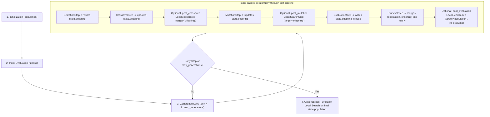

# Local search placement and custom pipeline stages in GeneticAlgorithm

This guide provides exact, copy-pasteable patterns for configuring or extending where local search (such as `CPUTwoOpt`, `NaiveGPUTwoOpt`, `BatchGPUTwoOpt`, or any `LocalSearchStrategy`) executes inside [`GeneticAlgorithm`](../src/algorithms/metaheuristics/genetic_algorithm.py#L236-L595). Every section includes the data flow contract, complete Python or JSON code, and a runnable verification command.

> [!IMPORTANT]
> Any invariant violation—such as modifying `state.population` in-place without re-computing `state.fitness`—corrupts elitist survivor selection because `state.fitness[i]` will no longer match the tour cost of `state.population[i]`. Every pattern in this guide explicitly preserves the `(population, fitness)` invariant.

## 1. Core architecture and data contracts

The evolutionary loop in [`GeneticAlgorithm`](../src/algorithms/metaheuristics/genetic_algorithm.py#L70-L230) is driven by two core primitives: `GenerationState` (the mutable data carrier) and `GenerationStep` (the step execution protocol).

### 1.1. The GenerationState carrier

Defined in [`src/algorithms/metaheuristics/genetic_algorithm.py`](../src/algorithms/metaheuristics/genetic_algorithm.py#L70-L80):

```python
@dataclass
class GenerationState:
  """Mutable state carried through evolutionary pipeline steps each generation."""

  population: Routes
  fitness: Fitness
  context: ProblemContext
  offspring: Routes | None = None
  offspring_fitness: Fitness | None = None
  generation: int = 0
```

Field contracts at every point in the pipeline:

| Field | Type | Shape | Device residency | Meaning |
| --- | --- | --- | --- | --- |
| `state.population` | `Routes` | `(N, n_cities)` | `np.ndarray` (CPU) or `cp.ndarray` (GPU) | Current survivor pool of `N` permutations |
| `state.fitness` | `Fitness` | `(N,)` | `np.ndarray` (CPU) or `cp.ndarray` (GPU) | Tour cost of each row in `state.population` |
| `state.context` | `ProblemContext` | scalar object | Host wrapper caching CPU/GPU distance matrices | Provides `get_cpu_distances()`, `get_gpu_distances()`, and `rng` |
| `state.offspring` | `Routes \| None` | `(N, n_cities)` | `np.ndarray` or `cp.ndarray` | Candidate tours produced in the current generation |
| `state.offspring_fitness` | `Fitness \| None` | `(N,)` | `np.ndarray` or `cp.ndarray` | Tour cost of each row in `state.offspring` |
| `state.generation` | `int` | scalar `>= 1` | Python `int` | 1-based index of the current generation inside `evolve()` |

### 1.2. The GenerationStep protocol

Defined in [`src/algorithms/metaheuristics/genetic_algorithm.py`](../src/algorithms/metaheuristics/genetic_algorithm.py#L81-L87):

```python
class GenerationStep(Protocol):
  """Protocol for an individual step within an evolutionary generation."""

  def run(self, state: GenerationState, timer: PhaseTimer) -> None:
    """Execute the evolutionary step, modifying `state` in-place."""
    ...
```

To record execution time in the benchmark's `phase_timings` dictionary, wrap the strategy call inside `timer.measure("<phase_name>", callable_fn, *args)`.

### 1.3. Pipeline execution flow



## 2. Built-in LocalSearchStage modes

The type alias [`LocalSearchStage`](../src/protocols/types.py#L18-L24) defines five built-in stage strings:

```python
type LocalSearchStage = Literal[
  "post_crossover",
  "post_mutation",
  "post_evaluation",
  "post_evolution",
  "none",
]
```

You do not need to write a custom `pipeline` to use any of these five stages. Pass `local_search` and `local_search_stage` directly to `GeneticAlgorithm(...)` or set `"local_search_stage"` in [`configs/algorithms.json`](../configs/algorithms.json).

### 2.1. Option A: Pure Genetic Algorithm (`local_search=None` or `local_search_stage="none"`)

- **Behavior:** No local search is executed during initialization, inside the generational loop, or after evolution.
- **When to use:** Baseline evolutionary experiments without memetic refinement.

```python
from algorithms.metaheuristics.genetic_algorithm import GeneticAlgorithm
from algorithms.strategies import (
  CPUCostEvaluation,
  OrderCrossover,
  RandomInitialization,
  SwapMutation,
  TournamentSelection,
)

ga = GeneticAlgorithm(
  population_size=100,
  mutation_rate=0.05,
  seed=42,
  initialization=RandomInitialization(seed=42),
  selection=TournamentSelection(tournament_size=5, seed=42),
  crossover=OrderCrossover(seed=42),
  mutation=SwapMutation(seed=42),
  evaluation=CPUCostEvaluation(),
  local_search=None,
  local_search_stage="none",
)
```

### 2.2. Option B: Post-crossover local search (`local_search_stage="post_crossover"`)

- **Behavior:** Refines `state.offspring` immediately after `CrossoverStep` and **before** `MutationStep`.
- **Pipeline sequence:** `SelectionStep` → `CrossoverStep` → `LocalSearchStep(target="offspring")` → `MutationStep` → `EvaluationStep(target="offspring")` → `SurvivalStep`.
- **When to use:** Repairs edge crossings introduced by crossover cuts while allowing subsequent mutation to introduce diversity into the locally optimal tour before evaluation.

```python
from algorithms.metaheuristics.genetic_algorithm import GeneticAlgorithm
from algorithms.strategies import (
  BatchGPUTwoOpt,
  GPUCostEvaluation,
  GPUOrderCrossover,
  GPUSwapMutation,
  GPUTournamentSelection,
  RandomInitialization,
)

ga = GeneticAlgorithm(
  population_size=100,
  mutation_rate=0.05,
  seed=42,
  initialization=RandomInitialization(seed=42, return_gpu=True),
  selection=GPUTournamentSelection(tournament_size=5, seed=42),
  crossover=GPUOrderCrossover(seed=42),
  mutation=GPUSwapMutation(seed=42),
  evaluation=GPUCostEvaluation(),
  local_search=BatchGPUTwoOpt(max_iterations=10),
  local_search_stage="post_crossover",
)
```

### 2.3. Option C: Post-mutation local search (`local_search_stage="post_mutation"`)

- **Behavior:** Refines `state.offspring` after `MutationStep` and **before** `EvaluationStep(target="offspring")`.
- **Pipeline sequence:** `SelectionStep` → `CrossoverStep` → `MutationStep` → `LocalSearchStep(target="offspring")` → `EvaluationStep(target="offspring")` → `SurvivalStep`.
- **When to use:** Classic Memetic Algorithm. Every mutated offspring is brought to a local minimum before its fitness is evaluated.

```python
ga = GeneticAlgorithm(
  population_size=100,
  mutation_rate=0.05,
  seed=42,
  initialization=RandomInitialization(seed=42, return_gpu=True),
  selection=GPUTournamentSelection(tournament_size=5, seed=42),
  crossover=GPUOrderCrossover(seed=42),
  mutation=GPUSwapMutation(seed=42),
  evaluation=GPUCostEvaluation(),
  local_search=BatchGPUTwoOpt(max_iterations=10),
  local_search_stage="post_mutation",
)
```

### 2.4. Option D: Post-evaluation / post-survival local search (`local_search_stage="post_evaluation"`)

- **Behavior:** Offspring are evaluated raw (`EvaluationStep(target="offspring")`), survivors are selected (`SurvivalStep`), and then `LocalSearchStep(target="population", re_evaluate=self.evaluation)` refines the surviving `state.population` and re-evaluates `state.fitness`.
- **Pipeline sequence:** `SelectionStep` → `CrossoverStep` → `MutationStep` → `EvaluationStep(target="offspring")` → `SurvivalStep` → `LocalSearchStep(target="population", re_evaluate=self.evaluation)`.
- **Why `re_evaluate` is required here:** Because `LocalSearchStep` modifies `state.population` *after* `SurvivalStep`, `state.fitness` would otherwise hold the pre-2-opt costs. Passing `re_evaluate=self.evaluation` updates `state.fitness` immediately so early stopping and next-generation tournament selection see accurate costs.

```python
ga = GeneticAlgorithm(
  population_size=100,
  mutation_rate=0.05,
  seed=42,
  initialization=RandomInitialization(seed=42, return_gpu=True),
  selection=GPUTournamentSelection(tournament_size=5, seed=42),
  crossover=GPUOrderCrossover(seed=42),
  mutation=GPUSwapMutation(seed=42),
  evaluation=GPUCostEvaluation(),
  local_search=BatchGPUTwoOpt(max_iterations=10),
  local_search_stage="post_evaluation",
)
```

### 2.5. Option E: Post-evolution local search (`local_search_stage="post_evolution"`)

- **Behavior:** The generational loop runs as a pure Genetic Algorithm (zero local search inside the loop). After the loop terminates (via `max_generations`, `hit_optimal`, or `patience`), `evolve()` runs `local_search.improve_batch(state.population, context)` once on the final population and re-evaluates `state.fitness` ([`src/algorithms/metaheuristics/genetic_algorithm.py`](../src/algorithms/metaheuristics/genetic_algorithm.py#L559-L577)).
- **When to use:** Low-budget CPU runs where running $O(n^2)$ 2-opt at every generation is too expensive, so 2-opt is applied only once as a final polishing step.

```python
ga = GeneticAlgorithm(
  population_size=100,
  mutation_rate=0.05,
  seed=42,
  initialization=RandomInitialization(seed=42),
  selection=TournamentSelection(tournament_size=5, seed=42),
  crossover=OrderCrossover(seed=42),
  mutation=SwapMutation(seed=42),
  evaluation=CPUCostEvaluation(),
  local_search=CPUTwoOpt(max_iterations=50),
  local_search_stage="post_evolution",
)
```

## 3. Custom pipeline patterns via `GenerationStep`

When the five built-in stages are not enough, you can write a custom class implementing `run(self, state: GenerationState, timer: PhaseTimer) -> None` and pass a list of steps to `GeneticAlgorithm(..., pipeline=[...])`.

> [!WARNING]
> When passing a custom `pipeline=[...]` to `GeneticAlgorithm`, ALSO set `local_search_stage="none"` on `GeneticAlgorithm(...)` if your custom pipeline already manages local search. Otherwise, `evolve()` will still execute the initial-population local search block in [`genetic_algorithm.py`](../src/algorithms/metaheuristics/genetic_algorithm.py#L473-L504) before generation 1 begins.

### 3.1. Pattern 1: Post-initialization-only local search (`PostInitLocalSearchStep`)

**Goal:** Refine the initial random population once at `state.generation == 1` before parent selection starts, and then run pure GA for all subsequent generations (`state.generation > 1`).

#### Step-by-step implementation rules

1. Check `if state.generation == 1:` inside `run()`.
2. Refine `state.population` using `timer.measure("local_search", self.local_search.improve_batch, state.population, state.context)`.
3. Immediately re-evaluate `state.fitness` using `timer.measure("evaluation", self.evaluation.evaluate_batch, state.population, state.context)` so `SelectionStep` in generation 1 uses the updated fitness.
4. Place `PostInitLocalSearchStep` as the **first** element of `pipeline=[...]`, before `SelectionStep`.

```python
from __future__ import annotations

from typing import TYPE_CHECKING

from algorithms.metaheuristics.genetic_algorithm import (
  CrossoverStep,
  EvaluationStep,
  GenerationState,
  GenerationStep,
  GeneticAlgorithm,
  MutationStep,
  SelectionStep,
  SurvivalStep,
)

if TYPE_CHECKING:
  from protocols.algorithm_strategies import EvaluationStrategy, LocalSearchStrategy
  from utils.phase_timer import PhaseTimer


class PostInitLocalSearchStep:
  """Refine `state.population` only once at the start of generation 1."""

  def __init__(
    self,
    local_search: LocalSearchStrategy,
    evaluation: EvaluationStrategy,
  ) -> None:
    self.local_search: LocalSearchStrategy = local_search
    self.evaluation: EvaluationStrategy = evaluation

  def run(self, state: GenerationState, timer: PhaseTimer) -> None:
    if state.generation != 1:
      return
    state.population = timer.measure(
      "local_search",
      self.local_search.improve_batch,
      state.population,
      state.context,
    )
    state.fitness = timer.measure(
      "evaluation",
      self.evaluation.evaluate_batch,
      state.population,
      state.context,
    )


def build_post_init_ga(
  population_size: int,
  mutation_rate: float,
  seed: int,
  initialization,
  selection,
  crossover,
  mutation,
  evaluation,
  local_search,
) -> GeneticAlgorithm:
  ga = GeneticAlgorithm(
    population_size=population_size,
    mutation_rate=mutation_rate,
    seed=seed,
    initialization=initialization,
    selection=selection,
    crossover=crossover,
    mutation=mutation,
    evaluation=evaluation,
    local_search=local_search,
    local_search_stage="none",
  )
  ga.pipeline = [
    PostInitLocalSearchStep(local_search, evaluation),
    SelectionStep(selection, population_size),
    CrossoverStep(crossover),
    MutationStep(mutation, mutation_rate),
    EvaluationStep(evaluation, target="offspring"),
    SurvivalStep(ga._select_survivors),
  ]
  return ga
```

### 3.2. Pattern 2: Elite-only local search (`EliteOnlyLocalSearchStep`)

**Goal:** Instead of running expensive 2-opt on all $N$ individuals in `state.population`, refine only the top $k$ fittest individuals (`elite_count = k`) after `SurvivalStep` and update only their entries in `state.population` and `state.fitness`.

#### Step-by-step implementation rules

1. Place `EliteOnlyLocalSearchStep` **after** `SurvivalStep`.
2. Find the indices of the $k$ lowest-cost routes using `argsort(state.fitness)[:k]` (works identically for both NumPy `np.ndarray` and CuPy `cp.ndarray`).
3. Slice `elite_routes = state.population[elite_indices]`.
4. Refine `improved_elites = timer.measure("local_search", self.local_search.improve_batch, elite_routes, state.context)`.
5. Evaluate only the $k$ refined routes: `improved_fitness = timer.measure("evaluation", self.evaluation.evaluate_batch, improved_elites, state.context)`.
6. Write `improved_elites` and `improved_fitness` back into `state.population[elite_indices]` and `state.fitness[elite_indices]`.

```python
from __future__ import annotations

from typing import TYPE_CHECKING, Any

import numpy as np

from algorithms.metaheuristics.genetic_algorithm import (
  CrossoverStep,
  EvaluationStep,
  GenerationState,
  GeneticAlgorithm,
  MutationStep,
  SelectionStep,
  SurvivalStep,
)
from protocols.backend import cupy_backend
from utils.route_helpers import is_gpu_array

if TYPE_CHECKING:
  from protocols.algorithm_strategies import EvaluationStrategy, LocalSearchStrategy
  from utils.phase_timer import PhaseTimer


class EliteOnlyLocalSearchStep:
  """Apply local search exclusively to the top-k lowest-cost routes in `state.population`."""

  def __init__(
    self,
    local_search: LocalSearchStrategy,
    evaluation: EvaluationStrategy,
    elite_count: int = 10,
  ) -> None:
    if elite_count <= 0:
      raise ValueError(f"elite_count must be > 0, got {elite_count}")
    self.local_search: LocalSearchStrategy = local_search
    self.evaluation: EvaluationStrategy = evaluation
    self.elite_count: int = elite_count

  def run(self, state: GenerationState, timer: PhaseTimer) -> None:
    pop_size: int = int(state.population.shape[0])
    k: int = min(self.elite_count, pop_size)

    is_gpu: bool = is_gpu_array(state.fitness)
    xp: Any = cupy_backend() if is_gpu else np

    elite_indices = xp.argsort(state.fitness)[:k]
    elite_routes = state.population[elite_indices]

    improved_elites = timer.measure(
      "local_search",
      self.local_search.improve_batch,
      elite_routes,
      state.context,
    )
    improved_fitness = timer.measure(
      "evaluation",
      self.evaluation.evaluate_batch,
      improved_elites,
      state.context,
    )

    state.population[elite_indices] = improved_elites
    state.fitness[elite_indices] = improved_fitness


def build_elite_local_search_ga(
  population_size: int,
  mutation_rate: float,
  seed: int,
  elite_count: int,
  initialization,
  selection,
  crossover,
  mutation,
  evaluation,
  local_search,
) -> GeneticAlgorithm:
  ga = GeneticAlgorithm(
    population_size=population_size,
    mutation_rate=mutation_rate,
    seed=seed,
    initialization=initialization,
    selection=selection,
    crossover=crossover,
    mutation=mutation,
    evaluation=evaluation,
    local_search=local_search,
    local_search_stage="none",
  )
  ga.pipeline = [
    SelectionStep(selection, population_size),
    CrossoverStep(crossover),
    MutationStep(mutation, mutation_rate),
    EvaluationStep(evaluation, target="offspring"),
    SurvivalStep(ga._select_survivors),
    EliteOnlyLocalSearchStep(
      local_search=local_search,
      evaluation=evaluation,
      elite_count=elite_count,
    ),
  ]
  return ga
```

### 3.3. Pattern 3: Periodic / staged local search (`PeriodicLocalSearchStep`)

**Goal:** Execute local search only every `interval` generations (for example, when `state.generation % 10 == 0`), skipping local search on all other generations to reduce runtime while periodically smoothing the population's tours.

#### Step-by-step implementation rules

1. Check `if state.generation % self.interval != 0: return`.
2. Support both `target="offspring"` (placed before `EvaluationStep`) and `target="population"` (placed after `SurvivalStep` with `re_evaluate=evaluation`).

```python
from __future__ import annotations

from typing import TYPE_CHECKING, Literal

from algorithms.metaheuristics.genetic_algorithm import (
  CrossoverStep,
  EvaluationStep,
  GenerationState,
  GeneticAlgorithm,
  MutationStep,
  SelectionStep,
  SurvivalStep,
)

if TYPE_CHECKING:
  from protocols.algorithm_strategies import EvaluationStrategy, LocalSearchStrategy
  from utils.phase_timer import PhaseTimer


class PeriodicLocalSearchStep:
  """Execute local search once every `interval` generations."""

  def __init__(
    self,
    local_search: LocalSearchStrategy,
    interval: int = 10,
    target: Literal["offspring", "population"] = "population",
    re_evaluate: EvaluationStrategy | None = None,
  ) -> None:
    if interval <= 0:
      raise ValueError(f"interval must be > 0, got {interval}")
    if target == "population" and re_evaluate is None:
      raise ValueError("re_evaluate EvaluationStrategy is required when target='population'")
    self.local_search: LocalSearchStrategy = local_search
    self.interval: int = interval
    self.target: Literal["offspring", "population"] = target
    self.re_evaluate: EvaluationStrategy | None = re_evaluate

  def run(self, state: GenerationState, timer: PhaseTimer) -> None:
    if state.generation % self.interval != 0:
      return

    if self.target == "offspring":
      if state.offspring is None:
        raise RuntimeError("PeriodicLocalSearchStep(target='offspring') called before offspring exists.")
      state.offspring = timer.measure(
        "local_search",
        self.local_search.improve_batch,
        state.offspring,
        state.context,
      )
    else:
      state.population = timer.measure(
        "local_search",
        self.local_search.improve_batch,
        state.population,
        state.context,
      )
      if self.re_evaluate is not None:
        state.fitness = timer.measure(
          "evaluation",
          self.re_evaluate.evaluate_batch,
          state.population,
          state.context,
        )
```

### 3.4. Pattern 4: Multi-stage memetic pipeline (shallow per-generation + deep periodic elite)

**Goal:** Combine two distinct local search operators in the same pipeline:
- A fast, shallow 1-iteration `BatchGPUTwoOpt(max_iterations=1)` applied to all offspring (`post_mutation`).
- A deep 20-iteration `BatchGPUTwoOpt(max_iterations=20)` applied only to the top 5 elites every 10 generations after survival selection.

> [!NOTE]
> When using two separate `LocalSearchStrategy` instances in a custom pipeline, register both in `ga.local_search` or override `ga._all_strategies()` if you need H2D/D2H byte counters aggregated from both instances.

```python
shallow_2opt = BatchGPUTwoOpt(max_iterations=1)
deep_2opt = BatchGPUTwoOpt(max_iterations=20)

ga = GeneticAlgorithm(
  population_size=100,
  mutation_rate=0.05,
  seed=42,
  initialization=RandomInitialization(seed=42, return_gpu=True),
  selection=GPUTournamentSelection(tournament_size=5, seed=42),
  crossover=GPUOrderCrossover(seed=42),
  mutation=GPUSwapMutation(seed=42),
  evaluation=GPUCostEvaluation(),
  local_search=shallow_2opt,
  local_search_stage="none",
)

ga.pipeline = [
  SelectionStep(ga.selection, ga.population_size),
  CrossoverStep(ga.crossover),
  MutationStep(ga.mutation, ga.mutation_rate),
  LocalSearchStep(shallow_2opt, target="offspring"),
  EvaluationStep(ga.evaluation, target="offspring"),
  SurvivalStep(ga._select_survivors),
  EliteOnlyLocalSearchStep(
    local_search=deep_2opt,
    evaluation=ga.evaluation,
    elite_count=5,
  ),
]
```

## 4. Declarative JSON configuration in `configs/algorithms.json`

To benchmark any of the built-in stages through [`run_comprehensive_benchmark`](../src/benchmarking/runner/orchestration.py#L189-L205), either set `"local_search_stage"` in [`configs/algorithms.json`](../configs/algorithms.json) or override it in Python via `dataclasses.replace`.

### 4.1. In `configs/algorithms.json`

```json
    "FullGPUModular": {
      "module": "algorithms.metaheuristics.genetic_algorithm",
      "class_name": "GeneticAlgorithm",
      "use_gpu": true,
      "local_search_stage": "post_evaluation",
      "description": "Modular GPU GA with batch GPU strategies",
      "strategies": {
        "initialization": {
          "name": "RandomInitialization",
          "params": {
            "return_gpu": true
          }
        },
        "selection": {
          "name": "GPUTournamentSelection",
          "params": {
            "tournament_size": 5
          }
        },
        "crossover": {
          "name": "GPUOrderCrossover",
          "params": {}
        },
        "mutation": {
          "name": "GPUSwapMutation",
          "params": {}
        },
        "evaluation": {
          "name": "GPUCostEvaluation",
          "params": {}
        },
        "local_search": {
          "name": "BatchGPUTwoOpt",
          "params": {
            "max_iterations": 10
          }
        }
      }
    }
```

### 4.2. Programmatic stage override in a benchmark script

See [`benchmark_scripts/compare_local_search_stages.py`](../benchmark_scripts/compare_local_search_stages.py#L46-L70) for how multiple stages are benchmarked side-by-side without duplicating JSON entries:

```python
def build_stage_algorithm_configs() -> tuple[dict[str, AlgorithmConfig], list[str]]:
  """Expand base algorithms across local search stages for the orchestrator."""
  configs = load_all_configs(default_config_dir())
  base_algorithms: dict[str, AlgorithmConfig] = configs["algorithms"]

  expanded_configs: dict[str, AlgorithmConfig] = {}
  selected_names: list[str] = []

  for algo_name in BASE_ALGORITHMS:
    base_cfg: AlgorithmConfig = base_algorithms[algo_name]
    for stage in STAGES:
      variant_name = f"{algo_name}_{stage}"
      expanded_configs[variant_name] = replace(
        base_cfg,
        name=variant_name,
        local_search_stage=stage,
        description=f"{base_cfg.description} ({stage})",
      )
      selected_names.append(variant_name)

  return expanded_configs, selected_names
```

## 5. Verification snippet

Run the following command from the repository root to verify all built-in stages and custom `GenerationStep` patterns on `gr17`:

```bash
.venv/bin/python -c "
from loaders.database_loader import DatabaseLoader
from protocols.backend import ProblemContext
from algorithms.metaheuristics.genetic_algorithm import (
  CrossoverStep, EvaluationStep, GeneticAlgorithm, MutationStep, SelectionStep, SurvivalStep
)
from algorithms.strategies import (
  CPUCostEvaluation, CPUTwoOpt, OrderCrossover, RandomInitialization, SwapMutation, TournamentSelection
)

with DatabaseLoader('datasets/tsp.duckdb') as loader:
  problem = loader.load('gr17')

ctx = ProblemContext(problem, seed=42)
customers = list(range(problem.dimension))

for stage in ('none', 'post_crossover', 'post_mutation', 'post_evaluation', 'post_evolution'):
  ga = GeneticAlgorithm(
    population_size=30,
    mutation_rate=0.05,
    seed=42,
    initialization=RandomInitialization(seed=42),
    selection=TournamentSelection(tournament_size=3, seed=42),
    crossover=OrderCrossover(seed=42),
    mutation=SwapMutation(seed=42),
    evaluation=CPUCostEvaluation(),
    local_search=CPUTwoOpt(max_iterations=5),
    local_search_stage=stage,
  )
  tour, stats = ga.evolve(ctx, customers, max_generations=10, optimal_cost=2085.0)
  print(f'{stage:16s} -> best_cost={stats[\"best_fitness\"]:.1f}, gens={stats[\"generations_completed\"]}')
"
```

