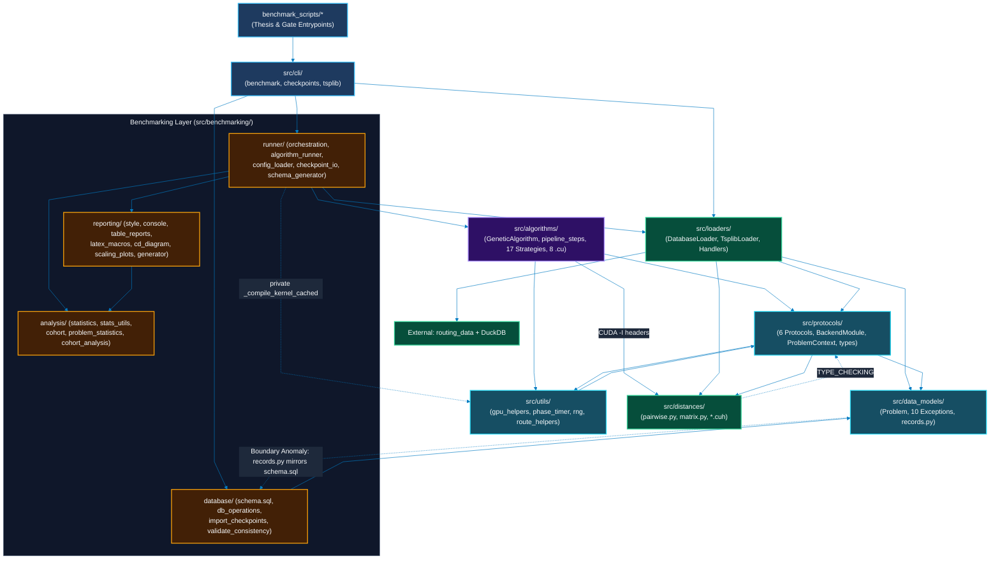
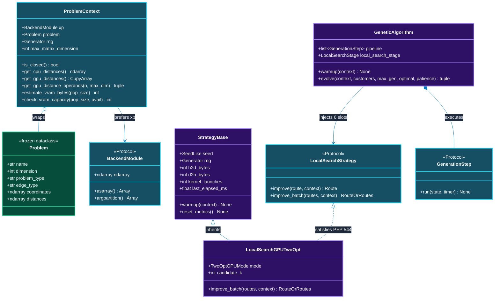

# Project Architecture Blueprint — GPU-Accelerated Routing Solver

This Master Blueprint serves as the single authoritative architectural reference for `gpu_accelerated_clean`. Deep implementation details for individual subsystems live in the four companion guides under `./analysis/`: [guide-architecture-protocols-and-data-models.md](./analysis/guide-architecture-protocols-and-data-models.md), [guide-architecture-loaders-and-distances.md](./analysis/guide-architecture-loaders-and-distances.md), [guide-architecture-algorithms-and-strategies.md](./analysis/guide-architecture-algorithms-and-strategies.md), and [guide-architecture-benchmarking-cli-and-utils.md](./analysis/guide-architecture-benchmarking-cli-and-utils.md).

---

## 1. Architecture Detection & Analysis

Inspection of [pyproject.toml](../pyproject.toml), `src/`, `configs/`, and `benchmark_scripts/` establishes a hybrid Python/CUDA scientific computing stack targeting Python `>=3.12` and NVIDIA CUDA 12.x (`cupy-cuda12x>=13.6.0`) under `pythonpath = ["src"]` (`DP-3`):

| Technology / Layer | Concrete Components & Versions | Architectural Role |
| :--- | :--- | :--- |
| **Core Runtime & Typing** | Python `>=3.12`, PEP 544 `Protocol`, PEP 695 `type` aliases & generic syntax | Structural operator contracts, strict `mypy` (`strict = true`), `ruff` linting |
| **Array & GPU Compute** | `numpy>=2.2.6`, `cupy-cuda12x>=13.6.0` (NVRTC JIT `RawKernel`) | Host/device array interchange (`BackendModule`), custom CUDA C++ `.cu`/`.cuh` kernels |
| **TSPLIB95 ETL & Storage** | `routing-data` (`v0.2.0` Git tag), `duckdb>=1.4.1`, `pandas>=2.3.2` | Corpus parsing (`FormatParser`, `ProblemNormalizer`), direct `.tsp` loading, optional `tsp.duckdb` & `results.duckdb` |
| **Inference & Reporting** | `scipy>=1.15.3`, `scikit-posthocs>=0.11.4`, `matplotlib>=3.10.6` | Demšar (2006) non-parametric tests, TikZ CD plots, ABNT vector figures, LaTeX tables/macros |
| **Configuration Contracts** | `configs/*.json`, `configs/schemas/*.schema.json` (Draft 2020-12) | Declarative GA composition, problem catalog, and reflective schema validation |
| **Quality & Gates** | `pytest>=8.4.2`, `mypy>=2.4.0`, `ruff>=0.17.3`, [check_docs.py](../benchmark_scripts/check_docs.py) | Unit/integration/GPU-gated tests, AST symbol & heading drift checks |

---

## 2. Architectural Overview

The repository implements a **Layered, Protocol-Driven, Strategy-Composed Hybrid CPU/GPU Architecture**:

1. **Structural Polymorphism Over Inheritance Hierarchies:** [algorithm_strategies.py](../src/protocols/algorithm_strategies.py) defines six `@runtime_checkable` PEP 544 `Protocol` slots (`Initialization*`, `Selection*`, `Crossover*`, `Mutation*`, `LocalSearch*`, `Evaluation*`). Concrete operators inherit telemetry/RNG plumbing from [`StrategyBase`](../src/algorithms/strategies/base.py) (`Design B`, `DP11-1`) without forcing `GeneticAlgorithm` to import any CPU or GPU implementation.
2. **Backend Dualism & Fail-Loud Hardware Semantics:** [`BackendModule`](../src/protocols/backend.py) abstracts NumPy/CuPy operations for shared array code, while [`GPUCapabilityProbe`](../src/protocols/backend.py) defers `import cupy` until runtime (`DP9-1`, `DP9-3`). GPU strategies call [`require_gpu`](../src/protocols/backend.py) and raise [`GPUUnavailableError`](../src/data_models/exceptions.py) rather than silently falling back to CPU (`DP9-2`).
3. **Single-Owner Lazy Device Memory:** [`ProblemContext`](../src/protocols/problem_context.py) wraps an immutable [`Problem`](../src/data_models/problem.py) and lazily caches host/device distance matrices, coordinates, demands, and $k$-NN candidate tables $\mathcal{N}_k$, eliminating redundant VRAM allocations (`DP10-17`) and supporting seamless CPU+GPU hybrid pipelines.
4. **Regime-Adaptive Distance Evaluation:** Below `DEFAULT_MAX_MATRIX_DIMENSION = 10_000` (`DP11-3`), coordinate problems materialize `int32` $(n, n)$ matrices; above $10{,}000$, GPU kernels compute TSPLIB95 metrics on the fly in registers via [`pairwise_device.cuh::gpu_pairwise_distance`](../src/distances/kernels/pairwise_device.cuh) (`DP10-19`).

---

## 3. Architecture Visualization

### 3.1 High-Level 8-Package Layered Architecture & Dependency Topology



*8-package dependency map across `src/`, highlighting the external `routing_data` boundary, CUDA header includes, and verified cross-package coupling anomalies.*

### 3.2 End-to-End Benchmark Execution & Persistence Sequence

```mermaid
---
config:
  theme: base
  themeVariables:
    darkMode: true
    background: "#0F172A"
    mainBkg: "#1E293B"
    primaryColor: "#1E293B"
    primaryTextColor: "#F8FAFC"
    primaryBorderColor: "#38BDF8"
    secondaryColor: "#1E3A5F"
    secondaryTextColor: "#F8FAFC"
    tertiaryColor: "#172554"
    tertiaryTextColor: "#F8FAFC"
    lineColor: "#027BC2"
    textColor: "#F8FAFC"
    actorBkg: "#1E293B"
    actorBorder: "#38BDF8"
    actorTextColor: "#F8FAFC"
    actorLineColor: "#027BC2"
    signalColor: "#38BDF8"
    signalTextColor: "#F8FAFC"
    labelBoxBkgColor: "#1E293B"
    labelBoxBorderColor: "#818CF8"
    labelTextColor: "#F8FAFC"
    loopTextColor: "#F8FAFC"
    activationBkgColor: "#1E3A5F"
    activationBorderColor: "#38BDF8"
    noteBkgColor: "#334155"
    noteBorderColor: "#FBBF24"
    noteTextColor: "#F8FAFC"
    sequenceNumberColor: "#0F172A"
  sequence:
    diagramMarginX: 24
    diagramMarginY: 16
    actorMargin: 45
    boxMargin: 12
    noteMargin: 12
    messageMargin: 38
    mirrorActors: true
    wrap: true
---
sequenceDiagram
    participant CLI as cli.benchmark.main
    participant Orch as orchestration.run_comprehensive_benchmark
    participant Loader as DatabaseLoader
    participant Runner as algorithm_runner.run_single_algorithm
    participant GA as GeneticAlgorithm
    participant Ctx as ProblemContext + CUDA
    participant Store as CheckpointManager + DuckDB
    participant Stats as StatisticalAnalyzer + Report

    rect rgb(24, 34, 54)
        CLI->>Orch: parse args + setup_benchmark_logging()
        Orch->>Orch: _run_preflight (configs, GPU probe, checkpoints)
        Orch->>Loader: load(problem_name) + assert size == dimension
        Loader-->>Orch: frozen Problem instance
        Orch->>Runner: run_single_algorithm(factory, problem, reps, candidate_cache)

        opt use_gpu is True
            Runner->>+GA: clone.warmup(warmup_ctx)
            GA->>Ctx: compile kernels + launch on arange(n)
            deactivate GA
        end

        loop rep in 1..repetitions
            Runner->>+GA: evolve(ctx, customers, 2n*sqrt(n), patience)
            GA->>Ctx: initialize + raw Gen-0 evaluate_batch
            loop gen in 1..max_generations
                GA->>Ctx: pipeline steps (PhaseTimer + @time_strategy async)
                GA->>GA: _best_cost() scalar D2H + _extract_best() only if improved
            end
            GA-->>-Runner: (best_tour, stats)
            Runner->>Store: save_checkpoint_atomic()
        end

        Runner->>Runner: verify JIT cache currsize unchanged + compute_series_stats(ddof=1)
        Orch->>Stats: analyze_problem() + analyze_cohort() -> ProblemAnalysis / CohortAnalysis
        Stats-->>CLI: log_problem_analysis / log_cohort_analysis + opt-in generate_result_tables (or tsp-report)
        Note over Store: Optional DuckDB consolidation via tsp-import-checkpoints (natural-key upsert)
    end
```



*End-to-end execution flow from CLI invocation through isolated AOT GPU warm-up (`DP11-21`), async evolutionary phases (`DP11-22`), atomic checkpointing (`DP12-7`), DuckDB persistence, and Demšar (2006) reporting.*

### 3.3 Core Protocol, Context, and Strategy Class Structure



*Structural unification of immutable domain data (`Problem`), shared resource holder (`ProblemContext`), PEP 544 protocols (`LocalSearchStrategy`, `GenerationStep`), `StrategyBase`, and `GeneticAlgorithm`.*

### 3.4 Host–Device Memory & CUDA Kernel Data Flow

```mermaid
---
config:
  theme: base
  themeVariables:
    darkMode: true
    background: "#0F172A"
    mainBkg: "#1E293B"
    primaryColor: "#1E293B"
    primaryTextColor: "#F8FAFC"
    primaryBorderColor: "#38BDF8"
    secondaryColor: "#1E3A5F"
    secondaryTextColor: "#F8FAFC"
    secondaryBorderColor: "#60A5FA"
    tertiaryColor: "#172554"
    tertiaryTextColor: "#F8FAFC"
    tertiaryBorderColor: "#818CF8"
    lineColor: "#027BC2"
    edgeLabelBackground: "#1E293B"
    textColor: "#F8FAFC"
    nodeTextColor: "#F8FAFC"
    clusterBkg: "#0F172A"
    clusterBorder: "#64748B"
    titleColor: "#F8FAFC"
  flowchart:
    nodeSpacing: 50
    rankSpacing: 60
    padding: 16
    wrappingWidth: 260
    curve: "linear"
---
flowchart LR
    classDef host fill:#064E3B,stroke:#34D399,color:#F8FAFC,stroke-width:2px;
    classDef guard fill:#422006,stroke:#F59E0B,color:#F8FAFC,stroke-width:2px;
    classDef vram fill:#1E3A5F,stroke:#38BDF8,color:#F8FAFC,stroke-width:2px;
    classDef sram fill:#4C0519,stroke:#FB7185,color:#F8FAFC,stroke-width:2px;

    HOST["Host RAM: Problem + rng<br/>(sample_distinct_pairs / sample_mutation_positions)"]:::host -->|"Check before alloc"| GUARD{"n <= 10,000 or EXPLICIT?"}:::guard

    GUARD -- "Yes (Dense)" --> CHK["check_vram_capacity / mem_info<br/>(raise VRAMInsufficientError if > free)"]:::guard
    CHK --> DMAT["VRAM: d_distances int32[n,n]<br/>(4n^2 bytes)"]:::vram

    GUARD -- "No (n > 10,000)" --> DCOORD["VRAM: d_coords float64[n,d]<br/>(8dn bytes; d_distances=nullptr)"]:::vram

    HOST -- "Initial pop / cuts / probs" --> DPOP["VRAM: d_population, d_offspring<br/>d_costs (12Pn + 24P bytes)"]:::vram

    DMAT --> K2OPT{"2-Opt Shmem Regime<br/>(two_opt_batch / multi_move)"}:::sram
    DCOORD --> K2OPT
    DPOP --> K2OPT

    K2OPT -- "n <= 11,520 & candidate_k" --> CAND["Shmem 3,072B + Global N_k & pos[N,n]"]:::sram
    K2OPT -- "n <= 11,520 exhaustive" --> UNTILED["Untiled s_tour[n] <= 48 KiB"]:::sram
    K2OPT -- "n > 11,520" --> TILED["Tiled Window T*=2048: 11,268B shmem<br/>(8 blocks/SM = 100% CC 6.1 occupancy)"]:::sram

    K2OPT -- "_best_cost: 8B scalar / _extract_best on strict <" --> HOST
```



*Host–device memory hierarchy flow showing pre-allocation VRAM guardrails, dense vs on-the-fly coordinate switching at $n = 10{,}000$, 2-opt shared-memory tiling at $T^* = 2{,}048$, and lazy D2H route transfer.*

---

## 4. Core Architectural Components

| Package | Primary Responsibility | Deep-Dive Companion Guide |
| :--- | :--- | :--- |
| `src/protocols/` | 6 `@runtime_checkable` strategy protocols, `BackendModule`, `GPUCapabilityProbe`, PEP 695 aliases, `ProblemContext` | [guide-architecture-protocols-and-data-models.md](./analysis/guide-architecture-protocols-and-data-models.md) |
| `src/data_models/` | Frozen `Problem` dataclass (`DP14-6`), 10 domain exceptions, `BenchmarkRunInput` / `NemenyiResult` TypedDicts | [guide-architecture-protocols-and-data-models.md](./analysis/guide-architecture-protocols-and-data-models.md) |
| `src/loaders/` | `DatabaseLoader`, `TsplibLoader`, `PROBLEM_TYPE_HANDLERS`, `routing_data` ETL & DuckDB ingestion | [guide-architecture-loaders-and-distances.md](./analysis/guide-architecture-loaders-and-distances.md) |
| `src/distances/` | 3-tier TSPLIB95 distances (`pairwise_device.cuh`, vectorized chunked `matrix.py`, `pairwise.py` w/ `BUG-32`) | [guide-architecture-loaders-and-distances.md](./analysis/guide-architecture-loaders-and-distances.md) |
| `src/algorithms/` | `GeneticAlgorithm`, `STAGE_SPECS`, `pipeline_steps.py`, 17 `Design B` strategies, 8 `.cu` kernels, `archive/` | [guide-architecture-algorithms-and-strategies.md](./analysis/guide-architecture-algorithms-and-strategies.md) |
| `src/utils/` | `load_kernel` (`-I` + SHA-256), `PhaseTimer` / `@time_strategy`, `make_rng` / `resolve_rng`, `route_helpers` | [guide-architecture-benchmarking-cli-and-utils.md](./analysis/guide-architecture-benchmarking-cli-and-utils.md) |
| `src/benchmarking/` | `runner/` (`orchestration`, `algorithm_runner`, `checkpoint_io`, `config_loader`, `schema_generator`), `analysis/` (`cohort`, `statistics`, `stats_utils`, `problem_statistics`, `cohort_analysis`), `reporting/` (`style`, `console`, `table_reports`, `latex_macros`, `cd_diagram`, `scaling_plots`, `generator`), `database/` | [guide-architecture-benchmarking-cli-and-utils.md](./analysis/guide-architecture-benchmarking-cli-and-utils.md) |
| `src/cli/` | 5 entry points (`benchmark.py`, `report.py`, `checkpoints.py`, `tsplib.py`) invoked directly or via `benchmark_scripts/` | [guide-architecture-benchmarking-cli-and-utils.md](./analysis/guide-architecture-benchmarking-cli-and-utils.md) |

Outside `src/`, [`configs/`](../configs/cpu-operators.example.json) stores generic example configurations and Draft 2020-12 JSON Schemas (`configs/schemas/`), while `benchmark_scripts/` isolates thesis Chapter 4 configs (`benchmark_scripts/configs/chapter4/`), thesis drivers ([run_chapter4_benchmark.py](../benchmark_scripts/run_chapter4_benchmark.py)), and verification gates ([check_docs.py](../benchmark_scripts/check_docs.py), [check_thesis.py](../benchmark_scripts/check_thesis.py)).

---

## 5. Architectural Layers & Dependency Rules

Dependencies are structured to flow downward from orchestration/CLI into domain algorithms, loaders/distances, and foundational protocols/data models. Cross-layer coupling is mediated via PEP 544 structural protocols, registries (`STRATEGY_REGISTRY`, `PIPELINE_STEP_REGISTRY`, `PROBLEM_TYPE_HANDLERS`), and `AlgorithmConfig.instantiate` acting as the composition root.

### Verified Coupling Anomalies & Package Surface Gaps

1. **Layering Anomaly in `data_models/records.py`:** [`records.py`](../src/data_models/records.py) defines [`BenchmarkRunInput`](../src/data_models/records.py) (matching `schema.sql`) and [`NemenyiResult`](../src/data_models/records.py) inside Layer 2 `data_models/` rather than `src/benchmarking/`. This prevents circular imports inside `benchmarking/` but leaks persistence schemas into the core domain layer.
2. **Resolved — Separated Pure `benchmarking/analysis/` from `benchmarking/reporting/`:** Pure statistical computation ([`statistics.py`](../src/benchmarking/analysis/statistics.py), [`stats_utils.py`](../src/benchmarking/analysis/stats_utils.py), [`cohort.py`](../src/benchmarking/analysis/cohort.py), [`problem_statistics.py`](../src/benchmarking/analysis/problem_statistics.py), [`cohort_analysis.py`](../src/benchmarking/analysis/cohort_analysis.py)) now emits single-pass immutable snapshots (`OmnibusTestResult`, `ProblemAnalysis`, `CohortAnalysis`) with zero console-logging or file-I/O side effects. All renderers live in `benchmarking/reporting/` ([`style.py`](../src/benchmarking/reporting/style.py), [`console.py`](../src/benchmarking/reporting/console.py), [`table_reports.py`](../src/benchmarking/reporting/table_reports.py), [`latex_macros.py`](../src/benchmarking/reporting/latex_macros.py), [`cd_diagram.py`](../src/benchmarking/reporting/cd_diagram.py), [`scaling_plots.py`](../src/benchmarking/reporting/scaling_plots.py), and [`generator.py`](../src/benchmarking/reporting/generator.py)) in a strictly acyclic DAG consuming the precomputed snapshot once.
3. **Private Symbol Coupling in `algorithm_runner.py`:** [`algorithm_runner.py`](../src/benchmarking/runner/algorithm_runner.py) imports the private function [`gpu_helpers.py::_compile_kernel_cached`](../src/utils/gpu_helpers.py) solely to check `.cache_info().currsize` around the repetition loop (`DP11-21`).
4. **Runner-to-Solver & Loader Top-Level Coupling:** [`config_loader.py`](../src/benchmarking/runner/config_loader.py) and [`schema_generator.py`](../src/benchmarking/runner/schema_generator.py) import `algorithms.strategies.STRATEGY_REGISTRY`, `PIPELINE_STEP_REGISTRY`, and `tsplib_loader` directly at import time to instantiate pipelines and reflectively generate JSON Schemas (`BUG-85`).
5. **Incomplete Barrel `__init__.py` Exports:**
   - [`data_models/__init__.py`](../src/data_models/__init__.py) exports only 6 symbols (`Problem` and 5 of 10 exceptions); [`protocols/__init__.py`](../src/protocols/__init__.py) omits `BackendModule`, `require_gpu`, and `DEFAULT_MAX_MATRIX_DIMENSION`; [`utils/__init__.py`](../src/utils/__init__.py) exports 9 of 16 helpers; [`distances/__init__.py`](../src/distances/__init__.py) omits `compute_distance_matrix`, `compute_candidate_list`, and `get_edge_type_code`.
   - `src/distances/factory.py` and `src/loaders/problem_adapter.py` do **not** exist in the codebase (`pairwise.py` owns distance factories; `tsplib_loader.py` adapts `routing_data`).
   - [`InvalidEdgeTypeError`](../src/data_models/exceptions.py) omits `EUC_3D` and `CEIL_2D` in its error text despite [`VALID_EDGE_TYPES`](../src/data_models/problem.py) supporting 6 types (`DP14-6`).
   - [`metaheuristics/__init__.py`](../src/algorithms/metaheuristics/__init__.py) retains `GeneticAlgorithmBase = GeneticAlgorithm` (re-exported by `algorithms/__init__.py`).
   - `src/algorithms/archive/` is quarantined from `algorithms.__all__`, `mypy`, and `ruff`, loaded solely via `benchmark_scripts/configs/chapter4/algorithms.archive.json` (`DP10-2`).

---

## 6. Data Architecture

- **Immutable Domain Value Object:** [`Problem`](../src/data_models/problem.py) validates positive `dimension`, `problem_type in {"TSP", "ATSP", "CVRP"}`, `edge_type in {"EUC_2D", "EUC_3D", "CEIL_2D", "GEO", "ATT", "EXPLICIT"}`, strict `(n, 2)` vs `(n, 3)` coordinate shapes (`DP14-6`), C-contiguous finite `float64` coordinates, `CVRP` demands/capacity, and content-based `__eq__`/`__hash__` (`BUG-1`).
- **Dual DuckDB Schemas:**
  - **Input Corpus (`tsp.duckdb`):** Owned by `routing_data` `DatabaseManager` (`DP10-14`), separating normalized hub tables (`problems`, `tsp_problems`, `atsp_problems`, `cvrp_problems`, `edge_weight_matrices`, `file_tracking`, `solutions`), read via [`DatabaseLoader`](../src/loaders/database_loader.py) and [`PROBLEM_TYPE_HANDLERS`](../src/loaders/problem_type_handlers.py).
  - **Results Store (`results.duckdb`, optional):** Defined in [`schema.sql`](../src/benchmarking/database/schema.sql) as a single denormalized `benchmark_runs` table (`43` keys matching [`BenchmarkRunInput`](../src/data_models/records.py): `22` required + `21` nullable, allowing `NULL` `optimal_cost`/gap columns on custom `.tsp` instances) with `LIST` (`raw_*`), `JSON` (`mean_phase_timings`, `algorithm_config`), `VIRTUAL` `is_test`, and 6 indexes, imported idempotently via `(problem_name, algorithm)` natural-key upsert (`BUG-49`).
- **GPU Memory & VRAM Capacity Model:** [`ProblemContext.estimate_vram_bytes`](../src/protocols/problem_context.py) predicts VRAM needs for population $P$, cities $n$, and coordinate dimension $d$:

$$
B_{\text{VRAM}}(n, P, d) =
\begin{cases}
4n^2 + 12Pn + 24P + 8dn, & n \le 10{,}000 \text{ or } \text{EXPLICIT}, \\
12Pn + 24P + 8dn, & n > 10{,}000 \text{ and coordinates present}.
\end{cases}
$$

Chunked matrix/candidate construction in [`matrix.py`](../src/distances/matrix.py) caps temporary broadcast memory at $\mathcal{O}(512 \cdot n \cdot d)$ for $n > 2{,}048$ (`DP10-16`, `DP10-20`).

---

## 7. Cross-Cutting Concerns

- **Pre-Flight Validation & VRAM Guardrails:** [`orchestration.py::_run_preflight`](../src/benchmarking/runner/orchestration.py) validates config schemas, GPU availability, and checkpoint compatibility (`DP10-5`, `BUG-79`) before evolution begins, while `ProblemContext.get_gpu_distances` and `check_vram_capacity` guard against CUDA OOM via [`VRAMInsufficientError`](../src/data_models/exceptions.py).
- **Non-Blocking Timing & Telemetry (`DP11-22`, `DP12-27`):** [`@time_strategy`](../src/utils/phase_timer.py) and [`PhaseTimer`](../src/utils/phase_timer.py) default to `time.perf_counter()` so GPU kernels enqueue asynchronously without injecting 5–6 `end_evt.synchronize()` barriers per generation (`BUG-26`); hardware CUDA Events remain opt-in (`use_gpu_events=True`) and execute outside `try/except` to prevent CPU replay (`BUG-51`).
- **Deterministic RNG Isolation (`DP10-15`, `BUG-2`, `BUG-37`):** All stochastic components consume `np.random.Generator` via [`make_rng`](../src/utils/rng.py) and [`resolve_rng`](../src/utils/rng.py), with sequential non-colliding seeds per repetition and isolated `warmup()` clones (`DP11-21`).
- **Fail-Loud Hardware Contracts (`DP9-2`):** [`require_gpu`](../src/protocols/backend.py) raises [`GPUUnavailableError`](../src/data_models/exceptions.py) when CuPy or CUDA hardware is absent; GPU strategies never silently fall back to CPU execution.
- **Logging & Environment Hygiene:** [`setup_benchmark_logging`](../src/benchmarking/logging_config.py) configures dual console + file logging after `parse_args` (`DP12-8`, `BUG-74`), though `benchmarking/database/` and `cli/{checkpoints,tsplib}.py` still emit `print()` statements. `algorithm_runner.py`, `orchestration.py`, and `tests/conftest.py` initialize `os.environ["CUPY_CACHE_DIR"]` in temp space if `~` is non-writable.

---

## 8. Boundary & Host–Device Communication Patterns

1. **Stream-Ordered GPU Pipelines (`DP10-18`, `BUG-15`):** In `FullGPUModular` (`InitializationRandom(return_gpu=True)` $\to$ `EvaluationGPUCost(return_gpu=True)`), population `(N, n)` `int32` and fitness `(N,)` `float64` arrays remain resident in VRAM across generations. Host–device synchronization occurs only on scalar fitness checks ([`GeneticAlgorithm._best_cost`](../src/algorithms/metaheuristics/genetic_algorithm.py)) or on strict improvement (`gen_best_cost < best_cost - 1e-6`) via [`GeneticAlgorithm._extract_best`](../src/algorithms/metaheuristics/genetic_algorithm.py) (`BUG-30`).
2. **Host-Oracle Parity for Stochastic Operators (`DP11-19`, `DP11-20`):** Crossover and mutation generate cut points and mutation positions on the host (`sample_distinct_pairs`, `sample_mutation_positions`) and upload compact `int32`/`float64` vectors `(N,)` to GPU kernels, guaranteeing CPU/GPU bit-identity (`OX-A`, `SWAP-A`, `INV-A`) without device PRNG divergence.
3. **NVRTC Header Injection & Intrinsics:** [`load_kernel`](../src/utils/gpu_helpers.py) supplies `-I<src/distances/kernels>` without `#include <math.h>`, enabling [`pairwise_device.cuh`](../src/distances/kernels/pairwise_device.cuh) and [`two_opt_common.cuh`](../src/distances/kernels/two_opt_common.cuh) to inline metric and delta arithmetic directly into strategy kernels.

---

## 9. Technology-Specific Architectural Patterns

- **Python 3.12 Typing & Reflection:** PEP 695 `type` aliases (`types.py`) and generic type-parameter syntax (`_timed_call[**P, R]`) pair with `inspect.signature` + `typing.get_type_hints` in [`schema_generator.py`](../src/benchmarking/runner/schema_generator.py) to auto-generate conditional Draft 2020-12 schemas directly from `STRATEGY_REGISTRY` and `PIPELINE_STEP_REGISTRY`.
- **CuPy `RawKernel` Cache & SHA-256 Guard (`BUG-58`):** [`load_kernel`](../src/utils/gpu_helpers.py) caches compiled `cp.RawKernel` objects in `lru_cache(maxsize=32)` keyed by file path and invalidates the cache whenever the `.cu` file's SHA-256 digest changes.
- **CUDA Warp & Shared-Memory Optimizations:**
  - **Format A 1-Warp/Route Order Crossover (`DP11-11`):** [`order_crossover.cu::order_crossover_kernel`](../src/algorithms/strategies/crossover/kernels/order_crossover.cu) assigns 32 threads per route, allocates `1` byte/city/warp in shared memory (`warps_per_block` scaling down from `8` to `1` to support up to $n = 49{,}152$), and compacts `parent2` genes deterministically via `__ballot_sync` and `__popc`.
  - **Shared-Memory Tiled 2-Opt (`DP10-19`):** Above $n = 11{,}520$ ($48\text{ KiB}$ per-block ceiling), [`two_opt_batch.cu::two_opt_batch_kernel`](../src/algorithms/strategies/local_search/kernels/two_opt_batch.cu) and [`two_opt_multi_move.cu::two_opt_multi_move_batch_kernel`](../src/algorithms/strategies/local_search/kernels/two_opt_multi_move.cu) stream windows of `TWO_OPT_TILE_SIZE = 2048` (`11,268 B` shared memory, `8` blocks/SM = `100%` Pascal CC 6.1 occupancy, `256:1` global tour read reduction).
  - **Warp-Shuffle & CUB Gather (`DP11-15`–`DP11-17`):** [`cost_calculator.cu::cost_calculator_kernel`](../src/algorithms/strategies/evaluation/kernels/cost_calculator.cu) pairs block-stride coalesced loads with `__shfl_down_sync` warp reductions; [`tournament_selection.cu::tournament_selection_kernel`](../src/algorithms/strategies/selection/kernels/tournament_selection.cu) outputs `winner_indices` for coalesced CuPy/CUB gather; [`inversion_mutation.cu::inversion_mutation_kernel`](../src/algorithms/strategies/mutation/kernels/inversion_mutation.cu) reverses segments across 32 warp lanes.

---

## 10. Concrete Implementation Patterns & GoF Mapping

| Pattern (GoF / Fowler) | Architectural Realization | Catalog Link |
| :--- | :--- | :--- |
| **Strategy** | 6 PEP 544 `*Strategy` protocols + 17 `StrategyBase` subclasses; `StatisticalAnalyzer` metric dispatch; `ProblemTypeHandler` | [Behavioral patterns](../design-patterns-links.md#behavioral-patterns) |
| **Template Method** | `GeneticAlgorithm.evolve` invariant loop; `StrategyBase.warmup`; `cli.benchmark.main` hooks (`preflight_validator`, `on_complete`) | [Behavioral patterns](../design-patterns-links.md#behavioral-patterns) |
| **Abstract Factory & Factory Method** | `AlgorithmConfig.instantiate` building coordinated pipelines from registries; `get_distance_function` / `get_edge_type_code` | [Creational patterns](../design-patterns-links.md#creational-patterns) |
| **Facade** | `DatabaseLoader` (DuckDB + `TsplibLoader` + `matrix.py`), `run_comprehensive_benchmark`, `cli/*` wrappers | [Structural patterns](../design-patterns-links.md#structural-patterns) |
| **Adapter** | `tsplib_loader.py` over `routing_data`; `route_helpers` (`ensure_routes_batch`, `to_cpu_batch`, `restore_routes_shape`) | [Structural patterns](../design-patterns-links.md#structural-patterns) |
| **Decorator** | `@time_strategy` wrapping operator methods with non-blocking timing counters (`DP11-22`) | [Structural patterns](../design-patterns-links.md#structural-patterns) |
| **Proxy / Flyweight Cache** | `ProblemContext` lazy CPU/GPU matrix and candidate caches; `_DistanceOperandCache` buffer tracking | [Structural patterns](../design-patterns-links.md#structural-patterns) |
| **Command / Pipeline** | `GenerationStep` implementations (`SelectionStep`..`SurvivalStep`, `PostInitLocalSearchStep`, `EliteOnlyLocalSearchStep`, `PeriodicLocalSearchStep`) | [Behavioral patterns](../design-patterns-links.md#behavioral-patterns) |

---

## 11. Testing Architecture

The `tests/` tree mirrors every package in `src/` (`algorithms/`, `benchmarking/`, `cli/`, `data_models/`, `distances/`, `loaders/`, `protocols/`, `utils/`, plus end-to-end `validation/` and hermetic `fixtures/`):
- **Automatic CUDA Test Gating:** [`tests/conftest.py`](../tests/conftest.py) inspects `protocols.backend.gpu_available()` at collection time and automatically marks `@pytest.mark.gpu` tests as skipped on CPU-only runners.
- **Hermetic Fixtures:** Session-scoped fixtures ingest `tests/fixtures/tsp/` (`att48`, `bayg29`, `berlin52`, `burma14`, `gr17`) into temporary DuckDB databases so tests never depend on external datasets.
- **Cross-Tier & Bit-Identity Verification:** `tests/distances/` includes [`probe_pairwise.cu`](../tests/distances/kernels/probe_pairwise.cu) to verify bit-exact parity across CUDA Tier 1, vectorized Tier 2, and scalar Tier 3 (`BUG-32`); `tests/algorithms/` enforces CPU/GPU bit-identity on OX, Swap, Inversion, Evaluation, and 2-Opt, plus `STAGE_SPECS` completeness and raw Generation-0 invariants.
- **Statistical, Schema, & Checkpoint Integrity:** `tests/benchmarking/` verifies Demšar (2006) scaling (`BUG-47`), monotonic Holm–Bonferroni (`BUG-46`), `ddof=1`, checkpoint atomic resume/quarantine (`BUG-37`), DuckDB natural-key idempotency (`BUG-49`), and `algorithms.schema.json` constructor parity (`BUG-85`).

---

## 12. Execution & Runtime Topology

[`pyproject.toml`](../pyproject.toml) exposes five installed console scripts:
- `tsp-benchmark` (`cli.benchmark:main`) $\to$ orchestrates configs (`--algorithms-config` or `--config-dir`, optional `--benchmark-config`/`--problems-config`), pre-flight validation, AOT warm-up, per-repetition atomic JSON checkpoints, and per-problem stats (`--tsp-dir`, `--tsp-files`, or optional `--db-path`); collection-only by default, with opt-in `--reports` and external `--report-style`.
- `tsp-report` (`cli.report:main`) $\to$ regenerates selectable Markdown/LaTeX tables, `benchmark_macros.tex`, Demšar CD `.tikz` diagrams, and scaling figures directly from `checkpoints/*.json` with optional `--report-style <file.json>` and zero DuckDB dependency.
- `tsp-import-checkpoints` (`cli.checkpoints:import_main`) & `tsp-validate-db` (`cli.checkpoints:validate_main`) $\to$ optional idempotent checkpoint ingestion into `results.duckdb` and cross-validation (optional `--db2`).
- `tsp-ingest` (`cli.tsplib:main`) $\to$ validates `.tsp` corpora and optionally ingests them via `routing_data` into `tsp.duckdb`.

Generic ready-to-run examples live directly in `configs/` ([`cpu-operators.example.json`](../configs/cpu-operators.example.json), [`local-search-pipelines.example.json`](../configs/local-search-pipelines.example.json), [`gpu-backends.example.json`](../configs/gpu-backends.example.json), [`algorithms.full.example.json`](../configs/algorithms.full.example.json), [`report-style.example.json`](../configs/report-style.example.json)), validated against `configs/schemas/`. Chapter 4 thesis configs and pt-BR presentation live isolated under `benchmark_scripts/configs/chapter4/` ([`algorithms.json`](../benchmark_scripts/configs/chapter4/algorithms.json), [`benchmark.json`](../benchmark_scripts/configs/chapter4/benchmark.json), [`problems.json`](../benchmark_scripts/configs/chapter4/problems.json), [`report_style.json`](../benchmark_scripts/configs/chapter4/report_style.json), [`algorithms.archive.json`](../benchmark_scripts/configs/chapter4/algorithms.archive.json)), consumed by [run_chapter4_benchmark.py](../benchmark_scripts/run_chapter4_benchmark.py) (`DP13-8`).

---

## 13. Extension & Evolution Patterns

1. **Adding a New Evolutionary Strategy (external or built-in):** External users never need to modify `src/` — implement the target PEP 544 `Protocol` (optionally subclassing `StrategyBase`) and inject directly into `GeneticAlgorithm(...)`, call [`register_strategy`](../src/algorithms/strategies/__init__.py), or reference `{"module": "...", "class": "..."}` in JSON. For built-in strategies under `src/algorithms/strategies/`, name `<SlotPrefix><Family>`, honor `resolve_rng` & `require_gpu()`, register in [`STRATEGY_REGISTRY`](../src/algorithms/strategies/__init__.py), and regenerate `configs/schemas/algorithms.schema.json` via `python -m benchmarking.runner.schema_generator` (`BUG-85`).
2. **Adding a New TSPLIB95 Edge Weight Type (`data_models` + `distances`):** Register in [`VALID_EDGE_TYPES`](../src/data_models/problem.py) (and [`THREE_DIMENSIONAL_EDGE_TYPES`](../src/data_models/problem.py) if 3D), implement Tier 3 scalar + [`EDGE_TYPE_TO_CODE`](../src/distances/pairwise.py) in `pairwise.py`, Tier 2 broadcast in [`_distance_block`](../src/distances/matrix.py), and Tier 1 device function in [`pairwise_device.cuh::gpu_pairwise_distance`](../src/distances/kernels/pairwise_device.cuh).
3. **Adding a Custom Pipeline Step (`src/algorithms/pipeline_steps.py`):** Declare `stage_anchor: StageAnchor`, `strategies()`, `public_params()`, `warmup(context)`, and `run(state, timer)`, and register in [`PIPELINE_STEP_REGISTRY`](../src/algorithms/pipeline_steps.py).
4. **Adding Statistical Outputs (`src/benchmarking/analysis/` & `reporting/`):** Extend [`StatisticalAnalyzer`](../src/benchmarking/analysis/statistics.py) and snapshot dataclasses (`ProblemAnalysis`, `CohortAnalysis`, `OmnibusTestResult`) inside `analysis/`, then wire pure formatters in `reporting/` ([`console.py`](../src/benchmarking/reporting/console.py), [`table_reports.py`](../src/benchmarking/reporting/table_reports.py), [`latex_macros.py`](../src/benchmarking/reporting/latex_macros.py), [`cd_diagram.py`](../src/benchmarking/reporting/cd_diagram.py), [`scaling_plots.py`](../src/benchmarking/reporting/scaling_plots.py), [`generator.py`](../src/benchmarking/reporting/generator.py)).

---

## 14. Architectural Pattern Code Examples

### 14.1 Lazy GPU Operand Dispatch & Pre-Allocation VRAM Guard (`ProblemContext`)

```python
def get_gpu_distance_operands(
  self, n: int, max_matrix_dimension: int | None = None
) -> tuple[Any, Any, int]:
  if self.uses_on_the_fly_distances(n, max_matrix_dimension):
    return 0, self.get_gpu_coordinates(), get_edge_type_code(self.problem.edge_type)
  return self.get_gpu_distances(), 0, 0  # Calls _raise_if_insufficient(4 * n^2, free_vram)
```

*Source: [`problem_context.py::ProblemContext.get_gpu_distance_operands`](../src/protocols/problem_context.py) (`DP10-17`, `DP10-19`).*

### 14.2 Declarative `STAGE_SPECS` & Extension Composition (`GeneticAlgorithm`)

```python
STAGE_SPECS: Mapping[LocalSearchStage, StageSpec] = {
  "none": StageSpec(pipeline_steps=_steps_standard, post_loop_hook=False, requires_local_search=False),
  "post_crossover": StageSpec(pipeline_steps=_steps_post_crossover, post_loop_hook=False, requires_local_search=True),
  "post_mutation": StageSpec(pipeline_steps=_steps_post_mutation, post_loop_hook=False, requires_local_search=True),
  "post_evaluation": StageSpec(pipeline_steps=_steps_post_evaluation, post_loop_hook=False, requires_local_search=True),
  "post_evolution": StageSpec(pipeline_steps=_steps_standard, post_loop_hook=True, requires_local_search=True),
}
```

*Source: [`genetic_algorithm.py::STAGE_SPECS`](../src/algorithms/metaheuristics/genetic_algorithm.py) (`DP11-8`, `DP11-9`).*

### 14.3 Non-Intrusive Async Strategy Timing (`@time_strategy`)

```python
@functools.wraps(func)
def wrapper(*args: P.args, **kwargs: P.kwargs) -> R:
  self_obj: Any = args[0] if args else None
  cp = cupy_backend() if getattr(self_obj, "use_gpu_events", False) else None
  result, elapsed_ms = _timed_call(cp, func, *args, **kwargs)
  if self_obj is not None and hasattr(self_obj, "__dict__"):
    self_obj.last_elapsed_ms = elapsed_ms
    self_obj.total_elapsed_ms = getattr(self_obj, "total_elapsed_ms", 0.0) + elapsed_ms
    self_obj.call_count = getattr(self_obj, "call_count", 0) + 1
  return result
```

*Source: [`phase_timer.py::time_strategy`](../src/utils/phase_timer.py) (`DP11-22`, `DP12-27`).*

---

## 15. Architectural Decision Records (ADRs)

All identifiers resolve to [table-of-symbols.plan.md](../documents_tcc/plan/table-of-symbols.plan.md); foundational theory draws from Gamma et al. (1994), Fowler (2004), Reinelt (1991), Rocki & Suda (2012, 2013), O'Neil & Burtscher (2015), Fleming & Wallace (1986), and Demšar (2006).

| ID | Architectural Decision & Rationale | Primary Anchors |
| :--- | :--- | :--- |
| `DP10-6` / `DP10-14` | Delegate TSPLIB parsing and corpus DuckDB DDL/upserts to `routing-data` (`FormatParser`, `ProblemNormalizer`, `DatabaseManager`). | [`tsplib_loader.py`](../src/loaders/tsplib_loader.py) |
| `DP10-15` | Standardize `ProblemContext.rng` and all stochastic operators on `np.random.Generator` via `make_rng` / `resolve_rng`. | [`rng.py::make_rng`](../src/utils/rng.py) |
| `DP10-16` / `DP10-19` | Row-chunked `matrix.py` (`chunk_size=512` above $n=2{,}048$) and register-level `pairwise_device.cuh` above $n=10{,}000$. | [`matrix.py::compute_distance_matrix`](../src/distances/matrix.py) |
| `DP10-20` | Shared $k$-NN candidate list $\mathcal{N}_k$ (`O(chunk_size * n)` construction) cached in `ProblemContext` for CPU/GPU reuse. | [`problem_context.py::ProblemContext.get_cpu_candidate_list`](../src/protocols/problem_context.py) |
| `DP11-1` | Design B: 17 slot-prefixed operator-family classes inheriting `StrategyBase`, replacing duplicated umbrella classes. | [`strategies/__init__.py::STRATEGY_REGISTRY`](../src/algorithms/strategies/__init__.py) |
| `DP11-3` | Unify eager matrix threshold at `DEFAULT_MAX_MATRIX_DIMENSION = 10_000` across loaders and `ProblemContext`. | [`problem_context.py::DEFAULT_MAX_MATRIX_DIMENSION`](../src/protocols/problem_context.py) |
| `DP11-6` / `DP11-8`–`DP11-10` | Enforce raw Generation-0 evaluation across all 5 `LocalSearchStage`s (including `post_evaluation`), extract `PostInitLocalSearchStep`, and implement real `EliteOnlyLocalSearchStep` / `PeriodicLocalSearchStep`. | [`genetic_algorithm.py::STAGE_SPECS`](../src/algorithms/metaheuristics/genetic_algorithm.py), [`pipeline_steps.py`](../src/algorithms/pipeline_steps.py) |
| `DP11-7` | Persist 8-phase timing telemetry (`survival`, `host_sync`, `ddof=1`) with lazy route D2H transfer on strict improvement. | [`genetic_algorithm.py::GeneticAlgorithm._extract_best`](../src/algorithms/metaheuristics/genetic_algorithm.py) |
| `DP11-11` / `DP11-18` | Format A 1-warp/route OX (`__ballot_sync`/`__popc`) and cooperative parallel segment reversal in 2-opt kernels. | [`order_crossover.cu::order_crossover_kernel`](../src/algorithms/strategies/crossover/kernels/order_crossover.cu) |
| `DP11-19` / `DP11-20` | Shared `resolve_route_bounds` topology resolver and rejection-free `sample_distinct_pairs` bijection (`72x` faster host sampling). | [`route_helpers.py::resolve_route_bounds, sample_distinct_pairs`](../src/utils/route_helpers.py) |
| `DP11-21` / `DP11-22` | Isolated AOT `warmup(context)` with JIT `currsize` invariant and non-synchronizing default `@time_strategy`. | [`algorithm_runner.py::run_single_algorithm`](../src/benchmarking/runner/algorithm_runner.py) |
| `DP12-7`–`DP12-9` / `DP12-24` / `DP12-27` | Atomic per-rep checkpoints, post-parse dual logging, baseline-agnostic reporting, Demšar $q_\alpha/\sqrt{2}$ scaling, single-shot timing. | [`checkpoint_io.py::save_checkpoint_atomic`](../src/benchmarking/runner/checkpoint_io.py), [`stats_utils.py::compute_nemenyi_critical_distance`](../src/benchmarking/analysis/stats_utils.py) |
| `DP13-3` / `DP13-4` / `DP13-5` / `DP13-8` | Iman–Davenport $F_F$, unconditional Wilcoxon + Hodges–Lehmann + Kerby $r$, NumPy vectorized CPU 2-opt, external CLI-delegating scripts. | [`statistics.py::StatisticalAnalyzer`](../src/benchmarking/analysis/statistics.py), [`two_opt.py::LocalSearchCPUTwoOpt`](../src/algorithms/strategies/local_search/two_opt.py) |
| `DP14-6` | Full `(n, 3)` `EUC_3D` coordinate support and C-contiguous finite `float64` validation across `Problem` and loaders. | [`problem.py::Problem`](../src/data_models/problem.py) |
| `DP15-1`–`DP15-3` | 4 subsystem guides + Master Blueprint in English (`Implementation-Ready`), pt-BR plan, bidirectional catalog, and `check_docs` gate. | [plan-architecture-documentation.plan.md](../documents_tcc/plan/plan-architecture-documentation.plan.md) |
| `DP16-1`–`DP16-2` | Phase 16 hardening (`BUG-96`–`BUG-102`): nullable `raw_gaps` + retroactive gaps, scale-invariant `wilcoxon_paired_summary`, preflight drift vs live corrupt-JSON quarantine, unified cohort/style reporting, strict `tsp-report`, PEP 544 slot validation, and full-table `compare_databases`. | [plan-benchmarking-hardening.plan.md](../documents_tcc/plan/plan-benchmarking-hardening.plan.md), [`checkpoint_io.py::validate_existing_checkpoints`](../src/benchmarking/runner/checkpoint_io.py), [`config_loader.py::validate_configs`](../src/benchmarking/runner/config_loader.py) |

---

## 16. Architecture Governance

Architectural consistency is enforced mechanically before changes land:
- **Static Quality & Typing:** `rtk .venv/bin/ruff check src tests benchmark_scripts` and `rtk .venv/bin/mypy src tests benchmark_scripts` (`strict = true`, Python 3.12).
- **Schema Reflexivity Gate:** `rtk .venv/bin/python -m benchmarking.runner.schema_generator --check` guarantees `configs/schemas/algorithms.schema.json` matches `STRATEGY_REGISTRY` and `PIPELINE_STEP_REGISTRY`.
- **Documentation & Thesis Drift Gates:** `rtk .venv/bin/python -m benchmark_scripts.check_docs` verifies Python AST & CUDA symbol anchors (`::`), GFM heading slugs, MD056 table parity, registered `DP-*`/`BUG-*` IDs, and absence of dead links or `[[WikiLinks]]`; `benchmark_scripts.check_thesis` validates LaTeX/BibTeX integrity.
- **Automated Test Suite:** `rtk .venv/bin/pytest -q` (auto-skipping `@pytest.mark.gpu` on CPU-only nodes via [`conftest.py`](../tests/conftest.py)).

---

## 17. Blueprint for New Development

1. **Follow Bottom-Up Layer Order:** Data invariants (`src/data_models/`) $\to$ Structural interfaces (`src/protocols/`) $\to$ Ingestion/metrics (`src/loaders/`, `src/distances/`) $\to$ Strategies & steps (`src/algorithms/`) $\to$ Benchmarking & CLI (`src/benchmarking/`, `src/cli/`).
2. **Adhere to Repository Guardrails ([AGENTS.md](../AGENTS.md)):** Never add legacy compatibility shims (Rule 10), never hardcode `#L<line>` anchors in Markdown for `.py`/`.cu`/`.cuh` files (Rule 11), always run `schema_generator --check` after editing strategy constructors, and register new `DP-*`/`BUG-*` identifiers in [table-of-symbols.plan.md](../documents_tcc/plan/table-of-symbols.plan.md) before referencing them.
3. **Avoid Known Pitfalls:**
   - Never call `cp.cuda.Stream.null.synchronize()` or `end_evt.synchronize()` inside hot strategy methods (`DP10-18`, `DP11-22`).
   - Never pass `cp.zeros` to warm-up paths or inspect `route[0] == route[-1]` on GPU tensors (`BUG-24`); always use `StrategyBase._warmup_batch` (`arange`) and `resolve_route_bounds`.
   - Never allocate private GPU distance matrices inside strategies; bind `context.get_gpu_distance_operands(n, max_matrix_dimension)` (`DP10-17`).
   - Never add unescaped `|` inside Markdown table cells (even inside inline code) and keep subsystem guides linked cleanly from [documentation/README.md](./README.md).
