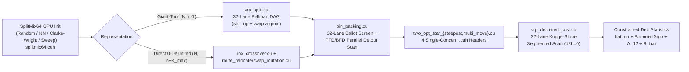

# CVRP Multi-Attribute Architecture, GPU Warp Kernels, `SplitMix64` Parity, and Constrained Deb Statistics

This knowledge-base note explains the mathematical models, 32-lane CUDA warp algorithms, hardware memory boundaries, and statistical contracts behind the **VRP Tier 1** architecture (`DP17-1`–`DP17-10`). It complements [analysis-problem-definition-tsp-cvrp.md](./analysis-problem-definition-tsp-cvrp.md) and [guide-project-architecture-blueprint.md](../guide-project-architecture-blueprint.md).

---

## 1. Unified VRP Tier 1 / VRP Tier 2 Taxonomy and `int32` TSPLIB95 `nint` Arithmetic (`DP17-1`, `DP17-6`, `DP17-10`)

### VRP Taxonomy (Vidal, Crainic, Gendreau & Prins, 2014)

Following the Unified Multi-Attribute VRP decomposition of **Vidal, Crainic, Gendreau & Prins (2014)**, routing constraints are partitioned into two explicit **VRP** tiers (kept strictly distinct from the two-tier statistical testing protocol in [guide-statistical-multicomparison-tests.md](./guide-statistical-multicomparison-tests.md)):

| VRP Taxonomy Tier | Variants | Algebraic / Constraint Structure | Representation in `VRPConstraints` |
| :--- | :--- | :--- | :--- |
| **VRP Tier 1** | `CVRP`, `OVRP`, `DCVRP`, Bounded-Fleet (`K_max`) | Symmetric prefix-additive constraints ($Q$, $L_{\max}$, $K_{\max}$, `return_to_depot`) | Active across loaders, unified CPU/GPU evaluators, split decoders, bin packing, and `2-opt*` local search |
| **VRP Tier 2** | `VRPTW`, `SDVRP` | Asymmetric time-warp monoids (`time_windows`, `service_times`) | Reserved fields on [vrp_constraints.py::VRPConstraints](../../src/data_models/vrp_constraints.py) (zero future schema migration) |

Every VRP Tier 1 variant is a specialization of [vrp_constraints.py::VRPConstraints](../../src/data_models/vrp_constraints.py), attached to [problem.py::Problem](../../src/data_models/problem.py) and cached lazily on [problem_context.py::ProblemContext](../../src/protocols/problem_context.py):

- Vehicle capacity $Q > 0$ (`capacity`),
- Route duration/distance cap $L_{\max} > 0$ (`max_route_distance`),
- Fleet size cap $K_{\max} > 0$ (`max_vehicles`),
- Topology indicator $\mathbb{I}_{\text{closed}} \in \{0, 1\}$ (`return_to_depot`: `True` for `CVRP`/`DCVRP`, `False` for `OVRP`).

For a fleet partition $\mathcal{R} = \{R_1, \dots, R_m\}$ covering customers $\{1, \dots, n - 1\}$ from depot $0$, let $d(u, v) \in \mathbb{Z}_{\ge 0}$ be the integer TSPLIB95 edge weight, $q(R_k) = \sum_{u \in R_k} q_u$ the route load, and $\ell(R_k)$ the route length (including $(v_{\text{last}}, 0)$ iff $\mathbb{I}_{\text{closed}} = 1$). The pure travel cost $c(\mathcal{R})$, raw violation vector $(\nu_Q, \nu_L, \nu_K)$, dimensionless relative violation $\hat{\nu}(\mathcal{R})$, and penalized objective $f_{\text{pen}}(\mathcal{R})$ are:

$$
\begin{aligned}
c(\mathcal{R}) &= \sum_{k=1}^{m} \ell(R_k), \\
\hat{\nu}(\mathcal{R}) &= \frac{\nu_Q}{Q} + \frac{\nu_L}{L_{\max}} + \frac{\nu_K}{K_{\max}}, \\
f_{\text{pen}}(\mathcal{R}) &= c(\mathcal{R}) + \omega_Q \nu_Q + \omega_L \nu_L + \omega_K \nu_K.
\end{aligned}
$$

All evaluators expose structured [vrp_strategies.py::RouteAssessment](../../src/protocols/vrp_strategies.py) payloads (`objectives`, `travel_costs`, `is_feasible`, `violations`, `normalized_violations`, `raw_violation_components`, `num_vehicles`) computed via [vrp_strategies.py::compute_normalized_violations](../../src/protocols/vrp_strategies.py) and pluggable [vrp_strategies.py::PenaltyPolicy](../../src/protocols/vrp_strategies.py) sub-strategies (`InstanceScaledPenaltyPolicy`, `StrictFeasibilityPolicy`, `FixedPenaltyPolicy`, `AdaptivePenaltyPolicy` — with zero magic fallback weights per `BUG-118`).

### Why Strict `int32` `nint` Arithmetic Matters (`DP17-6`)

TSPLIB95 (Reinelt, 1995) and CVRPLIB (Uchoa et al., 2017) define `EUC_2D` distances as $\text{nint}(\sqrt{\Delta x^2 + \Delta y^2}) = \lfloor d + 0.5 \rfloor$. Using `float32` edge weights causes catastrophic cancellation on large `Vrp-Set-Li` instances (Goldberg, 1991; Li, Golden & Wasil, 2005), and comparing integer `nint` costs against continuous `.sol` header totals creates false negative gaps. Therefore, [tsplib_reader.py::resolve_opt_tour_cost](../../src/loaders/tsplib_reader.py) recomputes the exact integer `BKS` from `.sol` routes, while CUDA kernels accumulate travel lengths in `int32`/`int64` and penalized objectives in `float64`.

---


## 2. Three-Representation Coexistence & End-to-End GPU Pipeline (`DP17-2`, `DP17-7`–`DP17-9`)

All six `@runtime_checkable` protocols in [algorithm_strategies.py](../../src/protocols/algorithm_strategies.py) remain unchanged (`32` core strategies in `STRATEGY_REGISTRY`), extended by `10` composable sub-strategies in `SUB_STRATEGY_REGISTRY` across `strategies/{decoding,penalties,bin_packing}/`:

| Representation Family | Tensor Shape | Crossover / Mutation | Evaluation, Repair & Local Search |
| :--- | :--- | :--- | :--- |
| **1. Giant-Tour (Implicit Split)** | `(N, n - 1)` `int32` | Standard TSP operators (`OX`, `PMX`, `Swap`, `Inversion`) | Unified [cost_evaluation.py::EvaluationCPUCost](../../src/algorithms/strategies/evaluation/cost_evaluation.py) / [cost_evaluation.py::EvaluationGPUCost](../../src/algorithms/strategies/evaluation/cost_evaluation.py) invoking [prins_split.py::PrinsSplitDecoder](../../src/algorithms/strategies/decoding/prins_split.py) or [greedy_split.py::GreedySplitDecoder](../../src/algorithms/strategies/decoding/greedy_split.py) |
| **2. Hybrid Split-Memetic** | `(N, n - 1)` $\leftrightarrow$ `(N, n + K_max)` | Standard TSP operators on `(N, n - 1)` | Declarative [pipeline_steps.py::SplitDecodeStep](../../src/algorithms/pipeline_steps.py) $\to$ [two_opt_star_gpu.py::LocalSearchGPUTwoOptStar](../../src/algorithms/strategies/local_search/two_opt_star_gpu.py) $\to$ [pipeline_steps.py::GiantTourEncodeStep](../../src/algorithms/pipeline_steps.py) |
| **3. Direct `0`-Delimited** | `(N, n + K_max)` `int32` | [rbx_crossover.py::CrossoverRBX](../../src/algorithms/strategies/crossover/rbx_crossover.py) / [rbx_crossover.py::CrossoverGPURBX](../../src/algorithms/strategies/crossover/rbx_crossover.py) (Potvin & Bengio, 1996), [route_relocate_mutation.py::MutationGPURouteRelocate](../../src/algorithms/strategies/mutation/route_relocate_mutation.py), [route_swap_mutation.py::MutationGPURouteSwap](../../src/algorithms/strategies/mutation/route_swap_mutation.py) | 32-lane Kogge-Stone [vrp_delimited_cost.cu::vrp_delimited_cost_kernel](../../src/algorithms/strategies/evaluation/kernels/vrp_delimited_cost.cu), VRAM-resident [ffd.py::BinPackingGPUFFD](../../src/algorithms/strategies/bin_packing/ffd.py) / [bfd.py::BinPackingGPUBFD](../../src/algorithms/strategies/bin_packing/bfd.py) via [vrp_pipeline_steps.py::FleetBinPackStep](../../src/algorithms/vrp_pipeline_steps.py), and [vrp_pipeline_steps.py::PenaltyAdaptationStep](../../src/algorithms/vrp_pipeline_steps.py) |



See [`configs/vrp-pipelines.example.json`](../../configs/vrp-pipelines.example.json) for schema-validated configurations of all three families.

---


## 3. Warp-Level CUDA Kernel Walkthroughs (`DP17-2`, `DP17-3`, `DP17-8`, `BUG-117`)

### 3.1 `vrp_split.cu`: 32-Lane Bellman DAG Relaxation

Prins (2004) models optimal giant-tour partitioning as a shortest path on a DAG where arc $(i, j)$ serves $(\pi_{i+1}, \dots, \pi_j)$:

$$
V_j = \min_{0 \le i < j:\; \text{feasible}(i, j)} \Big( V_i + d(0, \pi_{i+1}) + \sum_{t=i+1}^{j-1} d(\pi_t, \pi_{t+1}) + \mathbb{I}_{\text{closed}} \cdot d(\pi_j, 0) \Big), \qquad V_0 = 0.
$$

In [vrp_split.cu::vrp_split_kernel](../../src/algorithms/strategies/decoding/kernels/vrp_split.cu) (driven by [prins_split.py::PrinsSplitDecoder](../../src/algorithms/strategies/decoding/prins_split.py)), each CUDA block assigns one 32-lane warp per individual:

1. **Cooperative 32-Lane Tiled Prefix Scans:** Across tiles of 32 customers, lanes collaboratively load demands and edge weights via [pairwise_device.cuh::gpu_edge_distance](../../src/distances/kernels/pairwise_device.cuh) and run `__shfl_up_sync(0xffffffffu, val, offset)` to build prefix demand $W[t]$, prefix chain distance $P[t]$, and depot distances $d_0[t]$ in shared memory (defaulting to `max_shared_customers = 1024`, capped at `44 KiB` for Pascal `sm_61`, with seamless global workspace fallback for larger $n$).
2. **Warp-Parallel Predecessor Stride:** For each destination node $j = 1, \dots, n_{\text{cust}}$, lane $\ell \in \{0, \dots, 31\}$ evaluates predecessor candidates $i = j - 1 - \ell,\; j - 1 - \ell - 32, \dots \ge 0$ in parallel, computing exact route load $W[j] - W[i]$, route length $d_0[\pi_{i+1}] + (P[j] - P[i+1]) + \mathbb{I}_{\text{closed}} d_0[\pi_j]$, and IEEE-754-safe penalized cost.
3. **Deterministic Argmin Reduction:** The 32 per-lane best `(cost, pred)` pairs reduce via [block_reductions.cuh::warp_reduce_argmin_double_int](../../src/utils/kernels/block_reductions.cuh), which uses `__shfl_xor_sync` with deterministic smallest-index tie-breaking (`argmin_pair_beats`) to match CPU `np.argmin` bit-for-bit, followed by cooperative route write-back with `d2h_bytes == 0`.

### 3.2 `vrp_delimited_cost.cu`: 32-Lane Kogge-Stone Segmented Scan

Unified [cost_evaluation.py::EvaluationGPUCost](../../src/algorithms/strategies/evaluation/cost_evaluation.py) dispatches flat TSP/ATSP tours to [tour_cost.cu::tour_cost_kernel](../../src/algorithms/strategies/evaluation/kernels/tour_cost.cu) (honoring `context.return_to_depot`) and `0`-delimited VRP routes to [vrp_delimited_cost.cu::vrp_delimited_cost_kernel](../../src/algorithms/strategies/evaluation/kernels/vrp_delimited_cost.cu) (with CPU parity in [delimited_cost.py](../../src/algorithms/strategies/evaluation/delimited_cost.py)).

To evaluate a `0`-delimited chromosome of length $L$ without serializing over `tid == 0`, `vrp_delimited_cost_kernel` assigns **1 warp (32 lanes) per individual** and streams the chromosome in coalesced 32-element tiles:

1. Each lane $\ell$ loads `u = route[tile + l]` and `v = route[tile + l + 1]` (or `0` at boundary), classifies segment head flags `head_l = (u == 0)`, and computes the single-edge travel contribution and customer demand `q_u`.
2. Within the 32-lane tile, a **Kogge-Stone segmented inclusive scan** propagates `(seg_load, seg_dist, head_mask)` across offsets $\delta \in \{1, 2, 4, 8, 16\}$ using `__shfl_up_sync`, resetting the carry whenever a depot delimiter `0` separates two routes:

$$
(s_\ell, h_\ell) \leftarrow \begin{cases}
(s_\ell + s_{\ell - \delta},\; h_\ell \lor h_{\ell - \delta}) & \text{if } \ell \ge \delta \text{ and } \neg h_\ell, \\
(s_\ell,\; h_\ell) & \text{otherwise.}
\end{cases}
$$

1. Carry-over from the previous tile's lane 31 seamlessly bridges routes crossing tile boundaries; at every route-closing delimiter (`v == 0` with active route), the lane accumulates $\max(0, q(R_k) - Q)$, $\max(0, \ell(R_k) - L_{\max})$, total travel cost, and vehicle count into warp-wide sums reduced via `warp_reduce_sum`, writing `(travel_cost, nu_Q, nu_L, num_vehicles)` directly in VRAM (`d2h_bytes == 0`).

### 3.3 `bin_packing.cu`: 32-Lane VRAM Feasibility Screen & `FFD`/`BFD` Parallel Detour Scan

To eliminate the `BUG-117` per-generation `cp.asnumpy` D2H bottleneck of the legacy CPU-only FFD helper, `src/algorithms/strategies/bin_packing/` provides four explicit strategies — [ffd.py::BinPackingCPUFFD](../../src/algorithms/strategies/bin_packing/ffd.py), [ffd.py::BinPackingGPUFFD](../../src/algorithms/strategies/bin_packing/ffd.py), [bfd.py::BinPackingCPUBFD](../../src/algorithms/strategies/bin_packing/bfd.py), and [bfd.py::BinPackingGPUBFD](../../src/algorithms/strategies/bin_packing/bfd.py) — implementing Coffman, Garey & Johnson (1996) First-Fit Decreasing (`mode=0`) and Best-Fit Decreasing (`mode=1`):

1. **Step A — 32-Lane Coalesced Feasibility Screen (Zero-Write Fast Path):** In [bin_packing.cu](../../src/algorithms/strategies/bin_packing/kernels/bin_packing.cu) (supported by [bin_packing_helpers.cuh](../../src/algorithms/strategies/bin_packing/kernels/bin_packing_helpers.cuh)), each warp scans its row in 32-lane tiles using `__ballot_sync` and `__shfl_up_sync` to test fleet count $m \le K_{\max}$, per-route load $q(R_k) \le Q$, and (when $L_{\max}$ is active) route distance $\ell(R_k) \le L_{\max}$. If every constraint holds, the warp exits immediately with **zero global memory writes** and zero distance lookups on feasible rows.
2. **Step B — Parallel Detour Scan on Violating Rows:** For rows exceeding $K_{\max}$, $Q$, or $L_{\max}$, routes are sorted by `(0 if feasible else 1, -load, idx)`, excess tail customers are extracted in `(-demand, customer_id)` order, and all 32 warp lanes evaluate insertion detours $\Delta(c, r, pos)$ in parallel across candidate positions, selecting the optimal insertion via `warp_reduce_argmin_double_int` (first fitting bin for `FFD`, minimum residual capacity for `BFD`, honoring `OVRP`/`DCVRP` distance bounds and $K_{\max}$ overflow fallback). Shared memory handles `dim <= 768` (`1` warp/block), switching to a `4` warps/block (`128` threads) monotonic global workspace above `768`.

### 3.4 Route-Disjoint `2-opt*` Inter-Route Local Search (`LocalSearchGPUTwoOptStar`)

[two_opt_star_gpu.py::LocalSearchGPUTwoOptStar](../../src/algorithms/strategies/local_search/two_opt_star_gpu.py) (and CPU counterpart [two_opt_star_cpu.py::LocalSearchCPUTwoOptStar](../../src/algorithms/strategies/local_search/two_opt_star_cpu.py)) implements `Relocate(1, 0)`, `Swap(1, 1)`, and `2-opt*` (Potvin & Rousseau, 1995) via persistent single-launch CUDA kernels (O'Neil & Burtscher, 2015) decomposed into four single-concern `.cuh` headers ([vrp_route_prefix_buffers.cuh](../../src/algorithms/strategies/local_search/kernels/vrp_route_prefix_buffers.cuh), [relocate_swap_two_opt_star_deltas.cuh](../../src/algorithms/strategies/local_search/kernels/relocate_swap_two_opt_star_deltas.cuh), [vrp_candidate_neighborhood_scan.cuh](../../src/algorithms/strategies/local_search/kernels/vrp_candidate_neighborhood_scan.cuh), and [intra_route_two_opt.cuh](../../src/algorithms/strategies/local_search/kernels/intra_route_two_opt.cuh)):

1. **Steepest-descent mode** ([two_opt_star_steepest.cu::two_opt_star_steepest_kernel](../../src/algorithms/strategies/local_search/kernels/two_opt_star_steepest.cu)): evaluates all neighborhoods in parallel per block and applies the best improving move in-place until convergence or `max_iterations`.
2. **Route-disjoint multi-move mode** ([two_opt_star_multi_move.cu::two_opt_star_multi_move_kernel](../../src/algorithms/strategies/local_search/kernels/two_opt_star_multi_move.cu)): greedily commits mutually route-disjoint moves in one pass using a bitmask `uint32_t route_used_mask[32]` (`1024` routes in shared memory, with global fallback), guaranteeing exact $\Delta$-additivity.

---

## 4. `SplitMix64` Bit-Identical Initializers & NVRTC Intrinsics vs. CUB JIT Overhead

### 4.1 `SplitMix64` Cross-Backend Determinism (Steele, Lea & Flood, 2014)

All four initialization families have explicit CPU and GPU classes (`Initialization[CPU|GPU]{Random,NearestNeighbor,ClarkeWright,Sweep}` in `src/algorithms/strategies/initialization/` — covering uniform Fisher–Yates, GRASP Nearest Neighbor, randomized Clarke & Wright (1964) savings, and Gillett & Miller (1974) polar sweep).

To guarantee **bit-identical** populations between CPU and GPU runs without transferring full `(N, n)` random tables over PCIe, [splitmix64.py::splitmix64_step](../../src/utils/splitmix64.py) and [splitmix64.cuh](../../src/utils/kernels/splitmix64.cuh) implement the exact 64-bit `SplitMix64` bijection (Steele, Lea & Flood, 2014):

$$
\begin{aligned}
s_{t+1} &= (s_t + \texttt{0x9E3779B97F4A7C15}) \bmod 2^{64}, \\
z_1 &= (s_{t+1} \oplus (s_{t+1} \gg 30)) \cdot \texttt{0xBF58476D1CE4E5B9} \bmod 2^{64}, \\
z_2 &= (z_1 \oplus (z_1 \gg 27)) \cdot \texttt{0x94D049BB133111EB} \bmod 2^{64}, \\
x_t &= z_2 \oplus (z_2 \gg 31),
\end{aligned}
$$

paired with Lemire's high-32-bit multiply bounded integer draw $\lfloor ((x_t \gg 32) \cdot B) / 2^{32} \rfloor$. The host uploads only a compact `(N,)` `uint64` row-seed vector (`8 * N` bytes), and each GPU thread/warp evolves the exact same state trajectory as the CPU implementation.

### 4.2 Why NVRTC Warp Intrinsics Avoid `#include <cub/cub.cuh>` JIT Overhead

Shared reduction primitives live in [block_reductions.cuh](../../src/utils/kernels/block_reductions.cuh) (`warp_reduce_sum<T>`, `block_reduce_sum<T>`, `warp_reduce_argmin_double_int`, `block_reduce_argmin_double_int`), injected via `-I src/utils/kernels` by [gpu_helpers.py::load_kernel](../../src/utils/gpu_helpers.py).

We intentionally implement these reductions using native CUDA warp-shuffle intrinsics (`__shfl_down_sync`, `__shfl_xor_sync`, `__shfl_up_sync`, `__ballot_sync`) rather than `#include <cub/cub.cuh>`:

1. **Zero NVRTC Template/Header Explosion:** CuPy compiles `RawKernel` sources through runtime **NVRTC** (not ahead-of-time `nvcc`). Pulling in `<cub/cub.cuh>` transitively parses tens of thousands of lines of C++ template headers (`thrust`, `cuda/std`, `cub/block`), inflating cold JIT compilation latency from `< 50 ms` to several seconds per kernel and requiring host toolkit include paths that vary across CUDA 12.x installations.
2. **Deterministic Tie-Breaking Control:** `warp_reduce_argmin_double_int` encodes exact smallest-index tie-breaking (`argmin_pair_beats`) in 15 lines of self-contained device code, guaranteeing strict CPU `np.argmin` parity across `vrp_split.cu`, `bin_packing.cu`, and `two_opt_star_*.cu`.

---

## 5. Constrained Deb (2000) Statistical Inference Over All $R$ Paired Seeds (`DP17-4`, `DP17-10`)

### Dimensionless $\hat{\nu}$, Exact Binomial Sign + $\hat{A}_{12}$, and Seed-Averaged $\bar{R}_{p,j}$

When 100% of runs in a comparison/cohort are feasible (all `TSP`/`ATSP` and 100%-feasible VRP), the exact Demšar (2006) Wilcoxon signed-rank / Hodges-Lehmann / Kerby (2014) rank-biserial / Friedman / Nemenyi pipeline executes unchanged. When any seed is infeasible, [constrained_statistics.py](../../src/benchmarking/analysis/constrained_statistics.py) avoids raw-unit summation ($\text{kg} + \text{m} + \text{vehicles}$), $C^{\max}+1+\nu$ Wilcoxon magnitude distortion, and `29/30` cohort collapse:

1. **Dimensionless Violation $\hat{\nu}$:** Checkpoints persist `raw_normalized_violations` ($\hat{\nu} = \nu_Q/Q + \nu_L/L_{\max} + \nu_K/K_{\max}$), guaranteeing bit-for-bit invariance under unit rescaling (e.g., $\text{kg} \to \text{g}$).
2. **Feasible-Only Descriptives:** `mean_cost`, `std_cost`, `mean_gap`, and Hodges-Lehmann `ci_95` summarize strictly feasible runs (`NaN`/`None` when $0$ feasible; `ci_95 = (nan, nan)` whenever fewer than $6$ valid runs/mutually feasible pairs exist per $2^{-(n-1)} > 0.05$).
3. **Statistical Tier 1 (Within-Instance, all $R$ seeds):**
   + *Omnibus ($k \ge 3$):* [constrained_statistics.py::compute_deb_seed_rank_matrix](../../src/benchmarking/analysis/constrained_statistics.py) ranks all $k$ algorithms within each seed $r \in \{1..R\}$ under Deb's strict lexicographic tuple `(0 if feasible else 1, 0.0 if feasible else hat_nu, travel_cost if feasible else 0.0)` with average ranks on ties, feeding those per-seed ranks into Friedman + Iman-Davenport + Nemenyi.
   + *Pairwise ($2$ algorithms with any infeasible seed):* [constrained_statistics.py::constrained_paired_comparison](../../src/benchmarking/analysis/constrained_statistics.py) keeps all $R$ paired seeds and applies the exact two-sided Binomial Sign Test (`test_used="exact_binomial_sign_deb"`), Kerby-signed ordinal dominance $r_{\text{Kerby}} = (\text{wins}_b - \text{wins}_a) / R$ (Kerby, 2014), and the **Vargha–Delaney stochastic dominance statistic** (Vargha & Delaney, 2000; Arcuri & Briand, 2014):

$$
\hat{A}_{12} = \frac{\text{wins}_a + 0.5 \cdot \text{ties}}{R} \in [0, 1],
$$

   where $\hat{A}_{12} = 0.5$ denotes stochastic equivalence, $\hat{A}_{12} > 0.5$ favors Algorithm $A$ under Deb's strict feasibility-first ordering, and standard effect-size thresholds follow Vargha & Delaney (2000) / Arcuri & Briand (2014) (`negligible` $< 0.56$, `small` $\ge 0.56$, `medium` $\ge 0.64$, `large` $\ge 0.71$, symmetrically below $0.5$).
4. **Statistical Tier 2 (Across-Instance Cohort):** [cohort.py::BenchmarkCohort.quality_score_matrix](../../src/benchmarking/analysis/cohort.py) computes the seed-averaged Deb rank matrix via [constrained_statistics.py::compute_seed_averaged_deb_ranks](../../src/benchmarking/analysis/constrained_statistics.py):

$$
\bar{R}_{p, j} = \frac{1}{R_p} \sum_{r=1}^{R_p} \operatorname{rank}_{\text{Deb}}(p, r, j),
$$

so a solver with `29/30` feasible runs at `0.1%` gap strictly beats a `30/30` solver at `45%` gap ($\bar{R} = 31/30 < 59/30$), while a `30/30` solver strictly beats a lucky `3/30` solver ($\bar{R} = 1.10 < 1.90$).

### Executable Verification Snippet

```python
import numpy as np
from benchmarking.analysis.constrained_statistics import constrained_paired_comparison
from benchmarking.analysis.statistics import StatisticalAnalyzer

analyzer = StatisticalAnalyzer(alpha=0.05)
summary = constrained_paired_comparison(
  cost_a=np.array([200.0, 202.0, 204.0, 206.0, 150.0, 151.0, 152.0, 153.0]),
  hat_nu_a=np.array([0.0, 0.0, 0.0, 0.0, 0.1, 0.2, 0.3, 0.4]),
  feas_a=np.array([True, True, True, True, False, False, False, False]),
  cost_b=np.array([230.0, 232.0, 234.0, 236.0, 238.0, 240.0, 242.0, 244.0]),
  hat_nu_b=np.zeros(8),
  feas_b=np.ones(8, dtype=bool),
  label="AlgoA vs AlgoB",
  metric_name="cost",
  analyzer=analyzer,
)
print(summary.test_used, summary.p_value, summary.vargha_delaney_a12, summary.ci_95_difference)
# Expected: exact_binomial_sign_deb 1.0 0.5 (nan, nan)
```

---

## References

- **Arcuri, A., & Briand, L. (2014).** A Hitchhiker's Guide to Statistical Tests for Assessing Randomized Algorithms in Software Engineering. *Software Testing, Verification and Reliability*, 24(3), 219–250. [doi:10.1002/stvr.1486](https://doi.org/10.1002/stvr.1486)
- **Clarke, G., & Wright, J. W. (1964).** Scheduling of Vehicles from a Central Depot to a Number of Delivery Points. *Operations Research*, 12(4), 568–581. [doi:10.1287/opre.12.4.568](https://doi.org/10.1287/opre.12.4.568)
- **Coffman, E. G., Jr., Garey, M. R., & Johnson, D. S. (1996).** Approximation Algorithms for Bin Packing: A Survey. In D. S. Hochbaum (Ed.), *Approximation Algorithms for NP-Hard Problems* (pp. 46–93). PWS Publishing Company.
- **Deb, K. (2000).** An efficient constraint handling method for genetic algorithms. *Computer Methods in Applied Mechanics and Engineering*, 186(2–4), 311–338. [doi:10.1016/S0045-7825(99)00389-8](https://doi.org/10.1016/S0045-7825(99)00389-8)
- **Gillett, B. E., & Miller, L. R. (1974).** A Heuristic Algorithm for the Vehicle-Dispatch Problem. *Operations Research*, 22(2), 340–349. [doi:10.1287/opre.22.2.340](https://doi.org/10.1287/opre.22.2.340)
- **Goldberg, D. (1991).** What every computer scientist should know about floating-point arithmetic. *ACM Computing Surveys*, 23(1), 5–48. [doi:10.1145/103162.103163](https://doi.org/10.1145/103162.103163)
- **Kerby, D. S. (2014).** The Simple Difference Formula: An Approach to Teaching Nonparametric Correlation. *Comprehensive Psychology*, 3, 11.IT.3.1. [doi:10.2466/11.IT.3.1](https://doi.org/10.2466/11.IT.3.1)
- **Li, F., Golden, B., & Wasil, E. (2005).** Very large-scale vehicle routing: New test problems, algorithms, and results. *Computers & Operations Research*, 32(5), 1165–1179. [doi:10.1016/j.cor.2003.10.002](https://doi.org/10.1016/j.cor.2003.10.002)
- **O'Neil, M. A., & Burtscher, M. (2015).** Rethinking the parallelization of random-restart hill climbing: A case study in optimizing a 2-opt TSP solver for GPU execution. *Proceedings of GPGPU-8*, 72–81. [doi:10.1145/2716282.2716287](https://doi.org/10.1145/2716282.2716287)
- **Potvin, J.-Y., & Bengio, S. (1996).** The vehicle routing problem with time windows part II: Genetic search. *INFORMS Journal on Computing*, 8(2), 165–172. [doi:10.1287/ijoc.8.2.165](https://doi.org/10.1287/ijoc.8.2.165)
- **Potvin, J.-Y., & Rousseau, J.-M. (1995).** An exchange heuristic for routing problems with time windows. *Journal of the Operational Research Society*, 46(12), 1433–1446. [doi:10.1057/jors.1995.204](https://doi.org/10.1057/jors.1995.204)
- **Prins, C. (2004).** A simple and effective evolutionary algorithm for the vehicle routing problem. *Computers & Operations Research*, 31(12), 1985–2002. [doi:10.1016/S0305-0548(03)00158-8](https://doi.org/10.1016/S0305-0548(03)00158-8)
- **Reinelt, G. (1995).** *TSPLIB95*. Universität Heidelberg, Institut für Informatik. <http://comopt.ifi.uni-heidelberg.de/software/TSPLIB95/>
- **Steele, G. L., Jr., Lea, D., & Flood, C. H. (2014).** Fast Splittable Pseudorandom Number Generators. *Proceedings of the 2014 ACM International Conference on Object Oriented Programming Systems Languages & Applications (OOPSLA '14)*, 453–472. [doi:10.1145/2660193.2660195](https://doi.org/10.1145/2660193.2660195)
- **Uchoa, E., Pecin, D., Pessoa, A., Poggi, M., Vidal, T., & Subramanian, A. (2017).** New benchmark instances for the Capacitated Vehicle Routing Problem. *European Journal of Operational Research*, 257(3), 845–858. [doi:10.1016/j.ejor.2016.08.012](https://doi.org/10.1016/j.ejor.2016.08.012)
- **Vargha, A., & Delaney, H. D. (2000).** A Critique and Improvement of the CL Common Language Effect Size Statistics of McGraw and Wong. *Journal of Educational and Behavioral Statistics*, 25(2), 101–132. [doi:10.3102/10769986025002101](https://doi.org/10.3102/10769986025002101)
- **Vidal, T., Crainic, T. G., Gendreau, M., & Prins, C. (2014).** A unified solution framework for multi-attribute vehicle routing problems. *European Journal of Operational Research*, 234(3), 658–673. [doi:10.1016/j.ejor.2013.09.045](https://doi.org/10.1016/j.ejor.2013.09.045)
