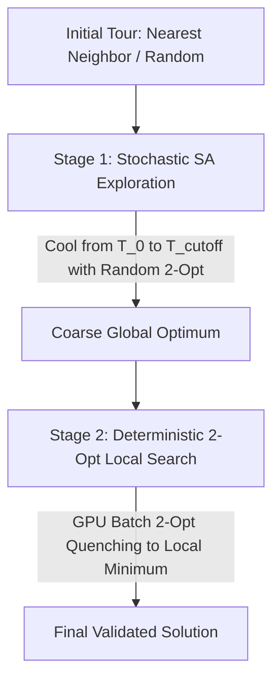

# Simulated Annealing: Theoretical Foundations, Cooling Schedules, and Algorithmic Dynamics

- [Simulated Annealing: Theoretical Foundations, Cooling Schedules, and Algorithmic Dynamics](#simulated-annealing-theoretical-foundations-cooling-schedules-and-algorithmic-dynamics)
  - [1. Historical Lineage and Talbi's Dual Taxonomy](#1-historical-lineage-and-talbis-dual-taxonomy)
    - [1.1 Physical Metallurgy Analogy and the Metropolis Foundation](#11-physical-metallurgy-analogy-and-the-metropolis-foundation)
    - [1.2 Talbi's Dual Classification: S-Task and P-Data](#12-talbis-dual-classification-s-task-and-p-data)
  - [2. The Metropolis Acceptance Criterion](#2-the-metropolis-acceptance-criterion)
    - [2.1 Mathematical Formulation](#21-mathematical-formulation)
    - [2.2 Thermodynamic Interpretation and Escape Mechanics](#22-thermodynamic-interpretation-and-escape-mechanics)
  - [3. Analytical Derivation of Initial Temperature ($T_0$)](#3-analytical-derivation-of-initial-temperature-t_0)
    - [3.1 Derivation from the Target Acceptance Ratio](#31-derivation-from-the-target-acceptance-ratio)
    - [3.2 Analytical Trade-offs: $\\chi_0 = 0.60$ vs $\\chi_0 = 0.80$](#32-analytical-trade-offs-chi_0--060-vs-chi_0--080)
    - [3.3 Practical Sampling Protocol for Problem Instances](#33-practical-sampling-protocol-for-problem-instances)
  - [4. Cooling Schedules and Annealing Regimes](#4-cooling-schedules-and-annealing-regimes)
    - [4.1 Geometric (Exponential) Cooling](#41-geometric-exponential-cooling)
    - [4.2 Logarithmic Cooling (Geman & Geman Convergence Proof)](#42-logarithmic-cooling-geman--geman-convergence-proof)
    - [4.3 Adaptive and Dynamic Cooling Schedules](#43-adaptive-and-dynamic-cooling-schedules)
      - [Huang et al. (1986) Statistical Annealing](#huang-et-al-1986-statistical-annealing)
      - [Aarts & Korst (1989) Polynomial-Time Annealing](#aarts--korst-1989-polynomial-time-annealing)
    - [4.4 Minimum Temperature ($T_{\\min}$) and Stopping Criteria](#44-minimum-temperature-t_min-and-stopping-criteria)
  - [5. Neighborhood Exploration Strategies for the TSP](#5-neighborhood-exploration-strategies-for-the-tsp)
    - [5.1 Random 2-Opt Move vs. Exhaustive Neighborhood Evaluation](#51-random-2-opt-move-vs-exhaustive-neighborhood-evaluation)
    - [5.2 Markov Chain Length ($L_k$) Scaling](#52-markov-chain-length-l_k-scaling)
    - [5.3 Temperature-Dependent Adaptive Exploration](#53-temperature-dependent-adaptive-exploration)
  - [6. Metaheuristic Composition and Hybrid Architectures](#6-metaheuristic-composition-and-hybrid-architectures)
    - [6.1 SA within Iterated Local Search (ILS) and Variable Neighborhood Search (VNS)](#61-sa-within-iterated-local-search-ils-and-variable-neighborhood-search-vns)
    - [6.2 Two-Stage Optimization: High-Temperature Exploration followed by Deterministic Quenching](#62-two-stage-optimization-high-temperature-exploration-followed-by-deterministic-quenching)
  - [7. Academic References](#7-academic-references)

---

## 1. Historical Lineage and Talbi's Dual Taxonomy

Simulated Annealing (SA) is a trajectory-based stochastic metaheuristic inspired by statistical thermodynamics. Originally conceived by Metropolis et al. (1953) to simulate chemical equilibrium in many-body physical systems, it was independently adapted to discrete combinatorial optimization problems by Kirkpatrick, Gelatt, and Vecchi (1983) and Černý (1985).

### 1.1 Physical Metallurgy Analogy and the Metropolis Foundation

In physical annealing, a solid material is heated to a high temperature where atoms diffuse freely in a disordered liquid state. The temperature is then decreased slowly through controlled thermal stages. If cooling is sufficiently slow, thermal mobility allows atoms to self-organize into a minimal-energy monocrystalline lattice. If the material is cooled too quickly (quenched), the system is frozen into an amorphous, metastable glass with high internal stress and defective structural order.

In combinatorial optimization:
- The microscopic physical state corresponds to a candidate solution $s \in \mathcal{S}$ (e.g., a Hamiltonian tour $\pi$ on graph $G = (V, E)$).
- The internal energy $E(s)$ corresponds to the objective cost function $f(s) = \sum_{i=1}^n d(\pi_i, \pi_{i+1})$.
- The thermodynamic temperature $T$ acts as a global continuous control parameter governing the probability of accepting moves that deteriorate the objective function.
- The minimum-energy crystal corresponds to the global optimal solution $s^* = \arg\min_{s \in \mathcal{S}} f(s)$.

### 1.2 Talbi's Dual Classification: S-Task and P-Data

In El-Ghazali Talbi's comprehensive taxonomy of metaheuristics (Talbi, 2009), optimization algorithms are characterized along two fundamental dimensions:
1. **Search Trajectory**: Single-solution trajectory search (S-Metaheuristics) vs. population-based search (P-Metaheuristics).
2. **Parallelization Axis**: Task parallelism (S-Task vs. P-Task) vs. Data parallelism (S-Data vs. P-Data).

Simulated Annealing occupies a distinct dual classification depending on the execution boundary under evaluation:

```text
┌────────────────────────────────────────────────────────────────────────┐
│                   Talbi's Dual Classification for SA                   │
├────────────────────────────────────────────────────────────────────────┤
│ 1. S-TASK REGIME (Sequential Trajectory along Markov Chain):           │
│    - Iteration i+1 depends strictly on state s_i and acceptance of s': │
│      s_{i+1} = s' if accepted, else s_i                                │
│    - Temperature T_{k+1} = α · T_k enforces strict temporal ordering   │
│    - Cannot evaluate iteration i+100 without resolving i .. i+99       │
├────────────────────────────────────────────────────────────────────────┤
│ 2. P-DATA REGIME (Spatial Parallelism within / across Steps):          │
│    - Level 2A (Intra-step): Evaluating O(n^2) 2-opt neighbor deltas in │
│      parallel for the current tour s_i across GPU threads.             │
│    - Level 2B (Multi-start): Launching M independent SA Markov chains  │
│      with distinct RNG seeds across parallel CUDA blocks.              │
└────────────────────────────────────────────────────────────────────────┘
```

#### S-Task: The Sequential Markov Chain
A standard Simulated Annealing execution generates a sequence of homogeneous or inhomogeneous Markov chains. At step $i$, generating candidate $s' \in \mathcal{N}(s_i)$ and deciding whether $s_{i+1} \leftarrow s'$ requires knowing $s_i$. You cannot compute step $i + 1$ without knowing the result of step $i$. This temporal dependency establishes SA as an **S-Task** (Single Task) trajectory algorithm: execution across the temperature schedule is inherently sequential.

#### P-Data: Parallel Move Evaluation and Multi-Trajectory Exploration
Simulated Annealing simultaneously exhibits strong **P-Data** (Parallel Data) characteristics in two concrete operational contexts:
1. **Intra-Step Combinatorial Neighborhood Evaluation**: While deciding which move to execute requires a single outcome, evaluating candidate moves $\Delta f(s, s')$ across the complete $O(n^2)$ 2-opt neighborhood can be partitioned across thousands of GPU cores simultaneously.
2. **Independent Replicated Trajectories (Multi-Start SA)**: Executing $M$ independent Markov chains from different initial tours $\pi^{(1)}_0, \dots, \pi^{(M)}_0$ at temperature schedule $\{T_k\}$ exhibits zero inter-chain data dependencies. Each GPU block or warp executes an independent chain, making the macro-execution purely P-Data.

---

## 2. The Metropolis Acceptance Criterion

### 2.1 Mathematical Formulation

Let $s \in \mathcal{S}$ denote the current tour and $s' \in \mathcal{N}(s)$ denote a candidate tour generated by perturbing $s$. The change in objective cost is:

$$\Delta E = f(s') - f(s)$$

Under the Metropolis criterion, the probability $P_{\text{acc}}(s \to s' \mid T)$ of accepting the transition to $s'$ at temperature $T$ is given by:

$$P_{\text{acc}}(s \to s' \mid T) = \begin{cases} 1 & \text{if } \Delta E \le 0 \\ \exp\left(-\frac{\Delta E}{T}\right) & \text{if } \Delta E > 0 \end{cases}$$

In stochastic software implementations, a pseudo-random variable $r \sim \mathcal{U}(0, 1)$ is sampled. The candidate solution $s'$ is accepted if:

$$r < \exp\left(-\frac{\Delta E}{T}\right) \iff \ln(r) < -\frac{\Delta E}{T} \iff -T \ln(r) > \Delta E$$

```python
"""Canonical Metropolis criterion implementation."""

import math
import random


def metropolis_accept(
    delta_e: float, temperature: float, rng: random.Random
) -> bool:
  """Evaluates Metropolis criterion for a candidate move.

  Args:
      delta_e: Cost differential f(s') - f(s). Negative indicates improvement.
      temperature: Current annealing temperature T > 0.
      rng: Pseudo-random number generator instance.

  Returns:
      True if the move is accepted, False otherwise.
  """
  if delta_e <= 0.0:
    return True
  if temperature <= 0.0:
    return False

  acceptance_prob = math.exp(-delta_e / temperature)
  return rng.random() < acceptance_prob
```

### 2.2 Thermodynamic Interpretation and Escape Mechanics

The acceptance probability function $\exp(-\Delta E / T)$ exhibits two boundary limits:
1. **High-Temperature Regime ($T \to \infty$):**
   $$\lim_{T \to \infty} \exp\left(-\frac{\Delta E}{T}\right) = \exp(0) = 1$$
   Every candidate move is accepted regardless of cost increase. The algorithm behaves as an unconstrained uniform random walk over the combinatorial search space, achieving ergodicity and escaping any initial basin of attraction.

2. **Low-Temperature Regime ($T \to 0^+$):**
   $$\lim_{T \to 0^+} \exp\left(-\frac{\Delta E}{T}\right) = 0 \quad (\text{for } \Delta E > 0)$$
   Deteriorating moves are rejected with probability 1. The algorithm degenerates into a purely greedy hill-climbing descent (first-improvement or best-improvement depending on neighborhood selection).

Between these extremes, the temperature $T$ acts as an adaptive filter that permits controlled uphill moves to escape local minima:

| Temperature ($T$) | Cost Delta ($\Delta E$) | Acceptance Probability $P_{\text{acc}}$ | Search Behavior |
|---|---|---|---|
| $10,000$ | $+100$ | $\exp(-100 / 10000) = 0.990$ | Free exploration; landscape smoothing |
| $1,000$ | $+100$ | $\exp(-100 / 1000) = 0.905$ | Coarse structural exploration |
| $200$ | $+100$ | $\exp(-100 / 200) = 0.606$ | Balanced exploration / intensification |
| $50$ | $+100$ | $\exp(-100 / 50) = 0.135$ | Strong intensification; escaping shallow valleys |
| $10$ | $+100$ | $\exp(-100 / 10) = 0.000045$ | Greedy descent; fine-tuning |
| $1$ | $+100$ | $\exp(-100 / 1) \approx 3.7 \times 10^{-44}$ | Pure deterministic local search |

---

## 3. Analytical Derivation of Initial Temperature ($T_0$)

Setting an arbitrary initial temperature (such as $T_0 = 10,000$ or $T_0 = 100$) produces erratic behavior: on small problem instances where average tour length is $1,000$, $T_0 = 10,000$ causes pure random drift for tens of thousands of steps; on large instances where average tour length is $100,000$, $T_0 = 100$ causes immediate premature freezing into poor local optima.

Kirkpatrick, Gelatt, and Vecchi (1983) established that $T_0$ must be derived analytically from the empirical distribution of cost increases $\Delta E^+$ for the target problem instance.

### 3.1 Derivation from the Target Acceptance Ratio

Let $\chi_0 \in (0, 1)$ denote the desired target acceptance probability for deteriorating moves at the start of the annealing process. Let $\overline{\Delta E^+}$ represent the expected value of positive cost changes ($\Delta E > 0$) encountered across random transitions in the neighborhood $\mathcal{N}(s)$:

$$\overline{\Delta E^+} = \mathbb{E}[\Delta E \mid \Delta E > 0]$$

Under the mean-field approximation, we equate the target acceptance ratio to the expected Metropolis probability:

$$\chi_0 \approx \exp\left(-\frac{\overline{\Delta E^+}}{T_0}\right)$$

Taking the natural logarithm of both sides:

$$\ln(\chi_0) = -\frac{\overline{\Delta E^+}}{T_0}$$

Solving directly for $T_0$:

$$T_0 = -\frac{\overline{\Delta E^+}}{\ln(\chi_0)} = \frac{\overline{\Delta E^+}}{\ln(1 / \chi_0)}$$

Because $\chi_0 \in (0, 1)$, $\ln(\chi_0) < 0$, ensuring $T_0 > 0$.

### 3.2 Analytical Trade-offs: $\chi_0 = 0.60$ vs $\chi_0 = 0.80$

The choice of target ratio $\chi_0$ establishes the fundamental trade-off between search breadth and compute budget efficiency:

```text
┌────────────────────────────────────────────────────────────────────────┐
│               Initial Acceptance Target Comparison                     │
├────────────────────────────────────────────────────────────────────────┤
│ Target Ratio: χ_0 = 0.80                                               │
│   Denominator: ln(1 / 0.80) = ln(1.25) ≈ 0.2231                        │
│   Initial Temp: T_0 ≈ 4.48 · ΔE^+                                      │
│   Characteristics:                                                     │
│     - Broad thermodynamic exploration                                  │
│     - Ergodic traversal of multi-modal search landscapes               │
│     - Requires large iteration budgets (N >= 200,000)                  │
│     - High early entropy; initial tour structure is quickly erased     │
├────────────────────────────────────────────────────────────────────────┤
│ Target Ratio: χ_0 = 0.60                                               │
│   Denominator: ln(1 / 0.60) = ln(1.667) ≈ 0.5108                       │
│   Initial Temp: T_0 ≈ 1.96 · ΔE^+                                      │
│   Characteristics:                                                     │
│     - Focused local exploration                                        │
│     - 56% lower starting temperature than χ_0 = 0.80                   │
│     - Preserves macro-features from construction heuristics (e.g. NN) │
│     - Suited for constrained evaluation budgets (N <= 50,000)          │
└────────────────────────────────────────────────────────────────────────┘
```

#### Why 60% Acceptance is Used in Practical Benchmarking
When Simulated Annealing is initialized from a nearest-neighbor or Christofides construction heuristic rather than a purely random tour, setting $\chi_0 = 0.80$ induces catastrophic forgetting: the initial high temperature destroys the high-quality edges discovered by the construction heuristic within the first 500 iterations. Selecting $\chi_0 = 0.60$ provides sufficient thermal energy to jump out of early local dead-ends while retaining the global topology of the heuristic tour.

### 3.3 Practical Sampling Protocol for Problem Instances

To compute $\overline{\Delta E^+}$ reliably without biasing the initial tour:
1. Generate an initial feasible tour $s_0$.
2. Execute a random walk of $m$ moves (typically $m \in [500, 2000]$).
3. Record all positive cost differentials: $\mathcal{D}^+ = \{ \Delta E_i \mid \Delta E_i > 0 \}$.
4. Compute the sample mean:
   $$\overline{\Delta E^+} = \frac{1}{|\mathcal{D}^+|} \sum_{\Delta E \in \mathcal{D}^+} \Delta E$$
5. Compute $T_0 = -\overline{\Delta E^+} / \ln(\chi_0)$.

```python
"""Analytical initial temperature calculation."""

import numpy as np


def compute_kirkpatrick_t0(
    distance_matrix: np.ndarray,
    target_ratio: float = 0.60,
    sample_size: int = 1000,
    rng: np.random.Generator | None = None,
) -> float:
  """Calculates T_0 via Kirkpatrick's sampling formula.

  Args:
      distance_matrix: (N, N) asymmetric or symmetric distance matrix.
      target_ratio: Target initial acceptance fraction chi_0 in (0, 1).
      sample_size: Number of random transitions to sample.
      rng: Numpy Generator instance.

  Returns:
      Analytically grounded initial temperature T_0.
  """
  if rng is None:
    rng = np.random.default_rng(42)

  n = distance_matrix.shape[0]
  tour = rng.permutation(n)

  worsening_deltas: list[float] = []

  for _ in range(sample_size):
    # Sample a random 2-opt pair (i, j) with i < j
    i, j = sorted(rng.choice(n, size=2, replace=False))
    if i == 0 and j == n - 1:
      continue

    # Evaluate 2-opt delta
    city_a = tour[i - 1]
    city_b = tour[i]
    city_c = tour[j]
    city_d = tour[(j + 1) % n]

    cost_before = distance_matrix[city_a, city_b] + distance_matrix[city_c, city_d]
    cost_after = distance_matrix[city_a, city_c] + distance_matrix[city_b, city_d]
    delta = float(cost_after - cost_before)

    if delta > 0.0:
      worsening_deltas.append(delta)

  if not worsening_deltas:
    # Degenerate uniform metric: fallback to mean edge weight
    mean_delta = float(np.mean(distance_matrix[distance_matrix > 0]))
  else:
    mean_delta = float(np.mean(worsening_deltas))

  t0 = -mean_delta / np.log(target_ratio)
  return max(t0, 1e-4)
```

---

## 4. Cooling Schedules and Annealing Regimes

The cooling schedule governs the sequence of temperatures $\{T_k\}_{k=0}^K$ and the duration spent at each stage. It directly controls the transition from global thermodynamic exploration to fine-grained local exploitation.

### 4.1 Geometric (Exponential) Cooling

Geometric cooling, introduced by Kirkpatrick et al. (1983), is the standard industrial cooling regime due to its simplicity and robust performance:

$$T_{k+1} = \alpha \cdot T_k, \quad 0 < \alpha < 1$$

Typical values of the cooling parameter $\alpha$ range between $0.80 \le \alpha \le 0.9999$. Given an initial temperature $T_0$, a target final temperature $T_{\min}$, and a total iteration budget $N$, the parameter $\alpha$ is uniquely determined by:

$$T_N = T_0 \cdot \alpha^N = T_{\min} \implies \alpha = \left(\frac{T_{\min}}{T_0}\right)^{1 / N}$$

For example, on instance `ch150` with $T_0 = 10,000$, $T_{\min} = 0.01$, and $N = 200,000$:

$$\alpha = \left(\frac{0.01}{10000}\right)^{1 / 200000} = (10^{-6})^{5 \times 10^{-6}} \approx 0.9999309$$

```text
Iter 0:      T = 10,000.0   (P_acc for ΔE=100: 99.0%)
Iter 50,000: T =  1,000.0   (P_acc for ΔE=100: 90.5%)
Iter 100,000: T =   100.0   (P_acc for ΔE=100: 36.8%)
Iter 150,000: T =    10.0   (P_acc for ΔE=100:  0.0045%)
Iter 200,000: T =     0.01  (P_acc for ΔE=100: ~0.0%)
```

### 4.2 Logarithmic Cooling (Geman & Geman Convergence Proof)

Geman and Geman (1984) proved that Simulated Annealing is mathematically guaranteed to converge to the set of global optimal configurations $\mathcal{S}^*$ with probability 1 if the cooling schedule satisfies:

$$T_k \ge \frac{c}{\ln(1 + k)}, \quad k = 1, 2, 3, \dots$$

where $c \ge d^*$, and $d^*$ represents the maximum escape depth (energy barrier) among all local sub-optima in the search landscape.

**Practical Limitation:** While theoretically sound, logarithmic cooling requires an astronomical number of steps. To reduce temperature from $T_0 = 1000$ to $T = 1$ with $c = 100$:

$$1 = \frac{100}{\ln(1 + k)} \implies \ln(1 + k) = 100 \implies k \approx e^{100} \approx 2.68 \times 10^{43} \text{ iterations}$$

This exceeds the lifespan of physical hardware, rendering logarithmic cooling impractical for real-world optimization. Consequently, geometric and adaptive schedules are universally preferred.

### 4.3 Adaptive and Dynamic Cooling Schedules

Adaptive cooling schedules adjust the rate of temperature decay at runtime based on real-time statistical metrics extracted from the Markov chain.

#### Huang et al. (1986) Statistical Annealing
Huang, Romeo, and Sangiovanni-Vincentelli (1986) proposed adjusting temperature so that the average energy decreases smoothly relative to the standard deviation of energy $\sigma(T_k)$:

$$T_{k+1} = T_k \cdot \exp\left(-\frac{\lambda \cdot T_k}{\sigma(T_k)}\right)$$

where $\lambda \le 1.0$ (typically $\lambda \in [0.5, 0.7]$).
- When $\sigma(T_k)$ is large (high variance across candidate tours, indicating a flat or chaotic region), the exponent $-\lambda T_k / \sigma(T_k)$ is small, causing temperature to decrease slowly.
- When $\sigma(T_k)$ is small (the search is confined within a narrow energy valley), temperature drops more rapidly to accelerate local convergence.

#### Aarts & Korst (1989) Polynomial-Time Annealing
Aarts and Korst (1989) formulated a cooling schedule that maintains quasi-equilibrium throughout the annealing trajectory. By bounding the distance between stationary distributions at consecutive temperatures, they derived:

$$T_{k+1} = \frac{T_k}{1 + \frac{T_k \cdot \ln(1 + \delta)}{3 \sigma(T_k)}}$$

where $\delta > 0$ is a small user-defined distance parameter (typically $\delta \in [0.1, 0.25]$). This formulation guarantees that the stationary Markov distribution does not diverge drastically between temperature steps, systematically preventing premature quenching.

### 4.4 Minimum Temperature ($T_{\min}$) and Stopping Criteria

The annealing process terminates when thermal energy is exhausted. Three stopping criteria are commonly employed:

1. **Fixed Temperature Threshold:**
   $$T_k \le T_{\min}$$
   where $T_{\min}$ is chosen such that the acceptance probability of the smallest conceivable worsening $\Delta E_{\min}^+$ is negligible:
   $$\exp\left(-\frac{\Delta E_{\min}^+}{T_{\min}}\right) < \epsilon \quad (\text{e.g., } \epsilon = 10^{-4})$$

2. **Frozen Search Detection:**
   The algorithm terminates if no candidate move has been accepted across $W$ consecutive Markov chains or temperature stages ($W \in [3, 10]$).

3. **Maximum Iteration Budget:**
   A hard execution cap $k \ge N_{\max}$ to ensure deterministic execution bounds in benchmarking suites.

---

## 5. Neighborhood Exploration Strategies for the TSP

In the Traveling Salesperson Problem, candidate solutions are represented as cyclic permutations of $n$ cities $\pi = (\pi_0, \pi_1, \dots, \pi_{n-1})$.

### 5.1 Random 2-Opt Move vs. Exhaustive Neighborhood Evaluation

Two primary strategies exist for generating neighbor candidate solutions $s' \in \mathcal{N}(s)$:

```text
┌────────────────────────────────────────────────────────────────────────┐
│               Random 2-Opt vs Exhaustive TwoOptMove                    │
├────────────────────────────────────────────────────────────────────────┤
│ 1. Random2OptStrategy:                                                 │
│    - Selects a single random pair (i, j) uniformly with i < j          │
│    - Evaluation Cost: O(1) pairwise arithmetic operations              │
│    - Memory Footprint: O(1) buffer overhead                            │
│    - Exploration Nature: High entropy; uniformly samples the space     │
│    - Best Used: High-temperature regime (T >= T_0 / 10)                │
├────────────────────────────────────────────────────────────────────────┤
│ 2. TwoOptMoveStrategy (Exhaustive Scan):                               │
│    - Evaluates all n(n - 1) / 2 possible edge exchanges in parallel    │
│    - Evaluation Cost: O(n^2) operations (or O(1) parallel GPU depth)   │
│    - Memory Footprint: O(n^2) delta matrices (or O(n) reduction)       │
│    - Exploration Nature: Deterministic; selects argmin ΔE              │
│    - Best Used: Low-temperature quenching (T < T_min · 10)             │
└────────────────────────────────────────────────────────────────────────┘
```

#### Analytical Complexity Comparison
For problem instance `ch150` ($n = 150$):
- Number of possible 2-opt moves: $\frac{150 \times 149}{2} = 11,175$.
- In `Random2OptStrategy`, exactly 1 move is generated and evaluated per step ($O(1)$). Over $100,000$ iterations, $100,000$ moves are evaluated.
- In `TwoOptMoveStrategy`, all $11,175$ moves are evaluated every step ($O(n^2)$). Over $1,000$ iterations, $11,175,000$ moves are evaluated.

Executing exhaustive neighborhood evaluation at high temperatures is computationally wasteful: when $T$ is high, even poor moves have an $80\%$ acceptance probability. Expending $O(n^2)$ effort to identify the single best move only to accept a suboptimal move a few iterations later wastes GPU and CPU cycles.

### 5.2 Markov Chain Length ($L_k$) Scaling

At each temperature level $T_k$, the algorithm executes an inner loop of length $L_k$ before updating temperature. Two primary regimes govern $L_k$:

1. **Linear Scaling with Problem Dimension:**
   $$L_k = \beta \cdot n, \quad \beta \in [1, 10]$$
   Ensures that every vertex has multiple opportunities to participate in an edge exchange at each thermal level.

2. **Quadratic Scaling with Neighborhood Cardinality:**
   $$L_k = \beta \cdot \frac{n(n - 1)}{2}, \quad \beta \in [0.1, 1.0]$$
   Ensures that a constant fraction of the complete 2-opt neighborhood is sampled before cooling proceeds.

### 5.3 Temperature-Dependent Adaptive Exploration

A high-performance SA implementation employs a hybrid, temperature-dependent neighborhood operator:

```python
"""Adaptive hybrid move selection across annealing regimes."""

from typing import Protocol


class MoveStrategy(Protocol):

  def generate_move(
      self, tour: list[int], temperature: float
  ) -> tuple[int, int]:
    ...


class TemperatureDependentMoveStrategy:
  """Switches from stochastic sampling to exhaustive search based on thermal state."""

  def __init__(self, threshold_temp: float):
    self.threshold_temp = threshold_temp

  def select_operator(self, current_temp: float) -> str:
    """Selects exploration operator based on temperature threshold.

    Args:
        current_temp: Current annealing temperature.

    Returns:
        'random_sample' if current_temp >= threshold, else 'exhaustive_scan'.
    """
    if current_temp >= self.threshold_temp:
      # High/medium temperature: rapid stochastic sampling
      return "random_sample"
    else:
      # Low temperature: greedy exhaustive intensification
      return "exhaustive_scan"
```

---

## 6. Metaheuristic Composition and Hybrid Architectures

Simulated Annealing functions both as an autonomous global optimizer and as an intensification/diversification component within larger algorithmic frameworks.

### 6.1 SA within Iterated Local Search (ILS) and Variable Neighborhood Search (VNS)

In modern combinatorial optimization, pure Simulated Annealing is rarely deployed in isolation. Instead, it is embedded within higher-order frameworks:

1. **SA as the Acceptance Engine in ILS:**
   In Iterated Local Search (Lourenço, Martin, & Stützle, 2003), a local search algorithm (e.g., 2-opt or 3-opt) finds a local optimum $s^*$. A perturbation operator (shake) generates $s' = \text{Perturb}(s^*)$, and local search yields a new local optimum $s^{*\prime} = \text{LocalSearch}(s')$. Rather than using a strict greedy acceptance criterion ($f(s^{*\prime}) < f(s^*)$), the Metropolis criterion with a constant or slowly oscillating temperature is used to accept or reject $s^{*\prime}$:
   $$P_{\text{acc}}(s^* \to s^{*\prime}) = \min\left(1, \exp\left(-\frac{f(s^{*\prime}) - f(s^*)}{T}\right)\right)$$

2. **Perturbation Operators in VNS:**
   Variable Neighborhood Search (Hansen & Mladenović, 2001) systematically alternates neighborhood structures $\mathcal{N}_1, \mathcal{N}_2, \dots, \mathcal{N}_k$. Random 2-opt, double-bridge 4-opt, and node reallocation act as pluggable perturbation components that shake the solution out of local minima before resuming annealing or local search.

### 6.2 Two-Stage Optimization: High-Temperature Exploration followed by Deterministic Quenching

Extensive empirical testing indicates that running Simulated Annealing to ultra-low temperatures ($T < 10^{-4}$) is inefficient: the acceptance probability of deteriorating moves drops to zero, but the stochastic sampler continues to generate random candidate moves blindly rather than systematically finding the steepest descent vector.

The optimal architectural pattern is a **Two-Stage Hybrid Solver**:



- **Stage 1 (Global Thermal Search):** Simulated Annealing runs for $N = 100,000$ iterations with `Random2OptStrategy`, cooling from $T_0$ to $T_{\text{cutoff}} = T_0 \times 10^{-3}$. This phase rapidly navigates across multiple basins of attraction without getting trapped in early sub-optima.
- **Stage 2 (GPU Deterministic Quenching):** The solution produced by Stage 1 is handed off to a vectorized, parallel GPU 2-opt kernel (e.g., `two_opt_batch.cu`). The kernel executes parallel reduction across all $O(n^2)$ moves until reaching full 2-optimal local stationarity ($\Delta E \ge 0$ for all moves).

This hybrid approach combines the global exploration of Simulated Annealing with the deterministic speed and accuracy of GPU-accelerated local search, avoiding the high overhead of single-move GPU kernel launches.

---

## 7. Academic References

1. **Metropolis, N., Rosenbluth, A. W., Rosenbluth, M. N., Teller, A. H., & Teller, E. (1953).** Equation of State Calculations by Fast Computing Machines. *The Journal of Chemical Physics*, 21(6), 1087–1092. DOI: [10.1063/1.1699114](https://doi.org/10.1063/1.1699114).
2. **Kirkpatrick, S., Gelatt, C. D., & Vecchi, M. P. (1983).** Optimization by Simulated Annealing. *Science*, 220(4598), 671–680. DOI: [10.1126/science.220.4598.671](https://doi.org/10.1126/science.220.4598.671).
3. **Černý, V. (1985).** Thermodynamical Approach to the Traveling Salesman Problem: An Efficient Simulation Algorithm. *Journal of Optimization Theory and Applications*, 45(1), 41–51. DOI: [10.1007/BF00940812](https://doi.org/10.1007/BF00940812).
4. **Geman, S., & Geman, D. (1984).** Stochastic Relaxation, Gibbs Distributions, and the Bayesian Restoration of Images. *IEEE Transactions on Pattern Analysis and Machine Intelligence*, PAMI-6(6), 721–741. DOI: [10.1109/TPAMI.1984.4767596](https://doi.org/10.1109/TPAMI.1984.4767596).
5. **Huang, M. D., Romeo, F., & Sangiovanni-Vincentelli, A. (1986).** An Efficient General Cooling Schedule for Simulated Annealing. In *Proceedings of the IEEE International Conference on Computer-Aided Design (ICCAD)*, pp. 381–384.
6. **Aarts, E., & Korst, J. (1989).** *Simulated Annealing and Boltzmann Machines: A Stochastic Approach to Combinatorial Optimization and Neural Computing*. John Wiley & Sons, Chichester.
7. **van Laarhoven, P. J., & Aarts, E. H. (1987).** *Simulated Annealing: Theory and Applications*. D. Reidel Publishing Company, Dordrecht. DOI: [10.1007/978-94-015-7744-1](https://doi.org/10.1007/978-94-015-7744-1).
8. **Talbi, E.-G. (2009).** *Metaheuristics: From Design to Implementation*. John Wiley & Sons, Hoboken, NJ. DOI: [10.1002/9780470496916](https://doi.org/10.1002/9780470496916).
9. **Lourenço, H. R., Martin, O. C., & Stützle, T. (2003).** Iterated Local Search. In F. Glover & G. A. Kochenberger (Eds.), *Handbook of Metaheuristics*, pp. 320–349. Springer, Boston, MA.
10. **Hansen, P., & Mladenović, N. (2001).** Variable Neighborhood Search: Principles and Applications. *European Journal of Operational Research*, 130(3), 449–467. DOI: [10.1016/S0377-2217(00)00100-4](https://doi.org/10.1016/S0377-2217(00)00100-4).
