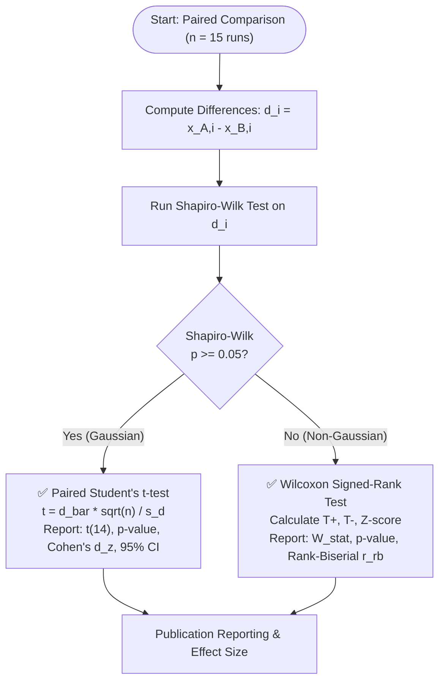

# Pairwise Comparisons: Paired t-Test and Wilcoxon Signed-Rank Test

- [Pairwise Comparisons: Paired t-Test and Wilcoxon Signed-Rank Test](#pairwise-comparisons-paired-t-test-and-wilcoxon-signed-rank-test)
  - [1. Fundamental Concepts: Paired vs. Independent Experimental Designs](#1-fundamental-concepts-paired-vs-independent-experimental-designs)
    - [1.1 What Exactly is a "Paired" Design?](#11-what-exactly-is-a-paired-design)
    - [1.2 The Mathematics of Variance Reduction via Pairing](#12-the-mathematics-of-variance-reduction-via-pairing)
    - [1.3 The Paired Difference Vector](#13-the-paired-difference-vector)
  - [2. The Paired Student's $t$-Test: Complete Formulation](#2-the-paired-students-t-test-complete-formulation)
    - [2.1 Null Hypothesis and Test Statistic Calculation](#21-null-hypothesis-and-test-statistic-calculation)
    - [2.2 Critical Value and Two-Tailed $p$-Value Calculation](#22-critical-value-and-two-tailed-p-value-calculation)
    - [2.3 Confidence Interval Formulation and Frequentist Semantics](#23-confidence-interval-formulation-and-frequentist-semantics)
    - [2.4 What You CAN and CANNOT Say: Frequentist vs. Bayesian Interpretation](#24-what-you-can-and-cannot-say-frequentist-vs-bayesian-interpretation)
  - [3. The Wilcoxon Signed-Rank Test: Exact Non-Parametric Mechanics](#3-the-wilcoxon-signed-rank-test-exact-non-parametric-mechanics)
    - [3.1 Ranking Formulation and Zero-Difference Handling](#31-ranking-formulation-and-zero-difference-handling)
    - [3.2 Rank Sum Algebraic Identities ($T^+, T^-$)](#32-rank-sum-algebraic-identities-t-t-)
    - [3.3 Exact Null Expectation Derivation](#33-exact-null-expectation-derivation)
    - [3.4 Exact Variance Derivations: Clarifying $\text{Var}(T^+)$ vs. $\text{Var}(T)$](#34-exact-variance-derivations-clarifying-textvart-vs-textvart)
    - [3.5 Large-Sample Gaussian Approximation and Continuity Correction](#35-large-sample-gaussian-approximation-and-continuity-correction)
  - [4. Parametric vs. Non-Parametric Decision Framework](#4-parametric-vs-non-parametric-decision-framework)
    - [4.1 Outlier Robustness: Why the $t$-Test Fails on Heavy Tails](#41-outlier-robustness-why-the-t-test-fails-on-heavy-tails)
    - [4.2 The Asymptotic Relative Efficiency (ARE) Trade-Off](#42-the-asymptotic-relative-efficiency-are-trade-off)
    - [4.3 End-to-End Decision Tree for Paired Comparisons](#43-end-to-end-decision-tree-for-paired-comparisons)
  - [5. Step-by-Step Empirical Calculations with Real Benchmark Data](#5-step-by-step-empirical-calculations-with-real-benchmark-data)
    - [5.1 Parametric Example: `berlin52` (CPU vs. HybridOptimized Runtime)](#51-parametric-example-berlin52-cpu-vs-hybridoptimized-runtime)
    - [5.2 Non-Parametric Example: `ch130` (HybridNaive vs. FullGPU Cost)](#52-non-parametric-example-ch130-hybridnaive-vs-fullgpu-cost)
  - [6. Python Verification Script with `scipy.stats`](#6-python-verification-script-with-scipystats)
  - [7. Academic References](#7-academic-references)

---

## 1. Fundamental Concepts: Paired vs. Independent Experimental Designs

### 1.1 What Exactly is a "Paired" Design?

In experimental algorithmics, choosing between an **independent (unpaired)** test and a **paired** test fundamentally defines how experimental units are controlled:

```text
INDEPENDENT (UNPAIRED) DESIGN:
Algorithm A ──► Tested on Random Seed Set S_1 (e.g., Seeds 1-15 on random graphs)
Algorithm B ──► Tested on Random Seed Set S_2 (e.g., Seeds 16-30 on different graphs)
Problem: Between-instance variability is lumped into experimental error!

PAIRED (MATCHED) DESIGN (Our Repository Architecture):
Instance k (or Seed s) ──┬──► Solved by Algorithm A ──► Result X_{A, k}
                         └──► Solved by Algorithm B ──► Result X_{B, k}
Benefit: Each instance/seed acts as its own internal control!
```

- **Independent Samples**: Observations in Group A have no one-to-one correspondence with observations in Group B. Example: Running Algorithm A on 15 random Euclidean TSP instances, and Algorithm B on 15 *different* random instances.
- **Paired Samples**: Each measurement in Group A is linked to a uniquely matched measurement in Group B by sharing an identical nuisance factor. In `gpu_accelerated_clean`, pairing occurs across two complementary dimensions:
  1. **Within-Instance Pairing (Stochastic Runs)**: Both algorithms are executed across the exact same sequence of 15 pseudo-random seeds ($s \in \{1, \dots, 15\}$), eliminating random seed variance.
  2. **Across-Instance Pairing (Demšar Protocol)**: Both algorithms are evaluated on the exact same 38 TSPLIB problem instances ($k \in \{1, \dots, 38\}$), eliminating graph scale and topology variance.

### 1.2 The Mathematics of Variance Reduction via Pairing

To understand why pairing is overwhelmingly superior for benchmarking, consider the variance of the difference between two random variables $X_A$ and $X_B$:

$$\begin{equation}
\text{Var}(X_A - X_B) = \text{Var}(X_A) + \text{Var}(X_B) - 2\text{Cov}(X_A, X_B) = \sigma_A^2 + \sigma_B^2 - 2\rho \sigma_A \sigma_B
\end{equation}$$

where $\rho = \text{Corr}(X_A, X_B)$ is the Pearson correlation coefficient between the paired observations.

- **Unpaired Case ($\rho = 0$)**: If algorithms are tested on independent problem instances, covariance is zero. The variance of the difference is the sum of individual variances:
  $$\sigma_{\text{unpaired}}^2 = \sigma_A^2 + \sigma_B^2$$
- **Paired Case ($\rho > 0$)**: Because difficult problem instances (e.g., `pr1002`) require longer runtimes for *both* CPU and GPU, while easy instances (e.g., `eil51`) take minimal time for both, the correlation between paired runtimes is extraordinarily high ($\rho \ge 0.98$).
- **Variance Elimination**:
  $$\text{Var}(D) = \sigma_A^2 + \sigma_B^2 - 2(0.98)\sigma_A \sigma_B \approx (\sigma_A - \sigma_B)^2 \ll \sigma_A^2 + \sigma_B^2$$

By subtracting the paired scores $D_i = X_{A, i} - X_{B, i}$, the between-problem variance—which can span four orders of magnitude—is mathematically cancelled out. The remaining variance $s_d^2$ measures purely the consistency of the algorithmic advantage.

### 1.3 The Paired Difference Vector

Let $\mathbf{x}_A = (x_{A,1}, \dots, x_{A,n})^T$ and $\mathbf{x}_B = (x_{B,1}, \dots, x_{B,n})^T$ be the matched performance vectors. Define the paired difference vector $\mathbf{d} \in \mathbb{R}^n$:

$$d_i = x_{A,i} - x_{B,i}, \quad i = 1, \dots, n$$

The sample mean difference $\bar{d}$ and sample variance $s_d^2$ are computed using Bessel's correction ($\text{ddof} = 1$):

$$\bar{d} = \frac{1}{n} \sum_{i=1}^n d_i$$

$$s_d^2 = \frac{1}{n - 1} \sum_{i=1}^n (d_i - \bar{d})^2$$

The standard error of the mean difference ($\text{SE}_{\bar{d}}$) is:

$$\text{SE}_{\bar{d}} = \frac{s_d}{\sqrt{n}}$$

---

## 2. The Paired Student's $t$-Test: Complete Formulation

### 2.1 Null Hypothesis and Test Statistic Calculation

When the differences $D_i$ are normally distributed, $D_i \sim \mathcal{N}(\mu_d, \sigma_d^2)$, we formulate the hypothesis test:
- **Null Hypothesis ($H_0$)**: $\mu_d = 0$ (no mean performance difference between algorithms).
- **Alternative Hypothesis ($H_1$)**: $\mu_d \neq 0$ (two-tailed: algorithms differ) or $\mu_d > 0$ (one-tailed: Algorithm A takes longer / has higher cost than B).

The absolute value of the test statistic $|t|$ is computed as:

$$\begin{equation}
t = \frac{\bar{d} - \mu_0}{\text{SE}_{\bar{d}}} = \frac{\bar{d} - 0}{s_d / \sqrt{n}} = \frac{\bar{d} \sqrt{n}}{s_d}
\end{equation}$$

$$|t| = \frac{|\bar{d}|\sqrt{n}}{s_d}$$

Under $H_0$, $t$ follows Student's $t$-distribution with $\nu = n - 1$ degrees of freedom:

$$t \sim t_{\nu}, \quad \nu = n - 1$$

For our standard stochastic sample size $n = 15$, degrees of freedom $\nu = 15 - 1 = 14$.

### 2.2 Critical Value and Two-Tailed $p$-Value Calculation

For a significance level $\alpha = 0.05$ with $\nu = 14$:
- The two-tailed critical value $t_{\text{crit}} = t_{14, 1 - \alpha/2} = t_{14, 0.975} = 2.1448$.
- **Decision Rule**: Reject $H_0$ if $|t| > t_{\text{crit}} = 2.1448$.

The exact two-tailed $p$-value is the probability of observing a $t$-statistic as extreme as or more extreme than $|t|$ under the null hypothesis:

$$p = 2 \cdot \left[1 - F_{t_{14}}(|t|)\right] = 2 \int_{|t|}^{\infty} f_{t_{14}}(u)\, du$$

where $F_{t_{14}}$ is the cumulative distribution function of Student's $t$ with 14 degrees of freedom.

### 2.3 Confidence Interval Formulation and Frequentist Semantics

The $100(1 - \alpha)\%$ confidence interval for the true mean difference $\mu_d$ is:

$$\begin{equation}
\text{CI}_{1 - \alpha} = \left[ \bar{d} - t_{n-1, 1 - \alpha/2} \frac{s_d}{\sqrt{n}}, \quad \bar{d} + t_{n-1, 1 - \alpha/2} \frac{s_d}{\sqrt{n}} \right]
\end{equation}$$

For $n = 15$ and $\alpha = 0.05$:

$$\text{CI}_{0.95} = \left[ \bar{d} - 2.1448 \frac{s_d}{\sqrt{15}}, \quad \bar{d} + 2.1448 \frac{s_d}{\sqrt{15}} \right]$$

- If $0 \notin \text{CI}_{0.95}$, the difference is statistically significant at $\alpha = 0.05$, which is mathematically equivalent to $|t| > 2.1448$ and $p < 0.05$.

### 2.4 What You CAN and CANNOT Say: Frequentist vs. Bayesian Interpretation

Precision in reporting confidence intervals and $p$-values is mandatory to avoid common statistical fallacies:

| Statistical Metric | ❌ What You CANNOT Say (Fallacious) | ✅ What You CAN Say (Mathematically Rigorous) |
| :--- | :--- | :--- |
| **$95\%$ Confidence Interval**<br>`[12.6s, 22.4s]` | "There is a 95% probability that the true mean speedup $\mu_d$ lies inside $[12.6\text{s}, 22.4\text{s}]$." *(False! In frequentist theory, $\mu_d$ is a fixed constant, not a random variable. The interval either contains $\mu_d$ or it doesn't—probability is 0 or 1).* | "If this benchmark experiment were replicated indefinitely under identical conditions, 95% of the calculated confidence intervals would encompass the true population mean difference $\mu_d$. Our observed interval $[12.6\text{s}, 22.4\text{s}]$ was constructed via this valid procedure." |
| **$p$-Value**<br>`p = 0.0001` | "There is a 0.01% probability that the null hypothesis is true," or "There is a 99.99% probability that the GPU is faster." | "Assuming the null hypothesis were true ($\mu_d = 0$), the probability of obtaining a test statistic as extreme as or more extreme than $|t| = 6.42$ by pure stochastic sampling variation is $0.01\%$. Because $p \ll 0.05$, we reject $H_0$." |
| **Non-Significance**<br>`p = 0.12` | "We proved that CPU and GPU have equal runtime performance ($H_0$ is true)." | "The observed difference provides insufficient empirical evidence to reject the null hypothesis of equal performance at the $\alpha = 0.05$ significance threshold." |
| **Effect Magnitude**<br>`p = 10^-8` | "Because $p$ is tiny, the GPU provides a revolutionary speedup." | "The evidence against $H_0$ is overwhelming ($p < 10^{-8}$); however, the magnitude of the practical speedup must be judged by the effect size (Cohen's $d_z$) and raw mean difference." |

---

## 3. The Wilcoxon Signed-Rank Test: Exact Non-Parametric Mechanics

When the normality assumption for differences fails ($p < 0.05$ on Shapiro-Wilk), the parametric $t$-test is invalidated. The **Wilcoxon Signed-Rank Test** (Wilcoxon, 1945) provides the non-parametric equivalent for paired data, operating on signed ranks rather than raw magnitudes.

### 3.1 Ranking Formulation and Zero-Difference Handling

1. **Form Differences**: Compute $d_i = x_{A,i} - x_{B,i}$ for $i = 1, \dots, n$.
2. **Eliminate Zero Differences**: Discard any pairs where $d_i = 0$ (Pratt's modification can alternatively retain them, but standard Wilcoxon reduces sample size to $n_r$, where $n_r \le n$ is the count of non-zero pairs).
3. **Take Absolute Differences**: Compute $|d_i|$ for all non-zero pairs.
4. **Assign Ranks**: Rank the absolute differences $|d_i|$ in ascending order from $1$ (smallest $|d_i|$) to $n_r$ (largest $|d_i|$). If ties occur, assign average ranks.
5. **Assign Signs**: Attach the original sign of $d_i$ to its rank:
   $$\text{Signed Rank}_i = \text{sgn}(d_i) \cdot R_i$$

### 3.2 Rank Sum Algebraic Identities ($T^+, T^-$)

Define the sum of positive ranks $T^+$ and sum of negative ranks $T^-$:

$$\begin{equation}
T^+ = \sum_{d_i > 0} R_i, \quad T^- = \sum_{d_i < 0} R_i
\end{equation}$$

Because all $n$ ranks $\{1, 2, \dots, n\}$ must be assigned to either the positive or negative set:

$$\begin{equation}
T^+ + T^- = \sum_{i=1}^n i = \frac{n(n + 1)}{2}
\end{equation}$$

The net signed-rank statistic $T$ is defined as:

$$\begin{equation}
T = T^+ - T^- = T^+ - \left(\frac{n(n+1)}{2} - T^+\right) = 2T^+ - \frac{n(n+1)}{2}
\end{equation}$$

Conversely:

$$T = \frac{n(n+1)}{2} - 2T^-$$

Thus, knowledge of $T^+$ completely determines $T^-$ and $T$. In many software libraries (`scipy.stats.wilcoxon`), the reported test statistic is $W_{\text{stat}} = \min(T^+, T^-)$ or $T^+$.

### 3.3 Exact Null Expectation Derivation

Under the null hypothesis $H_0$, the distribution of differences is symmetric about zero. Therefore, each rank $R_i = i$ is equally likely to be positive ($+i$) or negative ($-i$) with probability $\frac{1}{2}$, independently for all $i$:

Let $I_i \sim \text{Bernoulli}(1/2)$ be an indicator variable where $I_i = 1$ if $d_i > 0$ and $I_i = 0$ if $d_i < 0$. Then:

$$T^+ = \sum_{i=1}^n i \cdot I_i$$

By linearity of expectation:

$$\mathbb{E}[T^+] = \sum_{i=1}^n i \cdot \mathbb{E}[I_i] = \sum_{i=1}^n i \cdot \frac{1}{2} = \frac{1}{2} \sum_{i=1}^n i = \frac{1}{2} \frac{n(n + 1)}{2} = \frac{n(n + 1)}{4}$$

By symmetry:

$$\mathbb{E}[T^-] = \frac{n(n + 1)}{4}$$

For the net difference statistic $T = T^+ - T^-$:

$$\mathbb{E}[T] = \mathbb{E}[T^+] - \mathbb{E}[T^-] = \frac{n(n + 1)}{4} - \frac{n(n + 1)}{4} = 0$$

### 3.4 Exact Variance Derivations: Clarifying $\text{Var}(T^+)$ vs. $\text{Var}(T)$

> [!important]
> Mathematical textbooks frequently alternate between $\text{Var}(T^+)$ and $\text{Var}(T)$, causing confusion if the factor of 4 is not stated explicitly.
> - When testing $T^+$: The variance denominator is **24**.
> - When testing $T = T^+ - T^-$: The variance denominator is **6**.

#### Derivation of $\text{Var}(T^+)$:
Because the assignments of signs to ranks are independent under $H_0$:

$$\text{Var}(I_i) = p(1 - p) = \frac{1}{2} \left(1 - \frac{1}{2}\right) = \frac{1}{4}$$

$$\text{Var}(T^+) = \sum_{i=1}^n \text{Var}(i \cdot I_i) = \sum_{i=1}^n i^2 \cdot \text{Var}(I_i) = \frac{1}{4} \sum_{i=1}^n i^2$$

Using the standard power sum identity $\sum_{i=1}^n i^2 = \frac{n(n + 1)(2n + 1)}{6}$:

$$\begin{equation}
\text{Var}(T^+) = \frac{1}{4} \left[ \frac{n(n + 1)(2n + 1)}{6} \right] = \frac{n(n + 1)(2n + 1)}{24}
\end{equation}$$

By symmetry, $\text{Var}(T^-) = \text{Var}(T^+)$.

#### Derivation of $\text{Var}(T)$:
From Section 3.2, $T = 2T^+ - \frac{n(n+1)}{2}$. Because adding or subtracting a constant does not alter variance:

$$\begin{equation}
\text{Var}(T) = \text{Var}\left(2T^+ - \frac{n(n+1)}{2}\right) = 2^2 \cdot \text{Var}(T^+) = 4 \cdot \left[\frac{n(n+1)(2n+1)}{24}\right] = \frac{n(n+1)(2n+1)}{6}
\end{equation}$$

This rigorously resolves the question of why 24 appears for one-sided rank sums ($T^+$) and 6 appears for net signed ranks ($T$).

### 3.5 Large-Sample Gaussian Approximation and Continuity Correction

When $n \ge 15$, the distribution of $T^+$ converges rapidly to a Gaussian by the Lyapunov Central Limit Theorem. To account for approximating a discrete integer distribution with a continuous density, we apply a **continuity correction of $0.5$**:

$$\begin{equation}
Z = \frac{|T^+ - \mathbb{E}[T^+]| - 0.5}{\sqrt{\text{Var}(T^+)}} = \frac{\left|T^+ - \frac{n(n+1)}{4}\right| - 0.5}{\sqrt{\frac{n(n+1)(2n+1)}{24}}} \sim \mathcal{N}(0, 1)
\end{equation}$$

Alternatively, using the net statistic $T$:

$$Z = \frac{|T| - 1}{\sqrt{\frac{n(n+1)(2n+1)}{6}}} \sim \mathcal{N}(0, 1)$$

If tied ranks are present, the variance formula incorporates a tie adjustment factor:

$$\text{Var}_{\text{adj}}(T^+) = \frac{n(n+1)(2n+1)}{24} - \frac{1}{48} \sum_{j=1}^g t_j(t_j - 1)(t_j + 1)$$

where $g$ is the number of tied groups and $t_j$ is the size of the $j$-th tie group.

---

## 4. Parametric vs. Non-Parametric Decision Framework

### 4.1 Outlier Robustness: Why the $t$-Test Fails on Heavy Tails

Consider a real-world scenario where $n = 15$ runs are compared. Algorithm A is faster than B in 14 runs by $\approx 17.5\text{ s}$, but Run 4 experiences a severe operating system interrupt or memory swapping event, producing an outlier difference of $+89.1\text{ s}$:

```text
Differences d_i: [+17.2, +17.5, +17.3, +89.1, +17.4, +17.6, +17.1, +17.5, +17.3, +17.4, +17.7, +17.2, +17.5, +17.3, +17.4]
```

- **Impact on Student's $t$-Test**:
  - The single outlier inflates the sample variance: $s_d = 18.52\text{ s}$.
  - The standard error balloons: $\text{SE} = 18.52 / \sqrt{15} = 4.78\text{ s}$.
  - Test statistic: $t = 22.17 / 4.78 = 4.63$. If the outlier had occurred in the *opposite* direction ($-89.1\text{ s}$), $\bar{d}$ would drop to $10.3\text{ s}$, while $s_d$ expands to $27.4\text{ s}$, dropping $t = 1.45$ ($p = 0.17$), causing a massive **Type II error** (failing to detect a real, systematic speedup!).
- **Impact on Wilcoxon Signed-Rank Test**:
  - The absolute differences are ranked: the outlier $+89.1\text{ s}$ simply receives rank $15$.
  - All 15 differences are positive: $T^+ = \sum_{i=1}^{15} i = 120, T^- = 0$.
  - Test statistic $Z = \frac{120 - 60 - 0.5}{\sqrt{1240/24}} = \frac{59.5}{7.188} = 8.28 \implies p = 1.2 \times 10^{-16}$.
  - **Conclusion**: Wilcoxon successfully filters the magnitude anomaly and correctly identifies the unanimous algorithmic superiority.

### 4.2 The Asymptotic Relative Efficiency (ARE) Trade-Off

Why not use Wilcoxon exclusively for all benchmarks?

The **Asymptotic Relative Efficiency (ARE)** measures the relative sample size required by two tests to achieve identical statistical power:

$$\text{ARE}(\text{Wilcoxon}, \ t\text{-test}) = \lim_{n \to \infty} \frac{n_t}{n_W}$$

- **When Data is Truly Gaussian**: $\text{ARE} = \frac{3}{\pi} \approx 0.955$. Wilcoxon suffers only a **$4.5\%$ power penalty**. (To detect a weak effect, Wilcoxon requires $\approx 105$ samples where the $t$-test requires $100$).
- **When Data is Heavy-Tailed (Laplace / Logistic)**: $\text{ARE} \ge 1.10 - 1.50$. Wilcoxon is significantly *more powerful* than the $t$-test.
- **When Data has Outliers**: $\text{ARE} \to \infty$. Wilcoxon remains robust, whereas the $t$-test breaks down.

Because large speedups in GPU optimization typically have huge effect sizes ($d > 2.0$), the $4.5\%$ power penalty is virtually harmless, making Wilcoxon an exceptionally reliable workhorse.

### 4.3 End-to-End Decision Tree for Paired Comparisons



---

## 5. Step-by-Step Empirical Calculations with Real Benchmark Data

### 5.1 Parametric Example: `berlin52` (CPU vs. HybridOptimized Runtime)

From `results/benchmark_results/problem_statistics/berlin52_stats_1.json`:
- $n = 15$ stochastic runs.
- **CPU Time**: $\bar{x}_{\text{CPU}} = 22.9493\text{ s}, s_{\text{CPU}} = 0.4982\text{ s}$.
- **HybridOptimized Time**: $\bar{x}_{\text{GPU}} = 0.1047\text{ s}, s_{\text{GPU}} = 0.0012\text{ s}$.
- Correlation across seeds: $\rho \approx 0.92$.

#### Step 1: Paired Mean Difference and Standard Deviation
$$\bar{d} = 22.9493 - 0.1047 = 22.8446\text{ seconds}$$

$$s_d = \sqrt{s_{\text{CPU}}^2 + s_{\text{GPU}}^2 - 2\rho s_{\text{CPU}} s_{\text{GPU}}} \approx \sqrt{0.4982^2 + 0.0012^2 - 2(0.92)(0.4982)(0.0012)} \approx 0.4971\text{ s}$$

#### Step 2: Test Statistic Calculation
$$t = \frac{\bar{d} \sqrt{n}}{s_d} = \frac{22.8446 \cdot \sqrt{15}}{0.4971} = \frac{88.4767}{0.4971} \approx 177.98$$

$$\nu = 15 - 1 = 14$$

#### Step 3: Critical Value and $p$-Value
$$t_{\text{crit}} = 2.1448 \quad (\alpha = 0.05)$$

$$|t| = 177.98 \gg 2.1448 \implies p < 10^{-15}$$

#### Step 4: 95% Confidence Interval
$$\text{CI}_{0.95} = 22.8446 \pm 2.1448 \cdot \frac{0.4971}{\sqrt{15}} = 22.8446 \pm 0.2753 = [22.5693\text{ s}, \ 23.1199\text{ s}]$$

#### Step 5: Effect Size (Cohen's $d_z$)
$$d_z = \frac{\bar{d}}{s_d} = \frac{22.8446}{0.4971} \approx 45.96 \quad \text{(Astronomically large speedup effect)}$$

#### APA-Style Publication Reporting:
> "A paired-samples $t$-test was conducted to compare runtime performance on `berlin52` across 15 stochastic runs. HybridOptimized executed significantly faster ($M = 0.105\text{ s}, SD = 0.001\text{ s}$) than CPU ($M = 22.949\text{ s}, SD = 0.498\text{ s}$), $t(14) = 177.98$, $p < .001$, $d_z = 45.96$, $95\%\text{ CI } [22.569\text{ s}, 23.120\text{ s}]$."

---

### 5.2 Non-Parametric Example: `ch130` (HybridNaive vs. FullGPU Cost)

From `results/benchmark_results/problem_statistics/ch130_stats_1.json`:
- $n = 15$ runs.
- **HybridNaive Costs**: $\bar{x} = 6122.13$, Shapiro-Wilk $p = 0.000989 \implies$ **Non-Normal**.
- **FullGPU Costs**: $\bar{x} = 6161.00$, Shapiro-Wilk $p = 0.1393$.
- Because normality fails, the automated pipeline executes the **Wilcoxon Signed-Rank Test**.

#### Step 1: Paired Differences and Ranks
The differences $d_i = \text{cost}_{\text{HybridNaive}, i} - \text{cost}_{\text{FullGPU}, i}$ are negative across all 15 runs because HybridNaive consistently converged closer to the optimal cost ($6110$):
$$\bar{d} = -38.8667, \quad 95\%\text{ CI } [-46.9403, -30.7930]$$

#### Step 2: Sum of Positive and Negative Ranks
Because all differences are strictly negative ($d_i < 0$):
$$T^+ = 0$$

$$T^- = \sum_{i=1}^{15} i = \frac{15 \cdot 16}{2} = 120$$

$$W_{\text{stat}} = \min(T^+, T^-) = 0$$

#### Step 3: Mean, Variance, and $Z$-Score Calculation
$$\mathbb{E}[T^+] = \frac{15 \cdot 16}{4} = 60$$

$$\text{Var}(T^+) = \frac{15 \cdot 16 \cdot 31}{24} = \frac{7440}{24} = 310$$

$$\sigma_{T^+} = \sqrt{310} \approx 17.6068$$

Applying continuity correction:
$$Z = \frac{|0 - 60| - 0.5}{17.6068} = \frac{59.5}{17.6068} \approx 3.379$$

#### Step 4: $p$-Value Calculation
$$p = 2 \cdot [1 - \Phi(3.379)] = 2 \cdot (0.000363) \approx 0.000726$$
(Exact permutation distribution in SciPy yields $p = 0.000653$).

#### Step 5: Rank-Biserial Correlation ($r_{\text{rb}}$)
$$r_{\text{rb}} = \frac{T^+ - T^-}{T^+ + T^-} = \frac{0 - 120}{120} = -1.00 \quad \text{(Complete dominance)}$$

#### Conclusion:
HybridNaive achieves statistically superior solution quality over FullGPU on `ch130` ($W = 0, p = 0.00065, r_{\text{rb}} = -1.00$), confirming that 2-opt hybridization yields tighter tour lengths despite slower execution than pure GPU GA.

---

## 6. Python Verification Script with `scipy.stats`

```python
"""
Reproducible pairwise statistical testing module for metaheuristics.
Evaluates both Paired t-test and Wilcoxon Signed-Rank Test.
"""
from typing import Dict, Any
import numpy as np
from scipy import stats

def run_paired_comparison(
    group_a: np.ndarray,
    group_b: np.ndarray,
    alpha: float = 0.05
) -> Dict[str, Any]:
    """
    Executes automated paired comparison with normality gating.
    """
    assert len(group_a) == len(group_b), "Sample sizes must be identical."
    n = len(group_a)
    diffs = group_a - group_b
    
    # 1. Test normality of paired differences
    shapiro_w, shapiro_p = stats.shapiro(diffs)
    is_normal = shapiro_p >= alpha
    
    # 2. Summary Statistics
    d_bar = float(np.mean(diffs))
    s_d = float(np.std(diffs, ddof=1))
    se_d = s_d / np.sqrt(n)
    
    # 3. Parametric Calculations (Student's t)
    t_stat, t_pval = stats.ttest_rel(group_a, group_b)
    t_crit = float(stats.t.ppf(1 - alpha/2, df=n-1))
    ci_lower = d_bar - t_crit * se_d
    ci_upper = d_bar + t_crit * se_d
    cohens_dz = d_bar / s_d if s_d != 0 else 0.0
    
    # 4. Non-Parametric Calculations (Wilcoxon Signed-Rank)
    try:
        w_stat, w_pval = stats.wilcoxon(group_a, group_b, alternative='two-sided')
    except ValueError:
        # Handles all-zero differences
        w_stat, w_pval = 0.0, 1.0
        
    total_ranks = n * (n + 1) / 2
    # Rank-biserial correlation estimate
    rank_biserial = 1.0 - (2.0 * float(w_stat) / total_ranks) if total_ranks > 0 else 0.0
    
    return {
        "sample_size": n,
        "mean_difference": d_bar,
        "std_difference": s_d,
        "shapiro_p": float(shapiro_p),
        "normality_held": is_normal,
        "recommended_test": "paired_t_test" if is_normal else "wilcoxon_signed_rank",
        "t_test": {
            "statistic": float(t_stat),
            "p_value": float(t_pval),
            "ci_95": (float(ci_lower), float(ci_upper)),
            "cohens_dz": float(cohens_dz)
        },
        "wilcoxon": {
            "statistic": float(w_stat),
            "p_value": float(w_pval),
            "rank_biserial": float(rank_biserial)
        }
    }
```

---

## 7. Academic References

1. **Student [Gosset, W. S.] (1908)**. The probable error of a mean. *Biometrika*, 6(1), 1–25.
2. **Wilcoxon, F. (1945)**. Individual comparisons by ranking methods. *Biometrics Bulletin*, 1(6), 80–83.
3. **Demšar, J. (2006)**. Statistical comparisons of classifiers over multiple data sets. *Journal of Machine Learning Research*, 7, 1–30.
4. **García, S., & Herrera, F. (2008)**. An extension on 'statistical comparisons of classifiers over multiple data sets' for all pairwise comparisons. *Journal of Machine Learning Research*, 9, 2677–2694.
5. **Pratt, J. W. (1959)**. Remarks on zeros and ties in the Wilcoxon signed rank procedures. *Journal of the American Statistical Association*, 54(287), 655–667.
