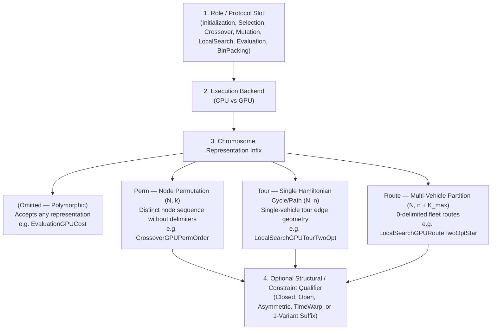

# Strategy, Operator, and CUDA Kernel Naming Taxonomy

This guide defines the canonical classification and naming architecture for evolutionary strategies, composable sub-strategies, Python modules, CUDA `.cu` kernels, and `.cuh` device headers across the routing library. For the concise enforcement checklist applied automatically during Python and CUDA reviews, see [python-typing-and-architecture.instructions.md §6. Strategy, Operator, and CUDA Kernel Naming](../../.agents/rules/python-typing-and-architecture.instructions.md#6-strategy-operator-and-cuda-kernel-naming).

---

## 1. Why Problem-Acronym Naming Breaks on Multi-Variant Solvers

Routing benchmarks classify instances under Operations Research problem labels (`TSP`, `ATSP`, `HCP`, `SOP`, `CVRP`, `OVRP`, `DCVRP`, `VRPTW`). However, evolutionary and local-search operators do **not** bind 1-to-1 to those problem labels:

1. **Combinatorial Subset Explosion ($2^M$ Problem Subsets):**
   With $M = 8$ problem types, there are $2^8 - 1 = 255$ non-empty subsets of compatible problems. Standard $\mathcal{O}(1)$ `2-opt` edge-reversal (Croes, 1958) is valid on symmetric `TSP` and `HCP`, but invalid as an $\mathcal{O}(1)$ move on `ATSP` because reversing segment $(\pi_i, \dots, \pi_j)$ flips directed arc weights $d(u, v) \ne d(v, u)$. Similarly, a closed-depot savings or local-search kernel may apply to `CVRP` and `DCVRP` while excluding `OVRP`. Concatenating problem acronyms (`LocalSearchGPUTwoOptTSPHCP` or `...CVRPDCVRP`) produces brittle names that break whenever a new compatible variant (such as `MDVRP`) is added.
2. **Cross-Family Chromosome Reuse (Giant-Tour VRP):**
   Under the Giant-Tour + Split paradigm (Prins, 2004; Vidal et al., 2012), a `CVRP`, `OVRP`, or `DCVRP` chromosome is stored as a depot-free customer permutation of shape `(N, n - 1)`. Standard permutation operators—Order Crossover (`OX`) and Inversion Mutation—solve both `TSP` and Giant-Tour `VRP` without modification. Tagging `OX` with a `TSP` suffix (`CrossoverGPUOrderTSP`) would falsely imply incompatibility with VRP pipelines.

> [!IMPORTANT]
> **Foundational Principle:** Algorithms transform **chromosome representations** under **algebraic edge/constraint invariants**, not marketing problem acronyms. Identifiers must therefore encode *representation* and *structural/constraint scope*, while exact multi-problem compatibility sets live in runtime validation and class capability metadata.

---

## 2. Three-Axis Classification of Routing Operators

Every operator registered in [`__init__.py::STRATEGY_REGISTRY`](../../src/algorithms/strategies/__init__.py) or [`__init__.py::SUB_STRATEGY_REGISTRY`](../../src/algorithms/strategies/__init__.py) sits at the intersection of three orthogonal axes:



### Axis 1: Role-Based Strategy Package & Slot Prefix

Directories under `src/algorithms/strategies/` are strictly **algorithmic operator roles**—never problem nouns (`cvrp/`) and never vague buckets (`repair/`):

- Core slots ([`algorithm_strategies.py`](../../src/protocols/algorithm_strategies.py)): `initialization/`, `selection/`, `crossover/`, `mutation/`, `local_search/`, `evaluation/`.
- Composable VRP sub-strategy slots ([`vrp_strategies.py`](../../src/protocols/vrp_strategies.py)): `decoding/`, `penalties/`, `bin_packing/`.

### Axis 2: Explicit Backend Token (`CPU` | `GPU`)

Compute-bound and device-resident strategies expose explicit `CPU` and `GPU` class pairs (`EvaluationCPUCost` / `EvaluationGPUCost`, `BinPackingCPUFFD` / `BinPackingGPUFFD`, `LocalSearchCPURouteTwoOptStar` / `LocalSearchGPURouteTwoOptStar`) so JSON configurations state device placement unambiguously without hidden host fallbacks.

### Axis 3: Representation Infix (`ø` | `Perm` | `Tour` | `Route`)

| Infix | Tensor / Graph Structure | Compatible Problem Families | Canonical Example |
| :--- | :--- | :--- | :--- |
| **`ø` (Omitted)** | Polymorphic across representations (`(N, n)`, `(N, n - 1)`, and `(N, n + K_{\max})`) or representation-independent fitness arrays `(N,)` | All (`TSP`, `ATSP`, `HCP`, `CVRP`, `OVRP`, `DCVRP`) | `EvaluationGPUCost`, `SelectionGPUTournament` |
| **`Perm`** | Customer/node permutation `(N, k)` with no `0` depot delimiters | `TSP`, `ATSP`, `HCP`, **and** VRP Giant-Tours (`CVRP`, `OVRP`, `DCVRP`, `VRPTW`) | `CrossoverGPUPermOrder`, `CrossoverGPUPermPartiallyMapped`, `MutationGPUPermInversion`, `MutationGPUPermSwap` |
| **`Tour`** | Single-vehicle Hamiltonian tour `(N, n)` (closed cycle or open path) whose moves depend on tour edge adjacency | Single-tour routing (`TSP`, `HCP`, open `TSP`, or `ATSP` when qualified) | `LocalSearchGPUTourTwoOpt`, `InitializationGPUTourNearestNeighbor` |
| **`Route`** | Explicit `0`-delimited multi-vehicle partition `[0, r_1..., 0, r_2..., 0]` of shape `(N, n + K_{\max})` | Multi-route VRP (`CVRP`, `OVRP`, `DCVRP`, Bounded-Fleet $K_{\max}$, `VRPTW`) | `CrossoverGPURouteRBX`, `MutationGPURouteRelocate`, `MutationGPURouteSwap`, `LocalSearchGPURouteTwoOptStar` |

---

## 3. Handling 2+ Problem Variants vs. Single-Variant Restrictions

### The Canonical Grammar

$$
\underbrace{\texttt{<Slot>}}_{\text{Role}}\;\underbrace{\texttt{<CPU|GPU>}}_{\text{Backend}}\;\underbrace{\texttt{[Perm|Tour|Route]}}_{\text{Representation}}\;\underbrace{\texttt{<Algorithm>}}_{\text{OR Name}}\;\underbrace{\texttt{[<Qualifier>]}}_{\text{Optional Scope}}
$$

When an operator applies only to a **subset** of problems within its representation (`Perm`, `Tour`, or `Route`), choose `<Qualifier>` using the three-step ladder below:

1. **Default — No `<Qualifier>` (Full Representation Scope):**
   Omit `<Qualifier>` whenever the implementation handles all standard constraints of its representation—for example, `LocalSearchGPURouteTwoOptStar` handles capacity $Q$, route distance $L_{\max}$, fleet cap $K_{\max}$, and `return_to_depot` (`CVRP`, `OVRP`, `DCVRP`, $K_{\max}$ — the entire **VRP Tier 1** algebra of Vidal et al., 2014).
2. **2+ Variants Sharing a Mathematical Property — Structural / Constraint Qualifier:**
   When an operator works on **two or more** variants (e.g., `CVRP` + `DCVRP`, or `TSP` + `HCP`, or `VRPTW` + `SDVRP`) because they share an algebraic invariant, name **that shared property**—**never** concatenate problem acronyms (`CVRPDCVRP`, `TSPHCP`):
   - `Closed` / `Open` — restricted to closed cycles (`return_to_depot=True`, e.g. `CVRP` + `DCVRP`) or open paths (`return_to_depot=False`, e.g. `OVRP` + open `TSP`).
   - `Asymmetric` — evaluates directed arc reversals $d(u, v) \ne d(v, u)$ (`ATSP` + asymmetric VRP), distinguishing `LocalSearchGPUTourTwoOptAsymmetric` from symmetric `LocalSearchGPUTourTwoOpt`.
   - `TimeWarp` — propagates Vidal et al. (2013, 2014) forward/backward time-window monoids (`VRPTW`, `OVRPTW`, `DCVRPTW`), e.g. `LocalSearchGPURouteTwoOptStarTimeWarp`.
3. **Strictly 1 Problem Variant — Single-Variant Suffix:**
   Append a problem-type acronym (`TSP`, `ATSP`, `SOP`, `CVRP`, `OVRP`, `VRPTW`) **only** when the heuristic's domain equation is intrinsically locked to a single OR problem definition (e.g., `LocalSearchGPUTourTwoOptPrecedenceSOP` or `InitializationGPURouteSavingsOVRP`).

### Reference Matrix Across Problem Scopes

| Compatibility Scope | Correct Identifier | Anti-Pattern (Banned) | Why |
| :--- | :--- | :--- | :--- |
| Universal (`TSP`, `ATSP`, `CVRP`, `OVRP`, `DCVRP`) | `EvaluationGPUCost` | `EvaluationGPUCVRPCost` | One polymorphic evaluator dispatches Hamiltonian, Giant-Tour, and `0`-delimited batches. |
| All permutations (`TSP`, `ATSP`, `HCP`, VRP Giant-Tour) | `CrossoverGPUPermOrder` | `CrossoverGPUOrderTSP` | `OX` operates on permutations, including VRP Giant-Tours. |
| Symmetric single-tour (`TSP` + `HCP`, not `ATSP`) | `LocalSearchGPUTourTwoOpt` | `LocalSearchGPUTwoOptTSPHCP` | Canonical `2-opt` (Croes, 1958) assumes symmetric edges; never concatenate `TSPHCP`. |
| Asymmetric single-tour (`ATSP` + `TSP`) | `LocalSearchGPUTourTwoOptAsymmetric` | `LocalSearchGPUTwoOptTSPAndATSP` | Names the directed-arc property rather than listing problem types. |
| All VRP Tier-1 (`CVRP`, `OVRP`, `DCVRP`, $K_{\max}$) | `LocalSearchGPURouteTwoOptStar` | `LocalSearchGPUInterRoute` / `...CVRPOVRPDCVRP` | Names `Route` + `2-opt*` (Potvin & Rousseau, 1995) without vague `InterRoute` or acronym lists. |
| Closed VRP only (`CVRP` + `DCVRP`, fails on `OVRP`) | `LocalSearchGPURouteTwoOptStarClosed` | `LocalSearchGPURouteTwoOptStarCVRPDCVRP` | Names the closed-tour topological invariant shared by `CVRP` and `DCVRP`. |
| VRP Tier-2 (`CVRP`, `OVRP`, `DCVRP`, `VRPTW`) | `LocalSearchGPURouteTwoOptStarTimeWarp` | `LocalSearchGPURouteTwoOptStarCVRPVRPTW` | Names the time-warp monoid (Vidal et al., 2014). |
| Strictly 1 variant (`SOP` precedence only) | `LocalSearchGPUTourOrOptSOP` | `LocalSearchGPUCustom` | Single-variant suffix is permitted when locked to one exact formulation. |

---

## 4. Machine Enforcement via Capability Metadata & Context Validation

Identifier names communicate **architectural intent to humans**; they are not a parser for runtime type checking. Whenever an operator supports a specific subset of problem types or constraint combinations (such as `{"CVRP", "DCVRP"}` or symmetric-only distance matrices):

1. **Declare capabilities explicitly on the class** (or validate against [`problem_context.py::ProblemContext`](../../src/protocols/problem_context.py) and [`vrp_constraints.py::VRPConstraints`](../../src/data_models/vrp_constraints.py) in `warmup()` / entry points), e.g.:
   ```python
   from typing import ClassVar

   class LocalSearchGPURouteTwoOptStarClosed(StrategyBase):
       """Closed-route 2-opt* variant requiring depot return arcs."""

       supported_representations: ClassVar[frozenset[str]] = frozenset({"route"})
       requires_return_to_depot: ClassVar[bool] = True
   ```
2. **Raise `ConfigurationError` / `ValueError` loudly** when paired with an incompatible [`problem_context.py::ProblemContext`](../../src/protocols/problem_context.py) (for instance, `not context.constraints.return_to_depot` on `OVRP`), rather than encoding `"CVRPDCVRP"` in the class name or silently producing invalid routes.

---

## 5. Module, CUDA `.cu` Kernel, and `.cuh` Header Naming & Placement

File names mirror the exact OR algorithm and single responsibility of their contents, using `snake_case` without inconsistent `cvrp_` prefixes on multi-variant VRP code:

1. **Python & `.cu` Entry Points:**
   - Pair operator files with matching kernel filenames: `rbx_crossover.py` $\leftrightarrow$ `kernels/rbx_crossover.cu` (Potvin & Bengio, 1996); `route_relocate_mutation.py` $\leftrightarrow$ `kernels/route_relocate_mutation.cu`; `two_opt_star_steepest.cu` and `two_opt_star_multi_move.cu`.
   - Never use non-descriptive mechanical names (`route_ops.cu`, `inter_route_batch.cu`, `inter_route_search.cuh`).
2. **Three-Tier `.cuh` Header Placement:**
   - **`src/utils/kernels/`** — Domain-agnostic CUDA device primitives (`block_reductions.cuh` warp/block reductions, `splitmix64.cuh` PRNG helpers).
   - **`src/distances/kernels/`** — TSPLIB95 metric and edge-delta geometry shared across operators (`pairwise_device.cuh`, `two_opt_common.cuh`).
   - **`src/algorithms/strategies/<role>/kernels/`** — Role-local `.cuh` headers split strictly by single responsibility (e.g., `vrp_route_prefix_buffers.cuh`, `relocate_swap_two_opt_star_deltas.cuh`, `vrp_candidate_neighborhood_scan.cuh`, and `intra_route_two_opt.cuh`—never hiding intra-route `2-opt` inside an `inter_route_*` file).

---

## References

- **Croes, G. A. (1958).** A method for solving traveling-salesman problems. *Operations Research*, 6(6), 791–812. [doi:10.1287/opre.6.6.791](https://doi.org/10.1287/opre.6.6.791)
- **Potvin, J.-Y., & Bengio, S. (1996).** The vehicle routing problem with time windows part II: Genetic search. *INFORMS Journal on Computing*, 8(2), 165–172. [doi:10.1287/ijoc.8.2.165](https://doi.org/10.1287/ijoc.8.2.165)
- **Potvin, J.-Y., & Rousseau, J.-M. (1995).** An exchange heuristic for routing problems with time windows. *Journal of the Operational Research Society*, 46(12), 1433–1446. [doi:10.1057/jors.1995.204](https://doi.org/10.1057/jors.1995.204)
- **Prins, C. (2004).** A simple and effective evolutionary algorithm for the vehicle routing problem. *Computers & Operations Research*, 31(12), 1985–2002. [doi:10.1016/S0305-0548(03)00158-8](https://doi.org/10.1016/S0305-0548(03)00158-8)
- **Vidal, T., Crainic, T. G., Gendreau, M., Lahrichi, N., & Rei, W. (2012).** A hybrid genetic algorithm for multidepot and periodic vehicle routing problems. *Operations Research*, 60(3), 611–624. [doi:10.1287/opre.1120.1048](https://doi.org/10.1287/opre.1120.1048)
- **Vidal, T., Crainic, T. G., Gendreau, M., & Prins, C. (2013).** A hybrid genetic algorithm with adaptive diversity management for a large class of vehicle routing problems with time-windows. *Computers & Operations Research*, 40(1), 475–489. [doi:10.1016/j.cor.2012.07.018](https://doi.org/10.1016/j.cor.2012.07.018)
- **Vidal, T., Crainic, T. G., Gendreau, M., & Prins, C. (2014).** A unified solution framework for multi-attribute vehicle routing problems. *European Journal of Operational Research*, 234(3), 658–673. [doi:10.1016/j.ejor.2013.09.045](https://doi.org/10.1016/j.ejor.2013.09.045)
