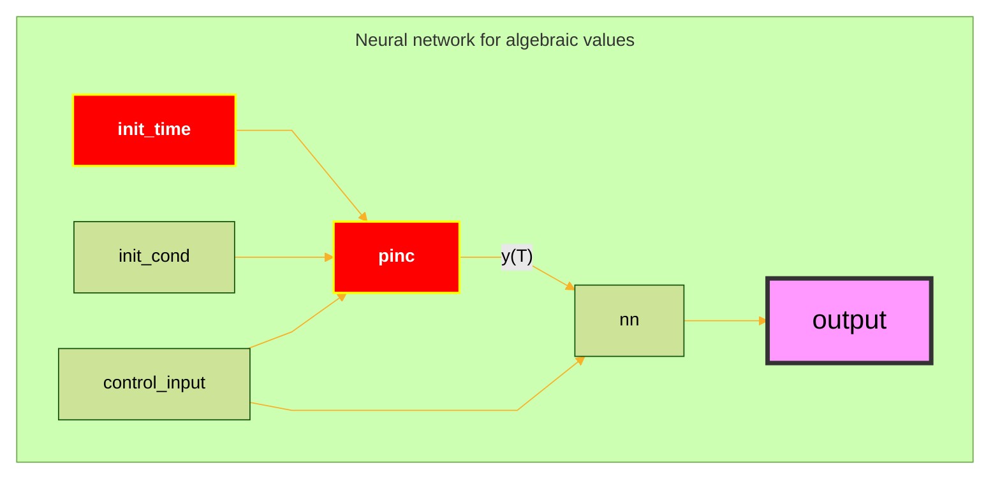
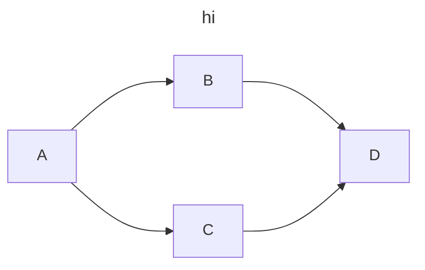
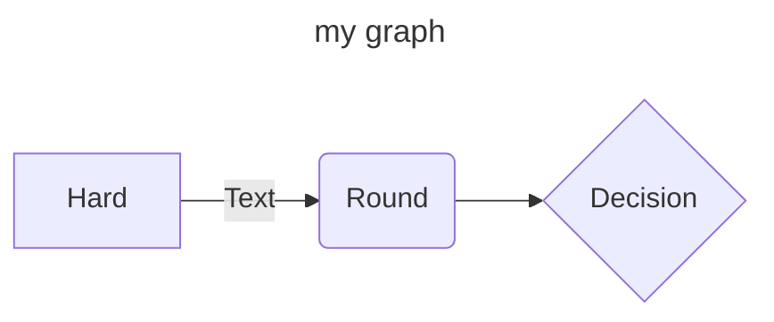
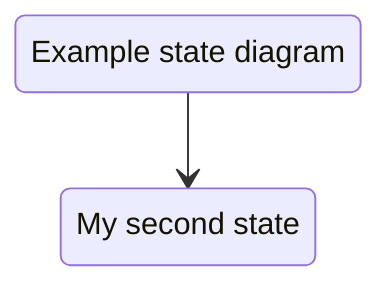
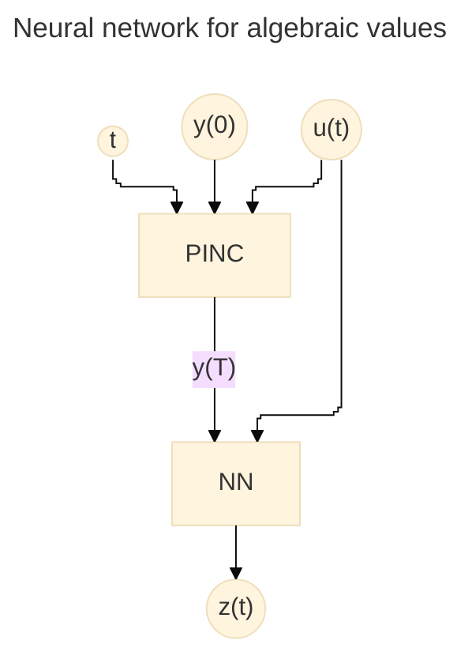
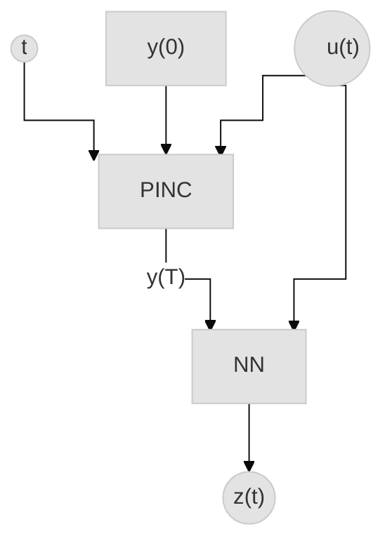
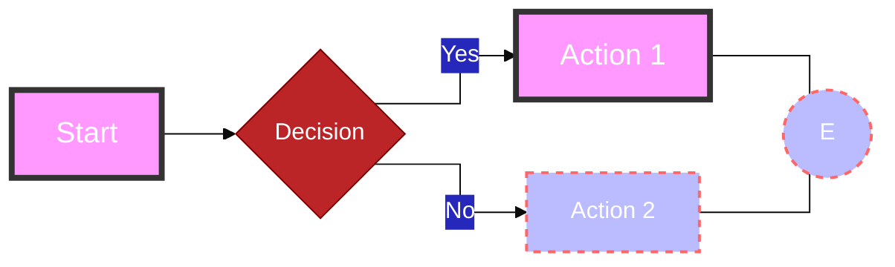

## Making nodes bigger in mermaid

1. Open a [sample flowchart](https://mermaid.live/edit)
2. Go to the element you want to see the properties and click on inspect element. There you'll see the properties of the element.
   1. Other option is directly opening the svg file and inspect the element as a whole.
3. Inspect the possible svg parameters you wanna change
