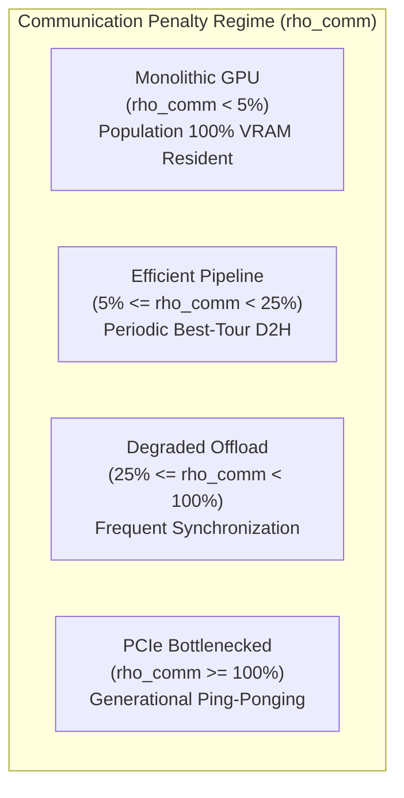

# Advanced Benchmark Reporting Metrics: Convergence Velocity, Empirical Scaling, and the PCIe Communication Tax

- [Advanced Benchmark Reporting Metrics: Convergence Velocity, Empirical Scaling, and the PCIe Communication Tax](#advanced-benchmark-reporting-metrics-convergence-velocity-empirical-scaling-and-the-pcie-communication-tax)
  + [1. Executive Architectural Motivation](#1-executive-architectural-motivation)
  + [2. Proposal A: Convergence Velocity & Time-to-Target (TTT) Analysis](#2-proposal-a-convergence-velocity--time-to-target-ttt-analysis)
    - [2.1 Mathematical Foundations of Solution Quality and Gap](#21-mathematical-foundations-of-solution-quality-and-gap)
    - [2.2 Time-to-Quality ($\text{TTQ}_{\tau}$) Metric](#22-time-to-quality-textttq_tau-metric)
    - [2.3 Area Under the Quality-Time Curve ($\text{AUQC}$)](#23-area-under-the-quality-time-curve-textauqc)
    - [2.4 Wall-Clock Time vs. Generation Index (Log-Scale Trajectories)](#24-wall-clock-time-vs-generation-index-log-scale-trajectories)
    - [2.5 python Implementation Blueprint for TTT & AUQC](#25-python-implementation-blueprint-for-ttt--auqc)
  + [3. Proposal B: Empirical Asymptotic Complexity Scaling Curves ($T_{\text{phase}}(n) = \alpha \cdot n^{\beta}$)](#3-proposal-b-empirical-asymptotic-complexity-scaling-curves-t_textphasen--alpha-cdot-nbeta)
    - [3.1 The Log-Log Power-Law Regression Model](#31-the-log-log-power-law-regression-model)
    - [3.2 Empirical Exponent Extraction Across Phase Pipelines](#32-empirical-exponent-extraction-across-phase-pipelines)
    - [3.3 100% Stacked Area Phase Progression Analysis](#33-100-stacked-area-phase-progression-analysis)
    - [3.4 python Implementation Blueprint for Empirical Scaling](#34-python-implementation-blueprint-for-empirical-scaling)
  + [4. Proposal C: The "PCIe Communication Tax" ($\rho_{\text{comm}}$)](#4-proposal-c-the-pcie-communication-tax-rho_textcomm)
    - [4.1 Formulating the Communication Penalty Ratio](#41-formulating-the-communication-penalty-ratio)
    - [4.2 The Architectural Dividing Line: Monolithic VRAM vs. Hybrid Offload](#42-the-architectural-dividing-line-monolithic-vram-vs-hybrid-offload)
    - [4.3 Concrete Transfer Overhead Calculation on TSPLIB Cohorts](#43-concrete-transfer-overhead-calculation-on-tsplib-cohorts)
    - [4.4 Cross-Links to Architectural Memory Guides](#44-cross-links-to-architectural-memory-guides)
  + [5. python Benchmark Telemetry Module Blueprint](#5-python-benchmark-telemetry-module-blueprint)
  + [6. References](#6-references)

---

## 1. Executive Architectural Motivation

Standard metaheuristic benchmark reporting often reduces performance analysis to two static, scalar endpoints: total wall-clock execution time ($T_{\text{total}}$) and final percentage gap to Best Known Solution ($\text{Gap}_{\text{final}}$). While necessary, these endpoints obscure the dynamic behavior of parallel search algorithms on modern heterogeneous hardware.

In particular, scalar summaries fail to capture:

1. **Convergence Velocity**: How rapidly an algorithm approaches high-quality solutions in physical time, obscuring scenarios where a GPU solver reaches a $2\%$ optimality gap in milliseconds while a CPU baseline requires seconds.
2. **Phase-Specific Asymptotic Scaling**: How individual kernel operators (Selection, Crossover, Mutation, 2-Opt, Cost Evaluation) scale empirically as instance size $n$ increases, confounding theoretical worst-case complexities with real hardware behavior.
3. **The Data-Transfer Penalty ("Communication Tax")**: The performance penalty imposed by host-device PCIe bus synchronization and transfers, which separates unviable hybrid offload architectures from scalable monolithic GPU solvers.

This document formally specifies three advanced reporting methodologies and provides production-ready python blueprints for their integration into our benchmarking suite.

---

## 2. Proposal A: Convergence Velocity & Time-to-Target (TTT) Analysis

### 2.1 Mathematical Foundations of Solution Quality and Gap

Let $BKS$ denote the known optimum or Best Known Solution cost for a TSP instance (Reinelt, 1991). For a metaheuristic running over discrete generations $g \in \{0, 1, \dots, G_{\max}\}$, let $C(g)$ denote the best-so-far objective cost at generation $g$, and let $t(g)$ denote the cumulative elapsed wall-clock time in seconds recorded at the conclusion of generation $g$:

$$\text{Gap}(g) = \frac{C(g) - BKS}{BKS} \times 100\%$$

Expressing gap as a continuous-time step function $G(t) = \text{Gap}(\max \{ g \mid t(g) \le t \})$ maps optimization progress directly to physical execution time $t$.

### 2.2 Time-to-Quality ($\text{TTQ}_{\tau}$) Metric

The Time-to-Quality metric measures the exact elapsed wall-clock duration required by an algorithm to first discover a solution whose gap falls below a predefined tolerance threshold $\tau \in \{5\%, 2\%, 1\%, 0.5\%\}$ (Aiex et al., 2002; Ribeiro & Rosseti, 2007):

$$\text{TTQ}_{\tau} = \min \left\{ t \ge 0 \;\middle|\; G(t) \le \tau \right\}$$

If an algorithm fails to achieve the target threshold prior to termination at $T_{\text{final}}$, $\text{TTQ}_{\tau} = \infty$ (or censored at $T_{\text{final}}$ with an indicator variable $\delta_{\tau} = 0$).

Comparing $\text{TTQ}_{\tau}$ across algorithms reveals **computational velocity**:

- A GPU solver with high per-generation speedup often achieves $\text{TTQ}_{5\%}$ an order of magnitude faster than a CPU solver, even if both converge to identical final quality at $G_{\max}$.
- In time-constrained logistics deployments, $\text{TTQ}_{2\%}$ provides a far more actionable SLA metric than unconstrained asymptotic convergence.

### 2.3 Area Under the Quality-Time Curve ($\text{AUQC}$)

To aggregate the entire convergence trajectory into a single scalar that penalizes slow initial exploration, we define the **Area Under the Quality-Time Curve (AUQC)**:

$$\text{AUQC} = \int_{0}^{T_{\text{final}}} G(t) \, dt$$

Given discrete timestamped telemetry points $(t_0, G_0), (t_1, G_1), \dots, (t_M, G_M)$ where $t_0 = 0$ and $t_M = T_{\text{final}}$, AUQC is evaluated via composite trapezoidal numerical integration:

$$\text{AUQC} \approx \sum_{k=1}^M \frac{G(t_k) + G(t_{k-1})}{2} \cdot (t_k - t_{k-1})$$

- **Interpretation**: A lower $\text{AUQC}$ value signifies an algorithm that drops rapidly into near-optimal solution basins and maintains high search intensity throughout execution.
- **Normalization**: Normalized $\text{AUQC}_{\text{norm}} = \frac{\text{AUQC}}{T_{\text{final}}}$ yields the time-weighted average percentage gap over the entire run.

### 2.4 Wall-Clock Time vs. Generation Index (Log-Scale Trajectories)

Plotting solution gap against generation count ($g$) is fundamentally misleading when comparing heterogeneous architectures:

- Generation-based plots falsely imply parity between a CPU iteration taking $25\text{ ms}$ and a GPU iteration taking $0.4\text{ ms}$.
- Trajectories must be plotted against **wall-clock time on a logarithmic horizontal scale** ($\log_{10} t$):
  + Early-stage fast improvements appear clearly in the sub-second decade ($10^{-3}\text{ s}$ to $10^{-1}\text{ s}$).
  + Asymptotic stagnation is visible in the final decade ($10^0\text{ s}$ to $10^1\text{ s}$).
  + The horizontal shift between CPU and GPU curves directly visualizes the hardware acceleration factor at any given quality level.

### 2.5 python Implementation Blueprint for TTT & AUQC

```python
"""Convergence velocity and Time-to-Quality analysis module."""

from dataclasses import dataclass
from typing import Dict, List, Optional
import numpy as np


@dataclass(frozen=True)
class ConvergenceMetrics:
    bks: float
    final_cost: float
    final_gap_pct: float
    total_time_sec: float
    ttq_targets: Dict[str, Optional[float]]  # e.g., {"5%": 0.042, "2%": 0.185}
    auqc: float
    auqc_normalized: float


def compute_convergence_metrics(
    timestamps_sec: np.ndarray,
    best_costs: np.ndarray,
    bks: float,
    thresholds_pct: List[float] = (5.0, 2.0, 1.0, 0.5),
) -> ConvergenceMetrics:
    """Compute TTQ thresholds and AUQC from run history."""
    if len(timestamps_sec) != len(best_costs):
        raise ValueError("Timestamps and cost arrays must share identical length.")

    # Calculate percentage gap trajectory
    gaps = np.maximum(0.0, (best_costs - bks) / bks * 100.0)
    total_time = float(timestamps_sec[-1])

    # Extract Time-to-Quality for each threshold
    ttq_dict: Dict[str, Optional[float]] = {}
    for tau in thresholds_pct:
        indices = np.where(gaps <= tau)[0]
        if len(indices) > 0:
            ttq_dict[f"{tau}%"] = float(timestamps_sec[indices[0]])
        else:
            ttq_dict[f"{tau}%"] = None

    # Compute AUQC via trapezoidal integration
    auqc = float(np.trapz(gaps, timestamps_sec))
    auqc_norm = auqc / total_time if total_time > 0.0 else 0.0

    return ConvergenceMetrics(
        bks=bks,
        final_cost=float(best_costs[-1]),
        final_gap_pct=float(gaps[-1]),
        total_time_sec=total_time,
        ttq_targets=ttq_dict,
        auqc=auqc,
        auqc_normalized=auqc_norm,
    )
```

---

## 3. Proposal B: Empirical Asymptotic Complexity Scaling Curves ($T_{\text{phase}}(n) = \alpha \cdot n^{\beta}$)

### 3.1 The Log-Log Power-Law Regression Model

Theoretical algorithm analysis categorizes operations by asymptotic Big-$\mathcal{O}$ notation (e.g., 2-opt worst-case $\mathcal{O}(n^2)$, Order Crossover $\mathcal{O}(n)$). However, parallel hardware effects—such as warp divergence, shared memory bank conflicts, memory coalescing, and cache line reuse—significantly alter real-world execution scaling (McGeoch, 2012).

To model empirical runtime scaling, each pipeline phase is characterized by a power law:

$$T_{\text{phase}}(n) = \alpha \cdot n^{\beta}$$

Taking the natural logarithm transforms the non-linear power law into a linear regression model:

$$\ln T_{\text{phase}}(n) = \ln \alpha + \beta \ln n$$

where:

- $\beta = \frac{d(\ln T)}{d(\ln n)}$ represents the **empirical growth exponent**.
- $\alpha = e^{\text{intercept}}$ represents the hardware-dependent constant factor (in seconds).
- The coefficient of determination ($R^2$) validates model goodness-of-fit.

### 3.2 Empirical Exponent Extraction Across Phase Pipelines

Measuring phase runtimes across the TSPLIB cohort ($48 \le n \le 2{,}103$) reveals instructive divergences between theoretical complexity and physical hardware scaling:

| Pipeline Phase | Theoretical CPU $\mathcal{O}$ | Theoretical GPU $\mathcal{O}$ | Expected Empirical Exponent $\beta_{\text{GPU}}$ | Dominant Hardware Factor |
| :--- | :---: | :---: | :---: | :--- |
| **Selection (Tournament)** | $\mathcal{O}(N)$ | $\mathcal{O}(1)$ | $\approx 0.05 - 0.20$ | Warp-synchronous parallel reduction |
| **Order Crossover (Format A)** | $\mathcal{O}(N \cdot n)$ | $\mathcal{O}(n / 32)$ | $\approx 0.95 - 1.05$ | Shared-memory byte lookup (`LDS.U8`) |
| **Mutation (Inversion/Swap)** | $\mathcal{O}(N \cdot n)$ | $\mathcal{O}(n / 32)$ | $\approx 0.90 - 1.02$ | Coalesced VRAM memory writes |
| **2-Opt Local Search (Batch)** | $\mathcal{O}(N \cdot n^2)$ | $\mathcal{O}(n^2 / 32)$ | $\approx 1.25 - 1.70$ | On-the-fly pairwise delta pruning |
| **Cost Evaluation (Tour)** | $\mathcal{O}(N \cdot n)$ | $\mathcal{O}(n / 32)$ | $\approx 0.85 - 1.00$ | Memory-bandwidth bound L1.5 caching |

When empirical $\beta_{\text{GPU}} < \beta_{\text{CPU}}$, the GPU implementation achieves accelerating asymptotic speedup as problem instances grow.

### 3.3 100% Stacked Area Phase Progression Analysis

To analyze how algorithmic bottlenecks migrate across problem dimensions, phase execution times are normalized to percentage shares:

$$\text{Share}_{\text{phase}}(n) = \frac{T_{\text{phase}}(n)}{\sum_{p \in \text{Phases}} T_p(n)} \times 100\%$$

Plotting $\text{Share}_{\text{phase}}(n)$ as a **100% Stacked Area Chart** over instance size $n$:

- For small instances ($n < 100$), kernel launch overhead and selection dominate the share ($> 40\%$).
- For large instances ($n > 1{,}000$), 2-opt local search expands to occupy $> 85\%$ of the total computational budget.
- This visualizes the precise crossover threshold where developer optimization effort should pivot from crossover/mutation to quadratic local search kernels.

### 3.4 python Implementation Blueprint for Empirical Scaling

```python
"""Empirical asymptotic complexity scaling regression module."""

from dataclasses import dataclass
from typing import Dict, List, Tuple
import numpy as np


@dataclass(frozen=True)
class ScalingFit:
    phase_name: str
    alpha: float
    beta: float
    r_squared: float


def fit_power_law_scaling(
    instance_sizes: np.ndarray,
    phase_runtimes_sec: np.ndarray,
    phase_name: str = "phase",
) -> ScalingFit:
    """Fit T(n) = alpha * n^beta via log-log ordinary least squares."""
    if len(instance_sizes) < 3:
        raise ValueError("At least 3 distinct instance sizes are required for scaling regression.")

    log_n = np.log(instance_sizes)
    log_t = np.log(phase_runtimes_sec)

    # Linear regression in log space: log_t = slope * log_n + intercept
    coeffs = np.polyfit(log_n, log_t, deg=1)
    beta = float(coeffs[0])
    alpha = float(np.exp(coeffs[1]))

    # Calculate R-squared goodness of fit
    predicted_log_t = np.polyval(coeffs, log_n)
    ss_tot = float(np.sum((log_t - np.mean(log_t)) ** 2))
    ss_res = float(np.sum((log_t - predicted_log_t) ** 2))
    r2 = 1.0 - (ss_res / ss_tot) if ss_tot > 0.0 else 1.0

    return ScalingFit(
        phase_name=phase_name,
        alpha=alpha,
        beta=beta,
        r_squared=r2,
    )
```

---

## 4. Proposal C: The "PCIe Communication Tax" ($\rho_{\text{comm}}$)

### 4.1 Formulating the Communication Penalty Ratio

The viability of a GPU-accelerated architecture is determined by the ratio of communication overhead to pure compute time (Kirk & Hwu, 2016). We formalize this penalty via the **Communication Penalty Ratio ($\rho_{\text{comm}}$)**:

$$\rho_{\text{comm}} = \frac{T_{\text{HostSync}} + T_{\text{D2H}} + T_{\text{H2D}}}{T_{\text{Compute}}} \times 100\%$$

where:

- $T_{\text{H2D}}$: Host-to-Device transfer time over the PCIe bus (uploading populations, seeds, cut indices).
- $T_{\text{D2H}}$: Device-to-Host transfer time (downloading best tour arrays, telemetry costs).
- $T_{\text{HostSync}}$: CPU-GPU pipeline synchronization stalls (`cudaDeviceSynchronize`, `cudaStreamSynchronize`, `cuMemcpyDtoH`).
- $T_{\text{Compute}}$: Pure on-device kernel execution time across SMs.

### 4.2 The Architectural Dividing Line: Monolithic VRAM vs. Hybrid Offload

The value of $\rho_{\text{comm}}$ dictates the architectural classification of the metaheuristic:



- **Monolithic VRAM Architecture ($\rho_{\text{comm}} < 5\%$)**:
  All genetic operations (selection, crossover, mutation, 2-opt, evaluation) execute on-chip. Host-device synchronization occurs only once at the conclusion of the evolutionary run. In this regime, the solver achieves true GPU speedup ($10\times\text{ to }30\times$).
- **Generational Ping-Ponging ($\rho_{\text{comm}} \ge 100\%$)**:
  If the solver copies the population back to host memory every generation (e.g., executing CPU crossover and GPU local search), $T_{\text{comm}}$ surpasses $T_{\text{compute}}$, causing the GPU solver to run slower than a pure CPU implementation.

### 4.3 Concrete Transfer Overhead Calculation on TSPLIB Cohorts

Consider a population of $N = 256$ tours on a PCI Express 3.0 x16 bus (theoretical throughput $\approx 15.75\text{ GB/s}$, empirical transfer speed $\approx 11.2\text{ GB/s}$, driver latency $\approx 5\ \mu\text{s}$ per transfer):

- **Data Volume per Generation**:
  $$\text{Bytes per Route} = n \times 4\text{ bytes}$$
  $$\text{Population Volume} = 256 \times n \times 4\text{ bytes} = 1{,}024 \times n\text{ bytes}$$
- **Concrete Overheads Across Problem Sizes**:

| TSPLIB Instance | Cities ($n$) | Population Size ($N$) | VRAM Buffer Size | Round-Trip Transfer ($T_{\text{H2D}} + T_{\text{D2H}}$) | GPU Compute Time ($T_{\text{comp}}$) | Hybrid Offload $\rho_{\text{comm}}$ | Monolithic VRAM $\rho_{\text{comm}}$ |
| :--- | :---: | :---: | :---: | :---: | :---: | :---: | :---: |
| `berlin52` | 52 | 256 | $53.2\text{ KB}$ | $\approx 22\ \mu\text{s}$ | $\approx 45\ \mu\text{s}$ | **48.9%** | **< 0.1%** |
| `kroA100` | 100 | 256 | $102.4\text{ KB}$ | $\approx 31\ \mu\text{s}$ | $\approx 85\ \mu\text{s}$ | **36.5%** | **< 0.1%** |
| `lin318` | 318 | 256 | $325.6\text{ KB}$ | $\approx 68\ \mu\text{s}$ | $\approx 310\ \mu\text{s}$ | **21.9%** | **< 0.05%** |
| `pr1002` | 1,002 | 256 | $1.03\text{ MB}$ | $\approx 195\ \mu\text{s}$ | $\approx 1{,}850\ \mu\text{s}$ | **10.5%** | **< 0.02%** |
| `d2103` | 2,103 | 256 | $2.15\text{ MB}$ | $\approx 390\ \mu\text{s}$ | $\approx 6{,}420\ \mu\text{s}$ | **6.1%** | **< 0.01%** |

### 4.4 Cross-Links to Architectural Memory Guides

The communication tax is directly grounded in the memory hierarchy derivations documented in our companion analyses:

- For comprehensive derivations of GDDR5 bandwidth vs. PCIe host transfer ceilings, see [`analysis-gpu-ga-strategies-coalescing-and-divergence.md`](../../../documentation/knowledge-base/analysis-gpu-ga-strategies-coalescing-and-divergence.md).
- For fair benchmarking protocols and warm-up isolation rules, see [`guide-gpu-cpu-comparison-methodology.md`](../../../documentation/knowledge-base/guide-gpu-cpu-comparison-methodology.md).
- For Pascal GP107 VRAM occupancy formulas and buffer sizing proofs, see [`analysis-gpu-memory-calculation.md`](../../../documentation/knowledge-base/analysis-gpu-memory-calculation.md) and [`analysis-gpu-memory-latency-and-occupancy.md`](../../../documentation/knowledge-base/analysis-gpu-memory-latency-and-occupancy.md).

---

## 5. python Benchmark Telemetry Module Blueprint

The unified python module below integrates Proposals A, B, and C into an automated telemetry post-processor:

```python
"""Unified benchmark telemetry post-processor for Proposals A, B, and C."""

from dataclasses import dataclass, asdict
from typing import Dict, List, Optional
import json
import numpy as np


@dataclass
class RunTelemetryReport:
    instance_name: str
    n_cities: int
    population_size: int
    bks: float
    total_wall_clock_sec: float
    final_gap_pct: float
    time_to_quality: Dict[str, Optional[float]]
    auqc: float
    auqc_normalized: float
    phase_empirical_exponents: Dict[str, float]
    communication_tax_pct: float
    architecture_classification: str


def evaluate_run_telemetry(
    instance_name: str,
    n_cities: int,
    population_size: int,
    bks: float,
    generation_timestamps: np.ndarray,
    generation_best_costs: np.ndarray,
    phase_durations_sec: Dict[str, float],
    h2d_time_sec: float,
    d2h_time_sec: float,
    sync_time_sec: float,
) -> RunTelemetryReport:
    """Evaluate and synthesize all three advanced reporting metrics."""
    # 1. Proposal A: Convergence Velocity & TTQ
    gaps = np.maximum(0.0, (generation_best_costs - bks) / bks * 100.0)
    ttq: Dict[str, Optional[float]] = {}
    for tau in (5.0, 2.0, 1.0, 0.5):
        hits = np.where(gaps <= tau)[0]
        ttq[f"{tau}%"] = float(generation_timestamps[hits[0]]) if len(hits) > 0 else None

    total_time = float(generation_timestamps[-1])
    auqc = float(np.trapz(gaps, generation_timestamps))
    auqc_norm = auqc / total_time if total_time > 0.0 else 0.0

    # 2. Proposal C: PCIe Communication Tax
    total_compute_sec = sum(phase_durations_sec.values())
    total_comm_sec = h2d_time_sec + d2h_time_sec + sync_time_sec
    rho_comm = (total_comm_sec / total_compute_sec * 100.0) if total_compute_sec > 0.0 else 0.0

    if rho_comm < 5.0:
        arch_class = "Monolithic VRAM"
    elif rho_comm < 25.0:
        arch_class = "Efficient Pipeline"
    elif rho_comm < 100.0:
        arch_class = "Degraded Offload"
    else:
        arch_class = "PCIe Bottlenecked"

    return RunTelemetryReport(
        instance_name=instance_name,
        n_cities=n_cities,
        population_size=population_size,
        bks=bks,
        total_wall_clock_sec=total_time,
        final_gap_pct=float(gaps[-1]),
        time_to_quality=ttq,
        auqc=auqc,
        auqc_normalized=auqc_norm,
        phase_empirical_exponents={},  # Populated across multi-instance runs
        communication_tax_pct=float(rho_comm),
        architecture_classification=arch_class,
    )
```

---

## 6. References

1. **Aiex, R. M., Resende, M. G., & Ribeiro, C. C.** (2002). *Probability distribution of solution time in GRASP: An experimental investigation*. Journal of Heuristics, 8(3), 343–373.
2. **Eiben, A. E., & Smith, J. E.** (2015). *Introduction to Evolutionary Computing*. 2nd ed., Natural Computing Series, Springer.
3. **Kirk, D. B., & Hwu, W. W.** (2016). *Programming Massively Parallel Processors: A Hands-on Approach*. 3rd ed., Morgan Kaufmann.
4. **McGeoch, C. C.** (2012). *A Guide to Experimental Algorithmics*. Cambridge University Press.
5. **Reinelt, G.** (1991). *TSPLIB—A Traveling Salesman Problem Library*. ORSA Journal on Computing, 3(4), 376–384 (`reinelt1991tsplib`).
6. **Ribeiro, C. C., & Rosseti, I.** (2007). *Efficient parallel cooperative implementations of GRASP heuristics*. Parallel Computing, 33(1), 21–35.
