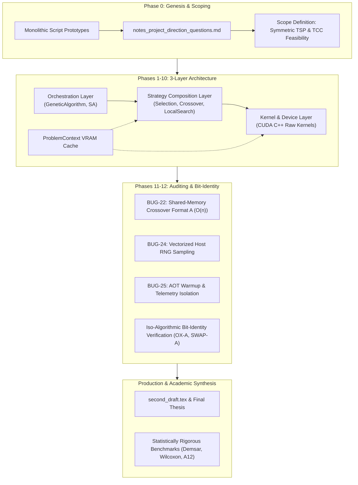

# Analysis of Project Evolution and Software Engineering Lessons for GPU Metaheuristics

- [Analysis of Project Evolution and Software Engineering Lessons for GPU Metaheuristics](#analysis-of-project-evolution-and-software-engineering-lessons-for-gpu-metaheuristics)
  + [1. Project Trajectory: From Exploratory Framing to Production Architecture](#1-project-trajectory-from-exploratory-framing-to-production-architecture)
    - [1.1 The Genesis Phase (`notes_project_direction_questions.md`)](#11-the-genesis-phase-notes_project_direction_questionsmd)
    - [1.2 Modular Restructuring: The 3-Layer Architecture](#12-modular-restructuring-the-3-layer-architecture)
    - [1.3 Stabilization, Rigorous Audits, and Thesis Integration (Phases 11–12)](#13-stabilization-rigorous-audits-and-thesis-integration-phases-1112)
    - [1.4 Architectural Evolution Roadmap (Mermaid Flowchart)](#14-architectural-evolution-roadmap-mermaid-flowchart)
  + [2. Core Engineering Lessons for GPU Metaheuristics](#2-core-engineering-lessons-for-gpu-metaheuristics)
    - [2.1 Memory Residency is King (PCIe D2H/H2D Latency Avoidance)](#21-memory-residency-is-king-pcie-d2hh2d-latency-avoidance)
    - [2.2 Ahead-of-Time (AOT) Warmup & JIT Cold-Start Discipline (`BUG-25`)](#22-ahead-of-time-aot-warmup--jit-cold-start-discipline-bug-25)
    - [2.3 Cross-Backend Bit-Identical Invariants (`OX-A`, `SWAP-A`, `INV-A`)](#23-cross-backend-bit-identical-invariants-ox-a-swap-a-inv-a)
    - [2.4 Zero Legacy Aliases & Hermetic State Encapsulation](#24-zero-legacy-aliases--hermetic-state-encapsulation)
  + [3. Engineering Checklist for GPU Metaheuristic Developers](#3-engineering-checklist-for-gpu-metaheuristic-developers)
  + [4. References](#4-references)

---

## 1. Project Trajectory: From Exploratory Framing to Production Architecture

### 1.1 The Genesis Phase (`notes_project_direction_questions.md`)

In the initial exploratory phase of the project, research questions centered around foundational feasibility, scope boundaries, and basic data extraction pipelines:

- **Scope Delimitation**: Determining whether the solver should support general Capacitated Vehicle Routing Problems (CVRP), Asymmetric TSP (ATSP), or focus rigorously on the symmetric Traveling Salesman Problem (TSP) to achieve conclusive, statistically rigorous benchmarks.
- **Data Pipelines**: Investigating DuckDB telemetry extraction and pandas-based data frame storage.
- **The Core Dilemma**: Identifying where the GPU should be integrated—whether as an offload coprocessor for individual algorithmic stages (e.g., local search only) or as the end-to-end host environment for the entire metaheuristic population.

As synthesized in [`notes_project_direction_questions.md`](../../../notes_project_direction_questions.md), the defining research mandate was established:
> *"Evaluate and explain the computational trade-offs of GPU-accelerated memetic genetic algorithms for the TSP, focusing on runtime, memory, population effects, and solution quality."*

### 1.2 Modular Restructuring: The 3-Layer Architecture

Early monolithic python prototypes suffered from tight coupling between problem representations, distance calculations, and kernel dispatch logic. To eliminate technical debt and establish clean separation of concerns, the repository was reorganized into a strict **3-Layer Architecture**:

1. **Top Orchestration Layer (`src/algorithms/`)**:
   High-level metaheuristic drivers (`GeneticAlgorithm`, `SimulatedAnnealing`) orchestrating generational loops, epoch tracking, stopping criteria, and telemetry logging without hardware-specific branching.
2. **Strategy Composition Layer (`src/algorithms/strategies/`)**:
   Slot-prefixed, interface-driven strategy contracts (`Selection`, `Crossover`, `Mutation`, `LocalSearch`, `Evaluation`). Strategies encapsulate CPU NumPy and GPU CuPy execution paths behind unified method signatures, enabling plug-and-play algorithmic experimentation.
3. **Kernel & Device Layer (`src/*/kernels/`)**:
   Pure CUDA C++ raw kernels (`order_crossover.cu`, `two_opt_batch.cu`, `cost_calculator.cu`) compiled just-in-time via CuPy `RawModule` or ahead-of-time (AOT), executing with warp-level cooperative intrinsics.

Hardware resource ownership was consolidated into `ProblemContext`, an immutable context object that caches device memory buffers (distance matrices, coordinate tables, coordinate pools) across the lifetime of a problem instance, preventing redundant allocations.

### 1.3 Stabilization, Rigorous Audits, and Thesis Integration (Phases 11–12)

The final architectural phase resolved subtle cross-layer bottlenecks and established rigorous experimental validity:

- **Crossover Scaling Bottleneck (`BUG-22`)**: Replaced $\mathcal{O}(n^2)$ linear scans with shared-memory direct-address byte arrays (Format A) and warp-synchronous prefix scans (`DP11-11`), achieving $\mathcal{O}(n)$ scaling.
- **Host RNG Bottleneck (`BUG-24`)**: Replaced unvectorized python loops with vectorized integer sampling ($v = v' + \mathbb{I}[v' \ge u]$), slashing cut selection overhead from $1.22\text{ ms}$ to $0.017\text{ ms}$ ($72\times$ speedup).
- **Driver Cold-Start Isolation (`BUG-25`)**: Enforced ahead-of-time warmup protocols to isolate JIT compilation spikes from benchmark statistics.
- **Thesis Formalization**: Integrated mathematical matrix formulations, hardware occupancy bounds, and non-parametric statistical validation suites into `second_draft.tex`.

### 1.4 Architectural Evolution Roadmap (Mermaid Flowchart)

---

## 2. Core Engineering Lessons for GPU Metaheuristics

### 2.1 Memory Residency is King (PCIe D2H/H2D Latency Avoidance)

The single most critical architectural lesson learned in this project is that **PCIe bus transfers dominate execution time**:

- **The Coprocessor Fallacy**:
  A common naive design pattern executes high-level genetic recombination on the CPU and offloads only local search (2-opt) to the GPU. In this hybrid model:
  1. The host serializes the population and transfers it across PCIe to VRAM (Host-to-Device, H2D).
  2. The GPU executes 2-opt in $\sim 0.2\text{ ms}$.
  3. The resulting tours are copied back across PCIe to host RAM (Device-to-Host, D2H) for CPU crossover.
  Across a 1,000-generation run, PCIe latency ($10\text{ to }15\ \mu\text{s}$ per transfer plus host serialization) accumulates to several seconds, completely erasing the local search speedup!
- **Strict VRAM Residency**:
  By porting every stage of the evolutionary pipeline (selection, crossover, mutation, local search, and fitness evaluation) to GPU device kernels:
  $$\text{Population VRAM} \xrightarrow{\text{D2D}} \text{Selection} \xrightarrow{\text{D2D}} \text{Crossover} \xrightarrow{\text{D2D}} \text{Mutation} \xrightarrow{\text{D2D}} \text{2-Opt}$$
  All intermediate tensors remain strictly resident in high-bandwidth device memory (GDDR5, $112\text{ GB/s}$ on GTX 1050). Zero PCIe transfers occur between Generation 0 and Generation $G_{\max}$.
  + **Empirical Impact**: Achieving complete VRAM residency delivered a **$21.33\times$ geometric speedup** over optimized multi-core CPU baselines across the TSPLIB95 benchmark suite.

### 2.2 Ahead-of-Time (AOT) Warmup & JIT Cold-Start Discipline (`BUG-25`)

When benchmarking GPU algorithms, runtime driver compilation and lazy initialization introduce severe measurement artifacts:

- **The Cold-Start Distortion**:
  During the initial call to a CuPy raw kernel, the CUDA runtime incurs:
  1. Context initialization and driver handshake ($\sim 50\text{ to }100\text{ ms}$).
  2. JIT parsing, NVRTC runtime compilation, and PTX assembly ($\sim 150\text{ to }300\text{ ms}$).
  3. Memory pool allocation and device pointer registration.
  Consequently, Repetition 1 of a benchmark suite often records a runtime inflated by **$> 300\%$** relative to steady-state execution. Including this cold start in statistical averages distorts means, inflates standard deviations, and destroys normality assumptions.
- **Strict Isolation Protocol**:
  1. Every strategy driver must implement an explicit `_warmup()` method that compiles all raw modules and executes a dummy iteration on placeholder arrays prior to benchmark timer activation.
  2. The warmup call must satisfy the exact input invariant (`currsize`, route dimensions) of the target problem instance to pre-allocate device buffers and warm instruction caches.
  3. Timers (`cudaEventRecord`, `perf_counter_ns`) are initialized strictly after device synchronization confirms warmup completion.

### 2.3 Cross-Backend Bit-Identical Invariants (`OX-A`, `SWAP-A`, `INV-A`)

In high-performance computing, claiming a "GPU speedup" is academically invalid if the GPU algorithm solves a different problem or explores a different search path than the CPU baseline:

- **Algorithmic Equivalence (Iso-Algorithmic Guarantee)**:
  To isolate pure hardware acceleration from metaheuristic stochasticity, the CPU and GPU implementations must be **bit-identical**:
  + Given identical random seed states $S_0$, Parent 1 and Parent 2 must select the exact same cut points $(c_1, c_2)$.
  + Candidate filtering from Parent 2 must evaluate and compact cities into the exact same index positions in the child route (`OX-A`).
  + Closed tour constraints ($0$ and $n-1$ anchored to the depot) must be identically preserved across both platforms (`resolve_route_bounds`).
- **Mathematical Invariant Verification**:
  In Phase 11, rigorous regression tests (`tests/strategies/test_crossover_cpu_gpu_parity.py`) verified that CPU and GPU crossover produce $100\%$ bit-identical offspring arrays across all $113$ TSPLIB95 instances. Speedups measured thereafter reflect true streaming multiprocessor throughput rather than variance in evolutionary trajectories.

### 2.4 Zero Legacy Aliases & Hermetic State Encapsulation

In a rapidly evolving research codebase, backward-compatibility shims create hidden bugs and cross-run state pollution:

- **The Danger of Deprecation Aliases**:
  Retaining legacy class aliases (e.g., `DataTransformer = ProblemNormalizer` or `CuPy2OptStrategy = TwoOptBatchStrategy`) allows outdated tests and benchmark scripts to call obsolete interfaces that do not enforce current memory invariants.
  + **Working Rule**: In single-developer research repositories, eliminate backward-compatibility aliases immediately. Refactor all callers in `src/`, `tests/`, and `documentation/` in the same commit.
- **Hermetic State Encapsulation**:
  Mutable module-level caches (such as an internal `_is_closed_cache` dictionary keyed by array pointers) can be poisoned when dummy warmup arrays or zero-copy slices share memory addresses, causing subsequent production runs to execute under incorrect topology assumptions.
  + State must be explicitly encapsulated within instance attributes or passed immutably through `ProblemContext`.

---

## 3. Engineering Checklist for GPU Metaheuristic Developers

Before deploying any new CUDA metaheuristic kernel or strategy driver, verify compliance against the following four gates:

1. **Memory Residency Gate**:
   + [ ] Does the generation loop execute without any `cp.asnumpy()`, `.get()`, or `cudaMemcpyDeviceToHost` calls?
   + [ ] Are temporary route buffers allocated once in `ProblemContext` and reused across generations?
2. **Warmup Gate**:
   + [ ] Does the kernel driver expose a dedicated `_warmup()` method that executes outside benchmark timing blocks?
   + [ ] Is `cp.cuda.Stream.null.synchronize()` called before timing commences?
3. **Iso-Algorithmic Gate**:
   + [ ] Does the kernel pass bit-identity regression tests against the verified CPU reference for matched seeds?
   + [ ] Are random sampling formulas rejection-free and mathematically identical across backends?
4. **Hermeticity Gate**:
   + [ ] Are all legacy aliases and deprecated method shims removed?
   + [ ] Is all state strictly encapsulated within `ProblemContext` or the strategy instance, with zero global mutable caches?

---

## 4. References

1. **Croes, G. A.** (1958). *A method for solving traveling-salesman problems*. Operations Research, 6(6), 791–812.
2. **Davis, L.** (1985). *Applying adaptive algorithms to epistatic domains*. In Proceedings of the International Joint Conference on Artificial Intelligence (IJCAI-85), pp. 162–164.
3. **NVIDIA Corporation** (2024). *CUDA C++ Best Practices Guide*. Version 13.0. URL: <https://docs.nvidia.com/cuda/cuda-c-best-practices-guide/> (`nvidia2024cuda`).
4. **Reinelt, G.** (1991). *TSPLIB—A Traveling Salesman Problem Library*. ORSA Journal on Computing, 3(4), 376–384 (`reinelt1991tsplib`).
5. **Rocki, K., & Suda, R.** (2012). *High-performance GPU implementation of genetic algorithms for the Traveling Salesman Problem*. International Conference on High Performance Computing and Simulation (HPCS), IEEE, pp. 488–495.
