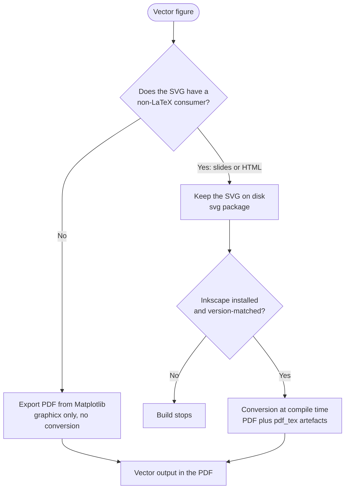

# Publication-grade vector figures for the thesis

Matplotlib is the plotting stack the thesis uses, and it is the right one: it is the only plotting library declared in `pyproject.toml`, it writes PDF vector output directly, and it can be told to typeset labels with the fonts of the document.
This note records what the PDF format accepts natively, which layer is worth an extra dependency, and the exact configuration that makes a figure look like part of the thesis instead of pasted into it.

## 1. Dynamic features in academic PDFs

A PDF renders only the constructs its own format defines. Two consequences matter for a thesis: interactive constructs depend on the *viewer*, and vector assets depend on the *toolchain that builds the PDF*.
Only the first is about interactivity, and both argue for static output.

### 1.1 Interactive layers and animations

| Construct | Package | Renders in | Behaviour elsewhere |
| --- | --- | --- | --- |
| Toggleable layers, pop-ups | `ocgx2`, PDF form annotations | Adobe Acrobat (proprietary script engine) | no-op, or a static error frame |
| Flip-book animation | `animate` | Acrobat Reader only | first frame only |
| Form fields, script actions | `hyperref` forms, `insdljs` | Acrobat only | dead widgets |

Institutional templates (abnTeX2 among them), thesis repositories and conference proceedings assume a static, self-contained document that renders identically on any viewer.
Interactivity that is genuinely useful — exploring a tour, filtering a table of results — belongs in an HTML companion (a Streamlit page or a Plotly HTML export) that the text links to, not in the manuscript.

The repository already follows this rule: [`scaling_plots.py`](../../../src/benchmarking/analysis/scaling_plots.py) emits static vector `.pdf` and `.svg` files (`formats=("pdf", "svg")`) and nothing that depends on a viewer feature.

### 1.2 Vector assets: PDF is native, SVG is not

PDF's graphics model is a page-description language, and `graphicx` reads what that model defines: PDF, PNG and JPG directly, EPS through an automatic `epstopdf` conversion.
SVG is XML and is none of those, so `lualatex`, `xelatex` and `pdflatex` cannot embed it as-is.
There are two ways out, and they differ in what they put on the critical path of the build.



**Option A — export PDF from Matplotlib (recommended).**

```python
fig.savefig("tsp_route_kroA100.pdf", format="pdf", bbox_inches="tight")
```

```latex
\begin{figure}[htbp]
  \centering
  \includegraphics[width=\linewidth]{figures/tsp_route_kroA100.pdf}
  \caption{Melhor rota obtida para a instância \texttt{kroA100}.}
  \label{fig:route-kroA100}
\end{figure}
```

Matplotlib writes vector primitives, so zoom is unbounded and no rasterisation occurs at any scale.
The build needs a TeX distribution and the file itself, and nothing else.

**Option B — keep the SVG as the canonical asset on disk.**

```latex
\usepackage{svg}
```

```latex
\includesvg[width=\linewidth]{assets/tsp_route_kroA100}
```

The extension is omitted on purpose: `\includesvg` appends `.svg` and asks Inkscape to convert it at compile time, leaving a `.pdf_tex` next to the asset.
The cost is not the conversion, it is the dependency:

+ Inkscape has to exist and be version-compatible on every machine and in CI, or the build stops;
+ the conversion runs through `-shell-escape`, which is a shell execution surface during the build;
+ the generated `.pdf_tex` accumulates in the repository beside the sources and has to be regenerated whenever the SVG changes.
  The package's `draft` option skips the conversion, but then it draws a placeholder instead of the figure.

> [!TIP]
> Keep `.pdf` as the canonical figure format, and keep the `.svg` only when the figure also feeds a non-LaTeX target such as a slide deck or the HTML companion.
> In Matplotlib that difference is the `format=` argument of `savefig`, and choosing `pdf` removes Inkscape from the build entirely.

### 1.3 What this already costs the thesis

[`second_draft.tex`](../../tex/thesis/second_draft.tex) refuses to compile unless `latexmk` is invoked with `-lualatex -shell-escape`, because `ltmermaid` renders the Mermaid diagrams through an external process.
The shell-escape part of Option B is therefore already paid; what Option B would add is the Inkscape dependency and the generated artefacts, not the flag.
Those two are the reasons to stay with direct PDF export.

Nothing else in the document is interactive: the empirical scaling figures come from [`scaling_plots.py`](../../../src/benchmarking/analysis/scaling_plots.py) (writing `scaling_time_gap.pdf` and `scaling_time_gap.svg` under `results_v4/figures/`, with no `.png` emitted by default), statistical rank diagrams come from native TikZ snippets generated by [`cd_diagram.py`](../../../src/benchmarking/analysis/cd_diagram.py), and the only compile-time external rendering step is the Mermaid one.

---

## 2. Tool recommendations

### 2.1 Matplotlib — the declared dependency

+ `matplotlib>=3.10.6` is declared in [pyproject.toml](../../../pyproject.toml) and it is the only plotting library the repository imports.
+ Vector output comes from `savefig(format="pdf")` and `savefig(format="svg")` (`formats=("pdf", "svg")`); `.png` is supported on explicit request (`formats=(..., "png")`) rather than emitted by default (`DP14-3`).
+ Typography is configurable in two ways with different costs: Matplotlib's own `mathtext` engine, or the `pgf` backend with LuaLaTeX typesetting the labels.
  Section 3.3 uses the first (with automatic TeX Live `Libertinus Serif` registration) and explains when the second is worth the render time.
+ Tour drawing needs nothing beyond the library: index the coordinates with the tour, close the cycle by repeating the first node, draw with a single `ax.plot`, and overlay a 2-opt exchange as a second line.
+ There is already a reference implementation to copy from: [`scaling_plots.py`](../../../src/benchmarking/analysis/scaling_plots.py) builds the two-panel time/gap figure with the colour-blind-safe Okabe–Ito palette, one marker and line style per variant, continuous `n` axis with isotonic/two-tier instance ticks (`x_axis_mode="continuous"`, `x_tick_mode="instances"`), and configurable dispersion bands defaulting to the empirical IQR (`Q25`–`Q75` around the median, `"iqr" | "std" | "ci"`).

### 2.2 Seaborn — only with a reason

+ It is **not** declared in [pyproject.toml](../../../pyproject.toml). It imports in the current environment (0.13.2) because another package pulls it in, so using it means taking on a dependency, not using what is already guaranteed.
+ The usual argument, that it produces confidence intervals for free, does not hold here: [`scaling_plots.py::_summarize_metric`](../../../src/benchmarking/analysis/scaling_plots.py) computes empirical IQR, Bessel-corrected `±1 SD` (`ddof=1`), and 95% Student-t CI bands directly, matching [`algorithm_runner.py::compute_series_stats`](../../../src/benchmarking/runner/algorithm_runner.py) and the dispersion definitions used everywhere else in the thesis.
  A second computation on the Seaborn side would be a second definition of the same band.
+ Where it would earn its place: violin or box comparisons of the four variants across the fifteen instances, or categorical gap plots.
  The thesis contains neither today, so the dependency would be paid for in advance.

---

## 3. A configuration that matches the document

### 3.1 Evolution from initial defaults to `DP14-3` / `DP14-5`

Originally, [`scaling_plots.py::generate_scaling_plots`](../../../src/benchmarking/analysis/scaling_plots.py) drew on an `8.5 × 6.8 in` canvas with `font.serif: ["DejaVu Serif"]`, `mathtext.fontset: "stix"`, `.png` twin emission, and unset `pdf.fonttype` (defaulting to Type 3 in Matplotlib 3.11.2), and [`04-resultados.tex`](../../tex/thesis/parts/04-resultados.tex) included it at `0.95\linewidth`. Under `DP14-3` and `DP14-5`, [`scaling_plots.py::get_academic_plot_rc_params`](../../../src/benchmarking/analysis/scaling_plots.py) aligns all four dimensions with the manuscript:

| Dimension | Legacy configuration | Current (`DP14-3` / `DP14-5`) | Effect on thesis PDF |
| --- | --- | --- | --- |
| Figure font family | `DejaVu Serif` | `Libertinus Serif` (auto-registered from TeX Live, fallback `DejaVu Serif`) | Matches manuscript x-height and stem width beside captions |
| Math glyphs | `mathtext.fontset: "stix"` | `mathtext.fontset: "custom"` mapped to `Libertinus Serif` | Consistent `$n$` and subscript glyphs without Times substitution |
| Embedded font type | `pdf.fonttype` unset (Type 3 bitmap) | `pdf.fonttype = 42`, `ps.fonttype = 42` | Vector outlines (`CID Type 0C` / TrueType), zero Type 3 fonts |
| Canvas width & inclusion | `8.5 in` at `0.95\linewidth` (0.70× scale) | `TEXT_WIDTH_INCHES = 6.3` at `width=\linewidth` | 1:1 scale so 10 pt labels print at 10 pt (`8 pt` ticks stay crisp) |
| Dispersion & x-axis | 95% Student-t CI; standard auto ticks | `dispersion_metric="iqr"` (`iqr`/`std`/`ci`), continuous `n` with PAVA + 2-tier 45° instance ticks (plus `ordinal` mode) | Non-parametric spread visible on log scale; zero label collisions |

### 3.2 Width is the constraint to fix first

`abnTeX2` on A4 leaves $210 - 30 - 20 = 160$ mm, that is 6.30 in, of text width.
A figure drawn on a wider canvas is scaled down by `\includegraphics`, and the scale applies to the text as well:

$$
\text{rendered size} = \text{declared size} \times
\frac{w_{\text{block}}}{w_{\text{canvas}}}
$$

An 8.5 in canvas included at `width=\linewidth` shrinks by 0.74; the same canvas at `0.95\linewidth` (used before `DP14-3`) shrinks by 0.70 and turns 10 pt into 7.0 pt — below the 8 pt floor most templates assume for figure text. Drawing at `TEXT_WIDTH_INCHES = 6.3` (or an exact fraction such as `3.15`) and including at `width=\linewidth` keeps the scale factor near 1 so every size in `rcParams` is the size on the page.

### 3.3 Configuration module

Written against the constraints above, and intended for the analysis script that produces the figures rather than for the benchmark itself:

```python
"""Configuration module for generating publication-quality vector charts."""

import matplotlib as mpl
import matplotlib.pyplot as plt
import numpy as np

# ABNT margins: A4 width = 210mm (~8.27 in). With 3cm left + 2cm right margins,
# the printable text width is 160mm (~6.3 inches).
TEXT_WIDTH_INCHES: float = 6.3


def setup_academic_plot_style() -> None:
    """Configure Matplotlib to match thesis typography and vector output standards.

    Sets font family to Libertinus Serif, enables true vector text rendering,
    and formats math expressions consistently with LaTeX unicode-math.
    """
    mpl.rcParams.update(
        {
            "font.family": "serif",
            "font.serif": ["Libertinus Serif", "DejaVu Serif"],
            # mathtext ships no Libertinus Math fontset, so the families are mapped
            # by hand. "cm" and "stix" would silently substitute Computer Modern
            # and Times, which is exactly what this block exists to prevent.
            "mathtext.fontset": "custom",
            "mathtext.rm": "Libertinus Serif",
            "mathtext.it": "Libertinus Serif:italic",
            "mathtext.bf": "Libertinus Serif:bold",
            "font.size": 10,
            "axes.labelsize": 10,
            "legend.fontsize": 9,
            "xtick.labelsize": 8,
            "ytick.labelsize": 8,
            # Type 42 (TrueType) subsets; matplotlib defaults to Type 3, whose
            # bitmap-derived glyphs several viewers antialias badly.
            "pdf.fonttype": 42,
            "ps.fonttype": 42,
        }
    )


def export_tsp_tour(
    coords: np.ndarray,
    tour: np.ndarray,
    instance_name: str,
    output_path: str,
) -> None:
    """Plot and export a 2D TSP tour as a vector PDF.

    Parameters
    ----------
    coords : np.ndarray
        Array of shape (N, 2) containing node coordinates.
    tour : np.ndarray
        1D array containing the permutation sequence of visited node indices.
    instance_name : str
        Name of the TSPLIB instance (e.g., 'kroA100').
    output_path : str
        Target file path for the exported PDF.
    """
    ordered_coords = coords[tour]
    # Close the cycle
    closed_tour = np.vstack([ordered_coords, ordered_coords[0]])

    fig, ax = plt.subplots(figsize=(TEXT_WIDTH_INCHES / 2, 3.2))

    # Plot tour edges
    ax.plot(
        closed_tour[:, 0],
        closed_tour[:, 1],
        color="#2b5c8f",
        linewidth=0.9,
        alpha=0.85,
        zorder=1,
    )

    # Plot city coordinates
    ax.scatter(
        coords[:, 0],
        coords[:, 1],
        c="#c0392b",
        s=12,
        edgecolors="none",
        zorder=2,
    )

    ax.set_title(f"Best Found Tour - {instance_name}", fontsize=10)
    ax.set_xlabel("Coordinate $X$")
    ax.set_ylabel("Coordinate $Y$")
    ax.grid(True, linestyle="--", alpha=0.4, linewidth=0.5)

    # Direct vector PDF export
    fig.savefig(output_path, format="pdf", bbox_inches="tight")
    plt.close(fig)

```

Two details of that module are worth knowing before copying it. `figure.autolayout` is absent on purpose: `bbox_inches="tight"` in `savefig` already crops the result, and enabling both makes the layout engine fight the crop. And the `custom` mathtext mapping is an *approximation* of Libertinus Math: the glyphs come from Libertinus Serif, which covers the Latin and Greek needed by the thesis labels but not the full math table.
When a figure needs true Libertinus Math, render it through the `pgf` backend with LuaLaTeX:

```python
"pgf.texsystem": "lualatex",
"text.usetex": False,  # pgf only; usetex goes through latex+dvips and cannot see unicode-math
```

with `\usepackage{fontspec}\setmainfont{Libertinus Serif}` and `\usepackage{unicode-math}\setmathfont{Libertinus Math}` in `pgf.preamble`.
The price is that every figure render invokes LuaLaTeX, which is an order of magnitude slower than the `Agg` canvas, so the trade is a batch job that runs once per coleta against a render that happens on every plotting tweak.

### 3.4 Including the result

```latex
\begin{figure}[htbp]
  \centering
  \includegraphics[width=\linewidth]{figures/tour_kroA100.pdf}
  \caption{Melhor circuito encontrado para a instância \texttt{kroA100}.}
  \label{fig:tour-kroA100}
\end{figure}
```

+ `width=\linewidth`, not `0.95\linewidth` and not `\textwidth`: the two lengths differ inside lists and minipages, and the scale factor has to stay at 1 for the sizes in `rcParams` to be the sizes on the page.
+ `bbox_inches="tight"` crops to the drawn content plus 0.1 in of padding, so the exported width lands a few percent under the canvas.
  That residual upscale stays below 2% and is invisible; if a figure has to be exact, export with `pad_inches=0` and `bbox_inches=None` after `fig.set_layout_engine("constrained")`.
+ Keep `.png` out of the manuscript (and out of default `generate_scaling_plots` output).
  Vector `.pdf` and `.svg` preserve infinite zoom, while `.png` is strictly an opt-in inspection format.

### 3.5 Unified Figure Generation Contract (`DP14-5`)

[`report_generator.py::generate_result_tables`](../../../src/benchmarking/analysis/report_generator.py) enforces strict separation between analytical TikZ diagrams, empirical Matplotlib Type 42 curves, and quantitative LaTeX macros:

| Artifact family | Generator | Formats & typography | Output path & LaTeX inclusion | Scope |
| --- | --- | --- | --- | --- |
| Critical Difference (CD) diagrams | [`cd_diagram.py::export_cd_diagram_tikz`](../../../src/benchmarking/analysis/cd_diagram.py) | Vector `.tikz` (`scale=2.2`, staggered bilateral elbows, white tick halo; inherits document `Libertinus Serif`) | `results_v4/tables/<benchmark>_cd_diagram_{gap,time}.tikz`; included via `\input{...}` inside `\begin{adjustbox}{max width=\linewidth}` | Analytical Demšar ranks, Nemenyi $CD$, maximal non-significant cliques |
| Empirical scaling curves | [`scaling_plots.py::generate_scaling_plots`](../../../src/benchmarking/analysis/scaling_plots.py) (thesis pt-BR wrapper: [`run_chapter4_benchmark.py::generate_thesis_scaling_plots`](../../../benchmark_scripts/experiments-and-examples/chapter4/run_chapter4_benchmark.py)) | Vector `.pdf` + `.svg` (`pdf.fonttype = 42`, `ps.fonttype = 42`, `Libertinus Serif`, `TEXT_WIDTH_INCHES = 6.3`) | `results_v4/figures/scaling_time_gap.{pdf,svg}`; `.pdf` included exclusively via `\includegraphics[width=\linewidth]{...}` | Log-scale total runtime + gap vs. $n$ with configurable dispersion (`iqr`/`std`/`ci`) and axis modes (`continuous`/`ordinal`) |
| Quantitative LaTeX macros | [`latex_macros.py::generate_latex_macros`](../../../src/benchmarking/analysis/latex_macros.py) | `\newcommand` numeric definitions with configurable `decimal_separator` (`{,}` for pt-BR) | `results_v4/tables/benchmark_macros.tex` (available via `\input{...}` when manuscript macros are enabled) | Cohort counts, aggregated means/SDs, pairwise geometric speedups, Friedman/Iman–Davenport, Nemenyi & Wilcoxon/Holm |

## References

1. Matplotlib, [Customizing Matplotlib with style sheets and rcParams](https://matplotlib.org/stable/users/explain/customizing.html) — `rcParams` keys and `rc_context` scope.
2. Matplotlib, [Fonts in PDF and PostScript](https://matplotlib.org/stable/users/explain/text/fonts.html) — `pdf.fonttype` values, Type 3 versus Type 42.
3. Matplotlib, [Writing mathematical expressions](https://matplotlib.org/stable/users/explain/text/mathtext.html) — `mathtext.fontset` options, including `custom`.
4. CTAN, [The `svg` package](https://ctan.org/pkg/svg) — `\includesvg`, the Inkscape call, and the `draft` option.
5. Okabe & Ito (2008), [Color Universal Design](https://jfly.uni-koeln.de/color/) — the palette used by `scaling_plots.py`.
