# Plano de arquitetura unificada para CVRP e variantes multi-atributo (Fase 17)

## Escopo e regras

Este plano estrutura a evolução do repositório `gpu_accelerated_clean` para suportar o Problema de Roteamento de Veículos Capacitado (`CVRP`) e suas variantes simétricas aditivas por prefixo sem descaracterizar a arquitetura composicional existente baseada em protocolos PEP 544.

- **Escopo permitido:** extensões retrocompatíveis em `src/data_models/`, `src/protocols/`, `src/loaders/`, `src/algorithms/`, `src/benchmarking/`, regeneração de esquemas em `configs/schemas/`, testes falsificáveis em `tests/`, documentação em inglês em `documentation/` e rastreabilidade neste plano e em [table-of-symbols.plan.md](./table-of-symbols.plan.md).
- **Escopo proibido:** nenhuma alteração em `results_v4/`, nenhuma quebra de contrato nos 6 slots de estratégia existentes para `TSP`/`ATSP`, nenhum alias legado de compatibilidade (`AGENTS.md` Regra 10), nenhuma edição direta em `/home/lucas_galdino/chimera/routing_data` a partir deste plano (`AGENTS.md` Regra 9) e nenhum `git commit` ou `git push` sem aprovação explícita.
- **Portões obrigatórios por lote:** toda tarefa de código exige teste unitário que falha sem a mudança; ao encerrar cada fase, exigir código `0` em `rtk .venv/bin/pytest -q -m "not gpu and not slow"`, testes GPU dedicados, `rtk .venv/bin/mypy src tests benchmark_scripts`, `rtk .venv/bin/ruff check src tests benchmark_scripts`, `rtk .venv/bin/python -m benchmarking.runner.schema_generator --check`, `rtk .venv/bin/python -m benchmark_scripts.check_docs` e paridade integral de `tsp-report` sobre `results_v4/checkpoints`.

## Fonte da verdade

Os identificadores `DP17-1` a `DP17-5` e `BUG-107` a `BUG-109` têm registro canônico em [table-of-symbols.plan.md](./table-of-symbols.plan.md). Este arquivo governa exclusivamente o trabalho em `gpu_accelerated_clean`; os pré-requisitos do conversor e do banco de dados corporativo pertencem a `routing_data/src/converter/TODO.md` (`#CV9` e `#CV10`).

## Decisões fixadas

- `DP17-1`: **Descritor global de restrições `VRPConstraints` (Tier 1 ativo, Tier 2 reservado)** — Seguindo a formulação unificada multi-atributo de Vidal et al. (2014)[^vidal2014], anexar `VRPConstraints` imutável a [problem.py::Problem](../../src/data_models/problem.py) e [problem_context.py::ProblemContext](../../src/protocols/problem_context.py), cobrindo nativamente `CVRP` canônico (`capacity`), roteamento aberto sem retorno ao depósito (`return_to_depot: bool`, habilitando `OVRP` e `Open TSP`), frota limitada (`max_vehicles`) e distância máxima por rota (`max_route_distance`, `DCVRP`), além de reservar `time_windows` e `service_times` opcionais para futura fase Tier 2 (`VRPTW`) sem nova migração de modelo de dados.
- `DP17-2`: **Preservação dos 6 slots de estratégia e coexistência das 3 famílias de representação** — Manter inalterados os 6 slots em [algorithm_strategies.py](../../src/protocols/algorithm_strategies.py) e o motor [genetic_algorithm.py::GeneticAlgorithm](../../src/algorithms/metaheuristics/genetic_algorithm.py), suportando como estratégias intercambiáveis: (1) `Giant-Tour` puro `(N, n - 1)` com reúso integral de `OX`, `PMX`, `Swap` e `Inversion`; (2) híbrido Prins–Vidal (`HGS`)[^prins2004][^vidal2012] com `(N, n - 1)` no AG e decodificação `Split` interna em avaliação e busca local; e (3) rotas delimitadas por `0` `(N, n + K_max)` ponta a ponta, conectáveis via passos opcionais `SplitDecodeStep` e `GiantTourEncodeStep` registrados em [pipeline_steps.py::register_pipeline_step](../../src/algorithms/pipeline_steps.py). Ao término de `evolve()`, `best_tour` de instâncias VRP é sempre normalizado para a forma canônica delimitada por `0` (`[0, r_1..., 0, r_2..., 0]`).
- `DP17-3`: **Invariantes estritos de tipos (`dtypes`) e residência em VRAM** — Preservar `Routes` e `demands` como `int32` C-contíguos em NumPy/CuPy, passar restrições escalares aos kernels CUDA via parâmetros escalares/estrutura POD sem alocação auxiliar no host e manter `Fitness` estritamente em `float64` `(N,)` carregando o custo penalizado $f_{\text{pen}}$ para seleção e sobrevivência, com zero sincronizações D2H por geração fora da leitura escalar de melhoria (`BUG-30`, `DP11-22`).
- `DP17-4`: **Retrocompatibilidade de checkpoints e dominância lexicográfica de factibilidade na estatística** — Manter todos os campos atuais dos checkpoints de `TSP` inalterados e anexar campos opcionais de factibilidade/frota (`raw_is_feasible`, `raw_unpenalized_costs`, `raw_num_vehicles`, `feasible_runs`, `feasibility_rate`, `mean_vehicles`). Métricas descritivas (`mean_cost`, `mean_gap`) agregam exclusivamente repetições factíveis (evitando *gaps* negativos espúrios de rotas sobrecarregadas), enquanto testes ordinais (`Friedman`, `Iman–Davenport`, `Wilcoxon/Holm`, tamanhos de efeito) aplicam a dominância lexicográfica de Deb (2000)[^deb2000] quando existirem execuções infactíveis, degenerando de forma bit-idêntica ao pipeline atual quando `feasibility_rate == 1.0`.
- `DP17-5`: **Fronteira limpa entre `gpu_accelerated_clean` e `routing_data`** — Saneamento em `gpu_accelerated_clean` da colisão de nomes gêmeos `(name, problem_type)` e leitura de `solutions.cost` em [database_loader.py::DatabaseLoader](../../src/loaders/database_loader.py) (`BUG-108`), suporte direto a arquivos `.vrp` e `.sol` em [tsplib_loader.py](../../src/loaders/tsplib_loader.py) e [orchestration.py::run_comprehensive_benchmark](../../src/benchmarking/runner/orchestration.py) (`BUG-109`), e adição de `problem_type` opcional em `problems.schema.json`, mantendo a evolução de DDL e ingestão em lote da CVRPLIB isolada em `routing_data/src/converter/TODO.md` (`#CV9`, `#CV10`).

[^vidal2014]: Vidal, T., Crainic, T. G., Gendreau, M., & Prins, C. (2014). A unified solution framework for multi-attribute vehicle routing problems. *European Journal of Operational Research*, 234(3), 658–673.

[^prins2004]: Prins, C. (2004). A simple and effective evolutionary algorithm for the vehicle routing problem. *Computers & Operations Research*, 31(12), 1985–2002.

[^vidal2012]: Vidal, T., Crainic, T. G., Gendreau, M., Lahrichi, N., & Rei, W. (2012). A hybrid genetic algorithm for multidepot and periodic vehicle routing problems. *Operations Research*, 60(3), 611–624.

[^deb2000]: Deb, K. (2000). An efficient constraint handling method for genetic algorithms. *Computer Methods in Applied Mechanics and Engineering*, 186(2–4), 311–338.

## Arquitetura preservada e integração por camadas

A premissa central da Fase 17 é **zero ruptura estrutural**: o fluxo `Loader -> Problem -> ProblemContext -> GeneticAlgorithm (6 slots + GenerationStep) -> Checkpoint -> BenchmarkCohort -> Relatórios` permanece idêntico. A capacidade de resolver `CVRP` e variantes nasce da composição de novas estratégias e de um descritor imutável `VRPConstraints`, nunca de ramificações rígidas espalhadas pelo motor evolucionário.

```mermaid
flowchart LR
  subgraph Ingestao["1. Ingestao (.tsp, .vrp, .sol, DuckDB)"]
    L1["TsplibLoader (.tsp / .vrp + .opt.tour / .sol)"]
    L2["DatabaseLoader (name + problem_type + solutions)"]
  end

  subgraph Dominio["2. Dominio Imutavel e Contexto"]
    P["Problem + VRPConstraints (Tier 1 ativo / Tier 2 reservado)"]
    PC["ProblemContext (distances, candidates, demands, constraints)"]
  end

  subgraph Motor["3. GeneticAlgorithm (6 Slots Intactos)"]
    S1["Initialization (Random / NN / ClarkeWright / Sweep)"]
    S2["Selection + Crossover + Mutation (OX / PMX / Swap / Inv / Route)"]
    S3["LocalSearch (2-opt / 3-opt / Relocate / Swap / 2-opt* + Split)"]
    S4["Evaluation (Cost TSP / CVRPCost Split ou Direto)"]
  end

  subgraph Saida["4. Checkpoints, Coorte e Estatistica"]
    CK["Checkpoint JSON (best_tour delimitado por 0 + factibilidade)"]
    ST["BenchmarkCohort (media factivel + ranking lexicografico de Deb)"]
  end

  L1 --> P
  L2 --> P
  P --> PC
  PC --> S1 --> S2 --> S3 --> S4 --> CK --> ST
```

### Formulação matemática global de Tier 1

| Símbolo | Significado |
| --- | --- |
| $n$ | Dimensão total da instância (`0` = depósito, $\{1, \dots, n - 1\}$ = clientes) |
| $Q$ | Capacidade homogênea por veículo (`capacity`) |
| $q_v$ | Demanda inteira não-negativa do nó $v$ ($q_0 = 0$) |
| $K_{\max}$ | Limite superior opcional de veículos ativos (`max_vehicles`) |
| $L_{\max}$ | Limite superior opcional de distância/duração por rota (`max_route_distance`) |
| $\mathbb{I}_{\text{closed}}$ | Indicador binário de retorno ao depósito (`1` em `CVRP`/`TSP`, `0` em `OVRP`/`Open TSP`) |
| $R = (r_1, \dots, r_m)$ | Partição dos clientes em $m$ rotas de veículos com carga $Q_l$ e distância $D_l$ |
| $\omega_Q, \omega_L, \omega_K$ | Pesos de penalidade para excesso de carga, distância e frota |
| $B$ | Número máximo factível de clientes por rota no DAG de `Split` ($B \le Q / \min_{v \ge 1} q_v$) |

Para qualquer solução decodificada ou explícita $R = (r_1, \dots, r_m)$, onde a rota $r_l = (0, u_{l,1}, \dots, u_{l,s_l}, 0)$ possui custo aberto $D_{\text{open}}(r_l) = d(0, u_{l,1}) + \sum_{p=1}^{s_l - 1} d(u_{l,p}, u_{l,p+1})$, distância total $D_l = D_{\text{open}}(r_l) + \mathbb{I}_{\text{closed}} \cdot d(u_{l,s_l}, 0)$ e carga acumulada $Q_l = \sum_{p=1}^{s_l} q_{u_{l,p}}$, o avaliador unificado computa simultaneamente o custo real de viagem $c(R)$, a violação escalar normalizada $\nu(R)$ e o *fitness* penalizado $f_{\text{pen}}(R)$:

$$\begin{align*}
c(R) &= \sum_{l=1}^{m} D_l \\
\nu(R) &= \sum_{l=1}^{m} \max(0, Q_l - Q) + \sum_{l=1}^{m} \max(0, D_l - L_{\max}) + \max(0, m - K_{\max}) \\
f_{\text{pen}}(R) &= c(R) + \omega_Q \sum_{l=1}^{m} \max(0, Q_l - Q) + \omega_L \sum_{l=1}^{m} \max(0, D_l - L_{\max}) + \omega_K \max(0, m - K_{\max})
\end{align*}$$

Quando uma estratégia usa `Giant-Tour` $T = (t_1, \dots, t_{n-1})$ com frota ilimitada ($K_{\max} = \infty$), o decodificador `Split` de Prins (2004)[^prins2004] resolve o caminho mínimo no grafo acíclico dirigido sobre prefixos acumulados de carga $W_j = \sum_{s=1}^{j} q_{t_s}$ e distância interna $P_j = \sum_{s=1}^{j-1} d(t_s, t_{s+1})$:

$$\begin{equation*}
V_j = \min_{\substack{0 \le i < j \\ W_j - W_i \le Q \\ \Delta D(i, j) \le L_{\max}}} \Bigl\{ V_i + \Delta D(i, j) \Bigr\}, \qquad \Delta D(i, j) = d(0, t_{i+1}) + (P_j - P_{i+1}) + \mathbb{I}_{\text{closed}} \cdot d(t_j, 0)
\end{equation*}$$

com $V_0 = 0$, garantindo $\nu(R) = 0$ por construção sempre que $\max_v q_v \le Q$ e $\min_l D_l \le L_{\max}$.

## Fluxo de tipos de dados (`dtypes` e formatos) e contrato de saídas

> [!IMPORTANT]
> Nenhuma etapa intermediária converte populações GPU para listas Python ou arrays `object` irregulares (*ragged arrays*). Toda representação em lote na VRAM é uma matriz retangular 2D `int32` C-contígua `(N, W)`, preservando coalescência de memória e compatibilidade direta com [types.py::Routes](../../src/protocols/types.py).

| Etapa do pipeline | `TSP` / `ATSP` / `Open TSP` | `CVRP` Família 1 e 2 (`Giant-Tour` / Híbrido `Split`) | `CVRP` Família 3 (Delimitadores explícitos) | Backend e `dtype` |
| --- | --- | --- | --- | --- |
| `Problem.demands` / `get_*_demands()` | `None` | `(n,)` com `demands[0] == 0` | `(n,)` com `demands[0] == 0` | `np.ndarray` / `cp.ndarray` `int32` |
| `customers` entregue a `evolve()` | `[0, ..., n - 1]` (`len = n`) | `[1, ..., n - 1]` (`len = n - 1`) | `[1, ..., n - 1]` + `K_max` sentinelas `0` | `Sequence[int]` no host |
| `Initialization.initialize()` | `(N, n)` | `(N, n - 1)` permutação pura | `(N, n + K_max)` delimitado por `0` | `int32` C-contíguo |
| `Selection.select_batch()` | `(N, n)` | `(N, n - 1)` | `(N, n + K_max)` | `int32` (agnóstico a `W`) |
| `Crossover` + `Mutation` | `(N, n)` | `(N, n - 1)` (`OX`, `PMX`, `Swap`, `Inversion` sem edição) | `(N, n + K_max)` (`CrossoverCVRPRoute` ou adaptador `Strip0`) | `int32` |
| Buffer interno em `LocalSearch` | `(N, n)` in-place | Híbrido: `Split` expande para scratch `(N, n + K_max)`, refina intra/inter-rotas e compacta `(N, n - 1)` | `(N, n + K_max)` in-place | `int32` em VRAM/RAM |
| `Evaluation.evaluate_batch()` | `(N,)` custo escalar | `(N,)` custo `Split` $V_{n-1}$ (ou $f_{\text{pen}}$ se $K_{\max}$ violado) | `(N,)` custo penalizado $f_{\text{pen}}(R)$ | `float64` (`Fitness`) |
| `SurvivalStep` (`_select_survivors`) | `(2N, n) -> (N, n)` | `(2N, n - 1) -> (N, n - 1)` | `(2N, n + K_max) -> (N, n + K_max)` | `int32` + `float64` |
| Retorno final `best_tour` de `evolve()` | `1D (n,)` permutação | `1D (n + m,)` decodificado `[0, r_1..., 0, ..., 0]` | `1D (n + m,)` compactado sem `0`s vazios extras (`[0, r_1..., 0]`) | `np.ndarray` `int32` no host |

### Contrato de saídas nos checkpoints JSON e no DuckDB de resultados

1. **Invariância para `TSP` e `ATSP`:** os 45 campos existentes em checkpoints de `TSP` permanecem inalterados; `results_v4/` continua 100% compatível sem migração retroativa.
2. **Campos adicionados para instâncias VRP (`problem_type in {"CVRP", "OVRP", "DCVRP"}`):**
   - `best_tour`: lista `int` canônica delimitada por `0` sem rotas vazias supérfluas (ex.: `[0, 3, 1, 0, 4, 2, 5, 0]`), permitindo validação determinística da cobertura exata dos clientes $\{1, \dots, n - 1\}$ e reconstrução imediata das rotas individuais.
   - `raw_is_feasible`: `list[bool]` de comprimento `successful_runs` (`True` quando $\nu(R) == 0$).
   - `raw_unpenalized_costs`: `list[float]` com o custo puro de transporte $c(R)$ de cada repetição (enquanto `raw_costs` registra $c(R)$ nas execuções factíveis e `NaN` ou $f_{\text{pen}}$ segregado, conforme regra estatística abaixo).
   - `raw_num_vehicles`: `list[int]` com a quantidade de rotas ativas $m$ em cada repetição.
   - Resumos agregados: `feasible_runs: int`, `feasibility_rate: float` ($\in [0, 100]\%$), `mean_vehicles: float | None` e `best_vehicles: int | None`.

## Comportamento estatístico e regra de dominância de factibilidade

Um erro metodológico clássico em benchmarks de VRP penalizados é misturar custos puros de soluções infactíveis (que economizam distância violando a capacidade $Q$) com custos de soluções factíveis, produzindo médias distorcidas e *gaps* percentuais negativos falsos frente ao ótimo da literatura (`BKS`). O pipeline estatístico em `src/benchmarking/analysis/` seguirá duas regras complementares (`DP17-4`):

1. **Estatística descritiva e tabelas de qualidade (`mean_cost`, `std_cost`, `best_cost`, `mean_gap`, `std_gap`):**
   - Calculadas **exclusivamente sobre o subconjunto de repetições factíveis** ($\mathcal{F} = \{r \mid \nu(R_r) = 0\}$) usando o custo puro de viagem $c(R_r)$ e correção de Bessel (`ddof=1`).
   - Quando $\lvert \mathcal{F} \rvert = 0$ (nenhuma repetição factível para um par problema–algoritmo), `mean_cost` e `mean_gap` assumem `None` (renderizados como `"—"` nas Tabelas 1 e 2) e `feasibility_rate` explicita `0.0%`.
   - Em coortes onde alguma variante apresente `feasibility_rate < 100.0%` ou onde `problem_type` seja VRP, a Tabela 1 e a Tabela 2 exibem opcionalmente `Feas. (%)` e `Vehicles` (`mean_vehicles`), mantendo o layout idêntico ao Capítulo 4 para coortes puramente `TSP`.
2. **Inferência não-paramétrica pareada e multi-algoritmo (`Friedman`, `Iman–Davenport`, `Nemenyi/CD`, `Wilcoxon/Holm`, postos bisseriais):**
   - Para comparar repetições pareadas por semente (no nível da instância em [problem_statistics.py::analyze_problem](../../src/benchmarking/analysis/problem_statistics.py)) ou blocos de instâncias (no nível da coorte em [cohort.py::BenchmarkCohort](../../src/benchmarking/analysis/cohort.py) e [statistics.py::StatisticalAnalyzer](../../src/benchmarking/analysis/statistics.py)), define-se a pontuação escalar monotônica de Deb (2000)[^deb2000] dentro de cada instância $p$:

$$\begin{equation*}
\tilde{z}_{p,a,r} = \begin{cases}
c(R_{p,a,r}), & \text{se } \nu(R_{p,a,r}) = 0 \\
C_{p}^{\max} + 1 + \nu(R_{p,a,r}), & \text{se } \nu(R_{p,a,r}) > 0
\end{cases}
\end{equation*}$$

   onde $C_{p}^{\max} = \max_{(a', r') \in \mathcal{F}_p} c(R_{p,a',r'})$ é o maior custo factível observado na instância $p$ (ou `0.0` se $\mathcal{F}_p = \varnothing$).
   - **Propriedades garantidas:** (a) toda solução factível vence estritamente qualquer solução infactível ($\tilde{z}_{\text{factível}} < \tilde{z}_{\text{infactível}}$), independentemente da escala arbitrária de $\omega_Q$; (b) duas soluções infactíveis são desempatadas pela menor violação física $\nu(R)$; e (c) **quando 100% das execuções são factíveis** ($\nu = 0$, caso garantido em `TSP` e em `CVRP` via `Split` sem teto rígido violado), $\tilde{z}_{p,a,r} \equiv c(R_{p,a,r})$, preservando **identidade numérica exata** com todos os testes atuais!

## Mapa de migração, esquemas JSON e documentação

| Subsistema / Artefato | Impacto da mudança | Risco para `TSP` / `results_v4` |
| --- | --- | --- |
| `src/data_models/problem.py` | Adição de `VRPConstraints` com valores padrão neutros e expansão de `VALID_PROBLEM_TYPES` (`OVRP`, `DCVRP`) | Zero (todos os novos campos têm padrão neutro) |
| `src/protocols/problem_context.py` | Propriedades `constraints`, `return_to_depot` e upload preguiçoso de demandas/restrições | Zero |
| `src/protocols/{algorithm_strategies,types}.py` | Nenhuma assinatura alterada nos 6 protocolos | Zero |
| `configs/schemas/algorithms.schema.json` | Regenerado automaticamente via `schema_generator.py` incluindo novas estratégias VRP nos 6 `$defs/strategy_slot_*` e 2 novos passos em `pipeline_step` | Zero (variantes existentes permanecem válidas) |
| `configs/schemas/problems.schema.json` | Adição de campo opcional `"problem_type"` (`"TSP" \| "ATSP" \| "CVRP" \| "OVRP" \| "DCVRP"`) para desambiguar nomes gêmeos (`eil51`, `att48`, `gil262`) | Zero (campo opcional) |
| `src/benchmarking/{runner,analysis,reporting}/` | Suporte a campos opcionais de factibilidade/veículos e filtro lexicográfico de Deb apenas quando `raw_is_feasible` indicar infactibilidade | Zero (paridade byte a byte validada em `results_v4/checkpoints`) |
| `documentation/` | Atualização dos 4 guias de subsistema, do blueprint mestre e adição de nota em `documentation/knowledge-base/` sobre `Split` GPU e dominância estatística | Apenas aditivo |

> [!NOTE]
> **Pré-requisitos isolados no repositório irmão `routing_data` (`AGENTS.md` Regra 9):** para popular `datasets/tsp.duckdb` (ou um `routing.duckdb` unificado) com as 50 instâncias `.vrp` e 390 soluções `.sol` já presentes em `routing_data/datasets_raw/`, as tarefas companheiras permanecem registradas exclusivamente em `routing_data/src/converter/TODO.md`: (1) `#CV10 A4` (`insert_solutions()` gravando custo `BKS` e rotas na tabela `solutions` e marcando `has_solution = TRUE`), (2) `#CV10 A5a` (varredura de arquivos `.sol` pareados aos `.vrp`), e (3) `#CV9` (adição das colunas opcionais `vehicles`, `max_distance`, `return_to_depot` e `display_coords` em `cvrp_problems`). O Lote 1 abaixo habilita desde já o uso direto de arquivos `.vrp`/`.sol` em `gpu_accelerated_clean` sem bloquear o desenvolvimento pelo rebuild do DuckDB.

## Fase 17A — Fundação de contratos, ingestão, `Split` e operadores base (Lotes 1 e 2)

### Lote 1 — Contratos `VRPConstraints`, correção de `2-opt` e ingestão `.vrp`/`.sol`/DuckDB (Tasks 17.1–17.3)

Execução **em paralelo** (conjuntos de escrita disjuntos: `data_models`+`protocols` vs. `strategies/local_search` vs. `loaders`+`runner/config`).

- [ ] **Task 17.1: Introduzir `VRPConstraints` global de Tier 1 (com reserva Tier 2) em `Problem` e `ProblemContext` (`DP17-1`, `DP17-3`)**

  - **O quê:** Criar a dataclass imutável `VRPConstraints` (`capacity`, `max_vehicles`, `max_route_distance`, `return_to_depot`, e campos reservados `time_windows`, `service_times`) integrada a [problem.py::Problem](../../src/data_models/problem.py) e [problem_context.py::ProblemContext](../../src/protocols/problem_context.py), estendendo `VALID_PROBLEM_TYPES` para admitir `"OVRP"` e `"DCVRP"` ao lado de `"TSP"`, `"ATSP"` e `"CVRP"`.
  - **Por quê:** Hoje `Problem` modela apenas `capacity` isolada e `ProblemContext.is_closed` testa apenas `problem_type == "CVRP"`, impossibilitando representar frotas limitadas (`K_max`), limites de distância (`DCVRP`) ou rotas abertas (`OVRP` / `Open TSP`) sem espalhar condicionais ad hoc em cada estratégia.
  - **Quem:** Agent (`implementer`).
  - **Onde:** [problem.py::Problem](../../src/data_models/problem.py), [problem.py::VALID_PROBLEM_TYPES](../../src/data_models/problem.py), [problem_context.py::ProblemContext](../../src/protocols/problem_context.py), [problem_context.py::ProblemContext.is_closed](../../src/protocols/problem_context.py), [route_helpers.py::resolve_route_bounds](../../src/utils/route_helpers.py).
  - **Quando:** Sem dependências; paralela às Tasks 17.2 e 17.3.
  - **Como:** Definir `VRPConstraints` em `src/data_models/vrp_constraints.py` (novo módulo) com validação de positividade, finitude e igualdade/hash de arrays opcionais; sincronizar `Problem.constraints` em `__post_init__` mantendo `Problem.capacity` consistente; expor `context.constraints` e `context.return_to_depot` em `ProblemContext`.
  - **Esforço:** Baixo.
  - **Impacto:** Estabelece o contrato único de restrições para todos os avaliadores, decodificadores e buscas locais sem alterar chamadas existentes de `Problem(...)` para `TSP`/`ATSP`/`CVRP`.
  - **DoD:** Testes unitários em `tests/data_models/` e `tests/protocols/` validam construção, imutabilidade, igualdade/hash, derivação automática de `VRPConstraints` para `CVRP`/`OVRP`/`DCVRP` e rejeição de limites negativos ou `NaN`.

- [ ] **Task 17.2: Corrigir `dist_stride`, guarda `is_closed` e suporte a rotas abertas em `LocalSearchCPUTwoOpt` e `LocalSearchGPUTwoOpt` (`BUG-107`)**

  - **O quê:** Separar o *stride* da matriz de distâncias (`dist_stride = context.dimension`) do comprimento da rota `n` e adicionar guardas de fronteira para rotas fechadas com depósito nas duas pontas (`is_closed: j <= n - 2`) e rotas abertas sem arco de retorno (`return_to_depot == False`) em [two_opt.py::LocalSearchCPUTwoOpt](../../src/algorithms/strategies/local_search/two_opt.py), [two_opt.py::LocalSearchGPUTwoOpt](../../src/algorithms/strategies/local_search/two_opt.py) e nos três kernels `two_opt_*.cu`.
  - **Por quê:** Em uma sub-rota CVRP fechada `[0, 3, 1, 4, 2, 0]` (`dimension = 5`, `n = 6`), `LocalSearchGPUTwoOpt` indexa linhas usando `n = 6` como *stride* (lendo distâncias erradas/fora de faixa) e aceita `j = n - 1`, deslocando o depósito final (`[0, 0, 1, 3, 2, 4]`); em `LocalSearchCPUTwoOpt`, `_exhaustive_pairs(n)` também permite reverter o depósito final e assume sempre o arco cíclico `(tour[n-1], tour[0])`.
  - **Quem:** Agent (`implementer`).
  - **Onde:** [two_opt.py::_exhaustive_pairs](../../src/algorithms/strategies/local_search/two_opt.py), [two_opt.py::_pair_deltas](../../src/algorithms/strategies/local_search/two_opt.py), [two_opt.py::LocalSearchCPUTwoOpt](../../src/algorithms/strategies/local_search/two_opt.py), [two_opt.py::LocalSearchGPUTwoOpt](../../src/algorithms/strategies/local_search/two_opt.py), [two_opt_batch.cu](../../src/algorithms/strategies/local_search/kernels/two_opt_batch.cu), [two_opt_multi_move.cu](../../src/algorithms/strategies/local_search/kernels/two_opt_multi_move.cu), [two_opt_single.cu](../../src/algorithms/strategies/local_search/kernels/two_opt_single.cu).
  - **Quando:** Sem dependências; paralela às Tasks 17.1 e 17.3.
  - **Como:** Passar `dist_stride`, `is_closed` e `is_cyclic` explicitamente aos três kernels CUDA (espelhando o cabeçalho limpo já validado em `three_opt_common.cuh`), restringir `j <= n - 2` quando `is_closed == True`, omitir a subtração do arco de retorno quando `j == n - 1` e `return_to_depot == False`, e desativar `candidate_k` quando `n != context.dimension` ou `is_closed == True` para evitar leituras de posições inexistentes.
  - **Esforço:** Médio.
  - **Impacto:** Torna `2-opt` em CPU e GPU (modos `batch`, `multi_move` e `naive`) matematicamente exato para sub-rotas fechadas de `CVRP`, `Open TSP` e `TSP` cíclico.
  - **DoD:** Teste de regressão falsificável prova que `[0, 3, 1, 4, 2, 0]` preserva `tour[0] == 0 == tour[-1]`, melhora monotonamente o custo real sob `distances` `(5, 5)` e coincide bit a bit entre CPU e os 3 modos GPU (além de um caso `Open TSP` sem arco de fechamento).

- [ ] **Task 17.3: Desambiguar `(name, problem_type)` e ler `solutions` no `DatabaseLoader`, e suportar `.vrp`/`.sol` nos loaders e runner (`BUG-108`, `BUG-109`, `DP17-5`)**

  - **O quê:** Adicionar `problem_type: str | None = None` em [database_loader.py::DatabaseLoader.load](../../src/loaders/database_loader.py) com consulta de custo ótimo/BKS na tabela `solutions`, ensinar [tsplib_loader.py::resolve_opt_tour_cost](../../src/loaders/tsplib_loader.py) e `_ingest_opt_tour_solutions` a ler arquivos `.sol` da CVRPLIB (`Cost` e `Route #k:`), expandir a descoberta de arquivos em [orchestration.py::run_comprehensive_benchmark](../../src/benchmarking/runner/orchestration.py) para `*.tsp` e `*.vrp`, e adicionar `"problem_type"` opcional em `problems.schema.json` e [config_loader.py::load_problems_config](../../src/benchmarking/runner/config_loader.py).
  - **Por quê:** `DatabaseLoader._load_metadata` filtra apenas `WHERE p.name = ?`, colidindo em instâncias gêmeas entre `TSP` e `CVRP` (`att48`, `eil51`, `gil262`) e ignorando `solutions.cost`; além disso, o carregamento de arquivos ignora `.vrp` no diretório de instâncias e `.sol` na resolução de `optimal_cost`.
  - **Quem:** Agent (`implementer`).
  - **Onde:** [database_loader.py::DatabaseLoader.load](../../src/loaders/database_loader.py), [database_loader.py::DatabaseLoader._load_metadata](../../src/loaders/database_loader.py), [problem_type_handlers.py::CvrpHandler](../../src/loaders/problem_type_handlers.py), [tsplib_loader.py::resolve_opt_tour_cost](../../src/loaders/tsplib_loader.py), [tsplib_loader.py::_ingest_opt_tour_solutions](../../src/loaders/tsplib_loader.py), [orchestration.py::run_comprehensive_benchmark](../../src/benchmarking/runner/orchestration.py), [config_loader.py::load_problems_config](../../src/benchmarking/runner/config_loader.py), [problems.schema.json](../../configs/schemas/problems.schema.json).
  - **Quando:** Sem dependências; paralela às Tasks 17.1 e 17.2.
  - **Como:** Quando `problem_type` é informado, filtrar `WHERE p.name = ? AND p.type = ?`; quando omitido e houver mais de um tipo para o mesmo `name`, levantar `AmbiguousProblemError(LoaderError)` explícito listando os tipos encontrados; adicionar método `load_optimal_cost(instance_name, problem_type=None)` consultando `solutions`; reutilizar `parse_solution_file` de `routing_data` em `tsplib_loader.py` para `.sol` (respeitando indexação `0 = depósito`); e descobrir `sorted([*tsp_dir.glob("*.tsp"), *tsp_dir.glob("*.vrp")])` em `orchestration.py`.
  - **Esforço:** Médio.
  - **Impacto:** Elimina colisões silenciosas entre `TSP` e `CVRP` no DuckDB e habilita execução imediata de benchmarks sobre arquivos `.vrp` + `.sol` da CVRPLIB.
  - **DoD:** Testes unitários cobrem banco DuckDB temporário contendo `eil51` (`TSP` e `CVRP` simultâneos + `solutions`), carregamento de par `.vrp` + `.sol` com extração exata de `Cost` BKS e validação de `problems.schema.json`.

### Lote 2 — Decodificadores `Split`, avaliação multi-atributo, inicialização e coexistência das 3 representações (Tasks 17.4–17.7)

Execução: `Task 17.4` precede `Tasks 17.5`–`17.7`; `Tasks 17.5`, `17.6` e `17.7` podem rodar em paralelo após `Task 17.4`.

- [ ] **Task 17.4: Implementar decodificadores `PrinsSplitDecoder` e `GreedySplitDecoder` (CPU e GPU CUDA) e passos `SplitDecodeStep` / `GiantTourEncodeStep` (`DP17-2`, `DP17-3`)**

  - **O quê:** Implementar os decodificadores em lote CPU/GPU `PrinsSplitDecoder` (programação dinâmica exata de Prins 2004 sobre DAG acíclico em `O(n * B)`) e `GreedySplitDecoder` (partição linear gulosa `O(n)`), retornando tanto o vetor de custos/violações quanto o buffer retangular delimitado por `0` `(N, n + K_max)`, além dos passos opcionais de pipeline `SplitDecodeStep` e `GiantTourEncodeStep`.
  - **Por quê:** O decodificador `Split` é o elo que permite evoluir permutações puras `(N, n - 1)` nos operadores genéticos existentes e, sob demanda, materializar rotas explícitas de veículos na VRAM para avaliação exata e busca local inter-rotas.
  - **Quem:** Agent (`implementer`).
  - **Onde:** [pipeline_steps.py::register_pipeline_step](../../src/algorithms/pipeline_steps.py), [genetic_algorithm.py::GenerationState](../../src/algorithms/metaheuristics/genetic_algorithm.py) (novos módulos `src/algorithms/strategies/cvrp/split_decoder.py` e `src/algorithms/strategies/cvrp/kernels/cvrp_split.cu`).
  - **Quando:** Depende da Task 17.1.
  - **Como:** No kernel CUDA `cvrp_split_kernel`, atribuir 1 bloco/warp por indivíduo para computar $V_j$ e ponteiros predecessores `pred[j]` em memória compartilhada (para $n \le 4096$, fallback global acima disso), reconstruindo cooperativamente a linha delimitada `[0, r_1..., 0, ..., 0]` com *padding* de zeros à direita até `n + K_max`, honrando `capacity`, `max_route_distance` e `return_to_depot`; registrar `SplitDecodeStep` e `GiantTourEncodeStep` em `PIPELINE_STEP_REGISTRY`.
  - **Esforço:** Médio.
  - **Impacto:** Fornece decodificação ótima em GPU sem transferências host-device e habilita composição flexível via `pipeline` em `algorithms.json`.
  - **DoD:** Testes unitários CPU e GPU provam otimalidade do `PrinsSplitDecoder` contra programação dinâmica de referência e força bruta em instâncias pequenas (`n <= 10`), paridade bit a bit de custos CPU vs. GPU, respeito a `return_to_depot=False` (`OVRP`) e ida-e-volta sem perda de clientes em `SplitDecodeStep -> GiantTourEncodeStep`.

- [ ] **Task 17.5: Implementar `EvaluationCPUCVRPCost` e `EvaluationGPUCVRPCost` para `Giant-Tour` e rotas delimitadas (`DP17-1`–`DP17-3`)**

  - **O quê:** Criar as estratégias `EvaluationCPUCVRPCost` e `EvaluationGPUCVRPCost` implementando [algorithm_strategies.py::EvaluationStrategy](../../src/protocols/algorithm_strategies.py), auto-detectando sem sincronização D2H se o lote de entrada possui formato `Giant-Tour` (`W == dimension - 1`, delegando ao `Split` configurado) ou formato explícito delimitado por `0` (`W >= dimension`, somando arcos e penalidades diretamente), e expondo método auxiliar `evaluate_detailed_batch` para extrair `(penalized_cost, unpenalized_cost, total_violation, num_vehicles)` no encerramento da repetição.
  - **Por quê:** `EvaluationCPUCost` e `EvaluationGPUCost` atuais somam um único ciclo hamiltoniano sem considerar depósitos múltiplos, demandas $q_v$, capacidade $Q$, distância máxima $L_{\max}$ ou limite de frota $K_{\max}$.
  - **Quem:** Agent (`implementer`).
  - **Onde:** [cost_evaluation.py::EvaluationCPUCost](../../src/algorithms/strategies/evaluation/cost_evaluation.py), [cost_evaluation.py::EvaluationGPUCost](../../src/algorithms/strategies/evaluation/cost_evaluation.py), [algorithm_strategies.py::EvaluationStrategy](../../src/protocols/algorithm_strategies.py) (novos módulos em `src/algorithms/strategies/evaluation/`).
  - **Quando:** Depende das Tasks 17.1 e 17.4; paralela às Tasks 17.6 e 17.7.
  - **Como:** Implementar `evaluate_batch` retornando `Fitness` (`float64`, `(N,)`, residente em GPU quando `return_gpu=True`), suportar distâncias em matriz ou *on-the-fly* via `pairwise_device.cuh`, parametrizar `split_mode: Literal["prins", "greedy"] = "prins"` e pesos `penalty_capacity`, `penalty_distance`, `penalty_vehicles`, e registrar ambas as classes em `STRATEGY_REGISTRY`.
  - **Esforço:** Médio.
  - **Impacto:** Permite avaliar na GPU tanto populações `Giant-Tour` quanto populações delimitadas por `0` sob todas as variantes de Tier 1 com zero quebra do protocolo `EvaluationStrategy`.
  - **DoD:** Testes CPU e GPU verificam igualdade exata de custo frente a soluções `.sol` conhecidas, penalização monotônica em sobrecarga de $Q$ / $L_{\max}$ / $K_{\max}$, retorno `float64` e `d2h_bytes == 0` com `return_gpu=True`.

- [ ] **Task 17.6: Implementar heurísticas construtivas CVRP (`InitializationClarkeWright`, `InitializationSweep`) e normalização de `customers` / `best_tour` (`DP17-2`, `DP17-3`)**

  - **O quê:** Implementar `InitializationClarkeWright` (economias de Clarke & Wright, 1964, com randomização controlada por `alpha` / ruído semeado via `ProblemContext.rng`) e `InitializationSweep` (varredura polar a partir do depósito `0`), configuráveis para emitir `Giant-Tour` `(N, n - 1)` ou rotas delimitadas `(N, n + K_max)`, e ajustar a derivação de `customers` (`[1..dimension-1]` para instâncias VRP) e a decodificação canônica do `best_tour` final em [algorithm_runner.py::run_single_algorithm](../../src/benchmarking/runner/algorithm_runner.py) / [genetic_algorithm.py::GeneticAlgorithm.evolve](../../src/algorithms/metaheuristics/genetic_algorithm.py).
  - **Por quê:** Inicializações puramente aleatórias convergem lentamente em instâncias CVRP grandes, e passar `0` dentro de `customers` para `InitializationRandom` em `Giant-Tour` duplicaria o depósito como se fosse cliente.
  - **Quem:** Agent (`implementer`).
  - **Onde:** [random_initialization.py::InitializationRandom](../../src/algorithms/strategies/initialization/random_initialization.py), [genetic_algorithm.py::GeneticAlgorithm.evolve](../../src/algorithms/metaheuristics/genetic_algorithm.py), [algorithm_runner.py::run_single_algorithm](../../src/benchmarking/runner/algorithm_runner.py).
  - **Quando:** Depende das Tasks 17.1 e 17.4; paralela às Tasks 17.5 e 17.7.
  - **Como:** Calcular a lista de economias $s(u, v) = d(u, 0) + d(0, v) - d(u, v)$ e ângulos polares $\theta_v = \operatorname{atan2}(y_v - y_0, x_v - x_0)$ (com fallback determinístico caso `coordinates is None`), gerar população diversa respeitando `ProblemContext.rng` e `return_gpu`, passar `customers = list(range(1, problem.dimension))` para problemas VRP no runner e converter `best_tour` `(n - 1,)` ao formato delimitado por `0` ao encerrar `evolve()`.
  - **Esforço:** Médio.
  - **Impacto:** Garante populações iniciais factíveis de alta qualidade e padroniza o formato de `best_tour` para todas as famílias de estratégias VRP.
  - **DoD:** Testes unitários confirmam reprodutibilidade por semente, factibilidade de carga das rotas construídas, ausência do nó `0` em saídas `Giant-Tour` `(N, n - 1)` e presença de delimitadores `0` válidos no `best_tour` final.

- [ ] **Task 17.7: Habilitar operadores para representação direta delimitada por `0` e sincronizar `algorithms.schema.json` (`DP17-2`)**

  - **O quê:** Implementar estratégias compatíveis com lotes delimitados por `0` `(N, n + K_max)` — adaptadores de cruzamento/mutação que preservam os delimitadores de rota ou reempacotam via `Split`/compactação (`CrossoverCVRPRoute` / `MutationCVRPRoute` em CPU e GPU) — e regenerar `configs/schemas/algorithms.schema.json`.
  - **Por quê:** Operadores de permutação pura (`OX`, `PMX`) colidem quando o símbolo `0` aparece múltiplas vezes na mesma linha; prover operadores compatíveis com `(N, n + K_max)` concretiza a decisão `DP17-2` de permitir comparar experimentalmente as três famílias de representação no mesmo framework.
  - **Quem:** Agent (`implementer`).
  - **Onde:** [schema_generator.py::generate_algorithms_schema](../../src/benchmarking/runner/schema_generator.py), [algorithms.schema.json](../../configs/schemas/algorithms.schema.json) (novos operadores registrados em `src/algorithms/strategies/__init__.py`).
  - **Quando:** Depende da Task 17.4; paralela às Tasks 17.5 e 17.6.
  - **Como:** Implementar cruzamento baseado em herança de rotas completas (*Route-Based Crossover* `RBX`, Potvin & Bengio, 1996, preenchendo clientes faltantes por inserção gulosa/ordem do segundo pai e mantendo largura fixa `n + K_max`) e mutação intra/entre rotas em `(N, n + K_max)`, registrar em `STRATEGY_REGISTRY` e executar `schema_generator.py`.
  - **Esforço:** Médio.
  - **Impacto:** Completa a tríade de representações VRP selecionáveis declarativamente em `algorithms.json` com autocompletar completo no VS Code.
  - **DoD:** Testes de contrato provam que cada cliente $\{1, \dots, n - 1\}$ aparece exatamente uma vez nas proles `(N, n + K_max)`, todas as 3 famílias rodam um ciclo completo de `GeneticAlgorithm.evolve()` em uma instância CVRP, e `schema_generator --check` retorna `0`.

## Fase 17B — Busca local inter-rotas em CPU/GPU, estatística, relatórios e documentação (Lotes 3 e 4)

### Lote 3 — Vizinhanças inter-rotas (`Relocate`, `Swap`, `2-opt*`) em CPU e GPU (Tasks 17.8–17.10)

Execução sequencial (`17.8` oráculo CPU $\to$ `17.9` kernels GPU $\to$ `17.10` paridade e integração composta).

- [ ] **Task 17.8: Implementar `LocalSearchCPUCVRP` com vizinhanças inter-rotas `Relocate(1,0)`, `Swap(1,1)` e `2-opt*` (`DP17-1`, `DP17-2`)**

  - **O quê:** Implementar `LocalSearchCPUCVRP` cumprindo [algorithm_strategies.py::LocalSearchStrategy](../../src/protocols/algorithm_strategies.py), combinando refinamento intra-rota (`2-opt` fechado corrigido na Task 17.2) com os três operadores inter-rotas clássicos (`Relocate` de 1 cliente, `Swap` 1–1 entre rotas distintas e `2-opt*` de troca de caudas sem inversão de Potvin & Rousseau, 1995[^potvin1995]), podados por listas de candidatos `candidate_k` (`DP10-20`) e verificação `O(1)` de capacidade/distância.
  - **Por quê:** Operadores puramente intra-rota (`2-opt`, `3-opt`) jamais transferem clientes entre veículos, ficando presos na partição inicial de rotas e produzindo *gaps* elevados em instâncias CVRP com capacidade apertada.
  - **Quem:** Agent (`implementer`).
  - **Onde:** [algorithm_strategies.py::LocalSearchStrategy](../../src/protocols/algorithm_strategies.py), [problem_context.py::ProblemContext](../../src/protocols/problem_context.py) (novo módulo `src/algorithms/strategies/local_search/cvrp_local_search.py`).
  - **Quando:** Depende do encerramento da Fase 17A (Tasks 17.1–17.7).
  - **Como:** Manter vetores auxiliares por rota (`route_id[v]`, `route_load[r]`, `prefix_load[pos]`, `prefix_dist[pos]`), avaliar apenas vizinhos $u \in \mathcal{N}_k(v)$ pertencentes a rotas distintas ($r_u \ne r_v$), aceitar movimentos estritamente melhoradores ($\Delta f_{\text{pen}} < 0$) em modo `best` ou `multi_move` disjunto por pares de rotas, e suportar entrada tanto `Giant-Tour` (via `Split` interno + compactação) quanto `(N, n + K_max)` direta.
  - **Esforço:** Médio.
  - **Impacto:** Entrega busca local memética competitiva em CPU e estabelece o oráculo determinístico de referência para os kernels CUDA da Task 17.9.
  - **DoD:** Testes unitários provam exatidão de $\Delta$ frente à reavaliação completa em cada operador (`Relocate`, `Swap`, `2-opt*`), preservação da bijeção de clientes, respeito a $Q$ e $L_{\max}$ e melhoria estrita em instâncias onde `2-opt` intra-rota isolado estagna.

[^potvin1995]: Potvin, J.-Y., & Rousseau, J.-M. (1995). An exchange heuristic for routeing problems with time windows. *Journal of the Operational Research Society*, 46(12), 1433–1446.

- [ ] **Task 17.9: Implementar `LocalSearchGPUCVRP` e kernels CUDA para `Relocate`, `Swap` e `2-opt*` em modos `batch` e `multi_move` (`DP17-2`, `DP17-3`)**

  - **O quê:** Implementar `LocalSearchGPUCVRP` e os kernels CUDA (`cvrp_inter_route_common.cuh`, `cvrp_inter_route_batch.cu`, `cvrp_inter_route_multi_move.cu`) executando 1 bloco CUDA por indivíduo da população, varrendo vizinhanças granulares `candidate_k` em paralelo pelas threads do bloco e aplicando ou o movimento mais íngreme (`batch`) ou múltiplos movimentos inter-rotas sobre **rotas disjuntas** (`multi_move`, com máscara de rotas tocadas na Thread 0).
  - **Por quê:** Executar busca local inter-rotas na CPU forçaria transferências `D2H + H2D` a cada geração, destruindo o *speedup* da arquitetura totalmente residente em GPU (`FullGPU`).
  - **Quem:** Agent (`implementer`).
  - **Onde:** [algorithm_strategies.py::LocalSearchStrategy](../../src/protocols/algorithm_strategies.py) (novos kernels em `src/algorithms/strategies/local_search/kernels/` e classe `LocalSearchGPUCVRP` em `src/algorithms/strategies/local_search/cvrp_local_search.py`).
  - **Quando:** Depende da Task 17.8.
  - **Como:** Carregar em memória compartilhada (respeitando o teto de 48 KB da GTX 1050 com fallback global acima do limiar) a solução delimitada, `route_of_pos`, `route_load` e `prefix_load`; cada thread avalia candidatos $u \in \mathcal{N}_k(v)$ em rotas distintas para `Relocate`, `Swap` e `2-opt*` e grava seu melhor `(delta, move_type, pos_a, pos_b)` nos slots compartilhados; no modo `multi_move`, a Thread 0 seleciona gulosamente movimentos cujas rotas envolvidas $(r_a, r_b)$ ainda não foram marcadas em `uint32_t route_used_mask`, aplicando as reconstruções cooperativamente sem conflito de cargas!
  - **Esforço:** Médio.
  - **Impacto:** Estende a resolução de conflitos multi-movimento em GPU de segmentos intra-rota para pares de rotas disjuntas em VRP, mantendo 100% de residência em VRAM.
  - **DoD:** Testes GPU comprovam zero corrupção de rotas, paridade exata de melhor movimento no modo `batch` contra `LocalSearchCPUCVRP`, validade estrita de capacidade após múltiplos movimentos simultâneos no modo `multi_move`, `d2h_bytes == 0` em entradas CuPy e conformidade com `warmup(context)`.

- [ ] **Task 17.10: Validar suíte integrada de paridade CVRP e regenerar esquema de algoritmos (`DP17-2`, `DP17-3`)**

  - **O quê:** Criar suíte integrada de testes ponta a ponta (`tests/algorithms/test_integration_cvrp_variants.py`) exercitando `CVRP`, `OVRP`, `Bounded-Fleet` e `DCVRP` nas 3 famílias de representação (CPU e GPU) e sincronizar `configs/schemas/algorithms.schema.json`.
  - **Por quê:** Garante que a composição de `Initialization*`, `Crossover*`, `Mutation*`, `LocalSearch*CVRP` (intra + inter-rotas) e `Evaluation*CVRPCost` funciona sem atritos de formato, `dtype` ou aquecimento JIT (`warmup`).
  - **Quem:** Agent (`implementer` + `reviewer`).
  - **Onde:** [genetic_algorithm.py::GeneticAlgorithm](../../src/algorithms/metaheuristics/genetic_algorithm.py), [schema_generator.py::generate_algorithms_schema](../../src/benchmarking/runner/schema_generator.py), [algorithms.schema.json](../../configs/schemas/algorithms.schema.json).
  - **Quando:** Depende da Task 17.9.
  - **Como:** Executar `GeneticAlgorithm.evolve()` em instâncias sintéticas e reais `.vrp` pequenas para cada variante de Tier 1, verificando cobertura exata de clientes, monotonicidade do histórico `best_cost_history`, determinismo por semente e `currsize` estável após `warmup()`.
  - **Esforço:** Baixo.
  - **Impacto:** Trava regressões entre operadores antes de integrar a camada de checkpoints e relatórios no Lote 4.
  - **DoD:** `pytest` aprova todos os cenários CPU e GPU em `< 10 s`, e `schema_generator --check` retorna código `0`.

### Lote 4 — Checkpoints VRP, estatística consciente de factibilidade, relatórios e documentação (Tasks 17.11–17.13)

Execução sequencial (`17.11` persistência $\to$ `17.12` estatística e relatórios $\to$ `17.13` documentação e portões globais).

- [ ] **Task 17.11: Estender checkpoints, estatísticas por problema e banco de dados com métricas opcionais de factibilidade e frota (`DP17-4`)**

  - **O quê:** Persistir nos checkpoints e na importação DuckDB os campos opcionais `raw_is_feasible`, `raw_unpenalized_costs`, `raw_num_vehicles`, `feasible_runs`, `feasibility_rate`, `mean_vehicles` e `best_vehicles` quando o problema avaliado possuir restrições VRP, preservando intacto o formato e a validação de checkpoints `TSP` existentes.
  - **Por quê:** Sem separar custo puro de transporte $c(R)$, indicador de factibilidade $\mathbb{I}[\nu(R)=0]$ e contagem de veículos $m$, o sistema de relatórios não consegue distinguir soluções factíveis de soluções penalizadas nem auditar o uso de frota.
  - **Quem:** Agent (`implementer`).
  - **Onde:** [algorithm_runner.py::_build_summary_payload](../../src/benchmarking/runner/algorithm_runner.py), [algorithm_runner.py::run_single_algorithm](../../src/benchmarking/runner/algorithm_runner.py), [checkpoint_io.py::_validate_checkpoint_arrays](../../src/benchmarking/runner/checkpoint_io.py), [checkpoint_io.py::is_valid_checkpoint](../../src/benchmarking/runner/checkpoint_io.py), [checkpoint_io.py::save_problem_statistics](../../src/benchmarking/runner/checkpoint_io.py).
  - **Quando:** Depende do Lote 3 (Task 17.10).
  - **Como:** Extrair métricas detalhadas da solução vencedora ao final de cada repetição sem custo extra durante as gerações; validar comprimentos de `raw_is_feasible` / `raw_num_vehicles` em `_validate_checkpoint_arrays` apenas quando presentes; computar `mean_cost` e `mean_gap` apenas sobre índices onde `raw_is_feasible[i] is True`.
  - **Esforço:** Médio.
  - **Impacto:** Preserva 100% de compatibilidade com todos os checkpoints `TSP` históricos (`results_v4/`) enquanto equipa `CVRP` com rastreabilidade completa de factibilidade e frota.
  - **DoD:** Testes em `tests/benchmarking/test_unit_checkpoint_io.py` confirmam aceitação de checkpoints `TSP` legados sem as novas chaves, validação estrita de alinhamento em checkpoints `CVRP`, retomada incremental correta e exclusão de repetições infactíveis do `mean_cost`/`mean_gap`.

- [ ] **Task 17.12: Integrar dominância lexicográfica de Deb (2000) na análise estatística e colunas condicionais VRP nos relatórios (`DP17-4`)**

  - **O quê:** Implementar a transformação monotônica $\tilde{z}_{p,a,r}$ de Deb (2000) em [problem_statistics.py::analyze_problem](../../src/benchmarking/analysis/problem_statistics.py) e [cohort.py::BenchmarkCohort](../../src/benchmarking/analysis/cohort.py) quando houver repetições infactíveis na amostra, e adicionar exibição condicional de `Feas. (%)` e `Vehicles` em [table_reports.py::generate_markdown_tables](../../src/benchmarking/reporting/table_reports.py) e [table_reports.py::generate_latex_tables](../../src/benchmarking/reporting/table_reports.py) apenas para coortes VRP ou com infactibilidade observada.
  - **Por quê:** Aplicar `Friedman` ou `Wilcoxon` sobre distâncias brutas infactíveis premiaria algoritmos que violam capacidade $Q$, enquanto aplicar sobre $f_{\text{pen}}$ tornaria os p-valores dependentes da magnitude arbitrária do peso $\omega_Q$ quando dois algoritmos usam penalidades diferentes.
  - **Quem:** Agent (`implementer`).
  - **Onde:** [cohort.py::BenchmarkCohort](../../src/benchmarking/analysis/cohort.py), [problem_statistics.py::analyze_problem](../../src/benchmarking/analysis/problem_statistics.py), [statistics.py::StatisticalAnalyzer](../../src/benchmarking/analysis/statistics.py), [table_reports.py::generate_markdown_tables](../../src/benchmarking/reporting/table_reports.py), [table_reports.py::generate_latex_tables](../../src/benchmarking/reporting/table_reports.py).
  - **Quando:** Depende da Task 17.11.
  - **Como:** Construir um helper puro `build_feasibility_aware_scores(costs, violations, is_feasible)` que retorna `costs` inalterado quando `all(is_feasible)` e aplica $C^{\max} + 1 + \nu$ às entradas infactíveis caso contrário; nas tabelas Markdown/LaTeX, preservar exatamente as colunas atuais quando a coorte é 100% `TSP` factível e ativar colunas VRP quando `any(problem_type in VRP_TYPES or feasibility_rate < 100.0)`.
  - **Esforço:** Médio.
  - **Impacto:** Garante rigor estatístico em Pesquisa Operacional para variantes VRP restritas e paridade byte a byte nos relatórios `TSP` existentes.
  - **DoD:** Testes unitários provam: (1) solução infactível com distância menor perde no ranking para solução factível com distância maior; (2) invariância dos postos à escolha de $\omega_Q$; e (3) `tsp-report` sobre `results_v4/checkpoints` gera saída byte a byte idêntica à linha de base.

- [ ] **Task 17.13: Atualizar documentação arquitetural, criar nota de base de conhecimento VRP e executar auditoria completa de portões (`DP17-1`–`DP17-5`)**

  - **O quê:** Atualizar os guias arquiteturais em `documentation/` (`README.md`, `guide-getting-started.md`, `guide-project-architecture-blueprint.md` e os 4 guias em `documentation/analysis/`), redigir nota técnica em inglês em `documentation/knowledge-base/` documentando o decodificador `Split` em GPU, vizinhanças inter-rotas disjuntas e dominância estatística de Deb, e validar todos os portões estáticos, documentais e de testes.
  - **Por quê:** Mantém o blueprint arquitetural, os catálogos de estratégias e as referências de `path::symbol` sincronizados com a implementação da Fase 17 (`DP15-1`–`DP15-3`, `AGENTS.md` Regras 4, 11 e 12).
  - **Quem:** Agent (`implementer` + `reviewer`).
  - **Onde:** [README.md](../../documentation/README.md), [guide-getting-started.md](../../documentation/guide-getting-started.md), [guide-project-architecture-blueprint.md](../../documentation/guide-project-architecture-blueprint.md).
  - **Quando:** Última tarefa da Fase 17B, após a Task 17.12.
  - **Como:** Documentar em inglês as novas estratégias VRP, o fluxo de tensores das 3 representações, exemplos JSON configuráveis e as equações em KaTeX, e rodar a bateria completa de verificação.
  - **Esforço:** Médio.
  - **Impacto:** Fecha a Fase 17 com documentação `Implementation-Ready` e zero deriva entre código, esquemas e docs.
  - **DoD:** Código `0` simultâneo em `pytest -q -m "not gpu and not slow"`, suíte GPU VRP, `mypy src tests benchmark_scripts`, `ruff check src tests benchmark_scripts`, `schema_generator --check`, `benchmark_scripts.check_docs` e teste de paridade `tsp-report` sobre `results_v4/checkpoints`.

## Itens adiados

- **Tier 2 — `VRPTW` assimétrico (`time_windows` e `service_times`):** os campos opcionais ficam reservados em `VRPConstraints` desde a Task 17.1, porém os kernels CUDA de avaliação em $\mathcal{O}(1)$ com estruturas monoidais bidirecionais de *time-warp* (Vidal et al., 2013) e o parser `.txt` de Solomon/Holmberger permanecem adiados para fase futura dedicada.
- **`MDVRP` (Múltiplos Depósitos) e `PDPTW` (Coleta e Entrega):** fora do escopo da Fase 17.
- **Rebuild do corpus DuckDB no repositório `routing_data`:** as tarefas `#CV9` e `#CV10` (`A4`, `A5a`, `A6`) pertencem exclusivamente a `/home/lucas_galdino/chimera/routing_data/src/converter/TODO.md` (`AGENTS.md` Regra 9) e serão executadas naquele repositório quando autorizadas.

## Handoff

- **State**: in progress
- **Last verified observation**: `rtk .venv/bin/python -m benchmark_scripts.check_docs` -> validação documental e de âncoras de símbolos sobre `plan-cvrp-architecture-and-variants.plan.md` e `table-of-symbols.plan.md` (2026-11-24)
- **Next item**: Aguardar revisão e aprovação explícita do usuário sobre o plano da Fase 17 antes de iniciar a execução do Lote 1 (`Tasks 17.1`–`17.3`)
- **Open decisions**: Nenhuma (decisões `DP17-1` a `DP17-5` fixadas pelo usuário) | N/A | N/A
- **Read first**: `documents_tcc/plan/plan-cvrp-architecture-and-variants.plan.md#decisões-fixadas`, `documents_tcc/plan/table-of-symbols.plan.md#fase-17-dp17`, `src/data_models/problem.py::Problem`, `src/algorithms/strategies/local_search/two_opt.py::LocalSearchGPUTwoOpt`, `src/loaders/database_loader.py::DatabaseLoader`
