# Plano de arquitetura unificada para CVRP e variantes multi-atributo (Fase 17)

## Escopo e regras

Este plano estrutura a evolução do repositório `gpu_accelerated_clean` para suportar o Problema de Roteamento de Veículos Capacitado (`CVRP`) e suas variantes simétricas aditivas por prefixo sem descaracterizar a arquitetura composicional existente baseada em protocolos PEP 544.

- **Escopo permitido:** extensões retrocompatíveis em `src/data_models/`, `src/protocols/`, `src/loaders/`, `src/algorithms/`, `src/benchmarking/`, regeneração de esquemas em `configs/schemas/`, testes falsificáveis em `tests/`, documentação em inglês em `documentation/` e rastreabilidade neste plano e em [table-of-symbols.plan.md](./table-of-symbols.plan.md).
- **Escopo proibido:** nenhuma alteração em `results_v4/`, nenhuma quebra de contrato nos 6 slots de estratégia existentes para `TSP`/`ATSP`, nenhum alias legado de compatibilidade (`AGENTS.md` Regra 10), nenhuma edição direta em `/home/lucas_galdino/chimera/routing_data` a partir deste plano (`AGENTS.md` Regra 9) e nenhum `git commit` ou `git push` sem aprovação explícita.
- **Portões obrigatórios por lote:** toda tarefa de código exige teste unitário que falha sem a mudança; ao encerrar cada fase, exigir código `0` em `rtk .venv/bin/pytest -q -m "not gpu and not slow"`, testes GPU dedicados, `rtk .venv/bin/mypy src tests benchmark_scripts`, `rtk .venv/bin/ruff check src tests benchmark_scripts`, `rtk .venv/bin/python -m benchmarking.runner.schema_generator --check`, `rtk .venv/bin/python -m benchmark_scripts.check_docs` e paridade integral de `tsp-report` sobre `results_v4/checkpoints`.

## Fonte da verdade

Os identificadores `DP17-1` a `DP17-10` e `BUG-107` a `BUG-116` têm registro canônico em [table-of-symbols.plan.md](./table-of-symbols.plan.md). Este arquivo governa exclusivamente o trabalho em `gpu_accelerated_clean`; os pré-requisitos do conversor e do banco de dados corporativo pertencem ao repositório irmão `routing_data`.

## Decisões fixadas

- `DP17-1`: **Descritor global de restrições `VRPConstraints` (`VRP Tier 1` ativo, `VRP Tier 2` reservado)** — Seguindo a formulação unificada multi-atributo de Vidal et al. (2014)[^vidal2014], anexar `VRPConstraints` imutável a [problem.py::Problem](../../src/data_models/problem.py) e [problem_context.py::ProblemContext](../../src/protocols/problem_context.py), cobrindo nativamente `CVRP` canônico (`capacity`), roteamento aberto sem retorno ao depósito (`return_to_depot: bool`, habilitando `OVRP` e `Open TSP`), frota limitada (`max_vehicles`) e distância máxima por rota (`max_route_distance`, `DCVRP`), além de reservar `time_windows` e `service_times` opcionais para futura fase `VRP Tier 2` (`VRPTW`) sem nova migração de modelo de dados.
- `DP17-2`: **Preservação dos 6 slots de estratégia e coexistência das 3 famílias de representação** — Manter inalterados os 6 slots em [algorithm_strategies.py](../../src/protocols/algorithm_strategies.py) e o motor [genetic_algorithm.py::GeneticAlgorithm](../../src/algorithms/metaheuristics/genetic_algorithm.py), suportando como estratégias intercambiáveis: (1) `Giant-Tour` puro `(N, n - 1)` com reúso integral de `OX`, `PMX`, `Swap` e `Inversion`; (2) híbrido Prins–Vidal (`HGS`)[^prins2004][^vidal2012] com `(N, n - 1)` no AG e decodificação `Split` interna em avaliação e busca local; e (3) rotas delimitadas por `0` `(N, n + K_max)` ponta a ponta, conectáveis via passos opcionais `SplitDecodeStep` e `GiantTourEncodeStep` registrados em [pipeline_steps.py::register_pipeline_step](../../src/algorithms/pipeline_steps.py). Ao término de `evolve()`, `best_tour` de instâncias VRP é sempre normalizado para a forma canônica delimitada por `0` (`[0, r_1..., 0, r_2..., 0]`).
- `DP17-3`: **Invariantes estritos de tipos (`dtypes`) e residência em VRAM** — Preservar `Routes` e `demands` como `int32` C-contíguos em NumPy/CuPy, passar restrições escalares aos kernels CUDA via parâmetros escalares/estrutura POD sem alocação auxiliar no host e manter `Fitness` estritamente em `float64` `(N,)` carregando o custo penalizado $f_{\text{pen}}$ para seleção e sobrevivência, com zero sincronizações D2H por geração fora da leitura escalar de melhoria (`BUG-30`, `DP11-22`).
- `DP17-4`: **Retrocompatibilidade de checkpoints e dominância lexicográfica de factibilidade na estatística** — Manter todos os campos atuais dos checkpoints de `TSP` inalterados e anexar campos opcionais de factibilidade/frota (`raw_is_feasible`, `raw_unpenalized_costs`, `raw_violations`, `raw_num_vehicles`, `feasible_runs`, `feasibility_rate`, `mean_vehicles`, `best_vehicles`). Métricas descritivas (`mean_cost`, `mean_gap`) agregam exclusivamente repetições factíveis (evitando *gaps* negativos espúrios de rotas sobrecarregadas), enquanto a inferência estatística restrita evolui sob `DP17-10` com violação adimensional $\hat{\nu}$, dominância pareada invariante a saltos e posto médio por semente $\bar{R}_{p,j}$, degenerando de forma bit-idêntica ao pipeline atual quando `feasibility_rate == 100%`.
- `DP17-5`: **Fronteira limpa entre `gpu_accelerated_clean` e `routing_data`** — Saneamento em `gpu_accelerated_clean` da colisão de nomes gêmeos `(name, problem_type)` e leitura de `solutions.cost` em [database_loader.py::DatabaseLoader](../../src/loaders/database_loader.py) (`BUG-108`), suporte direto a arquivos `.vrp` e `.sol` em [tsplib_loader.py](../../src/loaders/tsplib_loader.py), [tsplib.py::main](../../src/cli/tsplib.py) e [orchestration.py::run_comprehensive_benchmark](../../src/benchmarking/runner/orchestration.py) (`BUG-109`), vínculo editável local em `[tool.uv.sources]` durante o desenvolvimento (com repinagem de tag antes do *push* final) e adição de `problem_type` opcional em `problems.schema.json`, mantendo a evolução de DDL e ingestão em lote da CVRPLIB isolada no repositório `routing_data`.
- `DP17-6`: **Métrica inteira estrita TSPLIB95 `nint` (`int32`) ponta a ponta e `BKS` consistente** — Preservar todas as matrizes densas de distância e funções dispositivo (`pairwise_device.cuh`) estritamente em `int32` sob arredondamento TSPLIB95 `nint(d) = floor(d + 0.5)` (evitando perda de mantissa de 24 bits e oscilações de sinal em `float32` ou duplicação de VRAM em `float64`), e adotar como `optimal_cost` (`BKS`) o custo avaliado sobre as rotas de referência sob a mesma métrica TSPLIB95 `nint` (enquanto o valor textual bruto do arquivo permanece preservado como `stated_cost` de proveniência).
- `DP17-7`: **Hierarquia unificada por papel de operador e separação estrita CPU vs. GPU** — Reorganizar sub-estratégias em `src/algorithms/strategies/<role>/` (`decoding/`, `penalties/`, e `bin_packing/` provisório auto-condicionado sob os protocolos `RouteDecoder`, `PenaltyPolicy` e `BinPackingStrategy` em `src/protocols/vrp_strategies.py`), removendo `src/algorithms/strategies/cvrp/` e separando estritamente classes CPU vs. GPU (`DP9-2`/`DP11-1`) com nomes descritivos de Pesquisa Operacional (`CrossoverRouteBased`/`CrossoverGPURouteBased`, `MutationRouteRelocate`/`MutationGPURouteRelocate`, `MutationRouteSwap`/`MutationGPURouteSwap`, `LocalSearchCPUInterRoute`/`LocalSearchGPUInterRoute`, `EvaluationCPUVRPCost`/`EvaluationGPUVRPCost`) e zero aliases legados (`AGENTS.md` Regra 10).
- `DP17-8`: **Polimorfismo em `EvaluationStrategy`, superclasses compartilhadas, `warmup()` isolado e cabeçalhos CUDA comuns** — Estender `EvaluationStrategy` com `canonicalize_route` e `assess_batch -> RouteAssessment`, introduzir `EvaluationCPUBase`/`EvaluationGPUBase` e `BaseLocalSearchGPU`, isolar telemetria (`h2d_bytes`, `d2h_bytes`, `kernel_launches`) e `context.rng` no *Template Method* `StrategyBase.warmup()`, aplicar elitismo estrito `feasible-first` com atualização $\mathcal{O}(N)$ de *fitness* de sobreviventes em `GenerationState` (zero *imports* VRP em `GeneticAlgorithm` e `algorithm_runner.py`), e consolidar cabeçalhos CUDA compartilhados (`pairwise_device.cuh::gpu_edge_distance`, `block_reductions.cuh`, `two_opt_common.cuh`).
- `DP17-9`: **Políticas de penalização e empacotamento componíveis** — Adotar `InstanceScaledPenaltyPolicy` como padrão invariante à escala ($\omega_Q = 2 D_{\max} + 1$, $\omega_L = 2{,}0$, $\omega_K = 2 D_{\max} n_{\text{cust}}$), ao lado de `StrictFeasibilityPolicy`, `FixedPenaltyPolicy` e `AdaptivePenaltyPolicy` (corredor $\varepsilon_{\text{tol}}$ + `PenaltyAdaptationStep`), além da estratégia provisória auto-condicionada `BinPackingFirstFitDecreasing` + `FleetBinPackStep` em `src/algorithms/strategies/bin_packing/`.
- `DP17-10`: **Inferência estatística restrita usando todas as $R$ sementes e taxonomia `VRP Tier 1` / `VRP Tier 2`** — Adotar violação adimensional $\hat{\nu} = \nu_Q / Q + \nu_L / L_{\max} + \nu_K / K_{\max}$; médias/ICs descritivos sobre todas as execuções válidas (`NaN` para IC se $n < 6$); dominância pareada invariante a saltos no Tier 1 estatístico quando houver infactibilidade (teste do sinal binomial exato + $\hat{A}_{12}$ de Vargha–Delaney); posto médio por semente $\bar{R}_{p,j} = \frac{1}{R}\sum_{r=1}^{R} \operatorname{rank}_{\text{Deb}}(p, r, j)$ em `BenchmarkCohort` (Tier 2 estatístico); prefixo obrigatório `VRP Tier 1` / `VRP Tier 2` citando Vidal et al. (2014); e sobrescritas declarativas opcionais de restrições em `problems.json` (`return_to_depot`, `max_vehicles`, `max_route_distance`, `capacity`).

[^vidal2014]: Vidal, T., Crainic, T. G., Gendreau, M., & Prins, C. (2014). A unified solution framework for multi-attribute vehicle routing problems. *European Journal of Operational Research*, 234(3), 658–673. [doi:10.1016/j.ejor.2013.09.045](https://doi.org/10.1016/j.ejor.2013.09.045)

[^prins2004]: Prins, C. (2004). A simple and effective evolutionary algorithm for the vehicle routing problem. *Computers & Operations Research*, 31(12), 1985–2002. [doi:10.1016/S0305-0548(03)00158-8](https://doi.org/10.1016/S0305-0548(03)00158-8)

[^vidal2012]: Vidal, T., Crainic, T. G., Gendreau, M., Lahrichi, N., & Rei, W. (2012). A hybrid genetic algorithm for multidepot and periodic vehicle routing problems. *Operations Research*, 60(3), 611–624. [doi:10.1287/opre.1120.1048](https://doi.org/10.1287/opre.1120.1048)


## Arquitetura preservada e integração por camadas

A premissa central da Fase 17 é **zero ruptura estrutural**: o fluxo `Loader -> Problem -> ProblemContext -> GeneticAlgorithm (6 slots + GenerationStep) -> Checkpoint -> BenchmarkCohort -> Relatórios` permanece idêntico. A capacidade de resolver `CVRP` e variantes nasce da composição de novas estratégias e de um descritor imutável `VRPConstraints`, nunca de ramificações rígidas espalhadas pelo motor evolucionário.

```mermaid
flowchart LR
  subgraph Ingestao["1. Ingestao (.tsp, .vrp, .sol, DuckDB)"]
    L1["TsplibLoader (.tsp / .vrp + .opt.tour / .sol)"]
    L2["DatabaseLoader (name + problem_type + solutions)"]
  end

  subgraph Dominio["2. Dominio Imutavel e Contexto"]
    P["Problem + VRPConstraints (Tier 1 ativo / Tier 2 reservado)"]
    PC["ProblemContext (distances, candidates, demands, constraints)"]
  end

  subgraph Motor["3. GeneticAlgorithm (6 Slots Intactos)"]
    S1["Initialization (Random / NN / ClarkeWright / Sweep)"]
    S2["Selection + Crossover + Mutation (OX / PMX / Swap / Inv / Route)"]
    S3["LocalSearch (2-opt / 3-opt / Relocate / Swap / 2-opt* + Split)"]
    S4["Evaluation (Cost TSP / CVRPCost Split ou Direto)"]
  end

  subgraph Saida["4. Checkpoints, Coorte e Estatistica"]
    CK["Checkpoint JSON (best_tour delimitado por 0 + factibilidade)"]
    ST["BenchmarkCohort (media factivel + ranking lexicografico de Deb)"]
  end

  L1 --> P
  L2 --> P
  P --> PC
  PC --> S1 --> S2 --> S3 --> S4 --> CK --> ST
```



### Formulação matemática global de Tier 1

| Símbolo | Significado |
| --- | --- |
| $n$ | Dimensão total da instância (`0` = depósito, $\{1, \dots, n - 1\}$ = clientes) |
| $Q$ | Capacidade homogênea por veículo (`capacity`) |
| $q_v$ | Demanda inteira não-negativa do nó $v$ ($q_0 = 0$) |
| $K_{\max}$ | Limite superior opcional de veículos ativos (`max_vehicles`) |
| $L_{\max}$ | Limite superior opcional de distância/duração por rota (`max_route_distance`) |
| $\mathbb{I}_{\text{closed}}$ | Indicador binário de retorno ao depósito (`1` em `CVRP`/`TSP`, `0` em `OVRP`/`Open TSP`) |
| $R = (r_1, \dots, r_m)$ | Partição dos clientes em $m$ rotas de veículos com carga $Q_l$ e distância $D_l$ |
| $\omega_Q, \omega_L, \omega_K$ | Pesos de penalidade para excesso de carga, distância e frota |
| $B$ | Número máximo factível de clientes por rota no DAG de `Split` ($B \le Q / \min_{v \ge 1} q_v$) |

Para qualquer solução decodificada ou explícita $R = (r_1, \dots, r_m)$, onde a rota $r_l = (0, u_{l,1}, \dots, u_{l,s_l}, 0)$ possui custo aberto $D_{\text{open}}(r_l) = d(0, u_{l,1}) + \sum_{p=1}^{s_l - 1} d(u_{l,p}, u_{l,p+1})$, distância total $D_l = D_{\text{open}}(r_l) + \mathbb{I}_{\text{closed}} \cdot d(u_{l,s_l}, 0)$ e carga acumulada $Q_l = \sum_{p=1}^{s_l} q_{u_{l,p}}$, o avaliador unificado computa simultaneamente o custo real de viagem $c(R)$, a violação escalar normalizada $\nu(R)$ e o *fitness* penalizado $f_{\text{pen}}(R)$:

$$\begin{align*}
c(R) &= \sum_{l=1}^{m} D_l \\
\nu(R) &= \sum_{l=1}^{m} \max(0, Q_l - Q) + \sum_{l=1}^{m} \max(0, D_l - L_{\max}) + \max(0, m - K_{\max}) \\
f_{\text{pen}}(R) &= c(R) + \omega_Q \sum_{l=1}^{m} \max(0, Q_l - Q) + \omega_L \sum_{l=1}^{m} \max(0, D_l - L_{\max}) + \omega_K \max(0, m - K_{\max})
\end{align*}$$

Quando uma estratégia usa `Giant-Tour` $T = (t_1, \dots, t_{n-1})$ com frota ilimitada ($K_{\max} = \infty$), o decodificador `Split` de Prins (2004)[^prins2004] resolve o caminho mínimo no grafo acíclico dirigido sobre prefixos acumulados de carga $W_j = \sum_{s=1}^{j} q_{t_s}$ e distância interna $P_j = \sum_{s=1}^{j-1} d(t_s, t_{s+1})$:

$$\begin{equation*}
V_j = \min_{\substack{0 \le i < j \\ W_j - W_i \le Q \\ \Delta D(i, j) \le L_{\max}}} \Bigl\{ V_i + \Delta D(i, j) \Bigr\}, \qquad \Delta D(i, j) = d(0, t_{i+1}) + (P_j - P_{i+1}) + \mathbb{I}_{\text{closed}} \cdot d(t_j, 0)
\end{equation*}$$

com $V_0 = 0$, garantindo $\nu(R) = 0$ por construção sempre que $\max_v q_v \le Q$ e $\min_l D_l \le L_{\max}$.

## Fluxo de tipos de dados (`dtypes` e formatos) e contrato de saídas

> [!IMPORTANT]
> Nenhuma etapa intermediária converte populações GPU para listas Python ou arrays `object` irregulares (*ragged arrays*). Toda representação em lote na VRAM é uma matriz retangular 2D `int32` C-contígua `(N, W)`, preservando coalescência de memória e compatibilidade direta com [types.py::Routes](../../src/protocols/types.py).

| Etapa do pipeline | `TSP` / `ATSP` / `Open TSP` | `CVRP` Família 1 e 2 (`Giant-Tour` / Híbrido `Split`) | `CVRP` Família 3 (Delimitadores explícitos) | Backend e `dtype` |
| --- | --- | --- | --- | --- |
| `Problem.demands` / `get_*_demands()` | `None` | `(n,)` com `demands[0] == 0` | `(n,)` com `demands[0] == 0` | `np.ndarray` / `cp.ndarray` `int32` |
| `customers` entregue a `evolve()` | `[0, ..., n - 1]` (`len = n`) | `[1, ..., n - 1]` (`len = n - 1`) | `[1, ..., n - 1]` + `K_max` sentinelas `0` | `Sequence[int]` no host |
| `Initialization.initialize()` | `(N, n)` | `(N, n - 1)` permutação pura | `(N, n + K_max)` delimitado por `0` | `int32` C-contíguo |
| `Selection.select_batch()` | `(N, n)` | `(N, n - 1)` | `(N, n + K_max)` | `int32` (agnóstico a `W`) |
| `Crossover` + `Mutation` | `(N, n)` | `(N, n - 1)` (`OX`, `PMX`, `Swap`, `Inversion` sem edição) | `(N, n + K_max)` (`CrossoverRouteBased`/`CrossoverGPURouteBased` ou adaptador `Strip0`) | `int32` |
| Buffer interno em `LocalSearch` | `(N, n)` in-place | Híbrido: `Split` expande para scratch `(N, n + K_max)`, refina intra/inter-rotas e compacta `(N, n - 1)` | `(N, n + K_max)` in-place | `int32` em VRAM/RAM |
| `Evaluation.evaluate_batch()` | `(N,)` custo escalar | `(N,)` custo `Split` $V_{n-1}$ (ou $f_{\text{pen}}$ se $K_{\max}$ violado) | `(N,)` custo penalizado $f_{\text{pen}}(R)$ | `float64` (`Fitness`) |
| `SurvivalStep` (`_select_survivors`) | `(2N, n) -> (N, n)` | `(2N, n - 1) -> (N, n - 1)` | `(2N, n + K_max) -> (N, n + K_max)` | `int32` + `float64` |
| Retorno final `best_tour` de `evolve()` | `1D (n,)` permutação | `1D (n + m,)` decodificado `[0, r_1..., 0, ..., 0]` | `1D (n + m,)` compactado sem `0`s vazios extras (`[0, r_1..., 0]`) | `np.ndarray` `int32` no host |

### Contrato de saídas nos checkpoints JSON e no DuckDB de resultados

1. **Invariância para `TSP` e `ATSP`:** os 45 campos existentes em checkpoints de `TSP` permanecem inalterados; `results_v4/` continua 100% compatível sem migração retroativa.
2. **Campos adicionados para instâncias VRP (`problem_type in {"CVRP", "OVRP", "DCVRP"}`):**
   - `best_tour`: lista `int` canônica delimitada por `0` sem rotas vazias supérfluas (ex.: `[0, 3, 1, 0, 4, 2, 5, 0]`), permitindo validação determinística da cobertura exata dos clientes $\{1, \dots, n - 1\}$ e reconstrução imediata das rotas individuais.
   - `raw_is_feasible`: `list[bool]` de comprimento `successful_runs` (`True` quando $\nu(R) == 0$).
   - `raw_unpenalized_costs`: `list[float]` com o custo puro de transporte $c(R)$ de cada repetição (enquanto `raw_costs` registra $c(R)$ nas execuções factíveis e `NaN` ou $f_{\text{pen}}$ segregado, conforme regra estatística abaixo).
   - `raw_num_vehicles`: `list[int]` com a quantidade de rotas ativas $m$ em cada repetição.
   - Resumos agregados: `feasible_runs: int`, `feasibility_rate: float` ($\in [0, 100]\%$), `mean_vehicles: float | None` e `best_vehicles: int | None`.

## Comportamento estatístico e regra de dominância de factibilidade

Um erro metodológico clássico em benchmarks de VRP penalizados é misturar custos puros de soluções infactíveis (que economizam distância violando a capacidade $Q$) com custos de soluções factíveis, produzindo médias distorcidas e *gaps* percentuais negativos falsos frente ao ótimo da literatura (`BKS`). Além disso, somar violações em unidades incompatíveis ($\nu_Q + \nu_L + \nu_K$), aplicar Wilcoxon sobre diferenças com salto artificial $C^{\max} + 1 + \nu$ ou colapsar um bloco com `29/30` execuções factíveis a bloco infactível introduz vieses estatísticos (`BUG-110`). O pipeline estatístico em `src/benchmarking/analysis/` segue três regras complementares (`DP17-4`, `DP17-10`):

1. **Violação adimensional unificada ($\hat{\nu}$) e estatística descritiva:**
   - Define-se a violação adimensional normalizada pelos limites ativos da instância:

$$\begin{equation*}
\hat{\nu}(R) = \frac{\nu_Q(R)}{Q} + \frac{\nu_L(R)}{L_{\max}} + \frac{\nu_K(R)}{K_{\max}}
\end{equation*}$$

     (omitindo termos cujo limite correspondente seja `None`), de modo que excessos de carga, distância e frota sejam comparáveis sem mistura de unidades.
   - `mean_cost`, `std_cost`, `best_cost`, `mean_gap` e `std_gap` são calculados **exclusivamente sobre o subconjunto de repetições factíveis** ($\mathcal{F} = \{r \mid \hat{\nu}(R_r) = 0\}$) usando o custo puro de viagem $c(R_r)$ e correção de Bessel (`ddof=1`), com ICs descritivos reportando `NaN` quando $\lvert \mathcal{F} \rvert < 6$; quando $\lvert \mathcal{F} \rvert = 0$, esses escalares assumem `None` (renderizados como `"—"` nas Tabelas 1 e 2) e `feasibility_rate` explicita `0.0%`.
   - Em coortes onde alguma variante apresente `feasibility_rate < 100.0%` ou onde `problem_type` seja VRP, a Tabela 1 e a Tabela 2 exibem opcionalmente `Feas. (%)` e `Vehicles` (`mean_vehicles`), mantendo o layout idêntico ao Capítulo 4 para coortes puramente `TSP`.
2. **Tier 1 estatístico — Inferência pareada dentro de uma instância ([problem_statistics.py::analyze_problem](../../src/benchmarking/analysis/problem_statistics.py)):**
   - Quando **100% das repetições são factíveis** ($\hat{\nu} = 0$), preserva-se de forma **bit-idêntica** o protocolo Wilcoxon pareado + Hodges–Lehmann + *rank-biserial* $r$ + Friedman/Nemenyi existente.
   - Quando houver qualquer repetição infactível na amostra, compara-se cada par $(a, b)$ na mesma semente $r$ sob a ordem lexicográfica de Deb (2000)[^deb2000] usando $( \mathbb{I}[\hat{\nu} > 0],\; \hat{\nu},\; c )$ — sem salto aditivo sensível à magnitude — aplicando o **teste do sinal binomial exato** e o tamanho de efeito probabilístico $\hat{A}_{12}$ de Vargha–Delaney, além dos postos de Friedman/Nemenyi por semente $r$.
3. **Tier 2 estatístico — Inferência multi-instância em coorte ([cohort.py::BenchmarkCohort](../../src/benchmarking/analysis/cohort.py), [statistics.py::StatisticalAnalyzer](../../src/benchmarking/analysis/statistics.py)):**
   - Em vez de colapsar um algoritmo com `29/30` execuções factíveis a um bloco infactível, calcula-se para cada instância $p$ e algoritmo $j$ o **posto médio sobre todas as $R$ sementes pareadas**:

$$\begin{equation*}
\bar{R}_{p,j} = \frac{1}{R} \sum_{r=1}^{R} \operatorname{rank}_{\text{Deb}}(p, r, j)
\end{equation*}$$

   - **Propriedades garantidas:** (a) toda execução factível vence estritamente qualquer execução infactível na mesma semente $r$, independentemente de $\omega_Q, \omega_L, \omega_K$; (b) um algoritmo com `29/30` factíveis supera um algoritmo com `0/30` ou `15/30` factíveis sem perda de informação; (c) duas execuções infactíveis são desempatadas pela menor violação adimensional $\hat{\nu}$; e (d) **quando 100% das execuções são factíveis**, o pipeline degenera de forma **bit-idêntica** aos testes atuais de `TSP`.

## Mapa de migração, esquemas JSON e documentação

| Subsistema / Artefato | Impacto da mudança | Risco para `TSP` / `results_v4` |
| --- | --- | --- |
| `src/data_models/problem.py` | Adição de `VRPConstraints` com valores padrão neutros e expansão de `VALID_PROBLEM_TYPES` (`OVRP`, `DCVRP`) | Zero (todos os novos campos têm padrão neutro) |
| `src/protocols/problem_context.py` | Propriedades `constraints`, `return_to_depot` e upload preguiçoso de demandas/restrições | Zero |
| `src/protocols/{algorithm_strategies,types}.py` | Nenhuma assinatura alterada nos 6 protocolos | Zero |
| `configs/schemas/algorithms.schema.json` | Regenerado automaticamente via `schema_generator.py` incluindo novas estratégias VRP nos 6 `$defs/strategy_slot_*` e 2 novos passos em `pipeline_step` | Zero (variantes existentes permanecem válidas) |
| `configs/schemas/problems.schema.json` | Adição de campo opcional `"problem_type"` (`"TSP" \| "ATSP" \| "CVRP" \| "OVRP" \| "DCVRP"`) para desambiguar nomes gêmeos (`eil51`, `att48`, `gil262`) | Zero (campo opcional) |
| `src/benchmarking/{runner,analysis,reporting}/` | Suporte a campos opcionais de factibilidade/veículos e filtro lexicográfico de Deb apenas quando `raw_is_feasible` indicar infactibilidade | Zero (paridade byte a byte validada em `results_v4/checkpoints`) |
| `documentation/` | Atualização dos 4 guias de subsistema, do blueprint mestre e adição de nota em `documentation/knowledge-base/` sobre `Split` GPU e dominância estatística | Apenas aditivo |

> [!NOTE]
> **Pré-requisitos isolados no repositório irmão `routing_data` (`AGENTS.md` Regra 9):** para popular `datasets/tsp.duckdb` (ou um `routing.duckdb` unificado) com as 50 instâncias `.vrp` e 390 soluções `.sol` já presentes em `routing_data/datasets_raw/`, as tarefas companheiras permanecem registradas exclusivamente em `routing_data/src/converter/TODO.md`: (1) `#CV10 A4` (`insert_solutions()` gravando custo `BKS` e rotas na tabela `solutions` e marcando `has_solution = TRUE`), (2) `#CV10 A5a` (varredura de arquivos `.sol` pareados aos `.vrp`), e (3) `#CV9` (adição das colunas opcionais `vehicles`, `max_distance`, `return_to_depot` e `display_coords` em `cvrp_problems`). O Lote 1 abaixo habilita desde já o uso direto de arquivos `.vrp`/`.sol` em `gpu_accelerated_clean` sem bloquear o desenvolvimento pelo rebuild do DuckDB.

## Fase 17A — Fundação de contratos, ingestão, `Split` e operadores base (Lotes 1 e 2)

### Lote 1 — Contratos `VRPConstraints`, correção de `2-opt` e ingestão `.vrp`/`.sol`/DuckDB (Tasks 17.1–17.3)

Execução **em paralelo** (conjuntos de escrita disjuntos: `data_models`+`protocols` vs. `strategies/local_search` vs. `loaders`+`runner/config`).

- [x] **Task 17.1: Introduzir `VRPConstraints` global de Tier 1 (com reserva Tier 2) em `Problem` e `ProblemContext` (`DP17-1`, `DP17-3`)**

  - **O quê:** Criar a dataclass imutável `VRPConstraints` (`capacity`, `max_vehicles`, `max_route_distance`, `return_to_depot`, e campos reservados `time_windows`, `service_times`) integrada a [problem.py::Problem](../../src/data_models/problem.py) e [problem_context.py::ProblemContext](../../src/protocols/problem_context.py), estendendo `VALID_PROBLEM_TYPES` para admitir `"OVRP"` e `"DCVRP"` ao lado de `"TSP"`, `"ATSP"` e `"CVRP"`.
  - **Por quê:** Hoje `Problem` modela apenas `capacity` isolada e `ProblemContext.is_closed` testa apenas `problem_type == "CVRP"`, impossibilitando representar frotas limitadas (`K_max`), limites de distância (`DCVRP`) ou rotas abertas (`OVRP` / `Open TSP`) sem espalhar condicionais ad hoc em cada estratégia.
  - **Quem:** `@vrp-ga-operators` (`gemini-4-neon-medium`).
  - **Onde:** [problem.py::Problem](../../src/data_models/problem.py), [problem.py::VALID_PROBLEM_TYPES](../../src/data_models/problem.py), [problem_context.py::ProblemContext](../../src/protocols/problem_context.py), [problem_context.py::ProblemContext.is_closed](../../src/protocols/problem_context.py), [route_helpers.py::resolve_route_bounds](../../src/utils/route_helpers.py).
  - **Quando:** Sem dependências; paralela à Task 17.2 e à etapa inicial do pacote de dados.
  - **Como:** Definir `VRPConstraints` em `src/data_models/vrp_constraints.py` (novo módulo) com validação de positividade, finitude e igualdade/hash de arrays opcionais; sincronizar `Problem.constraints` em `__post_init__` mantendo `Problem.capacity` consistente; expor `context.constraints` e `context.return_to_depot` em `ProblemContext`.
  - **Esforço:** Baixo.
  - **Impacto:** Estabelece o contrato único de restrições para todos os avaliadores, decodificadores e buscas locais sem alterar chamadas existentes de `Problem(...)` para `TSP`/`ATSP`/`CVRP`.
  - **DoD:** Testes unitários em `tests/data_models/` e `tests/protocols/` validam construção, imutabilidade, igualdade/hash, derivação automática de `VRPConstraints` para `CVRP`/`OVRP`/`DCVRP` e rejeição de limites negativos ou `NaN`.
  - **Solution / O que foi feito:**
    - **Arquivos Alterados:** [vrp_constraints.py::VRPConstraints](../../src/data_models/vrp_constraints.py), [problem.py::Problem](../../src/data_models/problem.py), [problem.py::VRP_PROBLEM_TYPES](../../src/data_models/problem.py), [__init__.py](../../src/data_models/__init__.py), [problem_context.py::ProblemContext](../../src/protocols/problem_context.py), [route_helpers.py::resolve_route_bounds](../../src/utils/route_helpers.py), [test_unit_vrp_constraints.py](../../tests/data_models/test_unit_vrp_constraints.py), [test_unit_problem_context_vrp_constraints.py](../../tests/protocols/test_unit_problem_context_vrp_constraints.py), [test_unit_route_bounds_and_pairs.py](../../tests/utils/test_unit_route_bounds_and_pairs.py).
    - **Resumo:** Criou-se a dataclass imutável `VRPConstraints` com validação estrita de escalares e arrays (rejeitando `bool`, `NaN` e `Inf`, copiando `time_windows` e `service_times` em `float64` somente-leitura C-contíguos e provendo `__eq__`/`__hash__` por conteúdo). `Problem` foi expandido com `VRP_PROBLEM_TYPES` (`CVRP`, `OVRP`, `DCVRP`), sincronização bidirecional entre `capacity` e `constraints`, validação `demands` `int32` C-contíguo com `demands[0] == 0`, e `ProblemContext` recebeu `constraints`, `return_to_depot`, `is_closed` consciente de `return_to_depot` e contabilização `h2d_bytes` em `get_gpu_demands()`, além da preservação da fatia completa `(0, n)` para `Giant-Tour` (`n == dimension - 1`) em `resolve_route_bounds`.
    - **DoD atendido:** `rtk .venv/bin/pytest tests/data_models tests/protocols tests/utils -q` aprovou 341 testes (cobrindo `CVRP`/`OVRP`/`DCVRP`, imutabilidade, igualdade/hash e `Giant-Tour`), com `0` erros em `mypy` e `ruff`.

- [x] **Task 17.2: Corrigir `dist_stride`, guarda `is_closed` e suporte a rotas abertas em `LocalSearchCPUTwoOpt` e `LocalSearchGPUTwoOpt` (`BUG-107`)**

  - **O quê:** Separar o *stride* da matriz de distâncias (`dist_stride = context.dimension`) do comprimento da rota `n` e adicionar guardas de fronteira para rotas fechadas com depósito nas duas pontas (`is_closed: j <= n - 2`) e rotas abertas sem arco de retorno (`return_to_depot == False`) em [two_opt.py::LocalSearchCPUTourTwoOpt](../../src/algorithms/strategies/local_search/two_opt.py), [two_opt.py::LocalSearchGPUTourTwoOpt](../../src/algorithms/strategies/local_search/two_opt.py) e nos três kernels `two_opt_*.cu`.
  - **Por quê:** Em uma sub-rota CVRP fechada `[0, 3, 1, 4, 2, 0]` (`dimension = 5`, `n = 6`), `LocalSearchGPUTwoOpt` indexa linhas usando `n = 6` como *stride* (lendo distâncias erradas/fora de faixa) e aceita `j = n - 1`, deslocando o depósito final (`[0, 0, 1, 3, 2, 4]`); em `LocalSearchCPUTwoOpt`, `_exhaustive_pairs(n)` também permite reverter o depósito final e assume sempre o arco cíclico `(tour[n-1], tour[0])`.
  - **Quem:** `@cuda-local-search` (`gemini-4-hydrogen-high`).
  - **Onde:** [two_opt.py::_exhaustive_pairs](../../src/algorithms/strategies/local_search/two_opt.py), [two_opt.py::_pair_deltas](../../src/algorithms/strategies/local_search/two_opt.py), [two_opt.py::LocalSearchCPUTourTwoOpt](../../src/algorithms/strategies/local_search/two_opt.py), [two_opt.py::LocalSearchGPUTourTwoOpt](../../src/algorithms/strategies/local_search/two_opt.py), [two_opt_common.cuh](../../src/distances/kernels/two_opt_common.cuh), [two_opt_batch.cu](../../src/algorithms/strategies/local_search/kernels/two_opt_batch.cu), [two_opt_multi_move.cu](../../src/algorithms/strategies/local_search/kernels/two_opt_multi_move.cu), [two_opt_single.cu](../../src/algorithms/strategies/local_search/kernels/two_opt_single.cu).
  - **Quando:** Sem dependências; paralela à Task 17.1 e à etapa inicial do pacote de dados.
  - **Como:** Passar `dist_stride`, `is_closed` e `is_cyclic` explicitamente aos três kernels CUDA (espelhando o cabeçalho limpo já validado em `three_opt_common.cuh`), restringir `j <= n - 2` quando `is_closed == True`, omitir a subtração do arco de retorno quando `j == n - 1` e `return_to_depot == False`, e desativar `candidate_k` quando `n != context.dimension` ou `is_closed == True` para evitar leituras de posições inexistentes.
  - **Esforço:** Médio.
  - **Impacto:** Torna `2-opt` em CPU e GPU (modos `batch`, `multi_move` e `naive`) matematicamente exato para sub-rotas fechadas de `CVRP`, `Open TSP` e `TSP` cíclico.
  - **DoD:** Teste de regressão falsificável prova que `[0, 3, 1, 4, 2, 0]` preserva `tour[0] == 0 == tour[-1]`, melhora monotonamente o custo real sob `distances` `(5, 5)` e coincide bit a bit entre CPU e os 3 modos GPU (além de um caso `Open TSP` sem arco de fechamento).
  - **Solution / O que foi feito:**
    - **Arquivos Alterados:** [two_opt_common.cuh](../../src/distances/kernels/two_opt_common.cuh), [two_opt.py::_resolve_topology](../../src/algorithms/strategies/local_search/two_opt.py), [two_opt.py::_exhaustive_pairs](../../src/algorithms/strategies/local_search/two_opt.py), [two_opt.py::_pair_deltas](../../src/algorithms/strategies/local_search/two_opt.py), [two_opt.py::LocalSearchCPUTourTwoOpt](../../src/algorithms/strategies/local_search/two_opt.py), [two_opt.py::LocalSearchGPUTourTwoOpt](../../src/algorithms/strategies/local_search/two_opt.py), [two_opt_batch.cu](../../src/algorithms/strategies/local_search/kernels/two_opt_batch.cu), [two_opt_multi_move.cu](../../src/algorithms/strategies/local_search/kernels/two_opt_multi_move.cu), [two_opt_single.cu](../../src/algorithms/strategies/local_search/kernels/two_opt_single.cu), [test_unit_two_opt_topologies.py](../../tests/algorithms/strategies/local_search/test_unit_two_opt_topologies.py).
    - **Resumo:** Separou-se `dist_stride` (`context.dimension`) da largura de rota `n` nos três kernels CUDA e em `two_opt_common.cuh`, adicionando tratamento exato às três topologias (`TSP` cíclico, sub-rotas fechadas `[0, ..., 0]` com `is_closed` e rotas abertas `OVRP`/`Open TSP` com `return_to_depot == False`, cobrindo reversões de sufixo e prefixo) em CPU e GPU, além de desativar indexação por candidatos quando `n != context.dimension` ou `not is_cyclic`.
    - **DoD atendido:** `rtk .venv/bin/pytest tests/algorithms/strategies/local_search -q` aprovou 169 testes CPU e GPU (`[0, 3, 1, 4, 2, 0]` preservando `[0, ..., 0]` sob matriz `(5, 5)`, `OVRP` e `Open TSP` com `d2h_bytes == 0`), com `0` erros em `mypy` e `ruff`.

- [x] **Task 17.3: Desambiguar `(name, problem_type)` e ler `solutions` no `DatabaseLoader`, e suportar `.vrp`/`.sol` nos loaders, CLI e runner (`BUG-108`, `BUG-109`, `DP17-5`, `DP17-6`)**

  - **O quê:** Apontar `[tool.uv.sources]` em [pyproject.toml](../../pyproject.toml) para a cópia local editável do pacote de dados durante o desenvolvimento, adicionar `problem_type: str | None = None` em [database_loader.py::DatabaseLoader.load](../../src/loaders/database_loader.py) com leitura de restrições estendidas em [problem_type_handlers.py::CvrpHandler](../../src/loaders/problem_type_handlers.py) e consulta de custo ótimo/BKS canônico `nint` na tabela `solutions`, ensinar [tsplib_reader.py::resolve_opt_tour_cost](../../src/loaders/tsplib_reader.py), `_ingest_opt_tour_solutions` e [tsplib.py::main](../../src/cli/tsplib.py) a operar sobre `.vrp` e `.sol`, expandir a descoberta de arquivos em [orchestration.py::run_comprehensive_benchmark](../../src/benchmarking/runner/orchestration.py) para `*.tsp` e `*.vrp`, e adicionar `"problem_type"` opcional em `problems.schema.json` e [config_loader.py::load_problems_config](../../src/benchmarking/runner/config_loader.py).
  - **Por quê:** `DatabaseLoader._load_metadata` filtra apenas `WHERE p.name = ?`, colidindo em instâncias gêmeas entre `TSP` e `CVRP` (`att48`, `eil51`, `gil262`) e ignorando `solutions.cost`; além disso, `tsplib.py`, `tsplib_loader.py` e `orchestration.py` assumem sufixo fixo `.tsp`/`.opt.tour`.
  - **Quem:** `@data-etl-loader` (`gemini-4-hydrogen-high`).
  - **Onde:** [pyproject.toml](../../pyproject.toml), [database_loader.py::DatabaseLoader.load](../../src/loaders/database_loader.py), [database_loader.py::DatabaseLoader._load_metadata](../../src/loaders/database_loader.py), [problem_type_handlers.py::CvrpHandler](../../src/loaders/problem_type_handlers.py), [tsplib_reader.py::resolve_opt_tour_cost](../../src/loaders/tsplib_reader.py), [tsplib_ingestor.py::_ingest_opt_tour_solutions](../../src/loaders/tsplib_ingestor.py), [tsplib.py::main](../../src/cli/tsplib.py), [orchestration.py::run_comprehensive_benchmark](../../src/benchmarking/runner/orchestration.py), [config_loader.py::load_problems_config](../../src/benchmarking/runner/config_loader.py), [problems.schema.json](../../configs/schemas/problems.schema.json).
  - **Quando:** Após a conclusão do pacote de dados e da Task 17.1.
  - **Como:** Quando `problem_type` é informado, filtrar `WHERE p.name = ? AND p.type = ?`; quando omitido e houver mais de um tipo para o mesmo `name`, levantar `AmbiguousProblemError(LoaderError)` explícito listando os tipos encontrados; adicionar `load_optimal_cost(instance_name, problem_type=None)` consultando `solutions.cost` (recalculado sob `nint` conforme `DP17-6`); reutilizar `parse_solution_file` e `compute_routes_cost` em `tsplib_loader.py` para `.sol` (respeitando indexação `0 = depósito`), resolver sufixos `.tsp`/`.vrp` dinamicamente em `src/cli/tsplib.py` e descobrir `sorted([*tsp_dir.glob("*.tsp"), *tsp_dir.glob("*.vrp")])` em `orchestration.py`.
  - **Esforço:** Médio.
  - **Impacto:** Elimina colisões silenciosas entre `TSP` e `CVRP` no DuckDB e habilita execução imediata de benchmarks sobre o corpus reconstruído e arquivos `.vrp` + `.sol`.
  - **DoD:** Testes unitários cobrem banco DuckDB contendo `eil51` (`TSP` e `CVRP` simultâneos + `solutions`), carregamento de par `.vrp` + `.sol` com extração consistente de `BKS` sob `nint`, CLI `tsp-ingest` sobre `.vrp` e validação de `problems.schema.json`.
  - **Solution / O que foi feito:**
    - **Arquivos Alterados:** [pyproject.toml](../../pyproject.toml), [exceptions.py::AmbiguousProblemError](../../src/data_models/exceptions.py), [__init__.py](../../src/data_models/__init__.py), [problem_type_handlers.py::CvrpHandler](../../src/loaders/problem_type_handlers.py), [database_loader.py::DatabaseLoader](../../src/loaders/database_loader.py), [tsplib_reader.py::TsplibLoader](../../src/loaders/tsplib_reader.py), [tsplib.py::main](../../src/cli/tsplib.py), [problem_catalog.py::build_problem_configs_from_duckdb](../../src/benchmarking/runner/problem_catalog.py), [orchestration.py::run_comprehensive_benchmark](../../src/benchmarking/runner/orchestration.py), [problems.schema.json](../../configs/schemas/problems.schema.json), [problems.json](../../benchmark_scripts/experiments-and-examples/chapter4/configs/problems.json), [test_integration_loaders.py](../../tests/loaders/test_integration_loaders.py), [test_unit_cli_tsplib.py](../../tests/cli/test_unit_cli_tsplib.py).
    - **Resumo:** Configurou-se o vínculo editável local do pacote de dados em `pyproject.toml` com sincronização do banco reconstruído (`232` problemas e `431` soluções) em `datasets/tsp.duckdb`; adicionou-se `AmbiguousProblemError`, desambiguação `(name, problem_type)`, `load_optimal_cost` sobre `solutions.cost`, hidratação de `VRPConstraints` em `CvrpHandler` com guarda de depósito único, suporte a `.vrp`/`.sol` em `TsplibLoader`, `tsp-ingest` e `orchestration.py`, campo opcional `"problem_type"` em `problems.schema.json` e desambiguação de `att48`/`eil51` em `chapter4/configs/problems.json`.
    - **DoD atendido:** `rtk .venv/bin/pytest tests/loaders tests/cli tests/benchmarking/test_unit_config_loader.py tests/benchmarking/test_unit_config_validation.py -q` e suíte combinada da Fase 17A (`307 passed in 34.52s`), com `mypy` (`0` erros em 183 arquivos) e `ruff` em código `0`.
    - **Pendências encerradas (`2026-11-26`):** Sobrescritas declarativas em `problems.schema.json`/`ProblemConfig`, derivação `OVRP`/`DCVRP` em `DatabaseLoader`, remoção de `PRAGMA table_info` e divisão modular de `tsplib_loader.py` concluídas e verificadas na `Task 17.16`.

### Lote 2 — Decodificadores `Split`, avaliação multi-atributo, inicialização e coexistência das 3 representações (Tasks 17.4–17.7)

Execução: `Task 17.4` precede `Tasks 17.5`–`17.7`; `Tasks 17.5`, `17.6` e `17.7` podem rodar em paralelo após `Task 17.4`.

- [x] **Task 17.4: Implementar decodificadores `PrinsSplitDecoder` e `GreedySplitDecoder` (CPU e GPU CUDA) e passos `SplitDecodeStep` / `GiantTourEncodeStep` (`DP17-2`, `DP17-3`)**

  - **O quê:** Implementar os decodificadores em lote CPU/GPU `PrinsSplitDecoder` (programação dinâmica exata de Prins 2004 sobre DAG acíclico em `O(n * B)`) e `GreedySplitDecoder` (partição linear gulosa `O(n)`), retornando tanto o vetor de custos/violações quanto o buffer retangular delimitado por `0` `(N, n + K_max)`, além dos passos opcionais de pipeline `SplitDecodeStep` e `GiantTourEncodeStep`.
  - **Por quê:** O decodificador `Split` é o elo que permite evoluir permutações puras `(N, n - 1)` nos operadores genéticos existentes e, sob demanda, materializar rotas explícitas de veículos na VRAM para avaliação exata e busca local inter-rotas.
  - **Quem:** `@cuda-local-search` (`gemini-4-hydrogen-high`).
  - **Onde:** [pipeline_steps.py::register_pipeline_step](../../src/algorithms/pipeline_steps.py), [genetic_algorithm.py::GenerationState](../../src/algorithms/metaheuristics/genetic_algorithm.py) (migrado para `src/algorithms/strategies/decoding/` na `Task 17.21`).
  - **Quando:** Depende da Task 17.1.
  - **Como:** No kernel CUDA `cvrp_split_kernel`, atribuir 1 bloco/warp por indivíduo para computar $V_j$ e ponteiros predecessores `pred[j]` em memória compartilhada para $n \le 2048$ ($\approx 32\text{ KB}$, respeitando o teto físico de $48\text{ KB}$ da GTX 1050 `sm_61`, com *workspace* global pré-alocado acima de $2048$ suportando instâncias `vrp-XXL`), reconstruindo cooperativamente a linha delimitada `[0, r_1..., 0, ..., 0]` com *padding* de zeros à direita até `n + K_max`, honrando `capacity`, `max_route_distance` e `return_to_depot`; registrar `SplitDecodeStep` e `GiantTourEncodeStep` em `PIPELINE_STEP_REGISTRY`.
  - **Esforço:** Médio.
  - **Impacto:** Fornece decodificação ótima em GPU sem transferências host-device e habilita composição flexível via `pipeline` em `algorithms.json`.
  - **DoD:** Testes unitários CPU e GPU provam otimalidade do `PrinsSplitDecoder` contra programação dinâmica de referência e força bruta em instâncias pequenas (`n <= 10`), paridade bit a bit de custos CPU vs. GPU, respeito a `return_to_depot=False` (`OVRP`) e ida-e-volta sem perda de clientes em `SplitDecodeStep -> GiantTourEncodeStep`.
  - **Solution / O que foi feito:**
    - **Arquivos Alterados:** [prins_split.py::PrinsSplitDecoder](../../src/algorithms/strategies/decoding/prins_split.py), [greedy_split.py::GreedySplitDecoder](../../src/algorithms/strategies/decoding/greedy_split.py), [delimiter_ops.py::SplitBatchResult, strip_depot_delimiters, compact_delimited_route](../../src/algorithms/strategies/decoding/delimiter_ops.py), [vrp_split.cu::vrp_split_kernel](../../src/algorithms/strategies/decoding/kernels/vrp_split.cu), [pipeline_steps.py::SplitDecodeStep](../../src/algorithms/pipeline_steps.py), [pipeline_steps.py::GiantTourEncodeStep](../../src/algorithms/pipeline_steps.py), [algorithms.schema.json](../../configs/schemas/algorithms.schema.json), [test_unit_split_decoder.py](../../tests/algorithms/strategies/decoding/test_unit_split_decoder.py), [test_unit_pipeline_steps.py](../../tests/algorithms/test_unit_pipeline_steps.py).
    - **Resumo:** Implementados `PrinsSplitDecoder` e `GreedySplitDecoder` em CPU vetorizada e CUDA warp-paralela (`vrp_split.cu`), respeitando `capacity`, `max_route_distance`, `return_to_depot`, `max_vehicles` e `PenaltyPolicy`, com *fallback* de *workspace* global acima do teto `sm_61`, `decode_costs_only`, `strip_depot_delimiters_kernel` e passos `SplitDecodeStep`/`GiantTourEncodeStep`.
    - **DoD atendido:** Suíte CPU+GPU em `tests/algorithms/strategies/decoding/`, `test_unit_pipeline_steps.py` e `test_unit_algorithms_config_contract.py` aprovada integralmente com `schema_generator --check`, `mypy` e `ruff` em código `0` (pendências de retrabalho encerradas nas `Tasks 17.15` e `17.21`).

- [x] **Task 17.5: Implementar `EvaluationCPUCVRPCost` e `EvaluationGPUCVRPCost` para `Giant-Tour` e rotas delimitadas (`DP17-1`–`DP17-3`)**

  - **O quê:** Criar as estratégias `EvaluationCPUCVRPCost` e `EvaluationGPUCVRPCost` implementando [algorithm_strategies.py::EvaluationStrategy](../../src/protocols/algorithm_strategies.py), auto-detectando sem sincronização D2H se o lote de entrada possui formato `Giant-Tour` (`W == dimension - 1`, delegando ao `Split` configurado) ou formato explícito delimitado por `0` (`W >= dimension`, somando arcos e penalidades diretamente), e expondo método auxiliar `evaluate_detailed_batch` para extrair `(penalized_cost, unpenalized_cost, total_violation, num_vehicles)` no encerramento da repetição.
  - **Por quê:** `EvaluationCPUCost` e `EvaluationGPUCost` atuais somam um único ciclo hamiltoniano sem considerar depósitos múltiplos, demandas $q_v$, capacidade $Q$, distância máxima $L_{\max}$ ou limite de frota $K_{\max}$.
  - **Quem:** `@vrp-ga-operators` (`gemini-4-neon-medium`).
  - **Onde:** [cost_evaluation.py::EvaluationCPUCost](../../src/algorithms/strategies/evaluation/cost_evaluation.py), [cost_evaluation.py::EvaluationGPUCost](../../src/algorithms/strategies/evaluation/cost_evaluation.py), [algorithm_strategies.py::EvaluationStrategy](../../src/protocols/algorithm_strategies.py) (novos módulos em `src/algorithms/strategies/evaluation/`).
  - **Quando:** Depende das Tasks 17.1 e 17.4; agrupada com as Tasks 17.6 e 17.7 (lote de até 3 tarefas).
  - **Como:** Implementar `evaluate_batch` retornando `Fitness` (`float64`, `(N,)`, residente em GPU quando `return_gpu=True`), suportar distâncias em matriz ou *on-the-fly* via `pairwise_device.cuh`, parametrizar `split_mode: Literal["prins", "greedy"] = "prins"` e pesos `penalty_capacity`, `penalty_distance`, `penalty_vehicles`, e registrar ambas as classes em `STRATEGY_REGISTRY`.
  - **Esforço:** Médio.
  - **Impacto:** Permite avaliar na GPU tanto populações `Giant-Tour` quanto populações delimitadas por `0` sob todas as variantes de Tier 1 com zero quebra do protocolo `EvaluationStrategy`.
  - **DoD:** Testes CPU e GPU verificam igualdade exata de custo frente a soluções `.sol` conhecidas, penalização monotônica em sobrecarga de $Q$ / $L_{\max}$ / $K_{\max}$, retorno `float64` e `d2h_bytes == 0` com `return_gpu=True`.
  - **Solution / O que foi feito:**
    - **Arquivos Alterados:** [cost_evaluation.py::EvaluationCPUCost](../../src/algorithms/strategies/evaluation/cost_evaluation.py), [cost_evaluation.py::EvaluationGPUCost](../../src/algorithms/strategies/evaluation/cost_evaluation.py), [vrp_delimited_cost.cu](../../src/algorithms/strategies/evaluation/kernels/vrp_delimited_cost.cu), [__init__.py](../../src/algorithms/strategies/evaluation/__init__.py), [test_unit_cvrp_cost_evaluation.py](../../tests/algorithms/strategies/evaluation/test_unit_cvrp_cost_evaluation.py).
    - **Resumo:** Implementaram-se os avaliadores VRP de CPU/GPU (originalmente `EvaluationCPUCVRPCost`/`EvaluationGPUCVRPCost`, evoluídos para `EvaluationCPUVRPCost`/`EvaluationGPUVRPCost` na `Task 17.22`) e o kernel `cvrp_delimited_cost_kernel` com autodeteção de formato (`W == dimension - 1` via `Split` vs. `W >= dimension` delimitado por `0`), `CVRP`/`OVRP`/`DCVRP`/frota limitada, `evaluate_detailed_batch` e `warmup(context)` com `d2h_bytes == 0`.
    - **DoD atendido:** Suíte `test_unit_cvrp_cost_evaluation.py` + validação da Fase 17A (`307 passed`) e revalidação pós-Onda 2 (`620 passed`), provando paridade CPU/GPU, penalização monotônica e `d2h_bytes == 0`.
    - **Pendências de retrabalho (Auditoria 2026-11-26):** Todas as pendências (`warmup()` na `Task 17.14`, `PenaltyPolicy` na `Task 17.19`, kernel coalescido, CPU vetorizada sem `.tolist()` e renomeação `DP17-7` na `Task 17.22`) resolvidas em `2026-11-27`.

- [x] **Task 17.6: Implementar heurísticas construtivas CVRP (`InitializationClarkeWright`, `InitializationSweep`) e normalização de `customers` / `best_tour` (`DP17-2`, `DP17-3`)**

  - **O quê:** Implementar `InitializationClarkeWright` (economias de Clarke & Wright, 1964, com randomização controlada por `alpha` / ruído semeado via `ProblemContext.rng`) e `InitializationSweep` (varredura polar a partir do depósito `0`), configuráveis para emitir `Giant-Tour` `(N, n - 1)` ou rotas delimitadas `(N, n + K_max)`, e ajustar a derivação de `customers` (`[1..dimension-1]` para instâncias VRP) e a decodificação canônica do `best_tour` final em [algorithm_runner.py::run_single_algorithm](../../src/benchmarking/runner/algorithm_runner.py) / [genetic_algorithm.py::GeneticAlgorithm.evolve](../../src/algorithms/metaheuristics/genetic_algorithm.py).
  - **Por quê:** Inicializações puramente aleatórias convergem lentamente em instâncias CVRP grandes, e passar `0` dentro de `customers` para `InitializationRandom` em `Giant-Tour` duplicaria o depósito como se fosse cliente.
  - **Quem:** `@vrp-ga-operators` (`gemini-4-neon-medium`).
  - **Onde:** [random_init.py::InitializationCPUPermRandom](../../src/algorithms/strategies/initialization/random_init.py), [genetic_algorithm.py::GeneticAlgorithm.evolve](../../src/algorithms/metaheuristics/genetic_algorithm.py), [algorithm_runner.py::run_single_algorithm](../../src/benchmarking/runner/algorithm_runner.py).
  - **Quando:** Depende das Tasks 17.1 e 17.4; agrupada com as Tasks 17.5 e 17.7.
  - **Como:** Calcular a lista de economias $s(u, v) = d(u, 0) + d(0, v) - d(u, v)$ e ângulos polares $\theta_v = \operatorname{atan2}(y_v - y_0, x_v - x_0)$ (com fallback determinístico caso `coordinates is None`), gerar população diversa respeitando `ProblemContext.rng` e `return_gpu`, passar `customers = list(range(1, problem.dimension))` para problemas VRP no runner e converter `best_tour` `(n - 1,)` ao formato delimitado por `0` ao encerrar `evolve()`.
  - **Esforço:** Médio.
  - **Impacto:** Garante populações iniciais factíveis de alta qualidade e padroniza o formato de `best_tour` para todas as famílias de estratégias VRP.
  - **DoD:** Testes unitários confirmam reprodutibilidade por semente, factibilidade de carga das rotas construídas, ausência do nó `0` em saídas `Giant-Tour` `(N, n - 1)` e presença de delimitadores `0` válidos no `best_tour` final.
  - **Solution / O que foi feito:**
    - **Arquivos Alterados:** [clarke_wright.py::InitializationCPURouteClarkeWright](../../src/algorithms/strategies/initialization/clarke_wright.py), [sweep.py::InitializationCPURouteSweep](../../src/algorithms/strategies/initialization/sweep.py), [__init__.py](../../src/algorithms/strategies/initialization/__init__.py), [genetic_algorithm.py::GeneticAlgorithm.evolve](../../src/algorithms/metaheuristics/genetic_algorithm.py), [algorithm_runner.py::run_single_algorithm](../../src/benchmarking/runner/algorithm_runner.py), [test_unit_cvrp_initialization.py](../../tests/algorithms/strategies/initialization/test_unit_cvrp_initialization.py).
    - **Arquivos Alterados:** [clarke_wright.py::InitializationCPURouteClarkeWright](../../src/algorithms/strategies/initialization/clarke_wright.py), [sweep.py::InitializationCPURouteSweep](../../src/algorithms/strategies/initialization/sweep.py), [__init__.py](../../src/algorithms/strategies/initialization/__init__.py), [genetic_algorithm.py::GeneticAlgorithm.evolve](../../src/algorithms/metaheuristics/genetic_algorithm.py), [algorithm_runner.py::run_single_algorithm](../../src/benchmarking/runner/algorithm_runner.py), [test_unit_cvrp_initialization.py](../../tests/algorithms/strategies/initialization/test_unit_cvrp_initialization.py).
    - **Resumo:** Implementaram-se `InitializationClarkeWright` e `InitializationSweep` com suporte a `output_format` (`"giant_tour"` ou `"delimited"`), *fallback* sem coordenadas (`EXPLICIT`), reprodutibilidade por `context.rng`, normalização de `effective_customers = list(range(1, problem.dimension))` em `run_single_algorithm` e normalização canônica do `best_tour` VRP (`[0, r_1..., 0, ..., 0]`) ao final de `GeneticAlgorithm.evolve()`.
    - **DoD atendido:** Suíte `test_unit_cvrp_initialization.py` + validação combinada da Fase 17A (`307 passed`), provando determinismo, factibilidade, ausência de `0` em `Giant-Tour` e `best_tour` canônico delimitado por `0`.
    - **Pendências de retrabalho (Auditoria 2026-11-26):** Desacoplamento polimórfico (`EvaluationStrategy.canonicalize_route` / `assess_batch`, `BUG-112`) resolvido nas `Tasks 17.14`–`17.15`; operadores renomeados na Onda 2 (`Tasks 17.22`–`17.24`) com `test_unit_cvrp_initialization.py` verde (`620 passed` em `tests/algorithms`).

- [x] **Task 17.7: Habilitar operadores para representação direta delimitada por `0` e sincronizar `algorithms.schema.json` (`DP17-2`)**

  - **O quê:** Implementar estratégias compatíveis com lotes delimitados por `0` `(N, n + K_max)` — adaptadores de cruzamento/mutação que preservam os delimitadores de rota ou reempacotam via `Split`/compactação (`CrossoverCVRPRoute` / `MutationCVRPRoute` em CPU e GPU) — e regenerar `configs/schemas/algorithms.schema.json`.
  - **Por quê:** Operadores de permutação pura (`OX`, `PMX`) colidem quando o símbolo `0` aparece múltiplas vezes na mesma linha; prover operadores compatíveis com `(N, n + K_max)` concretiza a decisão `DP17-2` de permitir comparar experimentalmente as três famílias de representação no mesmo framework.
  - **Quem:** `@vrp-ga-operators` (`gemini-4-neon-medium`).
  - **Onde:** [schema_generator.py::generate_algorithms_schema](../../src/benchmarking/runner/schema_generator.py), [algorithms.schema.json](../../configs/schemas/algorithms.schema.json) (novos operadores registrados em `src/algorithms/strategies/__init__.py`).
  - **Quando:** Depende da Task 17.4; paralela às Tasks 17.5 e 17.6.
  - **Como:** Implementar cruzamento baseado em herança de rotas completas (*Route-Based Crossover* `RBX`, Potvin & Bengio, 1996, preenchendo clientes faltantes por inserção gulosa/ordem do segundo pai e mantendo largura fixa `n + K_max`) e mutação intra/entre rotas em `(N, n + K_max)`, registrar em `STRATEGY_REGISTRY` e executar `schema_generator.py`.
  - **Esforço:** Médio.
  - **Impacto:** Completa a tríade de representações VRP selecionáveis declarativamente em `algorithms.json` com autocompletar completo no VS Code.
  - **DoD:** Testes de contrato provam que cada cliente $\{1, \dots, n - 1\}$ aparece exatamente uma vez nas proles `(N, n + K_max)`, todas as 3 famílias rodam um ciclo completo de `GeneticAlgorithm.evolve()` em uma instância CVRP, e `schema_generator --check` retorna `0`.
  - **Solution / O que foi feito:**
    - **Arquivos Alterados:** [rbx_crossover.py::CrossoverCPURouteRBX](../../src/algorithms/strategies/crossover/rbx_crossover.py), [rbx_crossover.py::CrossoverGPURouteRBX](../../src/algorithms/strategies/crossover/rbx_crossover.py), [route_relocate_mutation.py::MutationCPURouteRelocate](../../src/algorithms/strategies/mutation/route_relocate_mutation.py), [route_relocate_mutation.py::MutationGPURouteRelocate](../../src/algorithms/strategies/mutation/route_relocate_mutation.py), [rbx_crossover.cu](../../src/algorithms/strategies/crossover/kernels/rbx_crossover.cu), [__init__.py](../../src/algorithms/strategies/__init__.py), [algorithms.schema.json](../../configs/schemas/algorithms.schema.json), [test_unit_rbx_crossover.py](../../tests/algorithms/strategies/crossover/test_unit_rbx_crossover.py), [test_unit_algorithms_config_contract.py](../../tests/benchmarking/test_unit_algorithms_config_contract.py).
    - **Resumo:** Implementaram-se os operadores `RBX` (Potvin & Bengio, 1996) e Swap/Relocate intra e inter-rotas em CPU e GPU (`cvrp_route_ops.cu`, evoluídos para classes separadas CPU/GPU na `Task 17.23`), atualizando `STRATEGY_REGISTRY` e `configs/schemas/algorithms.schema.json`.
    - **DoD atendido:** `test_unit_cvrp_route_operators.py` valida bijeção exata dos clientes `{1..n-1}`, ciclos completos de `GeneticAlgorithm.evolve()` nas 3 famílias (CPU e GPU) e `schema_generator --check` com código `0`.
    - **Pendências de retrabalho (Auditoria 2026-11-26):** Separação estrita CPU vs. GPU, eliminação de `cp.zeros` por geração, `max_route_distance` no `RBX`, remoção do viés modular `2×`, abertura de slot `0` vazio e RNG `int32` unificado (`BUG-113`, `BUG-114`, `DP17-7`) resolvidos na `Task 17.23` (`2026-11-27`).

## Fase 17B — Busca local inter-rotas em CPU/GPU, estatística, relatórios e documentação (Lotes 3 e 4)

### Lote 3 — Vizinhanças inter-rotas (`Relocate`, `Swap`, `2-opt*`) em CPU e GPU (Tasks 17.8–17.10)

Execução sequencial (`17.8` oráculo CPU $\to$ `17.9` kernels GPU $\to$ `17.10` paridade e integração composta).

- [x] **Task 17.8: Implementar `LocalSearchCPUCVRP` com vizinhanças inter-rotas `Relocate(1,0)`, `Swap(1,1)` e `2-opt*` (`DP17-1`, `DP17-2`)**

  - **O quê:** Implementar `LocalSearchCPUCVRP` cumprindo [algorithm_strategies.py::LocalSearchStrategy](../../src/protocols/algorithm_strategies.py), combinando refinamento intra-rota (`2-opt` fechado corrigido na Task 17.2) com os três operadores inter-rotas clássicos (`Relocate` de 1 cliente, `Swap` 1–1 entre rotas distintas e `2-opt*` de troca de caudas sem inversão de Potvin & Rousseau, 1995[^potvin1995]), podados por listas de candidatos `candidate_k` (`DP10-20`) e verificação `O(1)` de capacidade/distância.
  - **Por quê:** Operadores puramente intra-rota (`2-opt`, `3-opt`) jamais transferem clientes entre veículos, ficando presos na partição inicial de rotas e produzindo *gaps* elevados em instâncias CVRP com capacidade apertada.
  - **Quem:** `@cuda-local-search` (`gemini-4-hydrogen-high`).
  - **Onde:** [algorithm_strategies.py::LocalSearchStrategy](../../src/protocols/algorithm_strategies.py), [problem_context.py::ProblemContext](../../src/protocols/problem_context.py) (novo módulo `src/algorithms/strategies/local_search/cvrp_local_search.py`).
  - **Quando:** Depende do encerramento da Fase 17A (Tasks 17.1–17.7).
  - **Como:** Manter vetores auxiliares por rota (`route_id[v]`, `route_load[r]`, `prefix_load[pos]`, `prefix_dist[pos]`), avaliar apenas vizinhos $u \in \mathcal{N}_k(v)$ pertencentes a rotas distintas ($r_u \ne r_v$), aceitar movimentos estritamente melhoradores ($\Delta f_{\text{pen}} < 0$) em modo `best` ou `multi_move` disjunto por pares de rotas, e suportar entrada tanto `Giant-Tour` (via `Split` interno + compactação) quanto `(N, n + K_max)` direta.
  - **Esforço:** Médio.
  - **Impacto:** Entrega busca local memética competitiva em CPU e estabelece o oráculo determinístico de referência para os kernels CUDA da Task 17.9.
  - **DoD:** Testes unitários provam exatidão de $\Delta$ frente à reavaliação completa em cada operador (`Relocate`, `Swap`, `2-opt*`), preservação da bijeção de clientes, respeito a $Q$ e $L_{\max}$ e melhoria estrita em instâncias onde `2-opt` intra-rota isolado estagna.
  - **Solution / O que foi feito:**
    - **Arquivos Alterados:** [two_opt_star_cpu.py::LocalSearchCPURouteTwoOptStar](../../src/algorithms/strategies/local_search/two_opt_star_cpu.py), [two_opt_star_helpers.py](../../src/algorithms/strategies/local_search/two_opt_star_helpers.py), [test_unit_two_opt_star_local_search.py](../../tests/algorithms/strategies/local_search/test_unit_two_opt_star_local_search.py).
    - **Resumo:** Implementou-se a busca local inter-rotas em CPU (`mode="best" | "multi_move"`, originalmente `LocalSearchCPUCVRP`, migrada para `LocalSearchCPUInterRoute` na `Task 17.24`) com avaliação em $\mathcal{O}(1)$ de $\Delta f_{\text{pen}}$ para `Relocate(1,0)`, `Swap(1,1)`, `2-opt*` e `2-opt` intra-rota sobre todas as restrições VRP Tier 1 e entrada `Giant-Tour` ou `(N, W)`.
    - **DoD atendido:** `rtk .venv/bin/pytest tests/algorithms/strategies/local_search/test_unit_cvrp_local_search.py -q` aprovou todos os cenários de exatidão de $\Delta$, bijeção de clientes e melhoria estrita entre rotas onde `2-opt` intra-rota estagna.
    - **Pendências de retrabalho (Auditoria 2026-11-26):** Divisão modular sem `.tolist()`, renomeação `DP17-7` (`Task 17.24`) e consumo de `PenaltyPolicy` (`Task 17.19`) resolvidos em `2026-11-27`.

[^potvin1995]: Potvin, J.-Y., & Rousseau, J.-M. (1995). An exchange heuristic for routeing problems with time windows. *Journal of the Operational Research Society*, 46(12), 1433–1446.

- [x] **Task 17.9: Implementar `LocalSearchGPUCVRP` e kernels CUDA para `Relocate`, `Swap` e `2-opt*` em modos `batch` e `multi_move` (`DP17-2`, `DP17-3`)**

  - **O quê:** Implementar `LocalSearchGPUCVRP` e os kernels CUDA (`cvrp_inter_route_common.cuh`, `cvrp_inter_route_batch.cu`, `cvrp_inter_route_multi_move.cu`) executando 1 bloco CUDA por indivíduo da população, varrendo vizinhanças granulares `candidate_k` em paralelo pelas threads do bloco e aplicando ou o movimento mais íngreme (`batch`) ou múltiplos movimentos inter-rotas sobre **rotas disjuntas** (`multi_move`, com máscara multi-palavra de rotas tocadas na Thread 0).
  - **Por quê:** Executar busca local inter-rotas na CPU forçaria transferências `D2H + H2D` a cada geração, destruindo o *speedup* da arquitetura totalmente residente em GPU (`FullGPU`).
  - **Quem:** `@cuda-local-search` (`gemini-4-hydrogen-high`).
  - **Onde:** [algorithm_strategies.py::LocalSearchStrategy](../../src/protocols/algorithm_strategies.py) (novos kernels em `src/algorithms/strategies/local_search/kernels/` e classe `LocalSearchGPUCVRP` em `src/algorithms/strategies/local_search/cvrp_local_search.py`).
  - **Quando:** Depende da Task 17.8.
  - **Como:** Carregar em memória compartilhada (respeitando o teto de 48 KB da GTX 1050 `sm_61` com *fallback* global acima do limiar) a solução delimitada, `route_of_pos`, `route_load` e `prefix_load`; cada thread avalia candidatos $u \in \mathcal{N}_k(v)$ em rotas distintas para `Relocate`, `Swap` e `2-opt*` e grava seu melhor `(delta, move_type, pos_a, pos_b)` nos slots compartilhados; no modo `multi_move`, a Thread 0 seleciona gulosamente movimentos cujas rotas envolvidas $(r_a, r_b)$ ainda não foram marcadas em `uint32_t route_used_mask[32]` (`128 B` para até `1024` rotas, com *fallback* global acima disso), aplicando as reconstruções cooperativamente sem conflito de cargas!
  - **Esforço:** Médio.
  - **Impacto:** Estende a resolução de conflitos multi-movimento em GPU de segmentos intra-rota para pares de rotas disjuntas em VRP, mantendo 100% de residência em VRAM.
  - **DoD:** Testes GPU comprovam zero corrupção de rotas, paridade exata de melhor movimento no modo `batch` contra `LocalSearchCPUCVRP`, validade estrita de capacidade após múltiplos movimentos simultâneos no modo `multi_move` (incluindo instâncias com $m > 32$ rotas), `d2h_bytes == 0` em entradas CuPy e conformidade com `warmup(context)`.
  - **Solution / O que foi feito:**
    - **Arquivos Alterados:** [two_opt_star_gpu.py::LocalSearchGPURouteTwoOptStar](../../src/algorithms/strategies/local_search/two_opt_star_gpu.py), [vrp_route_prefix_buffers.cuh](../../src/algorithms/strategies/local_search/kernels/vrp_route_prefix_buffers.cuh), [relocate_swap_two_opt_star_deltas.cuh](../../src/algorithms/strategies/local_search/kernels/relocate_swap_two_opt_star_deltas.cuh), [vrp_candidate_neighborhood_scan.cuh](../../src/algorithms/strategies/local_search/kernels/vrp_candidate_neighborhood_scan.cuh), [intra_route_two_opt.cuh](../../src/algorithms/strategies/local_search/kernels/intra_route_two_opt.cuh), [two_opt_star_steepest.cu](../../src/algorithms/strategies/local_search/kernels/two_opt_star_steepest.cu), [two_opt_star_multi_move.cu](../../src/algorithms/strategies/local_search/kernels/two_opt_star_multi_move.cu), [gpu_helpers.py::_kernel_compile_options](../../src/utils/gpu_helpers.py), [test_unit_two_opt_star_local_search.py](../../tests/algorithms/strategies/local_search/test_unit_two_opt_star_local_search.py).
    - **Resumo:** Implementaram-se a busca local inter-rotas em GPU (originalmente `LocalSearchGPUCVRP`, extraída para `LocalSearchGPUInterRoute` na `Task 17.24`) e os kernels persistentes `cvrp_inter_route_batch_kernel` / `cvrp_inter_route_multi_move_kernel` (1 lançamento por chamada, memória compartilhada sob 48 KB com *fallback* global, máscara multi-palavra até 1024 rotas + *fallback* `uint8`, matriz densa e `coords` via `pairwise_device.cuh`) e `-I<kernel_dir>` no NVRTC em `gpu_helpers.py`.
    - **DoD atendido:** `rtk .venv/bin/pytest tests/algorithms/strategies/local_search/test_unit_cvrp_local_search.py -q` aprovou todos os cenários (`batch` bit-idêntico à CPU, `multi_move` com `m = 44 > 32` rotas, *fallback* global, `warmup` e `d2h_bytes == 0`).
    - **Pendências de retrabalho (Auditoria 2026-11-26):** Todas as pendências (`warmup()`/`BaseLocalSearchGPU` na `Task 17.14`, cabeçalhos CUDA comuns na `Task 17.21` e extração `vrp_inter_route_gpu.py` sem `str(__file__).replace` na `Task 17.24`) resolvidas em `2026-11-27`.

- [x] **Task 17.10: Validar suíte integrada de paridade CVRP e regenerar esquema de algoritmos (`DP17-2`, `DP17-3`)**

  - **O quê:** Criar suíte integrada de testes ponta a ponta (`tests/algorithms/test_integration_cvrp_variants.py`) exercitando `CVRP`, `OVRP`, `Bounded-Fleet` e `DCVRP` nas 3 famílias de representação (CPU e GPU) e sincronizar `configs/schemas/algorithms.schema.json`.
  - **Por quê:** Garante que a composição de `Initialization*`, `Crossover*`, `Mutation*`, `LocalSearch*CVRP` (intra + inter-rotas) e `Evaluation*CVRPCost` funciona sem atritos de formato, `dtype` ou aquecimento JIT (`warmup`).
  - **Quem:** `@vrp-ga-operators` (`gemini-4-neon-medium`).
  - **Onde:** [genetic_algorithm.py::GeneticAlgorithm](../../src/algorithms/metaheuristics/genetic_algorithm.py), [schema_generator.py::generate_algorithms_schema](../../src/benchmarking/runner/schema_generator.py), [algorithms.schema.json](../../configs/schemas/algorithms.schema.json).
  - **Quando:** Depende da Task 17.9.
  - **Como:** Executar `GeneticAlgorithm.evolve()` em instâncias sintéticas e reais `.vrp` pequenas para cada variante de Tier 1, verificando cobertura exata de clientes, monotonicidade do histórico `best_cost_history`, determinismo por semente e `currsize` estável após `warmup()`.
  - **Esforço:** Baixo.
  - **Impacto:** Trava regressões entre operadores antes de integrar a camada de checkpoints e relatórios no Lote 4.
  - **DoD:** `pytest` aprova todos os cenários CPU e GPU em `< 10 s`, e `schema_generator --check` retorna código `0`.
  - **Solution / O que foi feito:**
    - **Arquivos Alterados:** [__init__.py](../../src/algorithms/strategies/local_search/__init__.py), [__init__.py](../../src/algorithms/strategies/__init__.py), [algorithms.schema.json](../../configs/schemas/algorithms.schema.json), [test_integration_cvrp_variants.py](../../tests/algorithms/test_integration_cvrp_variants.py), [test_unit_algorithms_config_contract.py](../../tests/benchmarking/test_unit_algorithms_config_contract.py).
    - **Resumo:** Registraram-se `LocalSearchCPUCVRP` e `LocalSearchGPUCVRP` em `STRATEGY_REGISTRY` (`26` estratégias no total), regenerou-se `configs/schemas/algorithms.schema.json` sob `#/$defs/strategy_slot_local_search` e criou-se a suíte ponta a ponta `test_integration_cvrp_variants.py` cobrindo as 4 variantes Tier 1 (`CVRP`, `OVRP`, frota limitada e `DCVRP`) × 3 famílias de representação em CPU e GPU, instanciação declarativa via `AlgorithmConfig`, `best_tour` canônico, monotonicidade e `d2h_bytes == 0`.
    - **DoD atendido:** `rtk .venv/bin/pytest tests/algorithms/test_integration_cvrp_variants.py tests/benchmarking/test_unit_algorithms_config_contract.py -q` aprovou 34 testes em `7.96 s` (`< 10 s`), com `schema_generator --check`, `mypy` (`0` erros em 186 arquivos) e `ruff` em código `0`.
    - **Pendências de retrabalho (Auditoria 2026-11-26):** Elitismo `feasible-first` (`Task 17.15`), políticas/empacotamento (`Tasks 17.19`–`17.20`) e migração `DP17-7` + regeneração de `algorithms.schema.json` e revalidação ponta a ponta (`Tasks 17.22`–`17.24`) resolvidos em `2026-11-27` (`620 passed` em `tests/algorithms` + contrato).

### Lote 4 — Checkpoints VRP, estatística consciente de factibilidade, relatórios e documentação (Tasks 17.11–17.13)

Execução sequencial (`17.11` persistência $\to$ `17.12` estatística e relatórios $\to$ `17.13` documentação e portões globais).

- [x] **Task 17.11: Estender checkpoints, estatísticas por problema e banco de dados com métricas opcionais de factibilidade e frota (`DP17-4`)**

  - **O quê:** Persistir nos checkpoints e na importação DuckDB os campos opcionais `problem_type`, `raw_is_feasible`, `raw_unpenalized_costs`, `raw_num_vehicles`, `feasible_runs`, `feasibility_rate`, `mean_vehicles` e `best_vehicles` quando o problema avaliado possuir restrições VRP, tornar colunas de custo anuláveis em `benchmark_runs` quando `feasible_runs == 0`, desambiguar chave natural por `(problem_name, problem_type, algorithm)` e preservar intacto o formato e a validação de checkpoints `TSP` existentes.
  - **Por quê:** Sem separar custo puro de transporte $c(R)$, indicador de factibilidade $\mathbb{I}[\nu(R)=0]$ e contagem de veículos $m$, o sistema de relatórios não consegue distinguir soluções factíveis de soluções penalizadas nem auditar o uso de frota, e `NOT NULL` rígido em `mean_cost`/`std_cost` quebraria na importação de execuções com `0%` de factibilidade.
  - **Quem:** `@bench-stats-docs` (`gemini-4-neon-medium`).
  - **Onde:** [algorithm_runner.py::_build_summary_payload](../../src/benchmarking/runner/algorithm_runner.py), [algorithm_runner.py::run_single_algorithm](../../src/benchmarking/runner/algorithm_runner.py), [checkpoint_validation.py::_validate_checkpoint_arrays](../../src/benchmarking/runner/checkpoint_validation.py), [checkpoint_validation.py::is_valid_checkpoint](../../src/benchmarking/runner/checkpoint_validation.py), [checkpoint_stats.py::save_problem_statistics](../../src/benchmarking/runner/checkpoint_stats.py), [schema.sql](../../src/benchmarking/database/schema.sql), [db_operations.py::insert_benchmark_run](../../src/benchmarking/database/db_operations.py), [import_checkpoints.py::load_checkpoint](../../src/benchmarking/database/import_checkpoints.py).
  - **Quando:** Depende do Lote 3 (Task 17.10).
  - **Como:** Extrair métricas detalhadas da solução vencedora ao final de cada repetição sem custo extra durante as gerações; validar comprimentos de `raw_is_feasible` / `raw_num_vehicles` em `_validate_checkpoint_arrays` apenas quando presentes; computar `mean_cost` e `mean_gap` apenas sobre índices onde `raw_is_feasible[i] is True`; atualizar `schema.sql`, `db_operations.py` e `import_checkpoints.py` mantendo padrão `problem_type = 'TSP'` para checkpoints legados.
  - **Esforço:** Médio.
  - **Impacto:** Preserva 100% de compatibilidade com todos os checkpoints `TSP` históricos (`results_v4/`) enquanto equipa `CVRP` com rastreabilidade completa de factibilidade e frota.
  - **DoD:** Testes em `tests/benchmarking/test_unit_checkpoint_io.py` e `tests/benchmarking/database/` confirmam aceitação de checkpoints `TSP` legados sem as novas chaves, importação válida de checkpoints com `feasible_runs == 0`, retomada incremental correta e exclusão de repetições infactíveis do `mean_cost`/`mean_gap`.
  - **Solution / O que foi feito:**
    - **Arquivos Alterados:** [algorithm_runner.py::_build_summary_payload](../../src/benchmarking/runner/algorithm_runner.py), [checkpoint_validation.py::is_valid_checkpoint](../../src/benchmarking/runner/checkpoint_validation.py), [checkpoint_stats.py::save_problem_statistics](../../src/benchmarking/runner/checkpoint_stats.py), [records.py::BenchmarkRunInput](../../src/data_models/records.py), [schema.sql](../../src/benchmarking/database/schema.sql), [db_operations.py::insert_benchmark_run](../../src/benchmarking/database/db_operations.py), [import_checkpoints.py::load_checkpoint](../../src/benchmarking/database/import_checkpoints.py), [validate_consistency.py::compare_databases](../../src/benchmarking/database/validate_consistency.py), [test_unit_checkpoint_io.py](../../tests/benchmarking/test_unit_checkpoint_io.py), [test_unit_records.py](../../tests/data_models/test_unit_records.py), [test_unit_db_operations.py](../../tests/benchmarking/database/test_unit_db_operations.py).
    - **Resumo:** Preservaram-se intactos os 45 campos dos checkpoints `TSP`/`ATSP`; para instâncias VRP/restritas, cada repetição avalia o `best_tour` vencedor com `EvaluationCPUCVRPCost().evaluate_detailed_batch`, grava `problem_type`, `raw_is_feasible`, `raw_unpenalized_costs`, `raw_violations`, `raw_num_vehicles`, `feasible_runs`, `feasibility_rate`, `mean_vehicles` e `best_vehicles`, agrega custos/*gaps* somente sobre repetições factíveis (ou `None` em `0%` factível) e amplia `benchmark_runs` (`54` colunas) com chave natural `(problem_name, problem_type, algorithm)`.
    - **DoD atendido:** `rtk .venv/bin/pytest tests/benchmarking tests/data_models/test_unit_records.py tests/cli/test_unit_cli_report.py -q` aprovou 459 testes (cobrindo checkpoints `TSP` legados, `CVRP` com `feasible_runs == 0`, coexistência de gêmeos `(eil51, TSP)`/`(eil51, CVRP)` e retomada incremental), com `mypy` e `ruff` em código `0`.
    - **Pendências de retrabalho (Auditoria 2026-11-26):** Concluídas — `assess_batch` polimórfico (`Task 17.15`), persistência/validação de violação adimensional $\hat{\nu}$ (`Task 17.25`) e modularização de `checkpoint_io.py` em submódulos `< 550` linhas (`Task 17.26`).

- [x] **Task 17.12: Integrar dominância lexicográfica de Deb (2000) na análise estatística e colunas condicionais VRP nos relatórios (`DP17-4`)**

  - **O quê:** Implementar a transformação monotônica $\tilde{z}_{p,a,r}$ de Deb (2000) em [problem_statistics.py::analyze_problem](../../src/benchmarking/analysis/problem_statistics.py) e [cohort.py::BenchmarkCohort](../../src/benchmarking/analysis/cohort.py) quando houver repetições infactíveis na amostra, e adicionar exibição condicional de `Feas. (%)` e `Vehicles` em [table_reports.py::generate_markdown_tables](../../src/benchmarking/reporting/table_reports.py) e [table_reports.py::generate_latex_tables](../../src/benchmarking/reporting/table_reports.py) apenas para coortes VRP ou com infactibilidade observada.
  - **Por quê:** Aplicar `Friedman` ou `Wilcoxon` sobre distâncias brutas infactíveis premiaria algoritmos que violam capacidade $Q$, enquanto aplicar sobre $f_{\text{pen}}$ tornaria os p-valores dependentes da magnitude arbitrária do peso $\omega_Q$ quando dois algoritmos usam penalidades diferentes.
  - **Quem:** `@bench-stats-docs` (`gemini-4-neon-medium`).
  - **Onde:** [cohort.py::BenchmarkCohort](../../src/benchmarking/analysis/cohort.py), [problem_statistics.py::analyze_problem](../../src/benchmarking/analysis/problem_statistics.py), [statistics.py::StatisticalAnalyzer](../../src/benchmarking/analysis/statistics.py), [table_reports.py::generate_markdown_tables](../../src/benchmarking/reporting/table_reports.py), [table_reports.py::generate_latex_tables](../../src/benchmarking/reporting/table_reports.py).
  - **Quando:** Depende da Task 17.11.
  - **Como:** Construir um helper puro `build_feasibility_aware_scores(costs, violations, is_feasible)` que retorna `costs` inalterado quando `all(is_feasible)` e aplica $C^{\max} + 1 + \nu$ às entradas infactíveis caso contrário; nas tabelas Markdown/LaTeX, preservar exatamente as colunas atuais quando a coorte é 100% `TSP` factível e ativar colunas VRP quando `any(problem_type in VRP_TYPES or feasibility_rate < 100.0)`.
  - **Esforço:** Médio.
  - **Impacto:** Garante rigor estatístico em Pesquisa Operacional para variantes VRP restritas e paridade byte a byte nos relatórios `TSP` existentes.
  - **DoD:** Testes unitários provam: (1) solução infactível com distância menor perde no ranking para solução factível com distância maior; (2) invariância dos postos à escolha de $\omega_Q$; e (3) `tsp-report` sobre `results_v4/checkpoints` gera saída byte a byte idêntica à linha de base.
  - **Solution / O que foi feito:**
    - **Arquivos Alterados:** [statistics.py::build_feasibility_aware_scores](../../src/benchmarking/analysis/statistics.py), [problem_statistics.py::analyze_problem](../../src/benchmarking/analysis/problem_statistics.py), [cohort.py::BenchmarkCohort](../../src/benchmarking/analysis/cohort.py), [cohort_analysis.py::analyze_cohort](../../src/benchmarking/analysis/cohort_analysis.py), [table_reports.py::generate_markdown_tables](../../src/benchmarking/reporting/table_reports.py), [table_reports.py::generate_latex_tables](../../src/benchmarking/reporting/table_reports.py), [console.py](../../src/benchmarking/reporting/console.py), [test_unit_vrp_stats_and_reporting.py](../../tests/benchmarking/test_unit_vrp_stats_and_reporting.py).
    - **Resumo:** Implementou-se `build_feasibility_aware_scores` com identidade exata em amostras 100% factíveis e ordenação lexicográfica $C^{\max} + 1.0 + \nu_i$ em execuções infactíveis integrada a `analyze_problem`, `BenchmarkCohort` e `analyze_cohort`, além da exibição condicional de `Feas. (%)`, `Vehicles` e `"—"` nas Tabelas 1–2 apenas quando `cohort.is_vrp_cohort` é verdadeiro.
    - **DoD atendido:** `test_unit_vrp_stats_and_reporting.py` comprova derrota de soluções infactíveis, invariância a $\omega_Q$ e renderização `"—"` em `0%` factível; comparação direta de `tsp-report` sobre `results_v4/checkpoints` retornou `BYTE_PARITY_OK` (`0` linhas de diferença fora do carimbo de data/hora), com `mypy` (`0` erros em 187 arquivos) e `ruff` em código `0`.
    - **Pendências de retrabalho (Auditoria 2026-11-26):** Concluídas — inferência restrita com $\hat{\nu}$, sinal binomial + $\hat{A}_{12}$ e posto médio $\bar{R}_{p,j}$ (`Task 17.25`, `BUG-110`), e modularização de `table_reports.py` em submódulos `< 550` linhas (`Task 17.26`, `BUG-116`).

- [x] **Task 17.13: Atualizar documentação arquitetural, criar nota de base de conhecimento VRP e executar auditoria completa de portões (`DP17-1`–`DP17-6`)**

  - **O quê:** Atualizar os guias arquiteturais em `documentation/` (`README.md`, `guide-getting-started.md`, `guide-project-architecture-blueprint.md` e os 4 guias em `documentation/analysis/`), redigir nota técnica em inglês em `documentation/knowledge-base/` documentando o decodificador `Split` em GPU, vizinhanças inter-rotas disjuntas e dominância estatística de Deb, e validar todos os portões estáticos, documentais e de testes.
  - **Por quê:** Mantém o blueprint arquitetural, os catálogos de estratégias e as referências de `path::symbol` sincronizados com a implementação da Fase 17 (`DP15-1`–`DP15-3`, `AGENTS.md` Regras 4, 11 e 12).
  - **Quem:** `@bench-stats-docs` (`gemini-4-neon-medium`).
  - **Onde:** [README.md](../../documentation/README.md), [guide-getting-started.md](../../documentation/guide-getting-started.md), [guide-project-architecture-blueprint.md](../../documentation/guide-project-architecture-blueprint.md).
  - **Quando:** Última tarefa da Fase 17B, após a Task 17.12.
  - **Como:** Documentar em inglês as novas estratégias VRP, o fluxo de tensores das 3 representações, exemplos JSON configuráveis e as equações em KaTeX, e rodar a bateria completa de verificação.
  - **Esforço:** Médio.
  - **Impacto:** Fecha a Fase 17 com documentação `Implementation-Ready` e zero deriva entre código, esquemas e docs.
  - **DoD:** Código `0` simultâneo em `pytest -q -m "not gpu and not slow"`, suíte GPU VRP, `mypy src tests benchmark_scripts`, `ruff check src tests benchmark_scripts`, `schema_generator --check`, `benchmark_scripts.check_docs` e teste de paridade `tsp-report` sobre `results_v4/checkpoints`.
  - **Solution / O que foi feito:**
    - **Arquivos Alterados:** [analysis-cvrp-gpu-split-and-deb-statistics.md](../../documentation/knowledge-base/analysis-cvrp-gpu-split-and-deb-statistics.md), [README.md](../../documentation/knowledge-base/README.md), [README.md](../../documentation/README.md), [guide-getting-started.md](../../documentation/guide-getting-started.md), [guide-project-architecture-blueprint.md](../../documentation/guide-project-architecture-blueprint.md), [guide-architecture-protocols-and-data-models.md](../../documentation/analysis/guide-architecture-protocols-and-data-models.md), [guide-architecture-loaders-and-distances.md](../../documentation/analysis/guide-architecture-loaders-and-distances.md), [guide-architecture-algorithms-and-strategies.md](../../documentation/analysis/guide-architecture-algorithms-and-strategies.md), [guide-architecture-benchmarking-cli-and-utils.md](../../documentation/analysis/guide-architecture-benchmarking-cli-and-utils.md), [QUICKSTART.md](../../src/benchmarking/database/QUICKSTART.md).
    - **Resumo:** Redigiu-se em inglês a nota de base de conhecimento `analysis-cvrp-gpu-split-and-deb-statistics.md` cobrindo `VRPConstraints` (`DP17-1`), métrica `int32` `nint` (`DP17-6`), coexistência das 3 representações, `PrinsSplitDecoder` em CUDA (`sm_61` $n \le 2048$), busca local inter-rotas disjunta (`uint32_t[32]`) e dominância lexicográfica de Deb (2000), e sincronizaram-se o índice de documentação, o guia de início rápido, o blueprint mestre, os 4 guias de subsistema e `QUICKSTART.md` (`26` estratégias, `16` kernels `.cu`, `54` colunas em `benchmark_runs`).
    - **DoD atendido:** Varredura global executada pelo coordenador com código `0` em todos os portões: `pytest -q -m "not gpu and not slow"` (`1339 passed`), suíte GPU VRP (`92 passed in 3.20s`), `mypy src tests benchmark_scripts` (`0` erros em 187 arquivos), `ruff check src tests benchmark_scripts` (`All checks passed!`), `schema_generator --check` (`0`), `benchmark_scripts.check_docs` (`0` apontamentos) e `tsp-report` sobre `results_v4/checkpoints` (`BYTE_PARITY_OK`).
    - **Pendências de retrabalho (Auditoria 2026-11-26):** Concluídas na `Task 17.27` (`VRP Tier 1` / `VRP Tier 2` citando Vidal et al., 2014, limpeza de códigos internos em guias de usuário, catálogo `30 + 7` estratégias, `configs/vrp-pipelines.example.json` e teste de contrato JSON em `documentation/*.md`).

## Fase 17R — Modularização, correção de kernels/estatística e alinhamento arquitetural (Tasks 17.14–17.27)

Remediação estruturada em 3 ondas sequenciais pós-auditoria de cinco eixos (`/code-review-and-quality`), mantendo todos os módulos novos/refatorados abaixo de `550` linhas, sem aliases legados (`AGENTS.md` Regra 10) e com revisão obrigatória por fronteira de onda (`AGENTS.md` Regra 14).

### Onda 1 — Fundação polimórfica, desacoplamento do motor e loaders (Tasks 17.14–17.16)

Execução: `Task 17.14` precede `Task 17.15`; `Task 17.16` roda em paralelo sobre `src/loaders/` e `src/benchmarking/runner/config_loader.py`.

- [x] **Task 17.14: Introduzir protocolos VRP, `EvaluationStrategy` polimórfico, superclasses compartilhadas e `StrategyBase.warmup()` isolado (`DP17-8`, `BUG-115`)**

  - **O quê:** Criar `src/protocols/vrp_strategies.py` com os protocolos `RouteDecoder`, `PenaltyPolicy`, `BinPackingStrategy` e a estrutura imutável `RouteAssessment`; estender [algorithm_strategies.py::EvaluationStrategy](../../src/protocols/algorithm_strategies.py) com `canonicalize_route` e `assess_batch -> RouteAssessment`; introduzir superclasses compartilhadas `EvaluationCPUBase`, `EvaluationGPUBase` e `BaseLocalSearchGPU`; e transformar [base.py::StrategyBase.warmup](../../src/algorithms/strategies/base.py) em *Template Method* que salva/restaura telemetria (`h2d_bytes`, `d2h_bytes`, `kernel_launches`) e `context.rng`.
  - **Por quê:** Hoje `warmup()` polui contadores de transferência e avança o gerador aleatório (`BUG-115`), enquanto cada avaliador e busca local GPU repete lógica de contexto/VRAM e expõe assinaturas específicas de VRP fora do protocolo `EvaluationStrategy`.
  - **Quem:** Implementador (Onda 1).
  - **Onde:** [algorithm_strategies.py::EvaluationStrategy](../../src/protocols/algorithm_strategies.py), [base.py::StrategyBase.warmup](../../src/algorithms/strategies/base.py), [cost_evaluation.py::EvaluationCPUCost](../../src/algorithms/strategies/evaluation/cost_evaluation.py), [two_opt.py::LocalSearchGPUTourTwoOpt](../../src/algorithms/strategies/local_search/two_opt.py) (e novos módulos `src/protocols/vrp_strategies.py`, `src/algorithms/strategies/evaluation/base.py`, `src/algorithms/strategies/local_search/gpu_base.py`).
  - **Quando:** Sem dependências dentro da Fase 17R; primeira tarefa da Onda 1.
  - **Como:** Definir `RouteAssessment` (`penalized_costs`, `unpenalized_costs`, `violations`, `normalized_violations`, `is_feasible`, `num_vehicles`) e os 3 protocolos `@runtime_checkable` em `src/protocols/vrp_strategies.py`; prover implementações padrão em `EvaluationCPUBase`/`EvaluationGPUBase` (identidade para `TSP`/`ATSP`) e ciclo de vida comum de *workspace*/VRAM em `BaseLocalSearchGPU`; envolver `_warmup_impl(context)` em `StrategyBase.warmup()` preservando estado de RNG e zerando deltas de telemetria.
  - **Esforço:** Médio.
  - **Impacto:** Elimina duplicação entre operadores CPU/GPU e estabelece a base polimórfica que remove todo acoplamento VRP do motor genético e do runner.
  - **DoD:** Testes unitários provam que `warmup(context)` deixa `h2d_bytes == 0`, `d2h_bytes == 0`, `kernel_launches == 0` e sequência `context.rng` bit-idêntica antes/depois, e que `EvaluationCPUCost`/`EvaluationGPUCost` cumprem `canonicalize_route` e `assess_batch`.
  - **Solution / O que foi feito:**
    - **Arquivos Alterados:** [vrp_strategies.py::RouteAssessment, RouteDecoder, PenaltyPolicy, BinPackingStrategy](../../src/protocols/vrp_strategies.py), [algorithm_strategies.py::EvaluationStrategy](../../src/protocols/algorithm_strategies.py), [base.py::StrategyBase.warmup, StrategyBase._warmup_impl, StrategyBase.canonicalize_route, StrategyBase.assess_batch](../../src/algorithms/strategies/base.py), [base.py::EvaluationCPUBase, EvaluationGPUBase](../../src/algorithms/strategies/evaluation/base.py), [gpu_base.py::DistanceOperandCache, BaseLocalSearchGPU, ensure_gpu_workspace](../../src/algorithms/strategies/local_search/gpu_base.py), [cost_evaluation.py::EvaluationCPUCost, EvaluationGPUCost](../../src/algorithms/strategies/evaluation/cost_evaluation.py), [two_opt.py::LocalSearchGPUTourTwoOpt](../../src/algorithms/strategies/local_search/two_opt.py), [gpu_three_opt.py::LocalSearchGPUThreeOpt._warmup_impl](../../benchmark_scripts/experiments-and-examples/experiment-comparing-3opt-and-2opt/gpu_three_opt.py), [test_unit_polymorphic_vrp_core.py](../../tests/algorithms/test_unit_polymorphic_vrp_core.py), [test_unit_runner_warmup.py](../../tests/benchmarking/test_unit_runner_warmup.py).
    - **Resumo:** Criaram-se `RouteAssessment` e os três protocolos VRP em `vrp_strategies.py`, estendeu-se `EvaluationStrategy` com `canonicalize_route` e `assess_batch`, extraíram-se `EvaluationCPUBase`/`EvaluationGPUBase` e `BaseLocalSearchGPU`/`DistanceOperandCache` (com migração de `gpu_three_opt.py` e zero aliases legados), e converteu-se `StrategyBase.warmup` em *Template Method* sobre `_warmup_impl` restaurando contadores e RNG em todas as estratégias moduladas.
    - **DoD atendido:** Suítes `test_unit_runner_warmup.py`, `test_unit_polymorphic_vrp_core.py`, `test_unit_two_opt_topologies.py`, `test_unit_cvrp_cost_evaluation.py` e `test_gpu_three_opt.py` (`77 passed in 2.05s`) mais `pytest -q -m "not gpu and not slow"` (`1357 passed`), `mypy` (`0` erros em 195 arquivos) e `ruff check` em código `0`.

- [x] **Task 17.15: Desacoplar `GeneticAlgorithm` e `algorithm_runner.py`, aplicar elitismo `feasible-first` e corrigir `SplitDecodeStep` (`DP17-8`, `BUG-112`)**

  - **O quê:** Remover todos os *imports* e ramificações VRP de [genetic_algorithm.py::GeneticAlgorithm](../../src/algorithms/metaheuristics/genetic_algorithm.py) e [algorithm_runner.py::run_single_algorithm](../../src/benchmarking/runner/algorithm_runner.py) delegando para `evaluation.canonicalize_route` e `evaluation.assess_batch`; implementar elitismo estrito `feasible-first` com atualização $\mathcal{O}(N)$ do *fitness* de sobreviventes em `GenerationState`; e corrigir duplo `Split` e inversão de estágios em [pipeline_steps.py::SplitDecodeStep](../../src/algorithms/pipeline_steps.py).
  - **Por quê:** `algorithm_runner.py` instancia `EvaluationCPUCVRPCost()` fixo (ignorando política de penalidade/avaliador configurado), `GeneticAlgorithm._normalize_vrp_best_tour` acopla o motor genético a `VRP_PROBLEM_TYPES`, e `SplitDecodeStep` reexecuta `Split` desnecessariamente ou inverte a ordem com passos periódicos/elitistas (`BUG-112`).
  - **Quem:** Implementador (Onda 1).
  - **Onde:** [genetic_algorithm.py::GeneticAlgorithm](../../src/algorithms/metaheuristics/genetic_algorithm.py), [algorithm_runner.py::run_single_algorithm](../../src/benchmarking/runner/algorithm_runner.py), [pipeline_steps.py::SplitDecodeStep](../../src/algorithms/pipeline_steps.py), [pipeline_steps.py::GiantTourEncodeStep](../../src/algorithms/pipeline_steps.py).
  - **Quando:** Depende da Task 17.14.
  - **Como:** Substituir `_normalize_vrp_best_tour` por `self.evaluation.canonicalize_route(...)`; usar `current_algo.evaluation.assess_batch(...)` no runner para coletar métricas de factibilidade/frota; ordenar sobreviventes por `(not is_feasible, penalized_cost)` em $\mathcal{O}(N)$ reaproveitando o vetor de *fitness* já avaliado; e corrigir `stage_anchor`/cache de decodificação em `SplitDecodeStep` evitando duplo `Split`.
  - **Esforço:** Médio.
  - **Impacto:** Restaura independência completa entre motor evolucionário/runner e formulações VRP, garantindo elitismo válido sob restrições.
  - **DoD:** `grep -rn "VRP_PROBLEM_TYPES\|EvaluationCPUCVRPCost\|PrinsSplitDecoder" src/algorithms/metaheuristics/genetic_algorithm.py src/benchmarking/runner/algorithm_runner.py --exclude-dir={__pycache__,.mypy_cache,.pytest_cache,.ruff_cache}` retorna `0`; testes unitários comprovam elitismo `feasible-first` e ausência de duplo `Split`.
  - **Solution / O que foi feito:**
    - **Arquivos Alterados:** [genetic_algorithm.py::GeneticAlgorithm.evolve, GeneticAlgorithm._initial_feasible_cost](../../src/algorithms/metaheuristics/genetic_algorithm.py), [algorithm_runner.py::run_single_algorithm, _build_summary_payload](../../src/benchmarking/runner/algorithm_runner.py), [pipeline_steps.py::SplitDecodeStep, GiantTourEncodeStep](../../src/algorithms/pipeline_steps.py), [test_unit_polymorphic_vrp_core.py::test_feasible_first_elitism_beats_lower_penalized_infeasible, test_runner_vrp_improvement_uses_initial_feasible_cost_and_excludes_infeasible_gen0](../../tests/algorithms/test_unit_polymorphic_vrp_core.py), [test_unit_pipeline_steps.py](../../tests/algorithms/test_unit_pipeline_steps.py), [test_unit_checkpoint_io.py](../../tests/benchmarking/test_unit_checkpoint_io.py).
    - **Resumo:** Removidos integralmente *imports* e ramificações VRP de `GeneticAlgorithm` e `algorithm_runner.py`, delegando para `evaluation.canonicalize_route` e `evaluation.assess_batch`; adicionado elitismo estrito `feasible-first` $\mathcal{O}(N)$ em `GenerationState`; exposto `initial_feasible_cost` na Geração 0 em `evolve()` para evitar melhoria espúria (`NaN` quando não há tour factível inicial); e corrigido cache/estágio em `SplitDecodeStep` eliminando duplo `Split`.
    - **DoD atendido:** `grep -rn "VRP_PROBLEM_TYPES\|EvaluationCPUCVRPCost\|PrinsSplitDecoder" src/algorithms/metaheuristics/genetic_algorithm.py src/benchmarking/runner/algorithm_runner.py --exclude-dir={__pycache__,.mypy_cache,.pytest_cache,.ruff_cache}` retornou `0` ocorrências; suíte CPU (`1357 passed`) e GPU (`77 passed`) em código `0` com `mypy` e `ruff`.

- [x] **Task 17.16: Habilitar sobrescritas declarativas de restrições em `problems.json`/`DatabaseLoader`, remover `PRAGMA` e modularizar `tsplib_loader.py` (`DP17-10`, `BUG-111`, `BUG-116`)**

  - **O quê:** Adicionar sobrescritas declarativas opcionais de restrições (`return_to_depot`, `max_vehicles`, `max_route_distance`, `capacity`) em [problems.schema.json](../../configs/schemas/problems.schema.json) e [config_models.py::ProblemConfig](../../src/benchmarking/runner/config_models.py); suportar autodeteção e derivação de variantes como `DatabaseLoader.load("eil51", problem_type="OVRP")` a partir de instâncias `CVRP`; remover o shim legado `PRAGMA table_info` em [problem_type_handlers.py::CvrpHandler](../../src/loaders/problem_type_handlers.py); e dividir [tsplib_loader.py](../../src/loaders/tsplib_loader.py) em submódulos coesos (`< 550` linhas cada).
  - **Por quê:** Hoje experimentos `OVRP`/`DCVRP`/frota limitada não podem declarar sobrescritas de restrições em `problems.json`, `DatabaseLoader.load("eil51", problem_type="OVRP")` falha em bancos onde a instância base é `CVRP` (`BUG-111`), e `tsplib_loader.py` ultrapassa 800 linhas misturando parsing, resolução de ótimos e ingestão DuckDB (`BUG-116`).
  - **Quem:** Implementador (Onda 1, paralela às Tasks 17.14–17.15).
  - **Onde:** [problems.schema.json](../../configs/schemas/problems.schema.json), [config_models.py::ProblemConfig](../../src/benchmarking/runner/config_models.py), [database_loader.py::DatabaseLoader.load](../../src/loaders/database_loader.py), [problem_type_handlers.py::CvrpHandler](../../src/loaders/problem_type_handlers.py), [tsplib_loader.py](../../src/loaders/tsplib_loader.py).
  - **Quando:** Sem dependências dentro da Fase 17R; paralela às Tasks 17.14–17.15.
  - **Como:** Estender `problems.schema.json` e `ProblemConfig` com guardas contra `bool`/negativos, aplicar sobrescritas de `VRPConstraints` ao carregar instâncias no runner/loader, permitir derivação explícita de `OVRP`/`DCVRP` sobre registros `CVRP` em `DatabaseLoader`, consultar diretamente o esquema atual em `CvrpHandler` sem `PRAGMA table_info`, e extrair módulos focados mantendo a fachada pública de `tsplib_loader.py`.
  - **Esforço:** Médio.
  - **Impacto:** Habilita suítes declarativas `CVRP`/`OVRP`/`DCVRP` sobre o mesmo banco DuckDB e reduz acoplamento estrutural nos loaders.
  - **DoD:** Testes falsificáveis cobrem `DatabaseLoader.load("eil51", problem_type="OVRP")`, sobrescritas em `problems.json`, remoção de `PRAGMA table_info`, e `wc -l src/loaders/*.py` confirma cada módulo `< 550` linhas.
  - **Solution / O que foi feito:**
    - **Arquivos Alterados:** [problems.schema.json](../../configs/schemas/problems.schema.json), [config_models.py::ProblemConfig](../../src/benchmarking/runner/config_models.py), [config_loader.py::load_problems_config](../../src/benchmarking/runner/config_loader.py), [problem.py::Problem.with_constraints, Problem.is_vrp, Problem.default_evolutionary_nodes](../../src/data_models/problem.py), [vrp_constraints.py::VRPConstraints](../../src/data_models/vrp_constraints.py), [database_loader.py::DatabaseLoader.load](../../src/loaders/database_loader.py), [problem_type_handlers.py::CvrpHandler](../../src/loaders/problem_type_handlers.py), [tsplib_models.py](../../src/loaders/tsplib_models.py), [tsplib_reader.py::TsplibLoader](../../src/loaders/tsplib_reader.py), [tsplib_ingestor.py::ingest_tsplib_directory_to_duckdb](../../src/loaders/tsplib_ingestor.py), [tsplib_loader.py](../../src/loaders/tsplib_loader.py), [test_unit_config_loader.py](../../tests/benchmarking/test_unit_config_loader.py), [test_integration_loaders.py](../../tests/loaders/test_integration_loaders.py).
    - **Resumo:** Adicionadas sobrescritas declarativas (`return_to_depot`, `max_vehicles`, `max_route_distance`, `capacity`) com guardas em `problems.schema.json`/`ProblemConfig`, `Problem.with_constraints`, derivação `OVRP`/`DCVRP` sobre registros `CVRP` em `DatabaseLoader.load`, remoção de `PRAGMA table_info` em `CvrpHandler`, e divisão de `tsplib_loader.py` em `tsplib_models.py`, `tsplib_reader.py` e `tsplib_ingestor.py` mantendo apenas `__all__` público na fachada.
    - **DoD atendido:** `grep -rn "PRAGMA table_info" src/loaders/ --exclude-dir={__pycache__,.mypy_cache,.pytest_cache,.ruff_cache}` retornou `0`; `wc -l src/loaders/*.py` confirmou máximo `511` linhas (`database_loader.py`; novos módulos `255`/`374`/`248`/`43`); `pytest -q -m "not gpu and not slow"` (`1357 passed`), `schema_generator --check`, `mypy` e `ruff check` em código `0`.

### Onda 2 — Modularização do runner, sub-estratégias, kernels CUDA e operadores VRP (Tasks 17.17–17.24)

Execução sugerida em sub-etapas coesas (`< 550` linhas por módulo, 1 responsabilidade por tarefa):
1. Grupo A (`17.17` e `17.18` sobre `src/benchmarking/runner/` em paralelo ou sequência);
2. Grupo B (`17.19` seguido de `17.20`, conectando políticas em `schema_generator.py` / `spec_resolver.py`);
3. Grupo C (`17.21` seguido de `17.22` sobre cabeçalhos CUDA, `decoding/` e avaliação VRP);
4. Grupo D (`17.23` e `17.24` sobre operadores de rota e split modular da busca local inter-rotas).

- [x] **Task 17.17: Decompor `config_loader.py` (`1.330` linhas) em cinco módulos coesos (`< 350` linhas cada) compartilhando `unwrap_type_annotation` (`BUG-116`)**

  - **O quê:** Extrair [config_loader.py](../../src/benchmarking/runner/config_loader.py) em quatro novos módulos — `src/benchmarking/runner/config_models.py` (`GAParams`, `BenchmarkConfig`, `ProblemConfig`, `AlgorithmConfig`), `src/benchmarking/runner/spec_resolver.py` (`load_external_module`, `_resolve_class_spec`, `_validate_class_spec`, compartilhando [spec_resolver.py::unwrap_type_annotation](../../src/benchmarking/runner/spec_resolver.py) com [schema_generator.py](../../src/benchmarking/runner/schema_generator.py)), `src/benchmarking/runner/config_validation.py` (`validate_configs` dividido por seção) e `src/benchmarking/runner/problem_catalog.py` (`build_problem_configs_from_tsp_files` e `build_problem_configs_from_duckdb` sem duplicação de construção de `ProblemConfig`) — mantendo `config_loader.py` como fachada fina (`load_*_config`, `resolve_benchmark_configs` e reexportações públicas).
  - **Por quê:** `config_loader.py` concentra `1.330` linhas misturando modelos de dados, resolução reflexiva de plugins, validação cruzada e descoberta de catálogos TSP/DuckDB, além de duplicar `_unwrap_annotation` já existente em `schema_generator.py` (`BUG-116`).
  - **Quem:** Implementador (Onda 2 — Grupo A).
  - **Onde:** [config_loader.py](../../src/benchmarking/runner/config_loader.py), [spec_resolver.py::unwrap_type_annotation](../../src/benchmarking/runner/spec_resolver.py), [schema_generator.py](../../src/benchmarking/runner/schema_generator.py), [test_unit_config_loader.py](../../tests/benchmarking/test_unit_config_loader.py), [test_unit_config_validation.py](../../tests/benchmarking/test_unit_config_validation.py).
  - **Quando:** Início da Onda 2; paralela à Task 17.18.
  - **Como:** Mover cada coesão funcional preservando assinaturas e reexportações públicas em `config_loader.py` sem ciclos de importação (usando `schema_generator.unwrap_type_annotation` diretamente e fatorando helper compartilhado para linhas de `ProblemConfig`).
  - **Esforço:** Médio.
  - **Impacto:** Reduz todos os cinco arquivos do subsistema de configuração para `< 350` linhas e elimina duplicação estrutural antes da ligação de sub-estratégias.
  - **DoD:** `wc -l src/benchmarking/runner/{config_loader,config_models,spec_resolver,config_validation,problem_catalog}.py` confirma cada arquivo `< 350` linhas, `grep -rn "def _unwrap_annotation" src/benchmarking/runner/ --exclude-dir={__pycache__,.mypy_cache,.pytest_cache,.ruff_cache}` retorna `0`, e todos os testes de config e `mypy`/`ruff` passam com código `0`.
  - **Solution / O que foi feito:**
    - **Arquivos Alterados:** [config_models.py::AlgorithmConfig](../../src/benchmarking/runner/config_models.py), [spec_resolver.py::unwrap_type_annotation](../../src/benchmarking/runner/spec_resolver.py), [config_validation.py::validate_configs](../../src/benchmarking/runner/config_validation.py), [problem_catalog.py::_finalize_problem_config](../../src/benchmarking/runner/problem_catalog.py), [config_loader.py::resolve_benchmark_configs](../../src/benchmarking/runner/config_loader.py), [schema_generator.py](../../src/benchmarking/runner/schema_generator.py) e [test_unit_config_validation.py::test_spec_resolver_unwrap_type_annotation_shared_and_problem_catalog_finalize](../../tests/benchmarking/test_unit_config_validation.py).
    - **Resumo:** O módulo monolítico foi separado em modelos (`config_models.py`), resolução dinâmica e inspeção de tipos (`spec_resolver.py`), validação por seção (`config_validation.py`), catálogo TSP/DuckDB unificado via `_finalize_problem_config` (`problem_catalog.py`) e fachada de carregamento (`config_loader.py`), com `schema_generator.py` importando `unwrap_type_annotation` de `spec_resolver.py` sem ciclos.
    - **DoD atendido:** `wc -l` mede `303`, `320`, `342`, `194` e `266` linhas (`< 350`); `grep` por `def _unwrap_annotation` retorna `0`; `ruff`, `mypy` (`201` arquivos), `schema_generator --check` e `pytest tests/benchmarking tests/cli -q` (`474 passed`) passaram com saída `0`.

- [x] **Task 17.18: Decompor `orchestration.py::run_comprehensive_benchmark` (`598` linhas) em ajudantes de etapa explícitos (`BUG-116`)**

  - **O quê:** Extrair de [orchestration.py::run_comprehensive_benchmark](../../src/benchmarking/runner/orchestration.py) (`856` linhas totais; função orquestradora com `598` linhas, 32 parâmetros e 4 fechamentos aninhados `_factory`, `_get_strat_name`, `_get_strategy_params`, `_on_repetition_completed`) funções puras/coesivas de topo: `resolve_problem_selection`, `load_problem_and_optimal` (eliminando *kwargs* repetidos de sobrescrita), `plan_checkpoint_resume` (`ResumePlan`) e `build_checkpoint_static_metadata`, reduzindo `run_comprehensive_benchmark` para `~100` linhas e `orchestration.py` abaixo de `550` linhas.
  - **Por quê:** Uma função orquestradora de `598` linhas com 4 fechamentos aninhados e 32 parâmetros impede testes unitários isolados de seleção de instâncias, planejamento de retomada incremental e montagem de metadados (`BUG-116`).
  - **Quem:** Implementador (Onda 2 — Grupo A).
  - **Onde:** [orchestration.py::run_comprehensive_benchmark](../../src/benchmarking/runner/orchestration.py), [test_integration_pipeline.py](../../tests/benchmarking/test_integration_pipeline.py), [test_unit_checkpoint_io.py](../../tests/benchmarking/test_unit_checkpoint_io.py).
  - **Quando:** Início da Onda 2; paralela à Task 17.17.
  - **Como:** Extrair dataclass `ResumePlan` e os 4 ajudantes em `orchestration.py` (ou submódulo auxiliar caso ultrapasse o teto), substituindo as closures por helpers testáveis de nível de módulo mantendo assinatura externa de `run_comprehensive_benchmark` intacta.
  - **Esforço:** Médio.
  - **Impacto:** Aumenta testabilidade unitária da orquestração e elimina duplicação de sobrescritas e estado implícito em closures.
  - **DoD:** `wc -l src/benchmarking/runner/orchestration.py` `< 550` linhas e `run_comprehensive_benchmark` com `~100` linhas (zero closures aninhados `_factory`/`_get_strat_name`/`_get_strategy_params`/`_on_repetition_completed`); suíte `tests/benchmarking` e `mypy`/`ruff` em código `0`.
  - **Solution / O que foi feito:**
    - **Arquivos Alterados:** [orchestration_helpers.py::plan_checkpoint_resume](../../src/benchmarking/runner/orchestration_helpers.py), [orchestration_runtime.py::run_single_problem_phase](../../src/benchmarking/runner/orchestration_runtime.py), [orchestration.py::run_comprehensive_benchmark](../../src/benchmarking/runner/orchestration.py) e [test_unit_config_validation.py::test_plan_checkpoint_resume_covers_fresh_complete_partial_incremental_and_corrupt](../../tests/benchmarking/test_unit_config_validation.py).
    - **Resumo:** Extraídos `ResumePlan`, seleção/carga de instâncias e planejamento de retomada para `orchestration_helpers.py`, além de execução por célula/problema, metadados estáticos, callbacks de checkpoint via `functools.partial` e fechamento de coorte em `orchestration_runtime.py`, preservando assinatura externa e reexportações em `orchestration.py`.
    - **DoD atendido:** `wc -l` mede `507` linhas em `orchestration.py` (`301` em `_helpers`, `465` em `_runtime`) e `120` linhas em `run_comprehensive_benchmark` (zero closures aninhados); `ruff`, `mypy` (`201` arquivos) e `pytest tests/benchmarking tests/cli -q` (`474 passed`) passaram com saída `0`.

- [x] **Task 17.19: Implementar pacote `strategies/penalties/` (`InstanceScaledPenaltyPolicy`, `AdaptivePenaltyPolicy`) e `PenaltyAdaptationStep` (`DP17-9`)**

  - **O quê:** Criar `src/algorithms/strategies/penalties/` (`< 550` linhas por módulo) implementando o protocolo [vrp_strategies.py::PenaltyPolicy](../../src/protocols/vrp_strategies.py) através de quatro políticas — `InstanceScaledPenaltyPolicy` (padrão invariante à escala: $\omega_Q = 2 D_{\max} + 1$, $\omega_L = 2{,}0$, $\omega_K = 2 D_{\max} n_{\text{cust}}$), `StrictFeasibilityPolicy`, `FixedPenaltyPolicy` e `AdaptivePenaltyPolicy` (corredor $\varepsilon_{\text{tol}}$) — além de registrar `PenaltyAdaptationStep` em [pipeline_steps.py::PIPELINE_STEP_REGISTRY](../../src/algorithms/pipeline_steps.py).
  - **Por quê:** Pesos fixos arbitrários ($\omega_Q = 1000$) distorcem buscas em instâncias com escalas de distância díspares (`Vrp-Set-Li` vs. `Augerat`) e impedem adaptação dinâmica da penalização ao redor da fronteira factível (`DP17-9`).
  - **Quem:** Implementador (Onda 2 — Grupo B).
  - **Onde:** [vrp_strategies.py::PenaltyPolicy](../../src/protocols/vrp_strategies.py), [pipeline_steps.py::PIPELINE_STEP_REGISTRY](../../src/algorithms/pipeline_steps.py), [strategies/__init__.py](../../src/algorithms/strategies/__init__.py) (novo pacote `src/algorithms/strategies/penalties/`).
  - **Quando:** Depende da Onda 1 (`Task 17.14`).
  - **Como:** Calcular $D_{\max}$ a partir do contexto da instância na resolução da política, garantir saída determinística e invariante ao reescalamento uniforme de coordenadas em `InstanceScaledPenaltyPolicy`, e atualizar multiplicadores sem mutar *imports* globais em `PenaltyAdaptationStep`.
  - **Esforço:** Médio.
  - **Impacto:** Substitui constantes mágicas de penalização por políticas cientificamente fundamentadas e testáveis de forma independente.
  - **DoD:** Testes unitários provam invariância à escala de `InstanceScaledPenaltyPolicy`, comportamento do corredor $\varepsilon_{\text{tol}}$ em `AdaptivePenaltyPolicy`/`PenaltyAdaptationStep` e conformidade `isinstance(..., PenaltyPolicy)`.
  - **Solution / O que foi feito:**
    - **Arquivos Alterados:** [policies.py::InstanceScaledPenaltyPolicy, StrictFeasibilityPolicy, FixedPenaltyPolicy, AdaptivePenaltyPolicy](../../src/algorithms/strategies/penalties/policies.py), [penalties/__init__.py](../../src/algorithms/strategies/penalties/__init__.py), [vrp_pipeline_steps.py::PenaltyAdaptationStep](../../src/algorithms/vrp_pipeline_steps.py), [pipeline_steps.py::PIPELINE_STEP_REGISTRY](../../src/algorithms/pipeline_steps.py), [genetic_algorithm.py::GenerationState.refresh_penalized_fitness](../../src/algorithms/metaheuristics/genetic_algorithm.py) e [test_unit_penalty_policies.py](../../tests/algorithms/strategies/penalties/test_unit_penalty_policies.py).
    - **Resumo:** Implementadas as quatro políticas sob `PenaltyPolicy` (com cota $D_{\max}$ em $\mathcal{O}(n)$ acima de `max_matrix_dimension`, guarda IEEE-754 anti-`NaN` em `StrictFeasibilityPolicy` e `refresh_penalized_fitness`, e reinício de escala em `AdaptivePenaltyPolicy.reset_metrics`), além de `PenaltyAdaptationStep` (`post_survival`).
    - **DoD atendido:** `wc -l` mede `275` linhas em `policies.py` e `139` em `vrp_pipeline_steps.py`; testes unitários falsificáveis aprovados para invariância ao reescalamento, `0 * inf`, corredor $\varepsilon_{\text{tol}}$ e conformidade `isinstance(..., PenaltyPolicy)`.

- [x] **Task 17.20: Implementar `strategies/bin_packing/` provisório e expor sub-estratégias componíveis em `schema_generator.py` (`DP17-7`, `DP17-9`)**

  - **O quê:** Criar `src/algorithms/strategies/bin_packing/` implementando [vrp_strategies.py::BinPackingStrategy](../../src/protocols/vrp_strategies.py) via `BinPackingFirstFitDecreasing` + `FleetBinPackStep` (auto-condicionado à presença de `max_vehicles` não nulo); e estender [schema_generator.py::generate_algorithms_schema](../../src/benchmarking/runner/schema_generator.py) e `spec_resolver.py` para validar e instanciar sub-estratégias tipadas (`PenaltyPolicy`, `RouteDecoder`, `BinPackingStrategy`) em [algorithms.schema.json](../../configs/schemas/algorithms.schema.json).
  - **Por quê:** Sem despacho declarativo no esquema JSON e em `AlgorithmConfig`, estratégias de avaliação/busca local e passos como `FleetBinPackStep` não podem compor políticas de penalização, decodificadores ou empacotadores diretamente via `algorithms.json`.
  - **Quem:** Implementador (Onda 2 — Grupo B).
  - **Onde:** [vrp_strategies.py::BinPackingStrategy](../../src/protocols/vrp_strategies.py), [schema_generator.py::generate_algorithms_schema](../../src/benchmarking/runner/schema_generator.py), [pipeline_steps.py::PIPELINE_STEP_REGISTRY](../../src/algorithms/pipeline_steps.py), [algorithms.schema.json](../../configs/schemas/algorithms.schema.json) (novo pacote `src/algorithms/strategies/bin_packing/` + `spec_resolver.py` da `Task 17.17`).
  - **Quando:** Depende das Tasks 17.17 e 17.19.
  - **Como:** Registrar `FleetBinPackStep` com disparo apenas quando `constraints.max_vehicles is not None`, gerar `$defs/sub_strategy_*` reflexivamente a partir dos 3 protocolos de `vrp_strategies.py` em `schema_generator.py` e hidratar sub-objetos aninhados em `spec_resolver.py` / `AlgorithmConfig.instantiate`.
  - **Esforço:** Médio.
  - **Impacto:** Habilita configuração JSON completa, validada por esquema, para todas as sub-estratégias componíveis da Fase 17R.
  - **DoD:** Testes cobrem auto-condicionamento de `FleetBinPackStep`, instanciação JSON aninhada de `PenaltyPolicy`/`BinPackingStrategy` e `rtk .venv/bin/python -m benchmarking.runner.schema_generator --check` retorna `0`.
  - **Solution / O que foi feito:**
    - **Arquivos Alterados:** [ffd.py::BinPackingCPUFFD, BinPackingGPUFFD](../../src/algorithms/strategies/bin_packing/ffd.py), [vrp_pipeline_steps.py::FleetBinPackStep](../../src/algorithms/vrp_pipeline_steps.py), [pipeline_steps.py::SplitDecodeStep](../../src/algorithms/pipeline_steps.py), [strategies/__init__.py::SUB_STRATEGY_REGISTRY](../../src/algorithms/strategies/__init__.py), [schema_generator.py::SUB_STRATEGY_PROTOCOLS, generate_algorithms_schema](../../src/benchmarking/runner/schema_generator.py), [spec_resolver.py::build_component_spec, _validate_class_spec](../../src/benchmarking/runner/spec_resolver.py), [config_models.py::AlgorithmConfig.instantiate](../../src/benchmarking/runner/config_models.py), [config_validation.py::_validate_algorithms](../../src/benchmarking/runner/config_validation.py), [algorithms.schema.json](../../configs/schemas/algorithms.schema.json), [test_unit_bin_packing.py](../../tests/algorithms/strategies/bin_packing/test_unit_bin_packing.py), [test_unit_algorithms_config_contract.py::test_sub_strategy_schema_defs_and_declarative_instantiation](../../tests/benchmarking/test_unit_algorithms_config_contract.py) e [test_unit_pipeline_steps.py::test_pipeline_step_registry_contents](../../tests/algorithms/test_unit_pipeline_steps.py).
    - **Arquivos Alterados:** [ffd.py::BinPackingCPUFFD](../../src/algorithms/strategies/bin_packing/ffd.py), [vrp_pipeline_steps.py::FleetBinPackStep](../../src/algorithms/vrp_pipeline_steps.py), [pipeline_steps.py::SplitDecodeStep](../../src/algorithms/pipeline_steps.py), [strategies/__init__.py::SUB_STRATEGY_REGISTRY](../../src/algorithms/strategies/__init__.py), [schema_generator.py::SUB_STRATEGY_PROTOCOLS, generate_algorithms_schema](../../src/benchmarking/runner/schema_generator.py), [spec_resolver.py::build_component_spec, _validate_class_spec](../../src/benchmarking/runner/spec_resolver.py), [config_models.py::AlgorithmConfig.instantiate](../../src/benchmarking/runner/config_models.py), [config_validation.py::_validate_algorithms](../../src/benchmarking/runner/config_validation.py), [algorithms.schema.json](../../configs/schemas/algorithms.schema.json), [test_unit_bin_packing.py](../../tests/algorithms/strategies/bin_packing/test_unit_bin_packing.py), [test_unit_algorithms_config_contract.py::test_sub_strategy_schema_defs_and_declarative_instantiation](../../tests/benchmarking/test_unit_algorithms_config_contract.py) e [test_unit_pipeline_steps.py::test_pipeline_step_registry_contents](../../tests/algorithms/test_unit_pipeline_steps.py).
    - **Resumo:** Implementado `BinPackingFirstFitDecreasing` provisório + `FleetBinPackStep` auto-condicionado em $\mathcal{O}(1)$ e adicionadas definições `$defs/sub_strategy_*` + resolução recursiva com compartilhamento via `step_defaults` em `AlgorithmConfig.instantiate`.
    - **DoD atendido:** `schema_generator --check`, `ruff`, `mypy` (`208` arquivos) e `pytest tests/algorithms tests/benchmarking/test_unit_algorithms_config_contract.py tests/benchmarking/test_unit_config_validation.py -q` (`710 passed`) passaram com código `0`.

- [x] **Task 17.21: Consolidar cabeçalhos CUDA comuns e migrar `strategies/cvrp/` para `strategies/decoding/` com `vrp_split.cu` warp-paralelo (`DP17-7`, `DP17-8`, `BUG-113`, `BUG-116`)**

  - **O quê:** Introduzir `src/distances/kernels/block_reductions.cuh` e `gpu_edge_distance` em [pairwise_device.cuh](../../src/distances/kernels/pairwise_device.cuh); migrar `src/algorithms/strategies/cvrp/` para `src/algorithms/strategies/decoding/` (deletando integralmente `strategies/cvrp/` e substituindo `str(__file__).replace` por `load_kernel`); paralelizar o laço interno da DP de Prins no warp em `vrp_split.cu`; e vetorizar a linha de base CPU de `PrinsSplitDecoder`/`GreedySplitDecoder` eliminando `.tolist()`.
  - **Por quê:** `cvrp_split.cu` serializa toda a programação dinâmica em `tid == 0` (`1/32` do warp), cada kernel replica reduções de bloco e leituras de aresta, laços `.tolist()` penalizam artificialmente a CPU e a pasta `strategies/cvrp/` foge da taxonomia por papel (`BUG-113`, `BUG-116`).
  - **Quem:** Implementador (Onda 2 — Grupo C).
  - **Onde:** [pairwise_device.cuh](../../src/distances/kernels/pairwise_device.cuh), [block_reductions.cuh](../../src/utils/kernels/block_reductions.cuh), [gpu_helpers.py::load_kernel](../../src/utils/gpu_helpers.py), [prins_split.py::PrinsSplitDecoder](../../src/algorithms/strategies/decoding/prins_split.py).
  - **Quando:** Depende da Onda 1 (`Task 17.14`) e precede a Task 17.22.
  - **Como:** Paralelizar a varredura de arcos de `PrinsSplitDecoder` dentro do warp com reduções de `block_reductions.cuh`, unificar leitura de aresta com `gpu_edge_distance`, remover `src/algorithms/strategies/cvrp/` atualizando todos os importadores (`AGENTS.md` Regra 10) e manter módulos `< 550` linhas.
  - **Esforço:** Médio.
  - **Impacto:** Desbloqueia paralelismo real de warp no `Split` e consolida infraestrutura CUDA comum para avaliação e busca local.
  - **DoD:** Testes CPU/GPU comprovam paridade exata do `Split` warp-paralelo em matriz e coordenadas, `d2h_bytes == 0`, remoção integral de `src/algorithms/strategies/cvrp/` e zero ocorrências de `str(__file__).replace` ou `.tolist()` no decodificador.
  - **Solution / O que foi feito:**
    - **Arquivos Alterados:** [pairwise_device.cuh::gpu_edge_distance](../../src/distances/kernels/pairwise_device.cuh), [block_reductions.cuh::warp_reduce_sum, block_reduce_sum, warp_reduce_argmin_double_int, block_reduce_argmin_double_int](../../src/utils/kernels/block_reductions.cuh), [tour_cost.cu::tour_cost_kernel](../../src/algorithms/strategies/evaluation/kernels/tour_cost.cu), [vrp_split.cu::vrp_split_kernel, strip_depot_delimiters_kernel](../../src/algorithms/strategies/decoding/kernels/vrp_split.cu), [delimiter_ops.py::SplitBatchResult, build_cpu_prefix_tables](../../src/algorithms/strategies/decoding/delimiter_ops.py), [split_base.py::_BaseSplitDecoder](../../src/algorithms/strategies/decoding/split_base.py), [prins_split.py::PrinsSplitDecoder](../../src/algorithms/strategies/decoding/prins_split.py), [greedy_split.py::GreedySplitDecoder](../../src/algorithms/strategies/decoding/greedy_split.py), [algorithms.schema.json](../../configs/schemas/algorithms.schema.json) e [test_unit_split_decoder.py::test_warp_parallel_multi_tile_cpu_gpu_parity_matrix_and_coords](../../tests/algorithms/strategies/decoding/test_unit_split_decoder.py).
    - **Resumo:** Criado `block_reductions.cuh` (realocado para `src/utils/kernels/` na `Task 17.28`), adicionado `gpu_edge_distance`, migrado o kernel de avaliação para `block_reduce_sum<long long>`, substituído `strategies/cvrp/` por `strategies/decoding/` com `PenaltyPolicy`, `vrp_split.cu` warp-paralelo (`__shfl_up_sync` + `warp_reduce_argmin_double_int` + escrita cooperativa) e linhas de base CPU vetorizadas em NumPy.
    - **DoD atendido:** `src/algorithms/strategies/cvrp` e `tests/algorithms/strategies/cvrp` removidos; `TOLIST=0`; todos os módulos `< 465` linhas; `schema_generator --check`, `ruff`, `mypy` (`211` arquivos) e `314` testes CPU+GPU aprovados com código `0`.

- [x] **Task 17.22: Renomear e otimizar `EvaluationCPUVRPCost`/`EvaluationGPUVRPCost` com kernel coalescido e avaliação CPU vetorizada (`DP17-7`, `BUG-113`, `BUG-116`)**

  - **O quê:** Renomear `cvrp_cost_evaluation.py::EvaluationCPUCVRPCost` e `EvaluationGPUCVRPCost` para `EvaluationCPUVRPCost` e `EvaluationGPUVRPCost` (zero aliases legados), injetar `PenaltyPolicy` (`InstanceScaledPenaltyPolicy` padrão), reescrever `cvrp_delimited_cost_kernel` em [vrp_delimited_cost.cu](../../src/algorithms/strategies/evaluation/kernels/vrp_delimited_cost.cu) com leituras coalescidas na VRAM e vetorizar a avaliação CPU em NumPy sem laços `.tolist()`.
  - **Por quê:** `cvrp_delimited_cost_kernel` executa leituras não-coalescidas (`BUG-113`), laços `.tolist()` desaceleram a linha de base CPU (`BUG-116`), e os nomes `Evaluation*CVRPCost` não refletem o suporte unificado a `CVRP`/`OVRP`/`DCVRP` nem as políticas de penalidade (`DP17-7`, `DP17-9`).
  - **Quem:** Implementador (Onda 2 — Grupo C).
  - **Onde:** [cost_evaluation.py](../../src/algorithms/strategies/evaluation/cost_evaluation.py), [vrp_delimited_cost.cu](../../src/algorithms/strategies/evaluation/kernels/vrp_delimited_cost.cu), [delimited_cost.py](../../src/algorithms/strategies/evaluation/delimited_cost.py), [strategies/__init__.py](../../src/algorithms/strategies/__init__.py), [test_unit_cvrp_cost_evaluation.py](../../tests/algorithms/strategies/evaluation/test_unit_cvrp_cost_evaluation.py).
  - **Quando:** Depende das Tasks 17.19 e 17.21.
  - **Como:** Herdar de `EvaluationCPUBase`/`EvaluationGPUBase`, usar `PenaltyPolicy` nos dois avaliadores, aplicar redução coalescida por warp/bloco no kernel GPU com `d2h_bytes == 0`, atualizar todos os chamadores em `src/`, `tests/` e `configs/`, deletar os símbolos antigos e regenerar `algorithms.schema.json`.
  - **Esforço:** Médio.
  - **Impacto:** Elimina gargalo de memória em VRAM, remove viés artificial contra CPU e alinha avaliação à taxonomia `DP17-7`.
  - **DoD:** Testes provam paridade CPU/GPU exata, respeito à `PenaltyPolicy` configurada, zero aliases `Evaluation*CVRPCost` no repositório (`--exclude-dir={__pycache__,.mypy_cache,.pytest_cache,.ruff_cache}`) e `schema_generator --check` com código `0`.
  - **Solution / O que foi feito:**
    - **Arquivos Alterados:** [cost_evaluation.py::EvaluationCPUCost](../../src/algorithms/strategies/evaluation/cost_evaluation.py), [cost_evaluation.py::EvaluationGPUCost](../../src/algorithms/strategies/evaluation/cost_evaluation.py), [delimited_cost.py](../../src/algorithms/strategies/evaluation/delimited_cost.py), [vrp_delimited_cost.cu::vrp_delimited_cost_kernel](../../src/algorithms/strategies/evaluation/kernels/vrp_delimited_cost.cu), [algorithms.schema.json](../../configs/schemas/algorithms.schema.json), [test_unit_cvrp_cost_evaluation.py](../../tests/algorithms/strategies/evaluation/test_unit_cvrp_cost_evaluation.py).
    - **Resumo:** Renomearam-se as classes para `EvaluationCPUVRPCost`/`EvaluationGPUVRPCost` (posteriormente unificadas em `EvaluationCPUCost`/`EvaluationGPUCost` na `Task 17.28`), injetou-se `PenaltyPolicy` (compartilhada com `_decoder`), vetorizou-se a avaliação CPU com `np.add.reduceat`/`np.add.at` (zero `.tolist()`) e reescreveu-se o kernel delimitado com 1 warp/indivíduo coalescido e saída `(N, 3)` com `d2h_bytes == 0`.
    - **DoD atendido:** `grep` de `Evaluation*CVRPCost` e `.tolist()` em `evaluation/` retornou `0`; suíte de avaliação e esquema validada na Onda 2 (`620 passed` em `tests/algorithms` + contrato, `schema_generator --check` = `0`).

- [x] **Task 17.23: Separar operadores `CrossoverRouteBased` e `MutationRoute*` (CPU/GPU) e corrigir viés, slot vazio e `DCVRP` (`DP17-7`, `BUG-113`, `BUG-114`)**

  - **O quê:** Separar classes CPU vs. GPU sem aliases legados — `CrossoverRouteBased`/`CrossoverGPURouteBased`, `MutationRouteRelocate`/`MutationGPURouteRelocate` e `MutationRouteSwap`/`MutationGPURouteSwap`; eliminar viés modular `2×` na mutação, permitir abertura de slot `0` vazio em `relocate`, unificar sorteios `int32` de RNG entre CPU/GPU, aplicar checagem de `max_route_distance` no `RBX` (`DCVRP`) e persistir *scratchpads* VRAM sem alocar `cp.zeros` por geração.
  - **Por quê:** Misturar CPU e GPU na mesma classe viola `DP9-2`/`DP11-1`; `MutationCVRPRoute` sofre viés `2×` e bloqueia criação de novas rotas; `CrossoverCVRPRoute` ignora `L_max` em `DCVRP` (`BUG-114`) e realoca VRAM toda geração (`BUG-113`).
  - **Quem:** Implementador (Onda 2 — Grupo D).
  - **Onde:** [rbx_crossover.py](../../src/algorithms/strategies/crossover/rbx_crossover.py), [route_relocate_mutation.py](../../src/algorithms/strategies/mutation/route_relocate_mutation.py), [rbx_crossover.cu](../../src/algorithms/strategies/crossover/kernels/rbx_crossover.cu), [strategies/__init__.py](../../src/algorithms/strategies/__init__.py), [test_unit_rbx_crossover.py](../../tests/algorithms/strategies/crossover/test_unit_rbx_crossover.py).
  - **Quando:** Depende da Task 17.21 (e 17.19 para custos consistentes em `RBX`).
  - **Como:** Desmembrar em classes CPU e GPU puras (herdando `StrategyBase`), usar `sample_distinct_pairs` / inteiros `int32` uniformes, incluir $L_{\max}$ na aceitação/reparo de `RBX`, alocar *scratchpad* persistente na instância GPU (via `ensure_gpu_workspace`), remover `CrossoverCVRPRoute`/`MutationCVRPRoute` e regenerar `algorithms.schema.json`.
  - **Esforço:** Médio.
  - **Impacto:** Corrige viés estocástico e infactibilidades ocultas de `DCVRP` mantendo residência integral em GPU.
  - **DoD:** Testes falsificáveis provam distribuição uniforme sem viés `2×`, abertura de slot `0` em `relocate`, respeito a `L_max` no `RBX`, paridade CPU/GPU `int32`, zero alocação `cp.zeros` por passo após `warmup`, zero aliases legados e `schema_generator --check` == `0`.
  - **Solution / O que foi feito:**
    - **Arquivos Alterados:** [rbx_crossover.py::CrossoverCPURouteRBX](../../src/algorithms/strategies/crossover/rbx_crossover.py), [rbx_crossover.py::CrossoverGPURouteRBX](../../src/algorithms/strategies/crossover/rbx_crossover.py), [route_relocate_mutation.py::MutationCPURouteRelocate](../../src/algorithms/strategies/mutation/route_relocate_mutation.py), [route_swap_mutation.py::MutationCPURouteSwap](../../src/algorithms/strategies/mutation/route_swap_mutation.py), [rbx_crossover.cu](../../src/algorithms/strategies/crossover/kernels/rbx_crossover.cu), [route_relocate_mutation.cu](../../src/algorithms/strategies/mutation/kernels/route_relocate_mutation.cu), [test_unit_rbx_crossover.py](../../tests/algorithms/strategies/crossover/test_unit_rbx_crossover.py).
    - **Resumo:** Separaram-se 6 classes CPU/GPU puras (`Crossover*RBX`, `Mutation*RouteRelocate`, `Mutation*RouteSwap`, sem `str(__file__).replace`, finalizadas na `Task 17.29`), adicionou-se checagem de `max_route_distance`/`return_to_depot` no `RBX`, *scratchpad* `d_visited` persistente via `ensure_gpu_workspace`, sorteios `int32` unificados e bijeção uniforme em `Relocate`/`Swap` (com alcance ao índice `0` e slots `0` vazios).
    - **DoD atendido:** Zero aliases `CrossoverCVRPRoute`/`MutationCVRPRoute`; testes de bijeção, uniformidade, abertura de rota e `DCVRP` integrados verdes na validação de fronteira (`620 passed`, `schema_generator --check` = `0`).

- [x] **Task 17.24: Dividir `cvrp_local_search.py` (`1.444` linhas) em módulos CPU e GPU separados (`LocalSearchCPUInterRoute` e `LocalSearchGPUInterRoute`) (`DP17-7`, `BUG-116`)**

  - **O quê:** Substituir `cvrp_local_search.py` (`1.444` linhas) por módulos coesos `< 550` linhas cada — separando a implementação CPU vetorizada sem `.tolist()` (`vrp_inter_route_cpu.py::LocalSearchCPUInterRoute` + ajudantes de deltas se necessário) da implementação GPU (`vrp_inter_route_gpu.py::LocalSearchGPUInterRoute`, herdando [gpu_base.py::BaseLocalSearchGPU](../../src/algorithms/strategies/local_search/gpu_base.py), consumindo `PenaltyPolicy` e reusando [two_opt_common.cuh](../../src/distances/kernels/two_opt_common.cuh) / `block_reductions.cuh` sem `str(__file__).replace`) — removendo `LocalSearchCPUCVRP`/`LocalSearchGPUCVRP` e atualizando `algorithms.schema.json`.
  - **Por quê:** `cvrp_local_search.py` atinge `1.444` linhas misturando oráculo CPU com driver CUDA e duplicando código de `BaseLocalSearchGPU` e cabeçalhos `2-opt`, além do *hack* `str(__file__).replace` (`BUG-116`).
  - **Quem:** Implementador (Onda 2 — Grupo D).
  - **Onde:** `cvrp_local_search.py` (removido), [gpu_base.py::BaseLocalSearchGPU](../../src/algorithms/strategies/local_search/gpu_base.py), [two_opt_common.cuh](../../src/distances/kernels/two_opt_common.cuh), [strategies/__init__.py](../../src/algorithms/strategies/__init__.py), [test_unit_two_opt_star_local_search.py](../../tests/algorithms/strategies/local_search/test_unit_two_opt_star_local_search.py).
  - **Quando:** Depende das Tasks 17.19 e 17.21; fecha a Onda 2 junto com a Task 17.23 (revisão de fronteira pós-Onda 2).
  - **Como:** Extrair avaliação de deltas e movimentos para `vrp_inter_route_cpu.py` (NumPy vetorizado) e controlador CUDA para `vrp_inter_route_gpu.py` (via `load_kernel` e `BaseLocalSearchGPU`), deletar `cvrp_local_search.py` monolítico e aliases antigos, atualizar chamadores e executar `schema_generator`.
  - **Esforço:** Médio.
  - **Impacto:** Reduz todos os arquivos de busca local inter-rotas abaixo de `550` linhas com paridade CPU/GPU preservada.
  - **DoD:** `wc -l src/algorithms/strategies/local_search/*.py` confirma os módulos VRP `< 550` linhas, testes CPU e GPU (`batch` + `multi_move` com $m > 32$) e integração (`test_integration_cvrp_variants.py`) passam, `LocalSearch*CVRP` retorna `0` ocorrências e `schema_generator --check` retorna `0`.
  - **Solution / O que foi feito:**
    - **Arquivos Alterados:** [two_opt_star_helpers.py](../../src/algorithms/strategies/local_search/two_opt_star_helpers.py), [two_opt_star_cpu.py::LocalSearchCPURouteTwoOptStar](../../src/algorithms/strategies/local_search/two_opt_star_cpu.py), [two_opt_star_gpu.py::LocalSearchGPURouteTwoOptStar](../../src/algorithms/strategies/local_search/two_opt_star_gpu.py), [vrp_route_prefix_buffers.cuh](../../src/algorithms/strategies/local_search/kernels/vrp_route_prefix_buffers.cuh), [relocate_swap_two_opt_star_deltas.cuh](../../src/algorithms/strategies/local_search/kernels/relocate_swap_two_opt_star_deltas.cuh), [vrp_candidate_neighborhood_scan.cuh](../../src/algorithms/strategies/local_search/kernels/vrp_candidate_neighborhood_scan.cuh), [intra_route_two_opt.cuh](../../src/algorithms/strategies/local_search/kernels/intra_route_two_opt.cuh), [two_opt_star_steepest.cu](../../src/algorithms/strategies/local_search/kernels/two_opt_star_steepest.cu), [two_opt_star_multi_move.cu](../../src/algorithms/strategies/local_search/kernels/two_opt_star_multi_move.cu), [algorithms.schema.json](../../configs/schemas/algorithms.schema.json).
    - **Resumo:** Excluiu-se `cvrp_local_search.py` e `cvrp_inter_route_common.cuh`, dividindo-os em 3 módulos Python (`268`–`501` linhas) e 3 `.cuh` (`303`–`351` linhas) com `PenaltyPolicy` + `two_opt_delta_topology`/`gpu_edge_distance`, zero `.tolist()`, compactação de candidatos ativos em `multi_move` e reconstrução paralela das rotas.
    - **DoD atendido:** `grep` de aliases legados retornou `0`; `schema_generator --check`, `ruff`, `mypy` (`213` arquivos) e `pytest` (`620 passed`) aprovaram toda a Onda 2.

### Onda 3 — Estatística restrita sobre todas as $R$ sementes, módulos `< 550` LOC e docs (Tasks 17.25–17.27)

Execução sequencial (`17.25` estatística $\to$ `17.26` divisão modular `checkpoint_io`/`table_reports` com paridade `results_v4` $\to$ `17.27` docs `VRP Tier 1 / VRP Tier 2`, exemplos e auditoria global).

- [x] **Task 17.25: Implementar inferência estatística restrita ($\hat{\nu}$, sinal binomial + $\hat{A}_{12}$, $\bar{R}_{p,j}$) sobre todas as $R$ sementes (`DP17-10`, `BUG-110`)**

  - **O quê:** Substituir violação bruta por $\hat{\nu} = \nu_Q/Q + \nu_L/L_{\max} + \nu_K/K_{\max}$ em avaliação/checkpoints; atualizar [problem_statistics.py::analyze_problem](../../src/benchmarking/analysis/problem_statistics.py) (Tier 1 estatístico) para aplicar teste do sinal binomial exato + $\hat{A}_{12}$ de Vargha–Delaney sob dominância lexicográfica invariante a saltos quando houver infactibilidade (com IC `NaN` para $< 6$ válidas); e atualizar [cohort.py::BenchmarkCohort](../../src/benchmarking/analysis/cohort.py) / [cohort_analysis.py::analyze_cohort](../../src/benchmarking/analysis/cohort_analysis.py) (Tier 2 estatístico) para computar posto médio $\bar{R}_{p,j} = \frac{1}{R}\sum_{r=1}^R \operatorname{rank}_{\text{Deb}}(p,r,j)$ sem colapsar blocos `29/30` factíveis.
  - **Por quê:** Colapsar `29/30` factíveis a bloco totalmente infactível descarta 97% das execuções válidas, o salto $C^{\max}+1+\nu$ distorce Wilcoxon pareado sobre diferenças com magnitude, e $\nu_Q + \nu_L + \nu_K$ soma grandezas incomensuráveis (`BUG-110`).
  - **Quem:** Implementador (Onda 3).
  - **Onde:** [statistics.py](../../src/benchmarking/analysis/statistics.py), [problem_statistics.py::analyze_problem](../../src/benchmarking/analysis/problem_statistics.py), [cohort.py::BenchmarkCohort](../../src/benchmarking/analysis/cohort.py), [cohort_analysis.py::analyze_cohort](../../src/benchmarking/analysis/cohort_analysis.py), [algorithm_runner.py::_build_summary_payload](../../src/benchmarking/runner/algorithm_runner.py), [test_unit_vrp_stats_and_reporting.py](../../tests/benchmarking/test_unit_vrp_stats_and_reporting.py).
  - **Quando:** Início da Onda 3, após o encerramento da Onda 2.
  - **Como:** Reutilizar `compute_normalized_violations` em checkpoint/análise preservando caminho bit-idêntico para coortes `TSP` 100% factíveis; usar ordenação lexicográfica estrita $(f_{\text{feas}}, \hat{\nu}, c)$ no sinal binomial exato + $\hat{A}_{12}$ em `analyze_problem`; e calcular $\bar{R}_{p,j}$ sobre todas as $R$ sementes por instância em `BenchmarkCohort`.
  - **Esforço:** Médio.
  - **Impacto:** Garante validade matemática rigorosa na comparação de instâncias VRP parcialmente factíveis sem alterar em nada a inferência `TSP` histórica.
  - **DoD:** Testes falsificáveis provam: (1) bloco `29/30` factível vence `15/30` e `0/30` via $\bar{R}_{p,j}$; (2) invariância exata sob qualquer escala $\omega_Q/\omega_L/\omega_K$ e reescalamento de unidades de $Q$ vs. $L_{\max}$; e (3) zero regressão nos testes estatísticos `TSP`.
  + **Solution / O que foi feito:**
    - **Arquivos Alterados:** [constrained_statistics.py](../../src/benchmarking/analysis/constrained_statistics.py), [statistics.py::StatisticalSummary](../../src/benchmarking/analysis/statistics.py), [problem_statistics.py::analyze_problem](../../src/benchmarking/analysis/problem_statistics.py), [cohort.py::BenchmarkCohort.quality_score_matrix](../../src/benchmarking/analysis/cohort.py), [cohort_analysis.py::_compute_stratum](../../src/benchmarking/analysis/cohort_analysis.py), [algorithm_runner.py::_build_summary_payload](../../src/benchmarking/runner/algorithm_runner.py), [checkpoint_validation.py::_validate_checkpoint_arrays](../../src/benchmarking/runner/checkpoint_validation.py), [test_unit_vrp_stats_and_reporting.py](../../tests/benchmarking/test_unit_vrp_stats_and_reporting.py).
    - **Resumo:** Criou-se `constrained_statistics.py` (`381` linhas) centralizando extração de $\hat{\nu}$ (`raw_normalized_violations`), postos lexicográficos de Deb por semente (`compute_deb_seed_rank_matrix`), teste do sinal binomial exato + dominância com sinal de Kerby + $\hat{A}_{12}$ (`constrained_paired_comparison`, descritivos apenas sobre factíveis e IC `(nan, nan)` para $< 6$ válidas) e posto médio $\bar{R}_{p,j}$ em coortes (`compute_seed_averaged_deb_ranks`), preservando identidade exata em 100% factível.
    - **DoD atendido:** `test_unit_vrp_stats_and_reporting.py` valida `29/30` vs `30/30` (`45%` gap), `30/30` vs `3/30`, invariância bit a bit a reescalamento `×1.000` de $Q$/$\omega_Q$, IC `NaN` para $< 6$ factíveis e equivalência byte a byte em `100%` factível (`112 passed` na fatia e `1382 passed` na suíte CPU global).

- [x] **Task 17.26: Modularizar `checkpoint_io.py` (`1.043` linhas) e `table_reports.py` (`951` linhas) em submódulos `< 550` linhas preservando paridade `results_v4` (`BUG-116`)**

  - **O quê:** Decompor [checkpoint_io.py](../../src/benchmarking/runner/checkpoint_io.py) (`1.043` linhas) em submódulos `< 550` linhas (`checkpoint_validation.py`, `checkpoint_stats.py` e fachada `checkpoint_io.py` mantendo API pública) e decompor [table_reports.py](../../src/benchmarking/reporting/table_reports.py) (`951` linhas) em cálculo de linhas (`table_reports.py`) + renderizadores separados (`table_markdown.py`, `table_latex.py`) `< 550` linhas cada, validando saída byte a byte de `tsp-report` sobre `results_v4/checkpoints`.
  - **Por quê:** Ambos os módulos ultrapassam `950`–`1.040` linhas acoplando validação/estatísticas/E/S e cálculo/formatação Markdown/LaTeX no mesmo arquivo (`BUG-116`).
  - **Quem:** Implementador (Onda 3).
  - **Onde:** [checkpoint_io.py](../../src/benchmarking/runner/checkpoint_io.py), [table_reports.py](../../src/benchmarking/reporting/table_reports.py), [test_unit_checkpoint_io.py](../../tests/benchmarking/test_unit_checkpoint_io.py), [test_unit_vrp_stats_and_reporting.py](../../tests/benchmarking/test_unit_vrp_stats_and_reporting.py).
  - **Quando:** Depende da Task 17.25.
  - **Como:** Extrair funções coesas mantendo todas as assinaturas públicas importáveis nos módulos originais (`checkpoint_io` e `table_reports`) e executar comparação `diff -u` com linha de base `tsp-report` sobre `results_v4/checkpoints` sem modificar `results_v4/`.
  - **Esforço:** Médio.
  - **Impacto:** Leva ambos os subsistemas abaixo do limite estrutural de `550` linhas garantindo zero regressão nos artefatos da tese.
  - **DoD:** `wc -l src/benchmarking/runner/checkpoint*.py src/benchmarking/reporting/table*.py` confirma cada arquivo `< 550` linhas, `tsp-report` sobre `results_v4/checkpoints` retorna `BYTE_PARITY_OK`, e suítes `tests/benchmarking` + `mypy` + `ruff` retornam `0`.
  + **Solution / O que foi feito:**
    - **Arquivos Alterados:** [checkpoint_io.py](../../src/benchmarking/runner/checkpoint_io.py), [checkpoint_validation.py](../../src/benchmarking/runner/checkpoint_validation.py), [checkpoint_stats.py](../../src/benchmarking/runner/checkpoint_stats.py), [table_reports.py](../../src/benchmarking/reporting/table_reports.py), [table_markdown.py](../../src/benchmarking/reporting/table_markdown.py), [table_latex.py](../../src/benchmarking/reporting/table_latex.py).
    - **Resumo:** `checkpoint_io.py` foi decomposto em fachada de E/S (`222` linhas), `checkpoint_validation.py` (`522` linhas) e `checkpoint_stats.py` (`205` linhas); `table_reports.py` foi decomposto em cálculo de tabelas/fachada (`523` linhas), `table_markdown.py` (`198` linhas) e `table_latex.py` (`255` linhas), preservando todas as assinaturas reexportadas e zero importações circulares.
    - **DoD atendido:** `wc -l` confirma todos os 6 arquivos `< 550` linhas; `61 passed` em `test_unit_checkpoint_io.py` + `test_unit_report_generator*.py`; `tsp-report` sobre `chapter4/results/checkpoints` reproduz paridade byte a byte de `chapter4_validation.md`, `benchmark_macros.tex` e diagramas CD TikZ (e `chapter4_validation.tex` idêntico em todos os valores numéricos).

- [x] **Task 17.27: Padronizar taxonomia `VRP Tier 1` / `VRP Tier 2`, limpar guias de usuário, criar `configs/vrp-pipelines.example.json` e validar contratos JSON em docs (`DP17-10`, `BUG-111`)**

  - **O quê:** Substituir ocorrências ambíguas de `"Tier-1"` / `"Tier 1"` por `VRP Tier 1` / `VRP Tier 2` citando Vidal et al. (2014); remover códigos internos (`DP*`/`BUG*`) de guias de usuário ([guide-getting-started.md](../../documentation/guide-getting-started.md)); sincronizar [analysis-cvrp-gpu-split-and-deb-statistics.md](../../documentation/knowledge-base/analysis-cvrp-gpu-split-and-deb-statistics.md), [guide-project-architecture-blueprint.md](../../documentation/guide-project-architecture-blueprint.md), [README.md](../../documentation/README.md) e os 4 guias de `documentation/analysis/` com os módulos finais da Fase 17R; criar `configs/vrp-pipelines.example.json` válido para as 3 famílias VRP; e adicionar teste `pytest` que valida blocos ` ```json ` em `documentation/*.md` contra `configs/schemas/`.
  - **Por quê:** Elimina colisão terminológica com `Tier 1 / Tier 2` estatísticos da dissertação (`BUG-111`), torna os guias de usuário autoexplicativos sem jargão interno e trava deriva entre documentação e JSON Schemas.
  - **Quem:** Implementador (Onda 3 — fechamento).
  - **Onde:** [guide-getting-started.md](../../documentation/guide-getting-started.md), [guide-project-architecture-blueprint.md](../../documentation/guide-project-architecture-blueprint.md), [analysis-cvrp-gpu-split-and-deb-statistics.md](../../documentation/knowledge-base/analysis-cvrp-gpu-split-and-deb-statistics.md), [README.md](../../documentation/README.md) (mais `documentation/analysis/guide-architecture-*.md`, novo `configs/vrp-pipelines.example.json` e teste em `tests/benchmarking/`).
  - **Quando:** Última tarefa da Fase 17R, após a Task 17.26.
  - **Como:** Revisar textos em inglês atualizando nomes de estratégias, fluxo `RouteAssessment`/`PenaltyPolicy`/`vrp_split.cu`, fórmulas $\hat{\nu}$ e $\bar{R}_{p,j}$; validar `configs/vrp-pipelines.example.json` contra `algorithms.schema.json`; e adicionar teste de contrato JSON para blocos documentados executando a bateria global de portões ao final.
  - **Esforço:** Médio.
  - **Impacto:** Encerra a Fase 17R com documentação `Implementation-Ready`, terminologia unívoca e portões de código/esquema/docs 100% verdes.
  - **DoD:** Código `0` simultâneo em `pytest -q -m "not gpu and not slow"`, suíte GPU VRP, `mypy src tests benchmark_scripts`, `ruff check src tests benchmark_scripts`, `schema_generator --check`, `benchmark_scripts.check_docs` (`0` apontamentos) e paridade `BYTE_PARITY_OK` em `results_v4/checkpoints`.
  + **Solution / O que foi feito:**
    - **Arquivos Alterados:** [vrp_constraints.py::VRPConstraints](../../src/data_models/vrp_constraints.py), [problem_context.py::ProblemContext.constraints](../../src/protocols/problem_context.py), [problem_type_handlers.py](../../src/loaders/problem_type_handlers.py), [guide-getting-started.md](../../documentation/guide-getting-started.md), [QUICKSTART.md](../../src/benchmarking/database/QUICKSTART.md), [analysis-cvrp-gpu-split-and-deb-statistics.md](../../documentation/knowledge-base/analysis-cvrp-gpu-split-and-deb-statistics.md), [guide-project-architecture-blueprint.md](../../documentation/guide-project-architecture-blueprint.md), [README.md](../../documentation/README.md), [vrp-pipelines.example.json](../../configs/vrp-pipelines.example.json), [test_unit_config_validation.py::test_vrp_pipelines_example_and_getting_started_doc_json_blocks_match_schemas](../../tests/benchmarking/test_unit_config_validation.py).
    - **Resumo:** Padronizou-se `VRP Tier 1` / `VRP Tier 2` citando Vidal, Crainic, Gendreau & Prins (2014) em código e docs, removeram-se códigos `DP*`/`BUG*` dos guias de usuário, sincronizou-se o catálogo (`30` estratégias + `7` sub-estratégias, `RouteAssessment`, `vrp_split.cu`, $\hat{\nu}$, $\bar{R}_{p,j}$), criou-se `configs/vrp-pipelines.example.json` e adicionou-se teste de contrato JSON Schema para os blocos de `guide-getting-started.md`.
    - **DoD atendido:** Portão global 100% verde (`schema_generator --check` `0`, `ruff` `All checks passed!`, `mypy` `0` erros em `218` arquivos, `check_docs` `0` apontamentos, `pytest -m "not gpu and not slow"` `1382 passed`, suíte GPU VRP/warmup/3-opt `334 passed in 6.38s`).

## Fase 17R-2 — Unificação Polimórfica, Operadores GPU (`2-opt*`, `RBX`, `FFD`/`BFD`, `SplitMix64`) e Fechamento (Tasks 17.28–17.32)

- [x] **Task 17.28: Realocar `block_reductions.cuh`, remover `_DEFAULT_PENALTY_WEIGHT` (`BUG-118`) e unificar `EvaluationCPUCost`/`EvaluationGPUCost` (`DP17-7`)**

  - **O quê:** Mover `block_reductions.cuh` para `src/utils/kernels/`, eliminar `_DEFAULT_PENALTY_WEIGHT = 10_000.0` e *kwargs* escalares legados em favor de `PenaltyPolicy` (`FixedPenaltyPolicy` com eixos `None` resolvidos via `InstanceScaledPenaltyPolicy`), e unificar `Evaluation[CPU|GPU]VRPCost` em `Evaluation[CPU|GPU]Cost` (`cost_evaluation.py`, `tour_cost.{py,cu}`, `delimited_cost.py`, `vrp_delimited_cost.cu`).
  - **Solution / O que foi feito:**
    - **Arquivos Alterados:** [block_reductions.cuh](../../src/utils/kernels/block_reductions.cuh), [gpu_helpers.py::_kernel_compile_options](../../src/utils/gpu_helpers.py), [policies.py::FixedPenaltyPolicy](../../src/algorithms/strategies/penalties/policies.py), [cost_evaluation.py::EvaluationCPUCost](../../src/algorithms/strategies/evaluation/cost_evaluation.py), [cost_evaluation.py::EvaluationGPUCost](../../src/algorithms/strategies/evaluation/cost_evaluation.py), [tour_cost.py](../../src/algorithms/strategies/evaluation/tour_cost.py), [tour_cost.cu::tour_cost_kernel](../../src/algorithms/strategies/evaluation/kernels/tour_cost.cu), [delimited_cost.py](../../src/algorithms/strategies/evaluation/delimited_cost.py), [vrp_delimited_cost.cu::vrp_delimited_cost_kernel](../../src/algorithms/strategies/evaluation/kernels/vrp_delimited_cost.cu), [algorithms.schema.json](../../configs/schemas/algorithms.schema.json).
    - **Resumo:** Realocou-se `block_reductions.cuh` para `src/utils/kernels/` com `-I{UTILS_KERNELS_DIR}` no NVRTC, eliminaram-se `_DEFAULT_PENALTY_WEIGHT` e *kwargs* escalares legados (`BUG-118`), e unificaram-se os avaliadores TSP/ATSP e VRP Tier 1 sob `EvaluationCPUCost`/`EvaluationGPUCost` com `tour_cost_kernel` (respeitando `return_to_depot`) e `vrp_delimited_cost_kernel` (varredura segmentada Kogge-Stone em 32 *lanes*).
    - **DoD atendido:** `grep -rn --exclude-dir={__pycache__,.mypy_cache,.pytest_cache,.ruff_cache} "Evaluation.*VRPCost\|_DEFAULT_PENALTY_WEIGHT" src/ tests/` retornou `0`; `schema_generator --check`, `ruff`, `mypy` e suítes de avaliação CPU/GPU aprovados com código `0`.

- [x] **Task 17.29: Renomear `Crossover[GPU]RBX`, separar mutações `route_{relocate,swap}_mutation` e migrar busca local para `LocalSearch[CPU|GPU]TwoOptStar` com 4 cabeçalhos `.cuh` (`DP17-7`)**

  - **O quê:** Padronizar nomes de operadores e kernels sem aliases legados (`rbx_crossover.{py,cu}`, `route_relocate_mutation.{py,cu}`, `route_swap_mutation.{py,cu}`, `two_opt_star_{cpu,gpu,helpers}.py`, `two_opt_star_{steepest,multi_move}.cu`) e decompor os cabeçalhos CUDA de busca local em 4 arquivos de responsabilidade única.
  - **Solution / O que foi feito:**
    - **Arquivos Alterados:** [rbx_crossover.py::CrossoverCPURouteRBX, CrossoverGPURouteRBX](../../src/algorithms/strategies/crossover/rbx_crossover.py), [rbx_crossover.cu](../../src/algorithms/strategies/crossover/kernels/rbx_crossover.cu), [route_relocate_mutation.py::MutationCPURouteRelocate, MutationGPURouteRelocate](../../src/algorithms/strategies/mutation/route_relocate_mutation.py), [route_relocate_mutation.cu](../../src/algorithms/strategies/mutation/kernels/route_relocate_mutation.cu), [route_swap_mutation.py::MutationCPURouteSwap, MutationGPURouteSwap](../../src/algorithms/strategies/mutation/route_swap_mutation.py), [route_swap_mutation.cu](../../src/algorithms/strategies/mutation/kernels/route_swap_mutation.cu), [two_opt_star_cpu.py::LocalSearchCPURouteTwoOptStar](../../src/algorithms/strategies/local_search/two_opt_star_cpu.py), [two_opt_star_gpu.py::LocalSearchGPURouteTwoOptStar](../../src/algorithms/strategies/local_search/two_opt_star_gpu.py), [two_opt_star_helpers.py](../../src/algorithms/strategies/local_search/two_opt_star_helpers.py), [two_opt_star_steepest.cu](../../src/algorithms/strategies/local_search/kernels/two_opt_star_steepest.cu), [two_opt_star_multi_move.cu](../../src/algorithms/strategies/local_search/kernels/two_opt_star_multi_move.cu), [vrp_route_prefix_buffers.cuh](../../src/algorithms/strategies/local_search/kernels/vrp_route_prefix_buffers.cuh), [relocate_swap_two_opt_star_deltas.cuh](../../src/algorithms/strategies/local_search/kernels/relocate_swap_two_opt_star_deltas.cuh), [vrp_candidate_neighborhood_scan.cuh](../../src/algorithms/strategies/local_search/kernels/vrp_candidate_neighborhood_scan.cuh), [intra_route_two_opt.cuh](../../src/algorithms/strategies/local_search/kernels/intra_route_two_opt.cuh), [algorithms.schema.json](../../configs/schemas/algorithms.schema.json).
    - **Resumo:** Renomearam-se `Crossover[GPU]RouteBased` $\to$ `Crossover[GPU]RBX` e `LocalSearch[CPU|GPU]InterRoute` $\to$ `LocalSearch[CPU|GPU]TwoOptStar`, desmembraram-se as mutações em pares individuais (`route_relocate_mutation` e `route_swap_mutation`) e os cabeçalhos CUDA de `2-opt*` em 4 `.cuh` de responsabilidade única (`109`–`352` linhas), atualizando registros, esquemas e testes.
    - **DoD atendido:** `grep -rn --exclude-dir={__pycache__,.mypy_cache,.pytest_cache,.ruff_cache} "Crossover.*RouteBased\|LocalSearch.*InterRoute" src/ tests/` retornou `0`; todos os módulos `< 500` linhas; `schema_generator --check`, `ruff`, `mypy` e suítes de crossover/mutação/busca local aprovados.

- [x] **Task 17.30: Implementar `BinPacking[CPU|GPU]{FFD,BFD}` residente em VRAM com triagem 32-*lanes* (`BUG-117`, `DP17-9`)**

  - **O quê:** Substituir `BinPackingFirstFitDecreasing` (que realizava `cp.asnumpy` D2H incondicional e `.tolist()`) por 4 sub-estratégias explícitas (`BinPackingCPUFFD`, `BinPackingGPUFFD`, `BinPackingCPUBFD`, `BinPackingGPUBFD`) com triagem coalescida em VRAM (`__ballot_sync`/`__shfl_up_sync`) e varredura paralela de desvios em `bin_packing.cu`.
  - **Solution / O que foi feito:**
    - **Arquivos Alterados:** [cpu_pack_core.py::screen_violating_rows_cpu, pack_batch_cpu](../../src/algorithms/strategies/bin_packing/cpu_pack_core.py), [gpu_pack_core.py::_BaseGPUBinPacking](../../src/algorithms/strategies/bin_packing/gpu_pack_core.py), [ffd.py::BinPackingCPUFFD, BinPackingGPUFFD](../../src/algorithms/strategies/bin_packing/ffd.py), [bfd.py::BinPackingCPUBFD, BinPackingGPUBFD](../../src/algorithms/strategies/bin_packing/bfd.py), [bin_packing.cu](../../src/algorithms/strategies/bin_packing/kernels/bin_packing.cu), [bin_packing_helpers.cuh](../../src/algorithms/strategies/bin_packing/kernels/bin_packing_helpers.cuh), [vrp_pipeline_steps.py::FleetBinPackStep](../../src/algorithms/vrp_pipeline_steps.py), [algorithms.schema.json](../../configs/schemas/algorithms.schema.json), [test_unit_bin_packing.py](../../tests/algorithms/strategies/bin_packing/test_unit_bin_packing.py).
    - **Resumo:** Implementaram-se `FFD` e `BFD` (Coffman, Garey & Johnson, 1996) em CPU vetorizada e GPU residente em VRAM (`1` warp/linha, atalho de escrita zero em linhas factíveis via `__ballot_sync`/`__shfl_up_sync` e seleção de desvio via `warp_reduce_argmin_double_int`), removendo integralmente `BinPackingFirstFitDecreasing` e atualizando `SUB_STRATEGY_REGISTRY` (`10` sub-estratégias) e `configs/vrp-pipelines.example.json`.
    - **DoD atendido:** `grep -rn --exclude-dir={__pycache__,.mypy_cache,.pytest_cache,.ruff_cache} "BinPackingFirstFitDecreasing\|\.tolist()\|asnumpy" src/algorithms/strategies/bin_packing/` retornou `0`; paridade CPU/GPU, `d2h_bytes == 0` em VRAM e `schema_generator --check` aprovados.

- [x] **Task 17.31: Implementar 8 inicializadores explícitos `Initialization[CPU|GPU]*` com `SplitMix64` bit-idêntico (`DP17-7`, `DP17-8`)**

  - **O quê:** Substituir as 4 classes ambíguas `Initialization{Random,NearestNeighbor,ClarkeWright,Sweep}` por 8 classes explícitas CPU/GPU (`Initialization[CPU|GPU]{Random,NearestNeighbor,ClarkeWright,Sweep}`) respaldadas por primitiva `SplitMix64` compartilhada (`splitmix64.py` / `splitmix64.cuh`) e 4 kernels CUDA dedicados.
  - **Solution / O que foi feito:**
    - **Arquivos Alterados:** [splitmix64.py::splitmix64_step, draw_row_seeds](../../src/utils/splitmix64.py), [splitmix64.cuh](../../src/utils/kernels/splitmix64.cuh), [vrp_helpers.py](../../src/algorithms/strategies/initialization/vrp_helpers.py), [random_init.py::InitializationCPUPermRandom, InitializationGPUPermRandom](../../src/algorithms/strategies/initialization/random_init.py), [random_init.cu](../../src/algorithms/strategies/initialization/kernels/random_init.cu), [nearest_neighbor_init.py::InitializationCPUTourNearestNeighbor, InitializationGPUTourNearestNeighbor](../../src/algorithms/strategies/initialization/nearest_neighbor_init.py), [nearest_neighbor_init.cu](../../src/algorithms/strategies/initialization/kernels/nearest_neighbor_init.cu), [clarke_wright.py::InitializationCPURouteClarkeWright, InitializationGPURouteClarkeWright](../../src/algorithms/strategies/initialization/clarke_wright.py), [clarke_wright.cu](../../src/algorithms/strategies/initialization/kernels/clarke_wright.cu), [sweep.py::InitializationCPURouteSweep, InitializationGPURouteSweep](../../src/algorithms/strategies/initialization/sweep.py), [polar_sweep.cu](../../src/algorithms/strategies/initialization/kernels/polar_sweep.cu), [algorithms.schema.json](../../configs/schemas/algorithms.schema.json).
    - **Resumo:** Deletou-se `random_initialization.py` e implementaram-se os 8 inicializadores CPU/GPU com determinismo bit-idêntico via `SplitMix64` (Steele, Lea & Flood, 2014), elevando `STRATEGY_REGISTRY` para `32` estratégias centrais com zero `.tolist()` e todos os arquivos `< 435` linhas.
    - **DoD atendido:** `grep -rn --exclude-dir={__pycache__,.mypy_cache,.pytest_cache,.ruff_cache} "Initialization\(Random\|NearestNeighbor\|ClarkeWright\|Sweep\)\b" src/ tests/ configs/` retornou `0`; testes de paridade CPU/GPU, `warmup` e contrato de esquema aprovados.
    - **Pendência encerrada (`2026-11-27`, `BUG-119`):** o `grep` de DoD acima não cobria `benchmark_scripts/`, e os configs dos experimentos externos mantiveram as classes removidas. Substituiu-se por `InitializationGPURandom`/`InitializationGPUNearestNeighbor` em [`algorithms.json` (3-opt)](../../benchmark_scripts/experiments-and-examples/experiment-comparing-3opt-and-2opt/configs/algorithms.json), [`algorithms.json` (OX/PMX)](../../benchmark_scripts/experiments-and-examples/experiment-comparing-OX-and-PMX/configs/algorithms.json) e [`algorithms.tuned.json` (OX/PMX)](../../benchmark_scripts/experiments-and-examples/experiment-comparing-OX-and-PMX/configs/algorithms.tuned.json), com ambos os `algorithms.schema.json` locais regenerados. Verificação: `grep -rln --exclude-dir={__pycache__,.mypy_cache,.pytest_cache,.ruff_cache} "InitializationRandom\|InitializationNearestNeighbor" benchmark_scripts/` → `0` arquivos; [`test_gpu_three_opt.py::test_config_relative_loading_and_validation`](../../benchmark_scripts/experiments-and-examples/experiment-comparing-3opt-and-2opt/test_gpu_three_opt.py) → `34 passed`.

- [x] **Task 17.32: Atualizar `refs.bib`, sincronizar guias e base de conhecimento com walkthroughs de warps, encerrar planos e rodar portão global**

  - **O quê:** Adicionar entradas BibTeX ausentes (`vargha2000critique`, `arcuri2014hitchhiker`, `coffman1996approximation`, `steele2014fast`) em `refs.bib`, sincronizar toda a documentação (`guide-getting-started.md`, `guide-project-architecture-blueprint.md`, `guide-architecture-algorithms-and-strategies.md`, `README.md`, `walkthroughs/`) e expandir `analysis-cvrp-gpu-split-and-deb-statistics.md` com walkthroughs matemáticos/CUDA, registrar `BUG-117`/`BUG-118` e executar o portão completo de fronteira de onda.
  - **Solution / O que foi feito:**
    - **Arquivos Alterados:** [refs.bib](../tex/thesis/refs.bib), [guide-getting-started.md](../../documentation/guide-getting-started.md), [analysis-cvrp-gpu-split-and-deb-statistics.md](../../documentation/knowledge-base/analysis-cvrp-gpu-split-and-deb-statistics.md), [guide-project-architecture-blueprint.md](../../documentation/guide-project-architecture-blueprint.md), [guide-architecture-algorithms-and-strategies.md](../../documentation/analysis/guide-architecture-algorithms-and-strategies.md), [README.md](../../documentation/README.md), [table-of-symbols.plan.md](./table-of-symbols.plan.md), [plan-cvrp-architecture-and-variants.plan.md](./plan-cvrp-architecture-and-variants.plan.md), [plan-reorganization-and-typing.plan.md](./plan-reorganization-and-typing.plan.md).
    - **Resumo:** Adicionaram-se as 4 referências BibTeX ausentes em `refs.bib` (junto às 3 já existentes), atualizaram-se os blocos JSON e catálogo (`32` estratégias + `10` sub-estratégias) em `guide-getting-started.md`, expandiu-se `analysis-cvrp-gpu-split-and-deb-statistics.md` com diagramas Mermaid e walkthroughs de 32 *lanes* (`vrp_split.cu`, `vrp_delimited_cost.cu`, `bin_packing.cu`, `SplitMix64` e NVRTC vs. CUB, `vargha_delaney_a12` e $\bar{R}_{p,j}$), registraram-se `BUG-117`/`BUG-118` e corrigiram-se todas as âncoras movidas nos planos e walkthroughs.
    - **DoD atendido:** Portão completo de fronteira de onda validado com saída `0` (`schema_generator --check`, `check_thesis`, `check_docs`, `ruff`, `mypy`, suíte CPU completa e suíte GPU VRP/warmup/contrato); `grep -rn --exclude-dir={__pycache__,.mypy_cache,.pytest_cache,.ruff_cache}` sem símbolos aposentados nos guias de usuário.

## Itens adiados

- **`VRP Tier 2` — `VRPTW` assimétrico (`time_windows` e `service_times`):** os campos opcionais ficam reservados em `VRPConstraints` desde a Task 17.1, porém os kernels CUDA de avaliação em $\mathcal{O}(1)$ com estruturas monoidais bidirecionais de *time-warp* (Vidal et al., 2013) e o parser `.txt` de Solomon/Holmberger permanecem adiados para fase futura dedicada.
- **`MDVRP` (Múltiplos Depósitos) e `PDPTW` (Coleta e Entrega):** fora do escopo da Fase 17.
- **Evolução do pacote corporativo de dados:** acompanhada isoladamente no plano próprio do repositório `routing_data` (`AGENTS.md` Regra 9).

## Handoff

- **State**: done
- **Last verified observation**:
  - `rtk .venv/bin/python -m benchmarking.runner.schema_generator --check` -> exit `0` (`2026-11-27`)
  - `rtk .venv/bin/python -m benchmark_scripts.check_thesis` -> `0` apontamentos (`tex_files=10, labels=101, refs=294, cited_keys=45`, `2026-11-27`)
  - `rtk .venv/bin/python -m benchmark_scripts.check_docs` -> `OK: no documentation drift detected` (`0` apontamentos, `2026-11-27`)
  - `rtk .venv/bin/ruff check src tests benchmark_scripts` -> `All checks passed!` (`2026-11-27`)
  - `rtk .venv/bin/mypy src tests benchmark_scripts` -> `Success: no issues found in 218 source files` (`2026-11-27`)
  - `rtk .venv/bin/python -m benchmark_scripts.check_docs` -> `OK: no documentation drift detected` (`0` apontamentos, `2026-11-27`)
  - `rtk .venv/bin/pytest -q -m "not gpu and not slow"` -> `1382 passed, 275 deselected in 60.91s` (`2026-11-27`)
  - GPU VRP + warmup + 3-opt suite -> `334 passed in 6.38s` (`2026-11-27`)
- **Next item**: Fase 17 e Fase 17R 100% concluídas (`Tasks 17.1`–`17.27` `[x]`); pronto para revisão final e commits atômicos aprovados pelo usuário.
  - `rtk .venv/bin/mypy src tests benchmark_scripts` -> `Success: no issues found in 225 source files` (`2026-11-27`)
  - `rtk .venv/bin/pytest -q -m "not gpu and not slow"` -> `1392 passed, 295 deselected in 71.32s` (`2026-11-27`)
  - GPU + VRP + warmup + contract suite -> `689 passed in 18.13s` (`2026-11-27`)
- **Next item**: Fases 17, 17R e 17R-2 100% concluídas (`Tasks 17.1`–`17.32` `[x]`); pronto para revisão final e commits atômicos aprovados pelo usuário.
- **Open decisions**: Nenhum bloqueio aberto | propor commits atômicos por onda/subsistema ao usuário | coordenador
- **Read first**: `documents_tcc/plan/plan-cvrp-architecture-and-variants.plan.md#handoff`, `documents_tcc/plan/table-of-symbols.plan.md#fase-17-dp17`, `documentation/knowledge-base/analysis-cvrp-gpu-split-and-deb-statistics.md`, `configs/vrp-pipelines.example.json`
